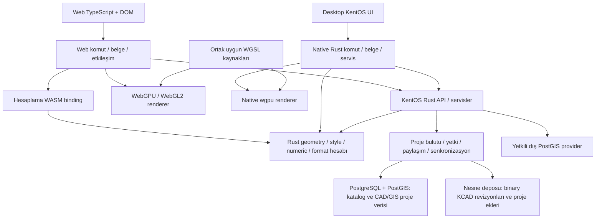

# KentOS CAD / GIS / 3D — Mimari ve ürün yol haritası

Tarih: 25 Eylül 2026. İncelenen kaynaklar: bu depo (`4399477`) ve `/home/cihad/Projects/kentos-rc` (`dc2e8df`). Bu belge kod incelemesine ve aşağıda bağlantıları verilen birincil teknik kaynaklara dayanır. İnceleme sırasında uygulama veya benchmark çalıştırılmadı; mevcut ölçüm raporları yeni ölçüm gibi sunulmaz. Bu çalışma yalnızca yol haritasıdır; UI taşıması veya aşağıdaki özelliklerin uygulanması yapılmış sayılmaz.

Hedef: aynı Rust hesaplama kütüphanelerini kullanan, uyumlu veri ve servis sözleşmelerine sahip ayrı web ve masaüstü uygulamalarıyla profesyonel CAD/GIS düzenleme, Python otomasyonu ve eksiksiz AI erişimi sunan; kişi ve kurumların projelerini bulutta saklayan, senkronize eden ve yetkiye göre erişilebilir/paylaşılabilir kılan; yol, mimari, arazi ve 3D dijital ikiz projelerine genişleyebilen KentOS.

**Son kapsam kararı:** KentOS sunucusunun ana görevi kişisel ve kurumsal proje bulutudur: 18 uygulaması, imar planı, ifraz/tevhit ve diğer CAD/GIS projelerini saklama, senkronizasyon, sürümleme, yetkili erişim ve paylaşım. Şimdiki kapsamda Martin görevi üstlenmeyecek; tile/harita yayın sunucusu ancak ileride ayrı bir ürün kararıyla değerlendirilebilir. Ne Martin entegrasyonu ne de Martin eşdeğeri geliştirmek proje bulutunun önkoşuludur. GIS projeleri PostGIS ile çalışabilir; CAD projeleri de düzenlenebilir CAD anlamı korunarak PostGIS üzerinde saklanabilir.

**Kesin web sınırı:** Web ayrı TypeScript/DOM uygulamasıdır. Desktop/Iced uygulaması web'e export edilmeyecek, uygulamanın tamamı WASM'a çevrilmeyecek. Web kendi komut/etkileşim/belge orkestrasyonunu ve WebGPU/WebGL renderer'larını korur. Ortak yürütülebilir KentOS kodu hesaplama kütüphaneleridir; veri/komut şemaları uyum için paylaşılır, uygun WGSL shader kaynakları ayrıca ortak kullanılabilir. Ortak Rust application veya wgpu renderer'ı web'e derleme hedefi yoktur.

**Web'e ara (sahibin kesin kararı, 12 Ekim 2026; [ADR 0228](docs/adr/0228-web-pause-desktop-and-cloud-first.md)):**

- Web katmanının son hâli **`1aad00d0`**'dır. Bundan sonra maddeler yalnız masaüstünde ve gerektiğinde bulutta, Python'da ve MCP'de
  yapılır. Web'e masaüstü ve bulut tamamen bitince, sahibin sözüyle dönülür.
- Ortak çekirdek, sözleşmeler, bağımsız başvurular, ortak fixture'lar ve izler aynen sürer.
- Kod, ileride mobil uygulama (önce görüntüleme) ve web eklenecekmiş gibi modüler kalır.
- Yalnız masaüstünde biten her madde §0.2'ye web'de gerekenleri yazar. Aşağıdaki maddelerde “iki platform” geçen kabul koşulları web için
  §0.2'ye ertelenmiş sayılır.

**Kesin dosya sınırı:** `.kcad` yalnız proje kaydetme/yükleme için sürümlü binary/byte dosyasıdır. Dosyaya veritabanı, SQL, kalıcı sorgu/arama indeksi veya doğrudan vector tile sunma görevi verilmeyecek. İlk mesajdaki aranabilir/tile kaynaklı container düşüncesi, kullanıcının bu sadeleştirmesiyle kapsamdan çıkmıştır. Büyük veri sorguları PostGIS/provider, bulut proje kataloğu ve erişim kuralları KentOS server sorumluluğudur; yerel belge açıldıktan sonraki geçici pick/snap indeksleri bu karardan etkilenmez.

## 0. Belgenin kullanımı ve öncelikler

- `[ ]`: henüz teslim edilmemiş iş. Kodda temeli bulunan işler de eksik kabul koşulları nedeniyle açık tutulur.
- `P0`: veri doğruluğu, ortak sözleşme ve mimari bağımlılıklar. İlk ürün dilimlerinin önkoşulu.
- `P1`: kullanılabilir desktop, binary dosya, kişisel/kurumsal proje bulutu, yetki/paylaşım, CAD/GIS PostGIS kaydı ve Python/AI'ın ilk üretim kapsamı.
- `P2`: profesyonel CAD/GIS derinliği, yaygın dış formatlar, operasyon ve büyük veri.
- `P3`: yol/altyapı, mimari/BIM ve 3D şehir tasarımının ileri kapsamı. Temel veri modeli bunları engellemeyecek; hepsi ilk sürüme sıkıştırılmayacak.
- Bölüm sonlarındaki kabul koşulları sağlanmadan ilgili iş grubu tamamlandı sayılmaz. Kütüphane eklemek, ekran göstermek veya test fixture'ını yeniden üretmek tek başına kabul değildir.
- Önerilen yollar, şemalar ve API örnekleri hedef tasarımdır; mevcut API diye kullanılmamalıdır. Yeni crate, bağımsız sorumluluğu ve ilk gerçek tüketicisi oluştuğunda açılır.
- Kullanıcının kesin hedefleri ile teknik öneriler ayrıdır: ayrı web uygulaması, Rust hesaplama paylaşımı, uyumlu sözleşmeler, KentOS UI, saf wgpu desktop viewport, Python, AI, yalnız kayıt/yükleme yapan binary `.kcad`, kişisel/kurumsal proje bulutu ve hem CAD hem GIS için PostGIS desteği kesindir. Martin benzeri rol kesin teslim değildir. Binary encoding seçimi, crate ayrıntıları ve aşama içi seçenekler bu incelemenin önerisidir; prototip ve ADR ile kesinleştirilir.

### 0.1 Kapsamın izlenmesi

| Kullanıcı hedefi | Yol haritasındaki karşılığı |
|---|---|
| Rust ile devam, ortak hesaplama | §2–4: Rust hesaplama kütüphaneleri, uyumlu ayrı uygulamalar |
| Desktop ve web aynı kullanım kalitesi | §5–8: komut oturumu, dinamik giriş, KentOS UI, wgpu (web'e ara: ADR 0228, §0.2) |
| Masaüstü ve bulut önce, web sonra; ileride mobil (görüntüleme) | ADR 0228; §0.2 Web'e ertelenenler; modüler düzen (`crates/shared`, `crates/native`, `crates/render/wgpu`) |
| Python embed ve Python kütüphaneleri | §14: CPython/PyO3, Pyodide, ortak SDK |
| Tam AI surface | §15: katalog, sorgu, önizleme, çalıştırma, MCP, kapsam testleri |
| `kentos-rc` bu depoya ve KentOS UI ad alanına | §6: dosya/modül bazında taşıma ve ayrıştırma |
| Ayarlardan tüm grafik/performance seçenekleri | §7–8: tipli settings, yeteneklere göre AA, bellek ve kalite |
| Binary ve açık `.kcad`; yalnız kayıt/yükleme | §9: belgelenmiş byte formatı, sürümleme ve dış okuyucu; DB/tile görevi yok |
| Cloud'a aynı formatta kayıt/senkronizasyon | §10: komut senkronizasyonu ve kalıcı `.kcad` revizyonları |
| CAD ve GIS projelerini PostGIS'e kaydetme ve doğrudan çalışma | §11: CAD anlamını koruyan saklama, kaynak otoritesi, provider ve metadata dosyası |
| Kişi/kurum projelerini saklama, erişim ve paylaşım | §10–12: proje kataloğu, senkronizasyon, sürümleme, üyelik ve proje yetkileri |
| İleride olası Martin benzeri rol | §12.5: ayrı karara bağlı gelecek seçeneği; mevcut teslimlerin bağımlılığı değil |
| 3D şehir, yol, harita ve mimari | §16–19: CAD/GIS, civil, BIM, dijital ikiz ve yayın |
| Uzun ömürlü yüksek performans | §13, §20–23: worker, test, işletim ve teslim kapıları |

### 0.2 Web'e ertelenenler (ADR 0228)

Web'in son hâli `1aad00d0`'dır (12 Ekim 2026). Bu liste web'e dönüşün planıdır. Şunlar buraya bir satır yazar:

- yalnız masaüstünde biten her madde;
- web'i bozduğu bilinen her ortak değişiklik (şema, `FORMATS_VERSION`, çekirdeğin imzası, web testinin okuduğu fixture).

Satırın biçimi:

```text
- [ ] `ID` (ADR NNNN, commit): web'de gerekenler: WASM bağlayıcısı ve TS sarmalayıcısı (…), arayüz (araç, pencere, şerit,
  ikon), oynatılacak izler (…), resimler, envanter; bilinen bozulmalar (…).
```

Geri dönüşün sırası:

1. `1aad00d0`'daki web'den başlanır.
2. Web'in takımı (`pnpm typecheck`, `pnpm test`, `pnpm e2e:interaction`) koşar; bozulanlar düzeltilir.
3. Bu liste sırayla kapatılır.
4. `catalog/v1/additions.json` web'in kaydına alınır, `pnpm inventory` koşar.
5. docs/MADDE-TARIFI.md'nin iki platform kuralı geri gelir.

Liste:

- [ ] `GIS-40` (ADR 0229, 12 Ekim): web'de gerekenler: WASM bağlayıcısı ve TS sarmalayıcısı (`ops::geocode`: ayrıştırma, dizin, arama,
  konumdan adres, Denetle; `kentos_services::geocode`: istekler, okuma, puan), arayüz (alt panelin Adres sekmesi, Konumdan adres aracı,
  Adres verisi ve Adres sağlayıcıları pencereleri, İşlemler'in Adres kategorisi ve Adres kaynağı parametresi; şerit yerleri, panelin ▾ listesi
  (`overflow`) ve altı ikon `catalog/v1/additions.json`'dan; tarayıcıdan sağlayıcılara istek `kentosd`'nin vekiliyle mi doğrudan mı, dönüşte karar), oynatılacak
  izler (`address-search.json`, `address-reverse.json`; iz biçiminin `address` beklentisi), resimler, envanter; bilinen bozulmalar:
  `.kcad` şema 42 ve `FORMATS_VERSION` 54 (web'in `io/` okuyucusu, `version.ts` 53), `fixtures/shell/v1/layout.json`'ın `bottomTab`'ında
  `address` ve `log.json`'ın sekmelerinde Adres (web'in `layoutPlan` ve `logPlan` testleri), komut kataloğunda `cad.addresses.define`,
  `fixtures/processing/v1/address.*` (web'in İşlemler'inde araç yok).
- [ ] `CADP-08` (ADR 0248, 12 Ekim): web'de gerekenler: beş komutun işleyicileri (`product/`: `cad.layers.edit`, `cad.layers.set`,
  `cad.layers.states`, `cad.styles.edit`, `cad.settings.set`) ve Katmanlar paneli, Kopyasını oluştur, Katmanları birleştir,
  Kullanılmayanları temizle, Katman durumları, Alanlar, katman araçları ve şeridin Ölçek'inin onlardan yazması; belgeye `moveLayer`
  (geri alınır, “Katmanı taşı”) ve `setLayerLocked`; komut koşucusuna (`product/fixtures.test.ts`) `activeLayer`, `name`,
  `settings` beklentileri; bilinen bozulmalar: komut kataloğunda beş yeni komut (masaüstünün), `fixtures/commands/v1`'de beş dosya
  (web'in koşucusunda kaydı olmayan komut), `fixtures/layers/v1/purge.json`'un altlık durumu (servis katmanı temizlenmez:
  `model/layerPurge.ts`'in `removable`'ı), Yazı ve Ölçü stillerinin değişmeyen nesneyi yazmaması (`app/styleTables.ts`).
- [ ] `CAD-CMD-02` (ADR 0246, 12 Ekim; plan/cad.md §24.1 madde 4): web'de gerekenler: `cad.entities.offset` işleyicisi `product/`'ta
  (web'in `edit` işleyicisine `offset` işlemiyle yazan, çekirdeğin `offsetEntity` ve `offsetThroughDistance`'ı WASM'dan; masaüstünün
  `offset.rs`'i gibi), web'in Ötele aracı (`tools/edgeTools.ts`'in `OffsetTool`'u) önizlemede komutun planını, tıklamada yazmasını
  kullanır; kayıt (`product/registry.ts`) ve katalogda `hosts`'a Web; oynatılacak iz `edge-tools.json` (değişmedi); ortak durumlar
  `fixtures/commands/v1/cad.entities.offset.json` web'in koşucusunda; bilinen bozulmalar: `product/fixtures.test.ts` bu dosyanın
  komutunu web'de bulamaz (“web'de çalışmıyor”); komut kataloğunda `cad.entities.offset` (yalnız `Desktop` işaretli).
- [ ] `.kcad` şema 43 (ADR 0249 §4, 12 Ekim): web'de gerekenler: `io/columns.ts`'in ölçü satırı `REFS` bayrağını (bit 28: başvuru
  maskesi, başvuru başına yerin türü, sayıları ve kopma bayrağı; metinlerde nesnenin kimliği ve kopma nedeni; `columns.rs`'in tablosu)
  okur ve yazar; `io/version.ts`'in `FORMATS_VERSION`'ı 55 (web'de 53 kaldı); bilinen bozulmalar: web'in `kcad.wasm.test.ts`'i
  `dimension-refs.kcad`'i ve `broken/dimension-refs-*`'i okur; `io/columns.ts` bit 28'i bilmez, başvurulu ölçünün sütunlarını okuyamaz.
- [ ] `CADP-06`, `CADP-07` (ADR 0249, 12 Ekim): web'de gerekenler: belgede ilişkili ölçünün izlenmesi (`model/`'de taramaların
  izlemesinin yanında, `crates/native/domain/src/dimension_ties.rs` gibi; çekirdeğin `subrefFollow`, `subrefPoint`, `subrefPlaceAt`'i
  WASM'dan), deponun bağ ve kopuk dizinleri; `cad.dimensions.reassociate` işleyicisi `product/`'ta ve katalogda `hosts`'a Web; ölçü
  aracının kenetin yerini bağlaması (`tools/dimensionTool.ts`), Yeniden bağla aracı, Öznitelikler'de İlişki ve Serbest bırak, çizimde
  kopuk bağ işareti; `cad.entities.edit`'in başvurusuz güncellemesinde ölçünün başvurularını koruma; iz oynatıcısına `refs`
  beklentisi; oynatılacak iz `dimension-refs.json`; bilinen bozulmalar: komut kataloğunda `cad.dimensions.reassociate` (yalnız
  `Desktop`), `fixtures/commands/v1/cad.dimensions.reassociate.json` web'in koşucusunda kayıtsız komut.
- [ ] `CADP-05` (ADR 0250, 13 Ekim): web'de gerekenler: dört komutun işleyicileri `product/`'ta (`cad.entities.trim`, `.extend`,
  `.fillet`, `.chamfer`; web'in deposunun `trimPreview`, `extendPreview`'i ve çekirdeğin köşe işlevleri WASM'dan), web'in Buda, Uzat,
  Köşe yuvarla, Pah ve tüm köşeler araçlarının önizlemeyi planla, yazmayı komutla yapması; `cad.entities.create`'in ilişkili ölçüsü
  yerleriyle (`placed_points`); katalogda `hosts`'a Web; oynatılacak iz `edge-commands.json`; bilinen bozulmalar: komut kataloğunda dört
  komut (yalnız `Desktop`), `fixtures/commands/v1`'de dört dosya ve `cad.entities.create.json`'un iki yeni durumu web'in koşucusunda.
- [ ] `CADP-09` (ADR 0251, 13 Ekim): web'de gerekenler: `.kcad` şema 44'ün okunması ve yazılması (`io/kcad.ts`'in başı ve
  `FORMATS_VERSION` 56; web'in WASM'ı 53'te olduğu için web şema 44'lü dosyayı açmaz), belgenin kitabı tutması (`model/` ve
  `set_sheets`'in karşılığı, geri alma adımı değil), pafta kipinin kitabı IndexedDB `kentos.sheets.v1`'in yerine belgeden alması ve
  ona yazması, IndexedDB'deki kitapların masaüstününkiyle aynı kuralla göçü (anahtar, kaydedince kenara alma, boş kitapla ezmeme),
  bulut istemcisinin `ProjectPatch.sheets`'i göndermesi ve `ProjectInfo.sheets`'i alması; pafta çekirdeğinin `project` modülü WASM'a
  (`sheet-wasm`); bilinen bozulmalar: örnek `fixtures/kcad/v2/sheets.kcad` ve dokuz bozuk dosya web'in okuyucusunda şema 44 olarak
  reddedilir.
- [ ] `CADP-12` (ADR 0252, 13 Ekim): web'de gerekenler: `cad.sheets.edit`'in işleyicisi (`product/`; ortak durumlar
  `fixtures/commands/v1/cad.sheets.edit.json`'u geçmeli) ve pafta kipinin kitabı belgeden izlemesi (ajanın değişikliği); Köşe
  yuvarla'nın `lines` köşesinde çizgilerin yönünü koruması (web'in `product/` işleyicisi eski kuralla; ortak durumlar ve `corner-tools`
  izi yenisini bekler); haritaların vektörleri `kentos-plot`'un kuralıyla (web'in `mapVectors.ts`'i aynı yolları vermeli); kabul
  senaryosunun izi (`acceptance-room.json`) web'in oynatıcısında.
- [ ] `CAD-CMD` (ADR 0253, 13 Ekim): web'de gerekenler: çağrı protokolü (`CallEnvelope`, `CallAnswer`: `requestId`, `expected`,
  `planId`; durum damgaları `etag`; özet; kayıt `kentos.calls/1` ve tekrar oynatma; `.kcad` şema 45'in `requests` defteri ve
  `FORMATS_VERSION` 57), `CommandError`'ın `uids` ve `retryable`'ı (`product/` işleyicileri ve `fixtures.test.ts`'in karşılaştırması),
  kanonik JSON'un sayı yazımı (eşitlikte çift; `fixtures/protocol/v1/cases.json` web'de de geçmeli), kataloğun `capabilities`'i ve
  kodların `host` türü, ortak değişiklik kümesi (`cad.changeset.apply`), uzun işlerin aşamaları; iz oynatıcısına `journal` beklentisi
  (`acceptance-room.json`); bilinen bozulmalar: komut kataloğunda yeni komutlar ve alanlar, `fixtures/commands/v1/cad.changeset.apply.json`.
- [ ] `CAD-CMD-05`, `06` (ADR 0254, 0255, 13 Ekim): web'de gerekenler: yedi komutun işleyicileri `product/`'ta (`cad.entities.stretch`,
  `.break`, `.join`, `.divide`, `.boundary`, `.hatch`, `cad.dimensions.create`; bölgeler, komşular ve ölçü ortak çekirdekten WASM'la:
  `FaceIndex`, `cut_base`, `seed_of`, `topology_edit`, `radial_dimension`, `arc_length_ends`, `edge_arms`, `vertex_arms`) ve katalogda
  `hosts`'a Web; Esnet, Kır, Birleştir (Zincir), Böl, İçine tıklayarak alan, Tarama, Çoklu tara ve Ölçülendirme araçlarının önizlemeyi
  planla, yazmayı komutla yapması; alanın halkalarının kanonik yazılışı (dış saat yönünün tersine, delikler saat yönünde, en alçak
  köşeden); oynatılacak iz `usage-semantic-tools.json` ve resimleri; bilinen bozulmalar: komut kataloğunda yedi komut (yalnız
  `Desktop`), `fixtures/commands/v1`'de yedi dosya web'in koşucusunda kayıtsız komut; web'in araçları eski `cad.entities.edit` ve
  `.create` işlemleriyle yazar (izler geçer, kayıtları başka komut adı taşır).
- [ ] `UNIT-02` (ADR 0165'in 13 Ekim eki, 13 Ekim): web'de gerekenler: `Program::read_in`'in WASM'dan çağrılması
  (`crates/wasm/geometry-wasm/src/store.rs`'in `Program::read(json)`'ı projenin biriminin metredeki sayısını alır; `readingUnit`
  `model/projectSettings.ts`'te var) ve stilli çizimin, pafta haritalarının (`app/sheet/mapFrames.ts`) ve PDF'in katmanı projenin
  birimiyle kurması, birim değişince katmanların yeniden kurulması; web'in Katman stili'nin (`style/classify.ts`: `valuesOf`,
  `numbersOf`; `ui/style/tally.ts`'in kural sayısı) ifadeyi projenin biriminde derlemesi (`exprCompileIn`, `evaluateExpressionIn`);
  `fixtures/style/v1/units.json`'u (bağımsız başvurusu `scripts/fixtures/style_units_cases.py`) okuyan bir web testi
  (`classifyFixture.test.ts`'in yanında); bilinen bozulmalar: web'de açılan mm projesinin işleyicisi eski gibi metrede okunur
  (masaüstünün yazdığı sınıflar mm²'dedir, web'de pencere ve çizim onlarla uyuşmaz), `fixtures/expression/v2/builder.json`'un `$alan`
  ve `$uzunluk` açıklamaları (web'in WASM'ı yeniden derlenene kadar `builder.test.ts` eski metni görür).
- [ ] `CAD-DATA-04`, `05`, `06`, `08` (ADR 0256, 13 Ekim): web'de gerekenler: `cad.units.change`'in işleyicisi `product/`'ta
  (birim kuralı sözleşmeninki: `kentos_contracts::units`, web'e WASM'la ya da `io/`'nun DXF birim çevirisinin yanında), belgede birimin
  geri alınan adımı (`model/document.ts`'e `Op::Units`'in karşılığı: birim, ana görünüm, çapa), Proje ayarları'nın birim sorusu
  (`ui/settings/ProjectSettingsDialog.ts`: Boyları korunsun, Sayıları korunsun, Vazgeç; komutun planıyla), ortak durumlar
  `fixtures/commands/v1/cad.units.change.json`; katalogda `hosts`'a Web; web'in DXF yazıcısının çevirisi aynı çekirdektendir
  (kutu, çerçeve, eğri artık ölçeklenir: `dxf-write/units` yeni nesneleriyle web'in koşucusunda da geçmeli); bilinen bozulmalar:
  web'in komut koşucusunda bir dosya kayıtsız komut, `CommandCatalog.ts`'in `units`'i (`CatalogUnit`) web'de okunmuyor.
- [ ] `CAD-DATA-07` (ADR 0257, 13 Ekim): web'de gerekenler: DXF içe aktarma penceresinde “Dosyanın birimi” (`ui/io/DrawingImportDialog.ts`:
  liste, kararın sözü, seçimde yeniden okuma; okuyucunun `fileUnit`'i WASM'a geçer), özette birimi başka bloklar; içe almanın
  `file.import.dxf` ile yazması (web'in komut koşucusu dosyayı yol yerine baytlarla alır: `CAD-IO-26`'nın dosya tutamacı) ve
  `io/apply.ts`'in uygulama katmanının kurallarıyla (`kentos_native_application::import_apply`) eşitliği; ortak durumlar
  `fixtures/commands/v1/file.import.dxf.json` (yeni beklentiler `fields`, `nodes`, yer tutucular `$fixture:`, `"$any"`) ve
  `fixtures/formats/v1/dxf-units/cases.json`; `FORMATS_VERSION` 58 (web'in kopyası 53).
- [ ] `CAD-DATA-15`…`CAD-DATA-17` (ADR 0259, 13 Ekim): web'de gerekenler: `nurbs` türü belgede ve TS türlerinde (`NurbsEntity`,
  `io/kcad.ts`'in KCAD şema 47'si ve tipli sütunların türü 19, `io/columns.ts`; `FORMATS_VERSION` 60); paketli biçimin türü 23
  (`wasm/pack.ts`); çekirdeğin JSON API'si `tangents`'ı taşımaz; `cad.nurbs.create`'in web işleyicisi ve NURBS eğrisi aracı
  (Yöntem, Derece, Kapat; önizleme planla); Öznitelikler'in satırları; seçim süzgecinde Eğri'nin NURBS'ü de tutması.
- [ ] `CAD-INPUT-01` (ADR 0266, 14 Ekim): web'de gerekenler: `coordinateInput.ts`'in metrik birimli uzunluğu (`2.5m`, `250cm`) ve
  parantezli toplamı (`fixtures/point-input/v1`'in 22 yeni satırı), `looksLikeCoordinate`'in `(`'u ve araçların uzunluk alanlarının
  birimli ve toplamlı okunması; web'in iz oynatıcısı `value-entry.json`'u geçmeli (`(`, `)`, `*` tuşları, Tab'ın birimli kilidi).
- [ ] `CAD-EDIT-03` (ADR 0289, 14 Ekim): web'de gerekenler: `cad.curves.construct`'ın işleyicisi (ortak durumlar ve adımların `within`
  anahtarı web'in çalıştırıcısında da); web'in Yay, Daire (2N, 3N, TTY, TTT) ve Elips araçları eğriyi bu komutun hesabından alsın,
  uyarıları komutun sözleri; paralel iki doğruya TTY, saat yönünde verilen yaydan Devam; araç durumları
  `fixtures/curve-methods/v1/tools.json`. Web'in donmuş çağrı kayıtları eski `arcStartCenterEnd` ve `arcStartCenterAngle`'ı (tam tur)
  tutar; geri dönüşte komutun kuralına getirilir.
- [ ] `CAD-BLOCK-01`, `02`, `03`, `04` blokta kararlı kimlik, katman kuralı, X/Y ölçeği ve birim (ADR 0315, 16 Ekim): web'de
  gerekenler: `.kcad` şema 57'nin `yScale`'i ve `units`'i (web'in kopyası 55'te), deponun paket kaydında y ölçeği (bayrağın 2'si)
  ve parçaların görünürlük kapısı (`Item::veiled`) web'in çiziminde ve seçiminde; 0'daki parçanın `byLayer`'ının yerleştirmenin
  katmanından alınması web'in stilli çiziminde; `cad.blocks.insert`'in ve `cad.blocks.edit` `units`'inin TS işleyicileri, Blok
  ekle'nin Y ölçeği, Öznitelikler'in X/Y ölçeği, Bloklar panelinin Birim ▸'i; web'in DXF yolu çekirdekten geldiği için hazır.
- [ ] `FORM-A`…`FORM-D` formlar (ADR 0400, 0401, 16 Ekim): web'de gerekenler: `.kcad` şema 60'ın ayarlarının `forms`'u ve alanın
  `id`'si (web'in kopyası 55'te); web'in `model/` belgesinde alanın kararlı kimliğinin taşınması (`set_layer_fields`'in kuralı,
  `fixtures/document-ops/v1` değişmeden); `cad.forms.edit`, `.validate`, `.submit` ve `cad.entities.set`'in yazma profilinin TS
  işleyicileri (`fixtures/commands/v1/cad.forms.*.json`, `cad.entities.set.forms.json`); form çekirdeği WASM'la
  (`kentos-forms`); Formlar ve Formla düzenle pencereleri (ADR 0401 §10); web'in özel açılır kutularında ve onay kutularında Tab ile
  gezinme ve tuşlar (ADR 0400). İfade motorunun tipli alan okuması (ADR 0401 §5) web'in WASM'ında da geçerli olur; web'in tipli
  sütun veren yolları değişmez.
- [ ] `FORM-E` formun kuralları, hesapları ve seçenekleri (ADR 0402, 16 Ekim): web'de gerekenler: sözleşmenin yeni anahtarları
  (`clearHidden`, `collapsed`, `warning`, `defaultExpr`, `calculate`, `choiceFilter`, `unique`, `reuseLast`; durumun `choices` ve
  `text`'i) ve `cad.forms.validate`, `.submit`'in `moment`, `user`'ı TS türlerinde üretildi; web belgesinde formu uygulanan
  katmanın izlemesi (`form_follow.rs`'in kuralı, `cad.polygon.create.forms.json` ve `cad.entities.set.forms.json` durumları);
  Formla düzenle'de hesaplanan alanların kilidi, süzülen listeler, sarı uyarı, kapalı grup, son değer; tasarımcının yeni
  denetçi satırları; kapalı girişin soluk görünüşü ve `Form`'un uyarı satırı web'in form bileşenlerinde.
- [ ] `FORM-N` geometrisiz kayıt (ADR 0410, 16 Ekim): web'de gerekenler: sözleşmenin `record` türü (TS türleri üretildi),
  `io/columns.ts`'in tür 20'si, `cad.records.create`'in TS işleyicisi (`fixtures/commands/v1/cad.records.create.json`), çizim
  ve seçimin kaydı atlaması, Öznitelik tablosunda Kayıt ekle, formun Yeni'si.
- [ ] `FORM-S` tarih ve saat, saat alanları (ADR 0412, 16 Ekim): web'de gerekenler: `LayerFieldKind`'in `datetime` ve `time`'ı
  (`model/layerFields.ts`'in değer kuralı ve gösterimi, `fixtures/layer-fields/v1/cases.json`), Alanlar penceresi, formun tarih
  öğesinin türe göre seçicisi, `io/` ve `.kcad` okuma.
- [ ] `FORM-AA` alanın bölme ve birleştirme kuralı (ADR 0419, 16 Ekim): web'de gerekenler: alanın `split` ve `merge`'i (TS türleri
  üretildi), `cad.entities.edit`'in TS işleyicisinde kurallar (`fixtures/commands/v1/cad.entities.edit.policies.json`), alan kuralları
  (`fixtures/layer-fields/v1/cases.json`), Alanlar penceresinde iki seçim, `.kcad` okuma.
- [ ] `FORM-Z` kullanımdan kalkan liste değeri (ADR 0418, 16 Ekim): web'de gerekenler: değer listesi öğesinin `retired`'ı (TS türü
  üretildi), `model/layerFields.ts`'in iki alan kuralı (`fixtures/layer-fields/v1/cases.json`), form çekirdeğinin `form_value_retired`'ı
  ve sunulan değerleri (`fixtures/forms/v1/cases.json`), seçicilerde “(kullanımdan kalktı)”, Alanlar'da Kalktı, `.kcad` okuma.
- [ ] `FORM-Y` değiştirilebilir hesap (ADR 0417, 16 Ekim): web'de gerekenler: form öğesinin `overridable`'ı (TS türü üretildi), web'in
  form çekirdeğinin aynı anlamı (`fixtures/forms/v1/cases.json`), formda ↺ ve izleme, tasarımcıda Değiştirilebilir.
- [ ] `FORM-W` Öznitelik tablosunda form görünümü (ADR 0416, 16 Ekim): web'de gerekenler: tablonun Tablo | Form seçimi, kayıt listesi ve
  panele gömülü form (Formla düzenle'nin kuralıyla, Kaydet formu tutar).
- [ ] `FORM-V` kaydı çoğaltma (ADR 0415, 16 Ekim): web'de gerekenler: `cad.records.duplicate`'in TS işleyicisi
  (`fixtures/commands/v1/cad.records.duplicate.json`), Öznitelik tablosunda Çoğalt, ilişkinin alt alanında üst nesnenin etiketi.
- [ ] `FORM-U` alanın kullanıldığı yerler (ADR 0414, 16 Ekim): web'de gerekenler: `cad.fields.usage`'in TS işleyicisi
  (`fixtures/commands/v1/cad.fields.usage.json`), `cad.layers.edit`'in yeniden adlandırmada başvuruları izlemesi
  (`cad.layers.edit.renames.json`; ifadenin ve şablonun adları dilin sözcükleriyle), Alanlar penceresinde Kullanıldığı yerler.
- [ ] `FORM-T` koşullu biçim (ADR 0413, 16 Ekim): web'de gerekenler: katmanın `tableStyles`'ı (TS türleri üretildi), `cad.layers.table`'ın
  TS işleyicisi (`fixtures/commands/v1/cad.layers.table.json`), Öznitelik tablosunda hücre görünüşü (`fixtures/table-styles/v1/looks.json`)
  ve Koşullu biçim penceresi, `.kcad` okuma.
- [ ] `FORM-F` formların izinleri ve sunucunun bekçisi (ADR 0411, 16 Ekim): web'de gerekenler: `ProjectRole`/`GrantRole`'ün `entry`'si
  (`app/cloud/sharePlan.ts`'in rol adları, sırası, davet rolleri ve açıklamaları; `fixtures/cloud/v1/share.json` güncellendi),
  `ProjectPermission`'ın üç izni; sunucu bekçisi zaten bütün istemciler için.
- [ ] `FORM-P` tabloda listelerin etiketi ve dosyadan kayıt (ADR 0410 §4, §6, 16 Ekim): web'de gerekenler: Öznitelik tablosunun formun
  başka katmandan listelerini etiketle göstermesi, Veri aktar'ın `records-append` ve `half-coordinates` durumları.
- [ ] `FORM-O` çizim komutlarında alanların kuralı (ADR 0199'un 16 Ekim eki): web'de gerekenler: `product/`'un çizim
  komutlarının öznitelikleri alanların kuralından geçirmesi ve varsayılanları yazması (`fixtures/commands/v1/*.fields.json`).
- [ ] `FORM-M` çoktan çoğa ilişki ve yeni alt kayıt (ADR 0409, 16 Ekim): web'de gerekenler: listesiz çok değerli alanın
  `check_value` yolu, çok değerli başvurunun formu ve ilişkili kayıtların “içerir” kuralı, silme politikasının çok değerli
  bağı izlemesi (`cad.entities.delete.relations.json`), Bağla, Bağı kopar ve Yeni.
- [ ] `FORM-L` çok değerli alan ve gezinme (ADR 0408, 16 Ekim): web'de gerekenler: alanın `multiple`'ı ve `check_value`'nun
  çok değerli yolu (`fixtures/layer-fields/v1`), `checkList` öğesi, Alanlar penceresinde seçenek, Formla düzenle'de ◀ ▶.
- [ ] `FORM-K` ekler, renk ve öneri (ADR 0407, 16 Ekim): web'de gerekenler: sözleşmenin `attachments` öğesi
  (`AttachmentAccept`), `color` öğe türü, alanın `suggest`'i ve durumun `suggestions`, `attachments`'ı; ön denetimin ve
  kaydın yeni kodları (`cad.forms.validate`, `.audit` durumları); web formunda renk seçici, öneri listesi ve ekler kutusu.
- [ ] `FORM-J` kayıt denetimi ve kaydırıcı (ADR 0406, 16 Ekim): web'de gerekenler: `cad.forms.audit`'in TS işleyicisi
  (`cad.forms.audit.json`), ön denetimin `slider`'ı ve `form_widget_needs_range`'i, web formunda kaydırıcı, Kayıtları denetle
  penceresi.
- [ ] `FORM-I` ilişkiler (ADR 0405, 16 Ekim): web'de gerekenler: ayarların `relations`'ı (`.kcad` şema 60), `cad.relations.edit`
  ve `cad.entities.delete`'in `relation_restricted`'ının TS işleyicileri (`cad.relations.edit.json`,
  `cad.entities.delete.relations.json`), web belgesinde silme politikasının izlenmesi, İlişkiler penceresi, Bağla ve Bağı kopar.
- [ ] `FORM-H` başka katmandan liste ve ilişkili kayıtlar (ADR 0404, 16 Ekim): web'de gerekenler: sözleşmenin `lookup`'ı,
  `related` öğesi, durumun `options` ve `related`'ı (TS türleri üretildi); WASM'daki form çekirdeğine öbür katmanların
  verisi (`World`); Formla düzenle'nin listeleri ve ilişkili kayıtlar kutusu, tasarımcının liste denetçisi.
- [ ] `FORM-G` tasarımcı ve giriş ekleri (ADR 0403, 16 Ekim): web'de gerekenler: `cad.forms.fill`'in TS işleyicisi
  (`fixtures/commands/v1/cad.forms.fill.json`), tasarımcının geri alması, ağaçta sürükleme ve canlı önizlemesi, çizilen nesnenin
  formu (`drafting.formOnCreate`), Formla düzenle'nin toplu kipi ve sürüm denetimi.
- [ ] `CAD-BLOCK-13`, `14`, `15`, `16` dinamik bloklar ve KentOS blok kitaplığı (ADR 0318, 16 Ekim): web'de gerekenler: `.kcad`
  şema 59'un tanım `dynamic`'i ve yerleştirme `parameters`'ı (web'in kopyası 55'te), deponun ve stilli çizimin varyantları (çekirdeğin
  `block_dynamic`'i WASM'la; yerleştirmenin değerleri depoya), `cad.blocks.parameters`'ın ve `cad.blocks.edit` `dynamic`'inin TS
  işleyicileri, Blok ekle'nin değerleri, KentOS blok kitaplığı komutu. Masaüstünde de açık: parametrelerin tutamaçları ve
  Öznitelikler'deki satırları (CAD-BLOCK-17, 18), parametre noktalarının eylemlerle zincirlenmesi, DXF'e değerli yerleştirmenin
  varyantı (CAD-BLOCK-20).
- [ ] `CAD-BLOCK-08`, `09`, `10`, `12` öznitelik seçenekleri, eşitleme, değiştirme, sorgu ve kartlar (ADR 0317, 16 Ekim): web'de
  gerekenler: `.kcad` şema 58'in öznitelik seçenekleri, `attributePlaces`'i ve bloğun `card`'ı (web'in kopyası 55'te); deponun ve
  stilli çizimin seçeneklere göre öznitelik yazısı (görünmez, sabit, taşınmış yer, çok satırlı kutu); `cad.blocks.edit`'in `sync`,
  `fields`, `place`, `card` işlemlerinin ve `attributes`/`update`'in eşitlemesinin, `cad.blocks.replace` ve `cad.blocks.query`'nin
  TS işleyicileri; Blok öznitelikleri penceresinde seçenekler, Öznitelik değerleri'nde doğrulama ve çok satır, Blok kartı ve Blok
  çizelgesi pencereleri, Bloklar panelinin Liste/Kartlar'ı ve kategori seçicisi. Masaüstünde de açık: DXF'te konum kilidi (16),
  görünmez özniteliğin ATTRIB'i ve okurken sabit ve görünmez ATTDEF'in öznitelik olarak alınması; taşınabilir özniteliğin
  tutamacı.
- [ ] `CAD-BLOCK-05`, `06`, `07`, `11` Blok düzenleyici, blokların dosya API'si ve boyut sınırı (ADR 0316, 16 Ekim): web'de
  gerekenler: Blok düzenleyici (tanımın nesneleri ayrı çizimde, Kaydet `cad.blocks.edit` `update`'iyle) ve `update`'in TS işleyicisi;
  `file.import.block`'un TS işleyicisi (web'in Dosyadan blok ekle'si ve Başka çizimden al'ı onunla; çakışan blok kimliğinin
  yenilenmesi web'in `app/drawingExchange.ts`'inde de); WBLOCK'un web'de indirme olarak yazılması; `model/blocks.ts`'in kurallarına
  `block_too_large` (bir milyon parça, doymalı sayım).
- [ ] `CAD-STYLE-12`, `13`, `14`, `15` haritanın katmanları, değişikliğin etkisi, kitaplık API'si ve etki raporu (ADR 0314, 16 Ekim):
  web'de gerekenler: pafta tasarımcısının Denetçi'sinde haritanın Katmanlar bölümü ve web'in pafta çiziminde `layerOverrides`
  (`kentos_plot::layers::map_layers`'ın kuralı WASM'la ya da sheet-wasm'dan); `cad.library.edit` ve `cad.styles.impact`'in TS
  işleyicileri, `cad.blocks.edit`'in `duplicate`, `export`, `import`'u (kanonik metin `canonical_json`'la aynı baytlar); Stil
  yöneticisinin ve Bloklar panelinin bu komutlarla yazması, Değişikliğin etkisi penceresi; kataloğun `effects`'ini web'in kendi
  geri alma ve kirlilik kurallarıyla sınayan test.
- [ ] `CAD-STYLE-08`, `09`, `10`, `11` çizgi tipleri (ADR 0313, 15 Ekim): web'de gerekenler: `.kcad` şema 56'nın `lineTypes`,
  `lineTypeScale` ve `linePattern`'ı (web'in kopyası 55'te), `cad.linetypes.edit`'in TS işleyicisi (LIN okuyucu ve yazıcı WASM'la
  `kentos_formats::lin`'den), `cad.layers.edit` ve `cad.entities.set`'in `linePattern`'ı; web'in stil motoru bağında
  `BuildOptions.line_types` (desenin kâğıt mm'si `dashes_of`, LTSCALE) ve bloğun parçasının deseni; Çizgi tipleri penceresi, Öznitelikler'in
  ve Katmanlar'ın Çizgi tipi listeleri; DXF'i ortak çekirdek yazar ve okur. SHX şekillerinin ve desendeki yazıların çizilmesi iki
  platformda ayrı iştir.
- [ ] `CAD-STYLE-03`, `06`, `07`, `16` çizim standardı, görünüşün kaynağı ve kâğıdın renkleri (ADR 0312, 15 Ekim): web'de gerekenler:
  `cad.standards.check` ve `.apply`'ın TS işleyicileri (yerleşik standart sözleşmenin `built_in_standard`'ından ya da web'in kendi
  kopyasıyla), Çizim standardı penceresi ve şeridin Standart paneli; web'in çizim hattında blok parçasının çizgi tipi, ölçeği ve
  saydamlığı (`PieceStroke`, `resolve_look`'un kuralı, `fixtures/look/v1/cases.json`) ve bloktaki `byLayer`'ın çizilmesi; web'in
  pafta lejantının tema renkleri `print_color` ile (`fixtures/look/v1/print.json`); DXF'i ortak çekirdek yazar ve okur.
- [ ] `CAD-STYLE-01`, `02`, `04`, `05` katmanlar (ADR 0311, 15 Ekim): web'de gerekenler: katmanın `frozen`'ı (`.kcad` şema 55,
  web'in kopyası 54'te) ve durum düğümünün `frozen`, `plot`'u; dondurulmuş düğümün çizilmemesi, seçilmemesi, kapsama sayılmaması
  (`LayerStore` ve iki çizim hattı), Hepsini göster'in çözmemesi; `cad.layers.set`'in `frozen`, `thawAll` ve `unisolate`'i, yalıtımın
  belgedeki notu; `cad.layers.states`'in `export` ve `import`'u (`kentos.layer-states` dosyası); `cad.layers.find` ve
  `cad.layers.translate`'in TS işleyicileri ve `wcmatch` örüntüsü; Katmanlar panelinde Dondur / Çöz, kar tanesi, Süzgeç ▾ ve örüntülü
  arama; Katmanı dondur, Bütün katmanları çöz, Katmanları çevir penceresi; DXF'in 70 grubunun 1. biti dondurma olarak (web'in okuyucusu
  ortak çekirdeği kullanır); `fixtures/layers/v1/states.json` web'in testinde dondurma ve yazdırmayla.
- [ ] `CAD-EDIT-23` çizim sırası ve maske (ADR 0310, 15 Ekim): web'de gerekenler: `cad.entities.order`'ın `above`, `under` ve
  `reference`'ı, `cad.polygon.create`'in ve `cad.entities.set`'in `wipeout`'u TS işleyicilerinde; web'in çizim hatlarında maskenin
  dolgusu (zemin rengi, renk kiplerinde değişmez) ve maskeli katmanın bantları; `.kcad` şema 54'ün ve sütunların 32 ve 64 bitlerinin
  okunması (`io/columns.ts`, web'in kopyası 53'te); Maske, Nesnenin üstüne ve altına, Yazıları öne getir ve Taramaları arkaya gönder
  araçları; deponun `set_masks`'ı. Ayrıca iki platformda: DXF'in WIPEOUT'u (kırpma sınırının kuralı AutoCAD'in bir örneğiyle ya da
  ezdxf'le bağımsız denetlenince) ve maskenin yazıları ve etiketleri örtmesi (yazı katmanının çizim sırasını bilmesi).
- [ ] `CAD-EDIT-22` pano komutları (ADR 0309, 15 Ekim): web'de gerekenler: `cad.entities.copy` ve `.paste`'in TS işleyicileri
  (sözleşme türleri `Clip`, `EntitiesCopy`, `EntitiesPaste` … üretildi; ortak durumlar `cad.entities.{copy,paste}.json`), web'in
  panosunun kopyayı tutması (katman yolları, bloklar, stiller, birim), Yapıştır'ın komutla yazması (kilitli katmanın reddi), Taban
  noktasıyla kopyala ve Blok olarak yapıştır araçları.
- [ ] Patlat'ta eğriler (ADR 0308, 15 Ekim): web'de gerekenler: `cad.entities.explode`'un `density`'si TS işleyicisinde (sözleşme türü
  `ExplodeDensity` üretildi; ortak durumlar `cad.entities.explode.curves.json`), web'in Patlat aracında sıklık aşaması (Sayı, Aralık,
  Sapma; önizlemede köşeler).
- [ ] `CAD-EDIT-21` (ADR 0307, 15 Ekim): web'de gerekenler: TS işleyicilerinde Kır, Buda ve Uzat çok parçalı çizgide tıklanan parçada
  (parçalar aynı nesnede; ortak durumlar `cad.entities.{break,trim,extend}.parts.json`).
- [ ] `CAD-EDIT-20` (ADR 0306, 15 Ekim): web'de gerekenler: `cad.drawing.audit`'in TS işleyicisi (sözleşme türleri `DrawingAudit`,
  `AuditPurge`, `AuditCode`, `AuditFinding`, `ResourceKind`, `UnusedResource`, `DrawingAudited` üretildi; ortak durumlar
  `cad.drawing.audit.json`), belgenin denetim kuralları (`kentos_domain::audit`'in karşılığı) ve Denetle aracı (`tool.audit`, üç seçenek).
- [ ] `CAD-EDIT-19` (ADR 0305, 15 Ekim): web'de gerekenler: `cad.entities.cleanup`'ın TS işleyicisi (sözleşme türleri `EntitiesCleanup`,
  `CleanupIgnore`, `CleanupReport`, `EntitiesCleaned`, `EntitiesCleanupPlan` üretildi; ortak durumlar `cad.entities.cleanup.json`),
  çekirdeğin `ops::overkill`'inin WASM'a açılması ve Çizimi temizle'nin komutun planıyla önizleyip yazması, beş seçeneği.
- [ ] `CAD-EDIT-18` (ADR 0304, 15 Ekim): web'de gerekenler: `cad.entities.match`'in TS işleyicisi (sözleşme türleri `EntitiesMatch`,
  `MatchProperty` üretildi; ortak durumlar `cad.entities.match.json`) ve Özellik kopyala'nın komutla yazması, istemdeki on anahtar.
- [ ] `CAD-EDIT-17` (ADR 0303, 15 Ekim): web'de gerekenler: `cad.curves.edit`'in TS işleyicisi (sözleşme türleri `CurvesEdit`,
  `CurveEdit` üretildi; ortak durumlar `cad.curves.edit.json`), çekirdeğin `through_tangents`'ının WASM'a açılması ve Eğriyi düzenle
  aracı (tıklanan eğrinin noktaları, türe göre seçenekler, taşınan noktada plandan önizleme).
- [ ] `CAD-EDIT-16` (ADR 0302, 15 Ekim): web'de gerekenler: `cad.entities.explode`'un TS işleyicisi (sözleşme türü `EntitiesExplode`
  üretildi; ortak durumlar `cad.entities.explode.json`) ve Patlat aracının komutla yazması (ilişkili dizinin öğesi bütün diziyi
  patlatır); Dizi, Kutupsal dizi ve Yol boyunca dizi'de İlişkili (İ).
- [ ] `CAD-EDIT-15` (ADR 0301, 15 Ekim): web'de gerekenler: `cad.arrays.edit`'in TS işleyicisi (sözleşme türleri `ArraysEdit`,
  `ArrayEdit` üretildi; ortak durumlar `cad.arrays.edit.json`, çalıştırıcıda `$array:k`) ve Diziyi düzenle aracı (öğeye tıklama,
  dizinin türüne göre seçenekler, Taban'da plandan önizleme).
- [ ] `CAD-EDIT-14` (ADR 0300, 15 Ekim): web'de gerekenler: belgenin `arrays`'i (`model/document.ts`: ekleme, değiştirme,
  kaldırma, geri alma, adımın sonunda izleme: silinen öğe boş, değişen `kept`, yol dizisi yolu izler), `.kcad` şema 53'ün okunup
  yazılması (`io/kcad.ts`; sözleşme türleri `AssocArray`, `ArrayItem`, `ArrayId` üretildi), `cad.entities.array`'in `associative`'i
  (TS işleyicisi; ortak durumlar `cad.entities.array.assoc.json`), bulut eşitlemesinde `ProjectPatch.arrays` ve `ProjectInfo.arrays`
  (`app/cloud/`); `io/version.ts`'in `FORMATS_VERSION`'ı 53'te.
- [ ] `CAD-EDIT-13` (ADR 0299, 15 Ekim): web'de gerekenler: `cad.entities.divide`'ın `block`, `start` ve `ends`'i (TS işleyicisi;
  sözleşme türleri `DivideBlock`, `DivideEnds` üretildi) ve Böl aracının Blok, Nokta, Hizala, Uçlar ve İlk seçenekleri, plandan
  önizleme; ortak durumlar `cad.entities.divide.places.json`. Çekirdeğin `division_places`'i WASM'a bağlanmadı (web `divisionPoints`
  kullanıyor; elips yayında gerçek uzunluk için ona geçmeli).
- [ ] `CAD-EDIT-12` (ADR 0298, 15 Ekim): web'de gerekenler: `cad.entities.lengthen` komutunun TS işleyicisi (katalog ve
  sözleşme türleri üretildi) ve Uzat-kısalt aracının komutla önizleyip yazması, Fark ve Toplam'da `<açı`; ortak durumlar
  `cad.entities.lengthen.json`. Elips yayı ve yeni ret iletileri çekirdekten WASM'la gelir; kayıtlı çağrı `calls-p6-path-editing.json`
  yeni kurala göre yazıldı.
- [ ] `CAD-EDIT-11` (ADR 0297, 15 Ekim): web'de gerekenler: `cad.entities.stretch`'in yeni kuralı (izleyen nesne kendisi esnemez:
  ilişkili tarama, bağlı yazı, ölçünün bağlı noktası; `follows_object`), planın ve sonucun `dependents`'ı (belgenin izlemesini bir
  kopyada çalıştıran `followers`'ın TS karşılığı) ve Esnet önizlemesinde izleyenler; ortak durumlar `cad.entities.stretch.policy.json`.
  Çekirdeğin yay kuralı WASM'la kendiliğinden gelir; kayıtlı çağrı `calls-p5-entities.json`'ın yay beklentisi yeni kuralla yazıldı.
- [ ] `CAD-EDIT-10` (ADR 0296, 14 Ekim): web'de gerekenler: `cad.entities.break`/`.join`'in taşınanlar ve ilişki politikası (ölçüler,
  bağlı yazılar, taramalar), Birleştir'in uyarıları, yeni `cad.entities.reverse` komutu ve Yönü çevir'in komutla yazması; ortak durumlar
  `cad.entities.{break,join}.policy.json`, `cad.entities.reverse.json`.
- [ ] `CAD-EDIT-09` (ADR 0295, 14 Ekim): web'de gerekenler: `cad.entities.fillet`/`.chamfer`'ın `lines` köşesinde açık çoklu çizginin uç
  kenarı ve aynı yolun iki ucu (yolu kapatma), Tüm köşeler'de uçları buluşan çizgiler (`line_corners`'ın kuralı), yeni retler; araçların
  iki tıklaması ve Tüm köşeleri yuvarla/pah'ın önizlemesi çizgilerle; ortak durumlar `cad.entities.{fillet,chamfer}.sides.json`.
- [ ] `CAD-EDIT-08` (ADR 0294, 14 Ekim): web'de gerekenler: `cad.entities.trim`/`.extend`'in `fence`, `crossing`, `edgeMode`,
  `eraseUncut` alanları web işleyicisinde; Buda ve Uzat araçlarında Kesişen (K, boş yere tıklama), Uzantılar (U), Sil (R), hızlı kipte
  kesilmeyenin silinmesi, çitin komuta verilmesi; ortak durumlar `cad.entities.{trim,extend}.modes.json`, iz `trim-modes.json`; tutamaç
  kipinde Döndür'ün açısı projenin düzeniyle.
- [ ] `CAD-EDIT-06` (ADR 0292, 14 Ekim): web'de gerekenler: Aynala aracına ve tutamaç kipine Yazılar (Y: okunur/aynalı);
  `cad.entities.transform` işleyicisine aynanın `text` alanı ve okunur kuralı (taban görüntüsü okunuyorsa yukarısı geri döner, üst ↔ taban;
  okunmuyorsa taban geri döner, sol ↔ sağ; tablo köşesi; eğri boyunca yazıda Aynalı ikinci çevirmeyi atlar); web'in `transformEntity`'si
  şimdilik eski kuralda (`TextPolicy::Web`), geri dönüşte okunura geçer ve `calls-*.json` güncellenir; iz `mirror.json`'un seçenekleri.
  Masaüstünde açık: tutamaç kipinde Döndür'ün yazılan açısı her projede derece (CAD-EDIT-05'in kuralına getirilmeli).
- [ ] `CAD-EDIT-07` (ADR 0293, 14 Ekim): web'de gerekenler: `cad.entities.offset`'in web işleyicisine delikli ve çok parçalı alanın
  delikleri, fit-point eğrisi ve NURBS (kirişleriyle), `radius_collapse`, `approximate_offset` ve `self_intersecting`; tersine dönen halkanın
  reddi; web'in `offsetEntity`'si geri dönüşte `offset_noted`'ın kuralına getirilir (donmuş çağrı kayıtları güncellenir).
- [ ] `CAD-EDIT-05` (ADR 0291, 14 Ekim): web'de gerekenler: Taşı ve Kopyala'ya Yer değiştirme (Y, temel noktada Enter, son yer
  değiştirme), Kopyala'ya Kip (P) ve Dizi (A, Sığdır S); `cad.entities.array` işleyicisine `line` yerleşimi; Döndür'ün yazılan açısı
  projenin düzeniyle (CBS'de grad, saat yönünde; Referans'ta semt) ve Noktalar (N), Ölçekle'ye Noktalar (N); dolu taramanın deseni
  dönüşümde değişmez; ortak durumlar `cad.entities.transform.kinds.json` ve `line` durumları; izler `move-copy`, `rotate-scale`,
  `usage-blocks-view` web'de de.
- [ ] `CAD-EDIT-04` (ADR 0290, 14 Ekim): web'de gerekenler: `cad.rectangle.create` ve `cad.polygon.regular`'ın web işleyicileri (ortak
  durumlar `fixtures/commands/v1/cad.rectangle.create.json`, `cad.polygon.regular.json`), web'in Dikdörtgen, Döndürülmüş dikdörtgen ve
  Düzgün çokgen araçlarının önizlemeyi komutun hesabından alıp komutla yazması (Çakışma ve Topoloji değiştirince alanın yolu).
- [ ] `CAD-EDIT-02` (ADR 0288, 14 Ekim): web'de gerekenler: Çoklu çizgi aracına PLINE'ın yay ikilileri (Açı+Merkez/Yarıçap, Merkez+Açı/Uzunluk,
  Yarıçap+Açı), yay kipinde Genişlik ve teğet yayla Kapat, kenar başına genişlik; tutamaç menüsünde Noktadan ya da yarıçapla yay… ve Kenar
  genişliği… ile Kenar düzenle aracı; `cad.entities.vertex` işleyicisine `through`, `radius`, `width`/`widths` ve `cad.entities.edit`'in
  `EdgeWidth`'i (ortak durumlar 84).
- [ ] `CAD-INPUT-21` (ADR 0285, 14 Ekim): web'de gerekenler: `.kcad` şema 52'nin `namedViews`'i (`io/kcad.ts`), `cad.views.edit`'in web
  işleyicisi ve Görünümler penceresi, iki çizim hattında kamera dönüşü (Görünümü döndür, Kuzey yukarı, UCS'e göre; dönmüş görünümde
  seçim kutusu), bölünmüş görünüm. Masaüstünde açık: 2×2 düzen, görünüm alanlarının sürüklenen boyu, görünüme göre katman görünürlüğü.
- [ ] `CAD-EDIT-01` (ADR 0287, 14 Ekim): web'de gerekenler: `catalog/v1/additions.json`'un `methods`'unu şeridin bölünmüş düğmelerine
  yerleştirmek (aracın düz düğmesini bölünmüş düğmeye çevirmek dahil) ve 24 ikonu; araçlarda yeni seçenekler: Yay'ın `BMS`…`MBU`'su,
  Daire'nin `MÇ`'si, Düzgün çokgen'in `İÇ`, `DIŞ`'ı, Dikdörtgen'in Alan (A), `BOYUT`, `ALAN`'ı (`rectSideForArea` WASM'da hazır), Yardımcı
  çizgi'nin Paralel (P) ve Noktadan (N)'ı (`xline_offset`), Revizyon bulutu'nun Nesne (N)'si (`cloud_around`); `construction-lines`,
  `donut-cloud`, `rect-options` izleri yeni seçenekleri bekliyor.
- [ ] `CAD-INPUT-22` (ADR 0286, 14 Ekim): web'de gerekenler: `PropertiesPanel`'in karışık seçimde kilitsizleri düzenlemesi ve kilitlileri
  sayan notu, Katman satırının ortak yolu ya da Çeşitli'si, Ortak öznitelikler bölümü (değer ya da “Çeşitli (k/n nesnede)”, bütün seçime
  `cad.entities.set` ile).
- [ ] `CAD-INPUT-20` (ADR 0284, 14 Ekim): web'de gerekenler: Komut geçmişi'nin belgenin kaydından ve reddedilen çağrılarından (web
  belgesinde `note_refusal`'ın karşılığı) okunur çağrı satırları (başlık, Türkçe girdi, sonuç, uyarı ve hata kodları, adıma göre gruplama,
  geri alındı), çekirdeğin `python_call`'ı WASM'la ya da TS ikiziyle Python kodu, “Python” göster, kopyala, `kentos.replay/1` kopyala ve
  indir düğmeleri.
- [ ] `CAD-INPUT-19` (ADR 0283, 14 Ekim): web'de gerekenler: ToolManager'da şeffaf araçlar (Kaydır, Pencere yakınlaştır, Mesafe ölç,
  Açı ölç, Koordinat oku) komutun üstünde `nest` ile, komutun kilitleri ve referansıyla askıda; askıdakiler yığını (hesaplayıcı şeffaf
  ölçmenin üstünde); Enter'ın şeffaf aracı bitirmesi; şeffaf aracın altında komutun taslağı; görünüm değişince ve komut dönünce
  `repoint`; Tümünü göster'de imlecin yeri; `fixtures/interaction/v1/transparent.json` web oynatıcısında.
- [ ] `CAD-INPUT-18` (ADR 0282, 14 Ekim): web'de gerekenler: `drafting.autocadAliases`'ın web'de de gösterilmesi (şemada `hosts`'a Web),
  `CommandLine`'ın `catalog/v1/aliases-autocad.json`'u okuması (KentOS'un adları ve tek tuş kısayolları önce gelir, aynı dışarıda kalma
  kuralı), öneri listesinde profil adları ve yöntem adlarının kendi satırı, kısayollar penceresinde AutoCAD adları grubu, Uygulama
  ayarları › Görünüm'de Komut satırı bölümü.
- [ ] `CAD-INPUT-17` (ADR 0281, 14 Ekim): web'de gerekenler: `CommandLine`'ın seçeneği adıyla ve adının başıyla seçmesi, bağlama göre
  tam ad, tekil kısaltma ve belirsiz adların adaylarıyla söylenmesi; takma ad çakışma testi web'in kataloğunda da.
- [ ] `CAD-INPUT-16` (ADR 0280, 14 Ekim): web'de gerekenler: `SelectTool`'da Shift ile birden çok sıcak tutamaç, tutamaç kipleri
  (E, T, D, L, A), taban noktası (B), referans (R), kopya (K), kiplerin önizlemesi ve harflerin kısayoldan önce gelmesi.
- [ ] `CAD-INPUT-15` (ADR 0279, 14 Ekim): web'de gerekenler: `cad.entities.vertex`'in web işleyicisi (ortak durumlar
  `fixtures/commands/v1/cad.entities.vertex.json`), web'in tutamaç menüsünün (`gripItems`) her tutamakta Esnet, Taşı, Döndür, Ölçekle
  ve Aynala'yı sunması ve köşe işlerini komutla yazması, Köşe ekle/sil aracının (`VertexTool`) komutla yazması.
- [ ] `CAD-INPUT-14` (ADR 0278, 14 Ekim): web'de gerekenler: `cad.entities.set` ve `.order`'ın web işleyicileri kilitlileri sayıyla atlamalı
  (ortak durumlar değişti), web'in kenar seçen araçları ve pencerelerin nesne seçmesi seçim süzgecine uymalı, kilitli nesneye tıklamada
  neden söylenmeli (`locked-and-filter.json`).
- [ ] `CAD-INPUT-13` (ADR 0277, 14 Ekim): web'de gerekenler: web'in seçim kutularının köşelerini dünya noktası olarak tutması
  (kaydırma ve yakınlaştırmada köşe çizimde kalır, yön değişmez) ve web'in iz oynatıcısına `mouse` adımı (`pointer-conflicts.json`).
- [ ] `CAD-INPUT-12` (ADR 0276, 14 Ekim): web'de gerekenler: `cad.entities.pick`'in web işleyicisi (ortak durumlar
  `cad.entities.pick.json`; alt nesne kuralı WASM'la çekirdekten), seçim aracında Ctrl+tık (alt nesnenin halkası, günlük satırı, çipte
  her adayın alt nesnesi) ve kısayol penceresinde Ctrl + tık ile Çizerken grubu.
- [ ] `CAD-INPUT-11` (ADR 0275, 14 Ekim): web'de gerekenler: `cad.entities.select`'in web işleyicisi (ortak durumlar
  `cad.entities.select.json`) ve web'in seçim araçlarının (`tools/select*.ts`, Tümünü seç, Ters çevir, Önceki seçim) aynı sorguya
  bağlanması; Ters çevir ve Önceki seçim katman süzgecine ve zaman penceresine uymalı.
- [ ] `CAD-INPUT-10` (ADR 0274, 14 Ekim): web'de gerekenler: deponun kapalı parçanın ağırlık merkezi WASM'la zaten gelir; web'in
  `cad.snap.find` işleyicisi (CAD-INPUT-08) iç içe bloğun parçasında yolu ve yeri vermeli (ortak durumlar `cad.snap.find.json`'un
  blok durumları) ve `fixtures/snap/v1/blocks.json` web'in depo testlerinde de koşmalı.
- [ ] `CAD-INPUT-09` (ADR 0273, 14 Ekim): web'de gerekenler: Tab dolaşmasının (ADR 0271) aday listesini çizimin sürümüne bağlamak; web'in
  `ViewportController`'ının basmada kenedi yeniden alması zaten var (CLAUDE.md §4.7), sınamaları masaüstününkiler gibi.
- [ ] `CAD-INPUT-08` (ADR 0272, 14 Ekim): web'de gerekenler: `cad.snap.find`'ın web işleyicisi (ortak durumlar
  `fixtures/commands/v1/cad.snap.find.json`), çekirdeğin `node` yerinin yazı, blok ve tablo için WASM'la gelmesi, ölçü aracının Ekleme
  noktasına bağlaması, Koordinat oku'nun kenet satırı.
- [ ] `CAD-INPUT-07` (ADR 0271, 14 Ekim): web'de gerekenler: çekirdeğin `snap_candidates`'i WASM'a, Tab ve Shift+Tab ile kenet adayları
  arasında dolaşma (`ViewportController`), işaretin yazısında nesnenin türü ve sıra; web'in iz oynatıcısı `snap-cycle.json`'u geçmeli.
- [ ] `CAD-INPUT-06` (ADR 0270, 14 Ekim): web'de gerekenler: `cad.points.construct`'ın web işleyicisi (ortak durumlar
  `fixtures/commands/v1/cad.points.construct.json`), `draft.trackPoint` (oturumun isteği, izlemenin geçici noktası Nesne izleme kapalıyken
  de), tek seferlik kenet menüsünde Geçici izleme noktası, Referans noktası ve İki nokta ortası; web'in iz oynatıcısı `track-point.json`'u
  geçmeli.
- [ ] `CAD-INPUT-05` (ADR 0269, 14 Ekim): web'de gerekenler: WASM'ın kenet türü adlarına `insertion` (bit 13), `snap.insertion` ayarı ve
  Kenet menüsünde Ekleme noktası, işareti (iki kare), `snapInsertion` ikonu; çekirdeğin yayın çeyrekleri ve tek seferlik Merkez'in eğrinin
  üstünden gelmesi WASM'la kendiliğinden gelir; web'in donmuş `store-v1.json` yanıtları Nokta'yı Ekleme noktasıyla eşler.
- [ ] `CAD-INPUT-04` (ADR 0268, 14 Ekim): web'de gerekenler: `tools/` noktalarının yardım önceliği (`Aid`), Shift'e basmak ve bırakmakla
  F8/F10'da önizlemenin imleç kımıldamadan yenilenmesi, `StatusBar.ts`'te Orto hücresinin Shift'li hâli ve Kutupsal'ın Orto açıkken
  `data-out`'u; web'in iz oynatıcısı `hold` adımını ve `aid` beklentisini okumalı, `aid-priority.json`'u geçmeli.
- [ ] `CAD-INPUT-03` (ADR 0267, 14 Ekim): web'de gerekenler: `tools/locks.ts`'te doğu ve kuzey kilitleri (çekirdeğin `coordinate_point`'i
  WASM'a, kilidin çerçevesi UCS), `ui/shell/CursorInput.ts`'te X ve Y alanları ve Tab'ın öbür koordinata geçmesi, çiplerin “(UCS)” eki,
  kilitli koordinatın kesikli kılavuzu, `draft.lock.east` ve `.north` komutları; web'in iz oynatıcısı `lock-coordinates.json`'u geçmeli.
- [ ] `CAD-DATA-13` (ADR 0263, 14 Ekim): web'de gerekenler: `SubPlace`'in `along`'u, `SubRef`'in ve `PlaceOn`'un `path`'i, `SubRange`
  (TS türleri, `io/kcad.ts`'in KCAD şema 51'i, `io/columns.ts`'in başvuru türü 6 ve blok yolu, `FORMATS_VERSION` 62), web belgesinin
  ilişkili ölçü izlemesinde `along` ve blok parçaları (çekirdeğin `follow_in`'i WASM'a), ölçü aracının Yakın, Dik, Teğet ve Çeyrek'te ve
  yerleştirmenin parçasında bağlaması (`place_at`, `place_in`), Yeniden bağla'nın istemindeki “kenar üstünde %…” ve “(blokta)”.
- [ ] `CAD-DATA-12` (ADR 0262, 14 Ekim): web'de gerekenler: `DrawingUnit`'in `in` ve `ft`'si ve ayarların `lengthStyle`'ı (TS
  türleri, `io/kcad.ts`'in KCAD şema 50'si), `Formatter`'ın tam oranla çevirisi ve ayak-inç biçimleri (çekirdeğin `tools::imperial`'i
  WASM'a), yazılan nokta ve uzunlukta ayak ve inç işaretleri (`point_text`'in `Len`'i), Proje ayarları'nda İnç, Ayak ve Uzunluk biçimi,
  sihirbazın iki yeni birim kartı, `cad.settings.set`'in `lengthStyle`'ı ve `cad.units.change`'in in ve ft çarpanları.
- [ ] `CAD-DATA-09`…`CAD-DATA-11` (ADR 0261, 13 Ekim): web'de gerekenler: ayarların `ucs` ve `namedUcs`'i (TS türleri,
  `io/kcad.ts`'in KCAD şema 49'u); `cad.ucs.set`'in web işleyicisi; yazılan noktanın UCS'te okunması (çekirdeğin
  `point_from_text_framed`'i WASM'a), orto ve kutupsal izlemenin UCS'in eksenleriyle (`constrain_cursor_in`), ızgaranın ve karelajın
  UCS'e göre çizilmesi, koordinat ekseni simgesinin dönmesi, durum çubuğunda UCS koordinatları; şeritte UCS ▾ (Dünya, Önceki, Nesne,
  İki nokta, Orijin, Döndür, Adlı UCS) ve araçları; Doğrusal ölçünün ve taramanın UCS'e göre yönü.
- [ ] `CAD-DATA-21` (ADR 0260, 13 Ekim): web'de gerekenler: belgenin ve TS türlerinin `look` alanları (`lineType`, `lineTypeScale`,
  `transparency`, `order`, `byLayer`) ve katmanın `plot`'u (`io/kcad.ts`'in KCAD şema 48'i, tipli sütunların bayrağı 64,
  `io/columns.ts`; `FORMATS_VERSION` 61); stil motoruna nesnenin çizgisinin (`Stroke`: desen ölçeği, saydamlık) ve çizim sırası
  bantlarının verilmesi (`LayerObjects::bands`, `geometry-wasm`'ın `store.rs`'i bugün boş verir), bloğun parçalarının katmanını
  izlemesi (`layer_styles`); `cad.entities.set`'in `lineType`, `lineTypeScale`, `transparency` işlemleri ve `cad.entities.order`'ın web
  işleyicileri; Öznitelikler'in Çizgi tipi, Çizgi tipi ölçeği ve Saydamlık satırları; şeridin Çizgi tipinin yeni nesnelere yazılması;
  Öne getir, Arkaya gönder ve katmanın Yazdır anahtarı; paftanın yazdırılmayan katmanları atlaması; DXF'in 6, 48, 440 ve 290'ı web'in
  okuyucusunda.
- [ ] `CAD-DATA-18`, `CAD-DATA-19` (ADR 0258, 13 Ekim): web'de gerekenler: belgenin ve TS türlerinin çoklu çizgisinde `closed` ve
  `widths` (`model/document.ts`, `io/kcad.ts`'in KCAD şema 46'sı ve tipli sütunların yol bitleri 13 ve 14, `io/columns.ts`;
  `FORMATS_VERSION` 59, web'in kopyası 53); çekirdeğin JSON API'si `Shape::Polyline`'ın `closed`'ını ve `widths`'ini taşımaz (web'in
  çizgileri açık ve genişliksiz okunur): JSON'a eklenmeli; paketli biçimin kapalı çoklu çizgisi tür 22'dir (`wasm/pack.ts`);
  stil motorunun genişlikli çizgisi `MIXED` kaydı ve nesnenin renginde dolu şerit (`style/geometry.ts`, web'in `leaderSymbolsOf`'u);
  Çoklu çizgi aracında Kapat (K) ve Genişlik (E), önizlemede şerit; Öznitelikler'de Kapalı, Genişlik ve kapalı çizginin Alan'ı;
  kartta Alan; DXF içe aktarma penceresinde “Kapalı çoklu çizgiler” (Projeye göre, Alan, Kapalı çizgi); `cad.entities.edit`'te
  genişliğin taşınması (`product/` ile `kentos_native_application::widths`'in eşitliği, `widths_lost`); ortak durumlar
  `fixtures/commands/v1/cad.polyline.create.json` (22 yeni), `cad.entities.edit.json` (11 yeni), `cad.entities.create.json`,
  `file.import.dxf.json` (yanıtta `closedPolylines`), `fixtures/kcad/v2` (yeni örnek ve 12 bozuk dosya; `schema-version-46.kcad`
  `schema-version-47.kcad` oldu); bilinen bozulmalar: web'in komut koşucusu yeni durumlarda düşer; Çoklu çizgi'nin istemindeki Genişlik (E) ve Kapat (K) yüzünden yedi ortak iz (`polyline-arc`, `right-angle`, `stream-draw`, `template-draw`, `template-group`, `trace-draw`, `usage-stream-draw`) web'de araç onları sunana dek düşer.
- [ ] Web'in bilinen hatası (12 Ekim, `1aad00d0`'da görüldü): belgenin yerel orijininden çok uzaktaki (~4 400 km) nesnede seçimin
  vurgu dolgusu float32 yüzünden 0,25 m'ye kadar kayar; kayma yakınlaşmayla değişir, nesnenin çizgisi ve tutamaçları yerindedir.
  Seçim ve üzerine gelme kaplamaları stilli çizimin karo düzenine (ADR 0157) geçmeli. Masaüstünde yok. Yeniden üretmek için: örnek
  çizimde 0,0'a 2 × 1,5 m'lik bir alan çizip seçin ve ona yakınlaşın.

## 1. Koddan doğrulanan mevcut durum

| Alan | Mevcut kanıt | Mimari sonucu / açık iş |
|---|---|---|
| Workspace | `Cargo.toml`, `rust-toolchain.toml`, `pnpm-workspace.yaml` | Rust 1.96.0 / edition 2024; ortak, WASM ve server ayrımı kurulmuş. Tümü yeniden başlatılmayacak. |
| Rust hesaplama | `crates/shared/geometry-core/src/`, `style-core/src/`, `svg-core/src/` | Geometri, stil/ifade ve SVG hesabı zaten önemli ölçüde Rust'ta. Var olan algoritmalar taşınacak UI içinde yeniden yazılmayacak. |
| Sıcak yollar | `geometry-core/src/store/{mod,rtree,pick,snap,draw,pack}.rs`, `apps/web/src/wasm/pack.ts` | Paketli veri, R-tree, snap/pick ve toplu çizim hesabı var. GPU ve belge katmanı bu birikimi kullanmalı. |
| Ortak sözleşmeler | `crates/shared/contracts/src/`, `apps/web/src/contracts/generated/` | Rust'tan TS tipleri üretiliyor. Tip üretimi, bütün platformların aynı iş kuralını çalıştırdığı anlamına henüz gelmiyor. |
| Belge ve undo | `apps/web/src/model/document.ts`, `document.test.ts`, ADR 0003 | Web belge yaşam döngüsü ve undo/redo TS'te kalır. Native karşılığı `crates/native/domain` (ADR 0020); ikisi `fixtures/document-ops/v1`'i geçiyor. |
| Komutlar | `apps/web/src/core/commands.ts`, `app/commands.ts`, `tools/ToolManager.ts` | UI registry `run(args?: unknown): void` kullanıyor. Tipli, async, headless ve sürümlü ürün komutları ayrıca kurulmalı. |
| Dinamik giriş | `ui/shell/CursorInput.ts`, `ui/bottom/CommandLine.ts`, `tools/pathTool.ts` | İmleç yanında otomatik giriş ve aktif araca metin gönderme var. Desktop kabul senaryosu için referans davranış. |
| Dosya | `model/snapshot.ts`, `app/fileIO.ts`, `contracts/src/document.rs` | `.kcad` v2 (binary, ADR 0025) yazılır; v1 `kentos.document` JSON okunur; MIME `application/octet-stream`. |
| Web renderer | `render/webgl2/`, `render/webgpu/`, `render/quality.ts` | WebGPU/WebGL2 bağımsız web renderer'ları korunur; kalite ayarları genişletilir. Uygun WGSL kaynakları native ile paylaşılabilir. |
| Ayarlar | `app/state.ts`, `model/projectSettings.ts`, `ui/settings/` | Kullanıcı ve proje ayarları ayrılmış; web kalıcılığı çoğunlukla localStorage. Ortak şema/validasyon ve desktop adapter eksik. |
| Sunucu | `apps/api/`, `crates/server/application/`, `crates/server/postgres/` | Axum/Tokio/SQLx, kimlik/tenant, proje ve PostGIS kodu var. “Backend yok” yazan eski belge girişleri güncel değil. |
| Kalıcı değişiklik | `application/src/changes.rs`, `contracts/src/{command,cloud}.rs` | `project.changes` v1; expected version, idempotency, audit/outbox ve proje satır kilidi var. Genel ürün command bus'ı henüz değil. |
| Büyük commit sınırı | `application/src/changes.rs::MAX_CHANGES` | Bir komutta 5.000 nesne sınırı var. Büyük CAD işlemini gelişigüzel parçalamak atomik undo/commit anlamını bozabilir; staging tasarımı gerekli. |
| CAD/PostGIS ilişkisi | `application/src/cad.rs`, `postgres/migrations/0001_foundation.sql` | Basit geometride `geom`, parametrik CAD'de `cad_definition` kaynak; GIS izdüşümü türetiliyor. Bu ayrım korunmalı. |
| Cloud | `apps/web/src/app/cloud/`, `ui/cloud/`, API WS testleri | Dayanıklı taslak, tekrar bağlanma/çakışma altyapısı var. Binary `.kcad` cloud checkpoint ve çoklu cihaz dosya akışı ayrıca gerekli. |
| İşleme | `apps/web/src/processing/`, `contracts/src/job.rs` | Araç/iş tanımı ve browser worker var. Kalıcı server worker'ın çalıştığı yalnız bu tiplerden çıkarılamaz. |
| Kimlik/öznitelik | `contracts/src/entity.rs`, `cloud.rs` | Yerel `u32` entity ID, cloud UUID; öznitelikler v1'de `BTreeMap<String,String>`. Global ID ve tipli şema göçü gerekli. |
| CRS | `apps/web/src/geo/crs.ts`, `contracts/tests/all/crs.rs` | CRS kataloğu var; web dosyasındaki başlangıç noktası seçimi tam reprojection motoru değildir. |
| Sayısal politika | `contracts/src/numeric.rs`, `geometry-core/src/{numeric,predicates,jsmath}.rs` | Decimal/hisse/yuvarlama ve deterministik hesap temeli korunacak. GPU float32, domain hassasiyeti yerine geçmeyecek. |
| UI kütüphanesi | `kentos-rc/Cargo.toml`, `src/widget/`, `src/theme/`, `examples/showcase/` | Iced 0.14.0, docking/ribbon/tablolar/girdiler gibi geniş bir temel var. Showcase üretim desktop uygulaması sayılmaz. |
| UI çizim alanı | `kentos-rc/src/spatial/model_space/render.rs`, `view_cube.rs` | Model alanı Iced Canvas; ViewCube özel wgpu pipeline kullanıyor. Ana viewport için ayrı render bağlantısı gerekli. |
| UI veri modeli | `kentos-rc/src/spatial/{feature,projection}.rs`, `src/attribute/value.rs` | WGS84/LonLat + Mercator ve Iced renkleriyle bağlı ikinci model var; CAD domain'i olarak doğrudan alınamaz. |
| UI GPU sürümü | `kentos-rc/Cargo.lock` | İncelenen kilitte `wgpu 27.0.1`. İnternetteki güncel wgpu API'si farklı olabilir; tek uyumlu sürüm kümesi seçilmeli. |
| Performans kanıtı | `docs/perf/`, ADR 0005 | Ölçüm altyapısı var. ADR hedefleri taslak; raporların GPU/donanım bağlamı ve bilinen headless sınırlamaları korunmalı. |
| Yeni ürün yüzeyleri | Workspace üyeleri ve incelenen giriş noktaları | Bu depoda üretim desktop, embed Python ve tam AI/MCP henüz görünmüyor; hedef olarak izlenecek. Mevcut cloud temeli, §12'nin ayrıntılı yetki/paylaşım kabulüyle ayrıca doğrulanmalı. |

### 1.1 İlk bakım işleri — P0

- [x] `BASE-01` `CLAUDE.md`, `docs/DEVIR.md`, ADR 0001/0005/0008/0009 ve bu belge arasında mevcut durum / hedef / eski karar ayrımını güncelle. Tarihsel ADR'yi silmek yerine yeni kararla hangisinin değiştiğini kaydet. — **25 Eylül:** kararlar [ADR 0010](docs/adr/0010-platform-boundaries.md), [0011](docs/adr/0011-kcad-binary-snapshot.md), [0012](docs/adr/0012-server-scope-project-cloud.md)'de. ADR 0001, 0002, 0005, 0006, 0008 ve 0009'da değişen maddeler işaretlendi, tarihsel metin korundu. `docs/DEVIR.md`'nin başına hangi bölümün geçerli kaldığı yazıldı.
- [x] `BASE-02` Özellikle eski Martin/yayın önceliğini kişisel/kurumsal proje bulutu kararıyla ilişkilendir; Martin rolünün mevcut teslimden çıkarıldığını kaydet. Olası Tauri/Electron önerisi, JSON `.kcad` ve “backend henüz yok” notlarını da yeni yönle ilişkilendir. Native Iced + wgpu bu yol haritasının desktop temelidir. — **25 Eylül:** Martin, tile hedefleri ve “backend yok” notları → ADR 0012; Tauri/Electron notu (eski CLAUDE.md §24.4) → ADR 0010; JSON `.kcad` → ADR 0011.
- [x] `BASE-03` İncelemede görülen izlenmeyen `.claude/`, `scripts/e2e/`, `scripts/showcase/`, `src/` içeriğinin sahipliğini ve kullanımını belirle; taşımada bunları otomatik silme veya yeni kaynak kabul etme. — **25 Eylül:** [başlangıç kaydı](docs/baseline/2026-09-25.md) §“Çalışma ağacındaki izlenmeyen içerik”. `.claude/worktrees/` üç alt ajan worktree'sidir (işleri main'de ya da `origin/wip/formats-dxf`'te); kökteki `src/`, `scripts/e2e/out`, `scripts/showcase/out` monorepo taşınmasından önceki çıktılardır. Sahibin kararıyla 25 Eylül'de silindiler: worktree'ler, yerel dalları ve eski çıktılar.
- [x] `BASE-04` Web komutları, araçlar, ayarlar, dosya alanları, processing işlemleri ve ekranlar için makinece okunabilir özellik envanteri çıkar; `implemented/partial/pending`, platform ve kabul senaryosu alanlarını ekle. — **25 Eylül:** [docs/inventory](docs/inventory/README.md). `pnpm inventory` üretir, `pnpm inventory:check` farkı yakalar.
  - Kaynak: çalışan uygulamanın kayıtları, kaynak taraması ve elle notlar.
  - Kapsam: 163 komut (18 bekleyen), 58 araç, 4 işlem aracı, 1 model, 5 çalışma modu, 63 ayar, 6 tarayıcı deposu, `.kcad` v1'in 34 sözleşmesi ve 174 alanı, 48 pencere/panel.
  - Her öğede durum, web/masaüstü sütunu ve test başvuruları var; komutlarda menü, şerit ve kısayol yerleri de var. Arayüzde yeri görünmeyen 2 komut bulundu.
- [x] `BASE-05` Mevcut native/WASM fixture'ları, web e2e ve UI showcase görüntülerini başlangıç referansı olarak dondur; ölçüm yapılan commit ve ortamı kaydet. — **25 Eylül:** [başlangıç kaydı](docs/baseline/2026-09-25.md) (`27f771d`, i5-11300H, Chrome 154).
  - Geçenler: `pnpm test` 747, Rust 347 (DB zorunlu kipte), e2e 155/155, görsel 25/25, bulut 22/22.
  - Fixture karmaları ve 35 kentos-rc vitrin görüntüsünün karmaları kayıtlı (7 görüntü depoda). Açılış ölçümü soğuk 797 ms, ılık 278 ms.
  - Bulgular: `cargo fmt --check` düşüyor; kentos-rc testleri paralel koşuda kararsız (SIGSEGV).
- [x] `BASE-06` Yeni bağımlılıkları sürüm, bakım, lisans, hedef platform, WASM derlenebilirliği ve gerçek kullanım gerekçesiyle ADR'ye bağla. Bu belgeyi yazmak bağımlılık kurulumunun yapıldığı anlamına gelmez. — **25 Eylül:** [bağımlılık kaydı](docs/deps/README.md) kuralı yazar ve bugünkü 17 Rust bağımlılığını ADR'leriyle eşler. Web'de runtime bağımlılığı yok. Geçişli 284 paketin lisansları tarandı, copyleft yok. Adaylar kurulmadı.

## 2. Hedef mimari ve uygulama sınırları

Hesaplama tek Rust kaynağından gelir; web bu kütüphaneleri dar WASM bağlayıcılarıyla, desktop/server native olarak çağırır. Web application, belge, command session, settings kalıcılığı ve render yaşam döngüsü TypeScript'te kalır. Desktop/server tarafında uygun Rust domain ve servis kodu paylaşılabilir; bu paylaşım web'e uygulama runtime'ı taşımaz. Platform uyumu sürümlü sözleşme, ortak fixture ve davranış testleriyle kurulur. Rust merkezli mimari, CPython/PROJ/PostGIS altyapılarını yeniden yazma şartı değildir.



Buradaki oklar çalışma akışını gösterir. Native application port arayüzlerini kullanır; depolama adapter'larını uygulama bileşimi seçer. Web çevrimdışı çizimde server gerektirmez; cloud/provider/paylaşım işlemleri için API kullanır. Desktop ayrıca yetkili dış PostGIS'e doğrudan bağlanabilir. Python ve AI, bulunduğu host'un uyumlu komut girişine bağlanır. Web renderer'a Rust wgpu Device/Queue veya Iced aktarılmaz. Domain verisi GPU kaynaklarını tutmaz. Dosya projesini bulutta tutmak bütün geometrilerini PostGIS tablolarına dönüştürmeyi gerektirmez; dosya ve canlı veritabanı modlarının otoritesi §10'da ayrılır.

### 2.1 Önerilen depo düzeni

```text
apps/
  web/                         mevcut DOM/TypeScript kabuğu ve browser adapter'ları
  desktop/                     native Iced + kentos_ui + wgpu uygulaması
  api/                         kentosd: HTTP, WS, proje bulutu, auth ve MCP bileşimi
  worker/                      kalıcı ağır işler; gerekirse önce kentosd worker modu
  cli/                         headless ürün komutları; yönetim CLI'siyle açık sınır
  ui-showcase/                 kentos-rc vitrininin yeni yeri
crates/
  shared/
    contracts/                 sürümlü dış veri sözleşmeleri; mevcut
    geometry-core/             mevcut sayısal/geometrik çekirdek
    style-core/                mevcut ifade ve stil hesabı
    svg-core/                  mevcut SVG hesabı
    formats/                   mevcut DXF/koordinat vb. import/export
  native/
    domain/                    desktop/server Rust domain; web karşılığı TS
    application/               native command/use case/port; web'e derlenmez
    interaction/               native tool session; web kendi TS session'ını korur
    settings/                  native ayar servisi; ortak şemanın Rust uygulaması
  ui/                          package kentos-ui, Rust kentos_ui; Iced bileşenleri
  render/wgpu/                 yalnız native wgpu renderer ve kaynak yönetimi
  storage/kcad/                binary dosya I/O, migration ve snapshot; DB değil
  providers/postgis/           desktop doğrudan PG bağlantısı; ortak capability sınırı
  server/
    application/               mevcut sunucu use case'leri; aşamalı ayrıştırılır
    postgres/                  mevcut DB, migration, RLS adapter'ı
    projects/                  katalog, sahiplik ve paylaşım; önce application modülü olabilir
    jobs/                      lease, fencing, kalıcı kuyruk
  wasm/                        sadece ortak hesaplama/codec kütüphanelerinin bağlayıcıları
  bindings/python/             PyO3 native binding; UI ve server bağımlılığı yok
  scripting/                   interpreter host, izinler, yaşam döngüsü
  automation/                  komut şemalarından MCP/CLI/SDK adapter'ları
python/kentos/                 kullanıcıya sunulan Python paketi
shaders/wgsl/                  paylaşılabilir WGSL; web GL için ayrı GLSL yolu
fixtures/                      platformlar arası sürümlü örnekler
docs/adr/                      kararlar ve geçiş gerekçeleri
docs/specs/                    KCAD, komut, settings, cloud/yetki ve SDK sözleşmeleri
```

Bu bir hedef haritadır; ilk adımda boş crate ağacı kurulmayacak. Native `domain`, `application`, `interaction`, `settings` gerektiğinde modül olarak başlayabilir. Mevcut `crates/server/application` paket adı `kentos-application` olduğundan yeni native servis ayrımında isim çakışması çözülmeli; mevcut paketi sırf isim için taşımak yerine ayrılan sorumluluklar ve bağımlı yollar birlikte değerlendirilir. Web'in karşılıkları `apps/web/src/` altında kalır.

### 2.2 Uygulama kuralları — P0

| Sınır | İzin verilen sorumluluk | Sınırı ihlal eden örnek |
|---|---|---|
| Domain / hesaplama | Kesin model, geometri, kurallar, saf dönüşüm | Iced `Color`, DOM, SQLx transaction, GPU buffer, global clock |
| Native application / web application | Aynı sözleşmeye uyan ayrı komut orkestrasyonu, plan ve undo | Geometri/hesap algoritmasını TS'te tekrar yazmak |
| Desktop | Pencere/input, native dosya, OS keychain, CPython host, wgpu surface | Web'in davranışını ayrı geometri algoritmasıyla yeniden üretmek |
| Web | TS/DOM/a11y, komut ve belge, WebGPU/WebGL, hesaplama WASM, offline depolama | Iced export, Rust application/render WASM, gizli PG parolası |
| Server | Auth/tenant, proje saklama/katalog, yetki/paylaşım, sync, durable commit, jobs, kota | İstemcinin actor/permission iddiasına güvenmek; sırf görüntüleme/paylaşım için tile servisini zorunlu kılmak |
| UI kütüphanesi | Widget, tema, ikon, layout, sunum modeli | Veritabanına yazmak, çizim belgesinin sahibi olmak |
| Renderer | Kaynak yönetimi, LOD, draw/pick pass, görünüm cache'i | Kalıcı koordinatı yuvarlamak, seçimi veri deposuna sessizce yazmak |
| Python / AI | Tipli komut ve sorgu adapter'ı, workflow | Repository/SQL/DOM üzerinden kuralları atlamak |

- [x] `ARCH-01` Derleme bağımlılığını adapter → application → domain/hesaplama yönünde tut; Cargo ve statik denetimle Iced/SQLx/PyO3/WASM runtime bağımlılıklarının saf çekirdeğe sızmasını engelle. Port arayüzlerini iç katman, implementation'larını dış adapter sahiplenir. — **25 Eylül:** `scripts/arch/deps.mjs` (`pnpm rust:test` sonunda, `pnpm arch:deps`).
  - Denetim her crate'i derlendiği hedefte `cargo tree` ile gezer. Grup yönünü ve geçişli çalışma zamanı sızıntısını yolunu göstererek yakalar.
  - Kurallar ve port sahipliği [ADR 0010](docs/adr/0010-platform-boundaries.md)'da.
  - Yeni UI/renderer/native yolu, kuralı yazılmadan denetimden geçmez.
- [ ] `ARCH-02` `DocumentRepository`, `DataProvider`, `AssetStore`, `SettingsStore`, `JobExecutor`, `EventSink`, `Clock`, `IdGenerator` gibi gerçekten ihtiyaç duyulan portları belirle; her portun transaction ve async anlamını yaz.
- [ ] `ARCH-03` Native async runtime ile web JS/Worker yaşam döngüsünü ayrı tasarla. Hesaplama WASM binding'leri dar ve toplu olsun; native runtime veya application trait ağacını browser'a taşıma.
- [ ] `ARCH-04` Her uygulamanın açık belgesi için tek mutation sahibi seç; web'de TS, desktop'ta native belge servisi. Render, autosave, Python ve UI'a revision'lı snapshot/değişiklik akışı ver; hesap/render cache'lerini ikinci otoriter belgeye dönüştürme. — **26 Eylül, kısmen (masaüstü):** native belge değişen nesneleri günlükle verir (`Document::changes_since`, web'in `touched`'ı); geometri deposu onu izler, ikinci otorite değildir, yuvayla cevaplar ([ADR 0029](docs/adr/0029-desktop-selection-and-snap.md)). Çizim alanı sahneyi hâlâ sürüm değişince baştan kurar (`REN-08`).
- [ ] `ARCH-05` Dış protokol, domain tipi ve GPU paketini ayrı sürümle; biri değişince bütün dosya formatı veya HTTP protokolü zorunlu olarak değişmesin.
- [ ] `ARCH-06` `Capabilities` sözleşmesi kur: offline/online, read/write, transaction, curve, Z/M, Python paketleri, GPU özellikleri ve provider yetenekleri açıkça sorgulanabilsin.
- [x] `ARCH-07` Kullanıcı mesajı ile sabit hata kodunu ayır; hata `code`, alan yolu, kaynak/revision, retry bilgisi ve açıklama taşısın. UI, Python ve AI aynı hatayı farklı sunabilsin. — **26 Eylül, kısmen:** ürün komutlarının hatası `CommandError { code, message, path, revision }` ([ADR 0022](docs/adr/0022-first-product-command.md)). **26 Eylül:** sunucunun `ApiError`'u da `path`, `revision`, `retryable`, `retryAfter` taşıyor (ADR 0013 notu); alanı bilinen doğrulamalar yolunu söylüyor (ad, açıklama, etiketler, paylaşım, arama, katalog parametreleri, nesne değişiklikleri); web istemcisi yeniden denemeyi bunlardan karar veriyor. Python ve AI yüzeyi geldiğinde aynı alanları kullanacak.
- [ ] `ARCH-08` Feature flag/modül manifestlerini ve lazy-load sınırlarını tanımla; ilk 2D açılış Python, BIM, terrain veya 3D asset yüklemek zorunda kalmasın.

Kabul: aynı basit düzenleme, ortak fixture ile native uygulamada, TS web uygulamasında ve server'da uyumlu sonuç/hata üretir. Hesaplamanın native↔WASM eşdeğerliği ayrıca sınanır. Web bundle'ına native application, Iced veya Rust renderer girmez.

## 3. Ortak domain, belge ve sayısal doğruluk — P0

### 3.1 Belgenin tek anlamı

- [ ] `DOM-01` `Project`, `Document`, `Layer`, `Entity`, `Dataset`, `SourceBinding`, `Style`, `Layout`, `Asset`, `Revision`, `SelectionRef` sınırlarını yaz. Katman, veri kaynağı ve görünüm aynı şey sayılmasın.
- [ ] `DOM-02` `apps/web/src/model/document.ts` transaction/savepoint/revision/undo davranışını ortak fixture'larla belgele; native belge karşılığını bu sözleşmeyle geliştir. TS belge sahibi korunur; Rust facade'a dönüştürülmez. — **25 Eylül, kısmen:** [ADR 0020](docs/adr/0020-native-document-model.md). 26 Eylül: katman ekleme ve benzersiz ad (`addLayer`, `uniqueLayerName`, `tree`; [ADR 0048](docs/adr/0048-desktop-file-exchange.md)), çizimin adı ve proje ayarları (`setName`, `setSettings`, `project.json`; [ADR 0049](docs/adr/0049-desktop-new-project-and-settings.md)) fixture'larda; iki koşucu geçer. Yeni projenin çizimi web'in kaydettiği `fixtures/project/v1/new-project.json` ile karşılaştırılır. Açık: dışarıdan değişiklik, stil kitaplığı.
  - `fixtures/document-ops/v1`: 45 senaryo, biçimi `fixtures/document-ops/README.md`'de. Web (`model/documentOps.test.ts`) ve native belge (`crates/native/domain/tests/all/fixtures.rs`) hepsini geçiyor.
  - Kapsam: ekleme, değiştirme ve silme ile toplu karşılıkları, başarısız işlem, iç içe kayıt noktası, grup ve iptali, geri al ve yinele, 200 adım sınırı, kirli bayrağı, sürüm, kayıt sürerken yapılan değişiklik, katman görünürlüğü, kilidi, adı ve stili, katman ekleme ve benzersiz ad, çizimin adı ve proje ayarları.
  - Kalanlar: `applyExternal`/`forgetHistoryOf`, stil kitaplığı değişikliği, belge olayları. Sunucu aynı fixture'ı henüz koşmuyor (§2 kabulü). Web'in ADR 0003'e aykırı dört davranışı ve taramanın ada kaybı 25 Eylül'de düzeltildi, fixture'a girdi; geri gelen nesne artık eski yerine döner, değiştirmeyen düzenleme düzenleme sayılmaz (ADR 0020).
- [ ] `DOM-03` Kalıcı global UUID ile runtime slot/index ve eski yerel `u32` kimliği ayır. Yerel dosya, cloud, PostGIS, Python ve provider identify aynı kalıcı kimliğe bağlansın. — **25 Eylül:** karar [ADR 0014](docs/adr/0014-persistent-entity-identity.md) (UUIDv7 kalıcı kimlik, `u32` çalışma yuvası); uygulama dilimleri ADR'de. Dilim 1 uygulandı: web belgesinde her nesnenin kalıcı `uid`'i var (UUIDv7, `core/uuid.ts`), `uid → yuva` dizini (`byUid`, `slotOf`, `uidOf`) ve `replace` eklendi. Buda, Kır, köşe ekleme ve Alan böl'de ilk parça nesnenin kendisidir. Ortak fixture `fixtures/document-ops/v1/identity.json`. Dilim 3 (bulut) ve dilim 4 (sözleşme, v2) açık. **26 Eylül:** dilim 3 (bulut) uygulandı: nesnenin `uid`'i sunucudaki `feature.id`'dir; izleyicinin ayrı eşlemesi ve v4 üretimi kalktı; açılış sunucunun kimliğini `uid` yapar; `applyExternal` gelen kimliği alır, geçmişi kalıcı kimliğe göre de temizler; cihaz taslağı biçim 2 ([ADR 0026](docs/adr/0026-cloud-sync-persistent-ids.md)). Dilim 4 (`.kcad` v2) sürüyor. Dilim 4 (26 Eylül): sözleşmede `EntityId`/`ProjectId`; v2 dosyada 16 baytlık kimlik, iki platformda kaydet/aç boyunca korunur (ADR 0025).
- [ ] `DOM-04` Eski `.kcad` yerel ID'leri için bir defalık deterministik göç haritası ve import namespace'i tasarla; aynı eski dosyanın yeniden açılması/retry yeni nesne çoğaltmasın. — **25 Eylül:** karar ADR 0014: kanonik v1 metninin sha256'sından UUIDv5 ad alanı; aynı dosya hep aynı kimlikleri verir. Uygulandı: `kentos_contracts::v1_uids` (kanonik v1 → sha256 → UUIDv5, `KENTOS_V1_IMPORT = 4a5259a1-97f7-4742-88ce-b747287025ed`). Bağımsız Python referansı `fixtures/document/v1/identity`'de. Web açılışta kimlikleri biçim worker'ından alır (`FORMATS_VERSION` 4), masaüstü `v1_entity_uids`'ten. Aynı dosya her açılışta aynı kimlikleri alır; buluta iki kez yüklenen aynı dosya aynı kimliklerle iki proje olur (26 Eylül, ADR 0026; `tests/persistent_ids.rs`, `pnpm e2e:cloud`). v1 kimlik yazmaz: düzenlenip v1 olarak kaydedilen dosya yeni kimlik alır (`FILE-05`). v2 göçün kaynağını ve projenin türetilen kimliğini yazar; v2 olarak kaydedilen dosya kimliklerini korur (ADR 0025).
- [ ] `DOM-05` `contracts::Entity`, geometry-core `Shape/Entity.rest`, TS `Entity` ve kentos-rc `Feature` arasındaki rolü belgeleyip açık dönüştürücüler kur; sıcak yol tipini bütün domain ile zorla birleştirme.
- [ ] `DOM-06` Kalıcı şema değişiminde bilinmeyen alan/extension round-trip politikasını tanımla. Tanınmayan kritik geometri salt okunur veya açık hata; sessiz düşürme yok. — 26 Eylül, kısmen: v2 bilinmeyen alan/türü açık hatayla reddeder; web v1'den gelen bilinmeyen alanları v2'ye yazmaz ve söyler.
- [ ] `DOM-07` `ChangeSet` içinde create/update/delete yanında schema/layer/style/settings/reference değişikliklerini ve inverse bilgisini kapsa; dependency invalidation sonuçlarını aynı revision'a bağla.
- [ ] `DOM-08` Çoklu belge, belge sekmeleri, xref/linked dataset ve document lifecycle tasarla; belge kapanınca GPU, Worker, sorgu, abonelik ve geçici script kaynakları bırakılsın.

### 3.2 Tipli öznitelik ve şema

- [ ] `DOM-09` Text, boolean, signed integer, kesin decimal, float, date, time, timezone'lu timestamp, enum/domain, UUID/reference, null ve gerekirse structured value türlerini tanımla.
- [ ] `DOM-10` `String → typed value` geçişini açık migration olarak yap; parse edilemeyen kaynağı raporla, boşa veya sıfıra çevirmeden koru. Şema revision'ı dosya/cloud/AI çıktısında bulunsun.
- [ ] `DOM-11` Alan adı ile sabit `FieldId`'yi ayır; rename ilişkiyi kırmasın. Zorunluluk, default, aralık, unique, coded values, birim, ilişki ve hesaplanan alan sözleşmesini kur.
  - **1 Ekim, araştırma:** maddenin anmadığı alt özellikler: alt türler ve koşullu değerler; bölme ve birleştirmede öznitelik politikaları (hukuki alanlar için kural [M]); düzenleme izleme alanları (kim, ne zaman); ifadeyle hesaplanan sanal alan. Kaynaklar [araştırma kaydında](docs/research/2026-10-01-netcad-arcgis-qgis.md#mevcut-maddelere-eklenen-notlar).
- [ ] `DOM-12` 64-bit integer ve revision'ları JS/JSON'da decimal string ya da açık binary integer olarak taşı. `kentos-rc::Value::compare` içindeki integer → f64 yolunu aynen taşımadan büyük tamsayı sıralamasını düzelt. — 26 Eylül: ürün komutlarında belge sürümü ondalık metindir, yalnız eşitlikle karşılaştırılır ([ADR 0022](docs/adr/0022-first-product-command.md)).
- [ ] `DOM-13` UI query builder, ifade dili, server filtreleri ve AI sorgularını tipli bir sorgu AST'sine bağla; SQL'e çevrilemeyen işlemleri capability/hata olarak bildir.
- [ ] `DOM-14` Türkçe arama/sıralama, `I/İ/ı/i`, decimal ayırıcı, null sırası ve case-fold kurallarını ortak fixture'larla tanımla; locale görüntüleme biçimi veri depolama biçimine dönüşmesin.

### 3.3 Hassasiyet, CRS ve geometri

- [ ] `NUM-01` Domain koordinatını `f64`, mülkiyet/hisse/nihai yuvarlama değerlerini mevcut decimal/rational sözleşmeleriyle koru. `NaN/Inf/-0` için hesaplama, dış protokol ve kalıcı dosya politikalarını ayrı yaz. Dosya politikası: NaN/±∞ yasak, −0 korunur (ADR 0025).
- [ ] `NUM-02` Mevcut libm/robust predicate ve bağımsız referans testlerini koru; GPU hesaplarını kadastral nihai değerlerin otoritesi yapma. Kalan sağlam karar dilimleri (yay kesişimleri, ortak sınır kararları, incircle) `docs/DEVIR.md` §3 madde 3'te tarif edilmiştir. — 28 Eylül: alanın ağırlık merkezi (`geometry::centroid`: etiket çapası, `$x`/`$y`, sembolün alan merkezine yerleşimi) mutlak TM koordinatlarıyla çarpım kurduğu için küçük parselde metrelerce sapıyordu; artık ilk köşeye göre, bağımsız kesin hesapla doğrulandı (ADR 0122). Mutlak koordinatla çarpım kuran başka hesap taranmalı.
- [ ] `NUM-03` Eksen sırasını açıklaştır: iç model `x=east, y=north`, arayüzdeki geleneksel `Y,X`, EPSG eksen sırası ve LonLat birbirine adapter ile dönsün.
- [ ] `NUM-04` Proje CRS, kaynak CRS, render CRS, yatay/düşey datum, coordinate epoch, Z/M ve birimi ayrı alanlarla modelle; `srid` tek başına bütün jeodezik bilgiyi taşımaz.
- [ ] `NUM-05` Native/server PROJ/PostGIS dönüşüm yolu ile WASM'da desteklenen dönüşümleri aynı servis sözleşmesinde sun; tarayıcıya her native bağımlılığın derlenebileceğini varsayma.
- [ ] `NUM-06` Dönüşüm işlemi, grid dosyaları ve hash'leri, engine sürümü, kullanım alanı ve doğruluk bilgisini kaydet. Eksik grid veya düşük doğrulukta sessiz alternatif seçmek yerine açık durum döndür.
- [ ] `NUM-07` ED50/TUREF/WGS84, TM/UTM, coğrafi↔yerel, yükseklik ve epoch senaryolarını bağımsız kontrol noktalarıyla doğrula; dosya açarken CRS tahminiyle koordinat değiştirme. GeoJSON/Shapefile içe aktarması dosyanın dediği sistemi gösterir; projeninkinden başkaysa kapalıdır, dönüştürmez ([ADR 0046](docs/adr/0046-geojson-and-shapefile.md)). TM projeksiyonu önerisi ADR 0046'da.
- [ ] `NUM-08` Snap toleransı (ekran px), geometrik tolerans (model birimi), CAD→GIS örnekleme toleransı ve çizim tessellation hatasını farklı ayarlar yap.
- [ ] `NUM-09` 2D, 2.5D ve 3D geometrileri birbirinden ayır; mevcut isteğe bağlı nokta Z'sini tam 3D model varmış gibi yorumlama. Curve, spline, surface ve solid extension'ları için sürümlü alan bırak.
- [ ] `NUM-10` Topoloji için ortak edge/node kimliği, yön, delik, çoklu geometri, komşuluk ve geçersiz geometri raporunu kur; “onar” işlemi ayrı undo/preview komutu olsun.
- [x] `NUM-11` Ölçü doğruluğu ve gösterim yuvarlaması ([ADR 0149](docs/adr/0149-measurement-accuracy-and-display-rounding.md); sahibin bildirimi, 1 Ekim: yarıçap ve çap ölçüsü arasında 0,001 fark; “hesaplamalar kusursuz olmalı”, “yuvarlama sorunu kabul edilemez”). Adımlar: 1) tek gösterim kuralı; 2) ölçülerin bağımsız denetimi; 3) eğrinin hesaplardaki yaklaşığı. — **1 Ekim, adım 1:** ekranda ve çizimde yazılan her sayı tek kurala bağlandı: önce 7 basamak, sonra gösterilen basamak, yarım sıfırdan uzağa, sıfır işaretsiz. Çekirdekte `display::fixed`, web'de `core/displayNumber.ts`. Bağımsız başvuru `numeric_display.py` 1556 durum; iki uygulama aynı, WASM üzerinden 10⁵ rastgele değerde de. Masaüstünün biçimlendiricisi, işlem araçları ve web'in 23 dosyadaki doğrudan `toFixed`'i kurala geçti. Yarımda biten bir yarıçapın ölçüsü artık yöne göre değişmiyor. — **1 Ekim, adım 2:** `measure_cases.py` (mpmath, 50 basamak) 224 durum yazar; çekirdek ve web WASM'ı sınır içinde ve 0–6 basamakta kesin değerin yazısıyla aynı. İki bulgu düzeltildi: eğrinin uzunluğu çizildiği kırık çizgiden ölçülüyordu (1,8 cm–1,08 m kısa), artık Bézier açıklıklarından uyarlamalı Gauss–Legendre tümleviyle; çok basık elipsin uzunluğu (1,3·10⁻⁸ m), artık aynı tümlevle. — **1 Ekim, adım 3:** hesaplar eğriyi ve elipsi 0,1 mm'lik açık bir sınırla alır (`geom::curve_outline`: Bézier açıklığı ve elips parçası sınır tutana dek ikiye bölünür): kenet, tıklama, seçme, budama ve uzatma sınırı, yol, Böl, Parçala, Patlat, alan işlemleri; tek yerin sorgusu yalnız oraya erişen parçaları böler. Değişen 27 dondurulmuş cevap bağımsız denetimle güncellendi; eski uçlar eğriden 2,27 cm'ye kadar uzaktı. Kenet 2 500 eğrili zorlamada 0,74 ms. İleride: kesin eğri kenarları (kesişim çekirdeğinde Bézier ve elips) gerekirse ayrı karar. Durum: üç adım tamam.
- [ ] `GEO-01` Kaplamanın (`geom::overlay`) birleşimi kendi sonucunu, uç daireleri o sonucun sınırına değen tamponlarla yeniden birleştirince alanı iki kez sayıyor: hizmet alanının ilk kuşağı (deliksiz tek alan) ikinci kuşağın tamponlarıyla yeniden birleşince bütün tamponların bir kerede birleşiminden (ve shapely'nin 27 590,47 m²'sinden) büyük çıkıyor. Hizmet alanı her kuşağı kendi tamponlarından birleştirdiği için etkilenmez (ADR 0209 §12); birleşimleri zincirleyen bir iş etkilenir. Kanıt: `crates/shared/geometry-core/tests/all/network.rs`'in yok sayılan `geo01_a_union_joined_again_with_touching_circles` testi. Kabul: test açılıp geçer, `geoprocess_cases.py` ve `network_cases.py` değişmeden geçer.
- [ ] `GEO-02` Tamponlar birbirine tam değdiğinde hizmet alanının alanları bütçeyi aşıyor: 50 m'lik ızgara şehirde (100 800 parça) Kenar payı 25 m iken komşu sokakların tamponları her blokta tek çizgide buluşur ve 5 ile 10 dakikalık alanlar 826 ms sürer (9 Ekim); bütçe 300 ms, araçların Kenar payıyla (50 m) 283 ms. Değen ama örtüşmeyen tampon çiftleri düzenlemede kesişim adayı oluyor; onları önceden ayırmak ya da ortak kenarları birleştirmek ölçülüp seçilmeli. Kaynak: ADR 0209 Doğrulama, `cargo test --release -p kentos-geometry-core --test all network::timing -- --ignored --nocapture`.

PROJ işlemin kullanılabilir grid ve doğruluğa göre seçilmesini destekler; bu yüzden engine sürümü ve dönüşüm verisi platform uyumunun parçasıdır. Her dış kütüphane çıktısına bit düzeyinde eşitlik sözü verilmez: saf KentOS işlemlerinde deterministik fixture, reprojection/harici kernel'de belgelenmiş sayısal tolerans kullanılır. [PROJ işlem seçimi](https://proj.org/en/stable/operations/operations_computation.html), [PROJ doğruluk ve grid seçenekleri](https://proj.org/en/stable/development/reference/functions.html).

Kabul: büyük koordinat, Türkçe alan adı, delikli/yaylı alan, büyük integer, decimal/hisse, bilinmeyen extension ve CRS fixture'ları desktop↔web↔server round-trip'inde semantik kayıp üretmez.

## 4. Tek command sistemi ve transaction semantiği — P0

UI düğmesi, komut satırı, Python çağrısı, HTTP, CLI ve AI aynı sürümlü komut sözleşmesinin girişleridir. Web'de handler/orkestrasyon TS, native'de Rust olur; hesaplama ortak Rust kütüphanesine gider. “Araç seç”, “kamerayı kaydır” gibi yerel etkileşimler ile “polygon oluştur”, “parsel böl”, “proje paylaş” gibi kalıcı komutlar katalogda kapsam bilgisi taşır; hepsi server commit'i gerektirmez.

### 4.1 Komut tanımı ve yürütme

- [x] `CMD-01` Ortak `CommandDescriptor` sözleşmesini oluştur: sabit ID, sürüm, açıklama/alias, tipli input/output, etki sınıfı, platform/headless desteği, izin, undo desteği, önkoşul, maliyet sınıfı ve örnekler. Native ve web registry ayrı uygulanır. — **25 Eylül:** sözleşme `crates/shared/contracts/src/catalog.rs`'te: kimlik, sürüm, açıklama, alias, etki, host'lar, headless, önkoşul, izin, geri alma, maliyet, üretilen girdi/çıktı şeması, örnekler ([ADR 0013](docs/adr/0013-product-command-contract.md)). Web ve native kayıtları ilk ürün komutuyla gelir (`CMD-04..07`).
- [x] `CMD-02` Domain komut ID'lerini kullanıcı dili ve tuş kısayolundan ayır; `cad.polygon.create`, `gis.feature.query`, `project.save`, `project.share` gibi adları sürümle. Bunlar önerilen isimlerdir. — **25 Eylül:** ad biçimi `alan.nesne.eylem` + sürüm tamsayısı (ADR 0013); katalog testi küçük harf ASCII ve benzersizliği denetler.
- [ ] `CMD-03` Rust kaynaklarından TS tipleri, JSON Schema, Python type stub, CLI help ve AI tool şemalarını üret; semantik handler ile üretilen metadata arasındaki uyumu CI'da denetle.
  - **25 Eylül, kısmen:** TS tipleri ts-rs ile, JSON Schema `schemars` ile üretiliyor. Katalog `commandCatalog.json` farkta testi düşürüyor; sunucunun komut listesi katalogla eşit (`application/tests/catalog.rs`).
  - **26 Eylül:** web ve masaüstü kayıtları da katalogla eşit: `apps/web/src/product/registry.test.ts` (`WEB_COMMANDS`), `crates/native/application/tests/all/catalog.rs` (`DESKTOP_COMMANDS`) ([ADR 0022](docs/adr/0022-first-product-command.md)).
  - Kalanlar: Python stub, CLI yardımı, AI araç şeması; hata kodlarının ve plan şemasının katalogda listelenmesi.
- [ ] `CMD-04` `discover → validate → preview/plan → execute → progress/result` akışını kur. Preview veri yazmaz; execute, beklenen revision ve planın girdilerine bağlı çalışır. — **26 Eylül, kısmen:** ilk ürün komutu `cad.polygon.create` v1 web'de (`apps/web/src/product`) ve masaüstünde (`crates/native/application`) aynı akışla çalışıyor ([ADR 0022](docs/adr/0022-first-product-command.md)): validate ve plan hiçbir şey yazmaz (sürüm, kirli bayrağı, geçmiş dahil); execute yeniden denetler, `expectedRevision` tutmazsa `conflict` döner, tek geri alma adımı yazar. Kapalı alan aracı iki platformda bu komuttan yazıyor. Ortak durumlar `fixtures/commands/v1` (23 durum), iki koşucu geçiyor. Açık: iş (job) komutlarında ilerleme; plan özeti `CMD-09`. 26 Eylül: `cad.line.create` ve `cad.polyline.create` v1 de aynı akışla ([ADR 0027](docs/adr/0027-line-and-polyline-commands.md)); çizgi ve çoklu çizgi araçları iki platformda bu komutlardan yazıyor; ortak durumlar 66 (23 + 20 + 23). 26 Eylül: `cad.entities.delete` v1 de aynı akışla ([ADR 0029](docs/adr/0029-desktop-selection-and-snap.md)); Sil aracı iki platformda bu komuttan siler, kilitli katmandakiler web'in kuralıyla kalır; ortak durumlar 89 (23 + 20 + 23 + 23). 26 Eylül: `cad.point.create`, `cad.circle.create` ve `cad.arc.create` v1 de aynı akışla ([ADR 0032](docs/adr/0032-desktop-drawing-tools.md)); nokta, Kot noktası, daire ve yay araçları bu komutlardan, dikdörtgen, döndürülmüş dikdörtgen ve düzgün çokgen `cad.polygon.create`'ten yazar; yeni kod `invalid_radius`; ortak durumlar 158 (23 + 20 + 23 + 23 + 23 + 23 + 23). 26 Eylül: `cad.entities.transform` v1 de aynı akışla ([ADR 0037](docs/adr/0037-desktop-modify-tools.md)): taşı, kopyala, döndür, ölçekle ve aynala araçları iki platformda seçimi kalıcı kimliklerle bu komuta verir; yerinde ya da kopya, adım aracın adı; yeni kodlar `invalid_factor`, `invalid_axis`; ortak durumlar 187 (23 + 20 + 23 + 23 + 23 + 23 + 23 + 29). 26 Eylül: `cad.entities.edit` v1 de aynı akışla ([ADR 0047](docs/adr/0047-desktop-edit-tools.md)): değişiklikler `update`, `replace`, `add`, `remove`; yeni kodlar `no_changes`, `repeated_entity`; ortak durumlar 213 (23 + 20 + 23 + 23 + 23 + 23 + 23 + 29 + 26). 26 Eylül: `cad.entities.array` v1 de aynı akışla ([ADR 0047](docs/adr/0047-desktop-edit-tools.md), 2. kısım): Dizi ve Kutupsal dizi; `cad.entities.transform`'a `align`, `cad.entities.edit`'e ölçü ve tarama; yeni kodlar `invalid_align`, `invalid_count`, `invalid_spacing`, `invalid_fill`; ortak durumlar 249 (23 + 20 + 23 + 23 + 23 + 23 + 23 + 38 + 28 + 25). 26 Eylül: `cad.entities.create` v1 de aynı akışla ([ADR 0057](docs/adr/0057-desktop-drawing-tools-3.md)): kendi komutu olmayan çizim araçlarının nesneleri, birden çok nesne tek adımda (`operation`: paralel çizgi, dikler, böl); geometri denetimi `cad.entities.edit` ile ortak; yeni kod `no_objects`; ortak durumlar 275 (249 + 26). 26 Eylül: `cad.entities.create`'e `hatch` işlemi (adım "Tarama", [ADR 0062](docs/adr/0062-desktop-hatch-tool.md)); ortak durumlar 276 (249 + 27). 27 Eylül: `cad.entities.set` v1 de aynı akışla ([ADR 0066](docs/adr/0066-properties-through-commands.md)): nesnelerin katmanı, rengi, sembolü, öznitelikleri ve etiketi; `cad.entities.edit`'e `properties` işlemi (adım "Değiştir"), düzenlemeye ve eklemeye `empty_text`; yeni kodlar `nothing_to_set`, `invalid_attribute`, `empty_text`; iki platformun Öznitelikler paneli bu komutlarla yazar; ortak durumlar 314 (set 30, düzenleme 35, ekleme 28). 27 Eylül: alan işlemleri de ürün komutlarıyla ([ADR 0069](docs/adr/0069-area-tools-through-commands.md)): `cad.entities.edit`'e altı işlem (`areaUnion` … `toPolyline`), `cad.entities.create`'e `boundary` ("Alan oluştur"); ortak geometri denetiminde yaylı kenarlı 2 köşeli halka geçerli; ortak durumlar 337 (düzenleme 42, ekleme 30).
- [x] `CMD-05` Sonucu `completed`, `queued(job_id)`, `needs_input`, `conflict`, `cancelled`, `failed` gibi açık durumlarla taşı; başarılı/başarısız boolean kritik bilgiyi kaybetmesin. — **26 Eylül:** `CommandResult<T>` (`contracts/src/command.rs`): durum etiketle taşınır (`completed`, `queued(jobId)`, `needs_input`, `conflict`, `cancelled`, `failed`); hata `CommandError { code, message, path, revision }`, uyarı `CommandWarning` ([ADR 0022](docs/adr/0022-first-product-command.md)). Sunucunun `ApiError`'unun bu biçime geçmesi `ARCH-07`'dedir.
- [ ] `CMD-06` Yerel kullanım için tenant zorunluluğu olmayan `ExecutionContext` kur; cloud'da actor ve yetki doğrulanmış oturumdan gelsin. Mevcut `CommandEnvelope` wire adapter olarak göç etsin. — **26 Eylül, kısmen:** yerel `ExecutionContext` yalnız açık belgedir, tenant ve aktör yok (web `product/command.ts`, masaüstü `native/application/src/context.rs`; [ADR 0022](docs/adr/0022-first-product-command.md)). Açık: bulut host'unda aktör ve yetkinin oturumdan eklenmesi; `CommandEnvelope`'un bu bağlama tel adaptörü olarak bağlanması.
- [x] `CMD-07` Command input'ta selection/layer/camera gibi örtük UI durumunu gerektiğinde somutlaştır; aynı Python/AI çağrısı başka aktif seçim yüzünden farklı nesneleri düzenlemesin. — **26 Eylül:** kural [ADR 0022](docs/adr/0022-first-product-command.md)'de: `cad.polygon.create` hedef katmanı (`layerId`) ve rengi girdide açıkça alır, komut arayüz durumunu okumaz; araç onları etkin katmandan ve güncel renkten doldurur. Her yeni ürün komutu aynı kurala uyar. 26 Eylül: `cad.entities.delete` v1 seçimi girdide kalıcı kimlik listesi (`uids`) olarak alır; Sil aracı ve Delete iki platformda seçimi ya da tıklanan nesneyi bu listeye yazar ([ADR 0029](docs/adr/0029-desktop-selection-and-snap.md)). 26 Eylül: `cad.point.create`, `cad.circle.create`, `cad.arc.create` de katmanı ve rengi girdide alır; Kot noktası aracı kendi katmanını (`kot`) verir ([ADR 0032](docs/adr/0032-desktop-drawing-tools.md)). 26 Eylül: `cad.entities.transform` v1 seçimi kalıcı kimlik listesi (`uids`), dönüşümü tipli (`move`, `rotate`, `scale`, `mirror`) alır; matrisi ortak çekirdek kurar ([ADR 0037](docs/adr/0037-desktop-modify-tools.md)). 26 Eylül: `cad.entities.edit` v1 nesneleri kalıcı kimlikle, geometriyi açık değer olarak alır; seçim ve görünüm okunmaz ([ADR 0047](docs/adr/0047-desktop-edit-tools.md)). 26 Eylül: `cad.entities.array` v1 seçimi kalıcı kimliklerle, yerleşimi tipli (`grid`, `polar`) alır; dönmeyen kopyaların ortasını komut kendisi ölçer ([ADR 0047](docs/adr/0047-desktop-edit-tools.md)). 26 Eylül: `cad.entities.create` v1 katmanı ve her nesnenin rengini girdide alır; araçlar etkin katmanı ve güncel rengi verir ([ADR 0057](docs/adr/0057-desktop-drawing-tools-3.md)).
- [ ] `CMD-08` Komut adı, schema revision, algoritma sürümü, numeric policy, source revision ve gerekiyorsa random seed'i replay kaydına ekle.
- [ ] `CMD-09` Önizleme değiştiğinde yeni plan hash'i/revision'ı üret; onay gerektiren işlemlerde onay sadece incelenen plana uygulansın. Normal düzenleme akışını gereksiz onaylarla yavaşlatma.
- [ ] `CMD-10` Komut kayıt ömrünü modül ömrüne bağla; alias çakışması, iki kez kayıt ve bilinmeyen komut hatalarını deterministik yap.

### 4.2 Atomiklik ve geri alma

- [x] `TX-01` Mevcut ADR 0003 rollback/savepoint anlamını native belgeye aktar; iptal veya hata sonrasında veri, dirty flag ve undo geçmişi tutarlı kalsın. — **25 Eylül:** `crates/native/domain` (`kentos-domain`, [ADR 0020](docs/adr/0020-native-document-model.md)). Hep ya da hiç işlem, iç içe kayıt noktası, grup ve iptali, 200 adımlık geçmiş; verilen yuva yeniden verilmez. Başarısız işlem ve iptal edilen grup veriyi, kirli bayrağını, sürümü ve geçmişi değiştirmez; katman stili de değiştirmez (web'de değiştiriyor). Ortak fixture'lar ve `crates/native/domain/tests/document.rs` sınıyor.
- [ ] `TX-02` Beklenen sürüm kontrolünü sadece yazılan nesnelere değil sonucu etkileyen okuma kümesine de gerektiğinde uygula; seçim sorgusunun/şemanın arada değişmesi algılansın.
- [ ] `TX-03` Yerel undo ile çok kullanıcılı undo'yu ayır. Cloud undo, yeni yetki ve version kontrolünden geçen inverse komut olsun; başka kullanıcının değişikliğini snapshot ile ezmesin.
- [ ] `TX-04` `project.changes` için var olan idempotency ve istek hash kontrolünü koru; aynı anahtar + farklı input reddi, commit sonrası kayıp ACK ve yeniden başlama senaryolarını bütün girişlerde çalıştır.
- [ ] `TX-05` 5.000 üzeri nesne için bounded-memory staging + son atomik commit veya açık kısmi işlem sözleşmesi kur. Ağ paketlerine bölme ile kullanıcı transaction'ını birbirine karıştırma.
- [ ] `TX-06` Büyük undo verisini sıkıştırılmış disk/OPFS günlüğüne taşıyabilen bir bütçe uygula; undo geçmişi sessizce eksilmesin, saklama politikası görünür olsun.
- [ ] `TX-07` Uzun hesapta revision'lı snapshot kullan; sonucu uygulamadan önce yeniden doğrula. Interactive preview, server işi veya Python çalışırken DB transaction'ını açık bekletme.
- [ ] `TX-08` İptal noktası, son geri dönülebilir aşama ve commit sonrası iptal cevabını tanımla; tamamlanmış işi “iptal edildi” diye raporlama.

Kabul: aynı kayıtlı komut UI, Python ve AI'dan aynı değişikliği üretir; hatalı batch hiçbir kısmi yazma bırakmaz; retry tek commit üretir; farklı kullanıcı düzenlemesi undo ile kaybolmaz.

## 5. Web ile desktop etkileşim eşdeğerliği — P0/P1

Temel kabul senaryosu: kullanıcı polygon aracını seçer, çizim alanında nokta verir; klavyeden sayı/koordinat yazınca imleç yanındaki parametre alanı açılır ve ilk karakter kaybolmadan girişe katılır. Desktop bunu aynı alışkanlıklarla karşılar. DOM ile Iced widget ağacının aynı olması gerekmez; davranış sözleşmesi aynı olmalıdır.

- [ ] `UX-01` `ToolSession` davranış sözleşmesini tanımla: başlangıç, nokta/nesne/mesafe/açı/seçenek bekleme, önizleme, commit, iptal, askıya alma ve geri dönme. Web'in TS session'ı korunur; desktop Rust karşılığı bu sözleşmeyle geliştirilir. — **25 Eylül, kısmen:** durumlar, geçişler ve izlerin okuduğu gözlenebilir durum [ADR 0018](docs/adr/0018-tool-session-and-input.md)'de; web `Tool.pointCount` veriyor. Masaüstü karşılığı `crates/native/interaction` (`kentos-interaction`, [ADR 0021](docs/adr/0021-native-tool-session.md)): durumlar, veri olarak istem (web'in metnini tam yazar), kapalı alan aracı; izlerin gözlenebilir durumunu aynı adlarla veriyor. Açık: askıya alma ve geri dönme (nokta hesaplayıcı, `UX-07`); kapalı alan, çizgi ve çoklu çizgi dışındaki araçlar. 26 Eylül: çizgi ve çoklu çizgi masaüstünde de ([ADR 0027](docs/adr/0027-line-and-polyline-commands.md)); `line-chain` ve `polyline-arc` izleri iki platformda üç varyantta geçiyor. 26 Eylül: seçim ve Sil araçları masaüstünde de; komut yokken fare seçim aracınındır ([ADR 0029](docs/adr/0029-desktop-selection-and-snap.md)). 26 Eylül: nokta, daire (Çap, 2N, 3N, TTY, TTT), yay (bütün yöntemler, Devam), dikdörtgen (köşe yuvarlama, pah, döndürme, boyutlar), döndürülmüş dikdörtgen ve düzgün çokgen masaüstünde de; araçların oturum belleği (`Memory`, web'in statik alanları); `point-series`, `circle-methods`, `arc-variants`, `rect-options` izleri iki platformda üç varyantta geçiyor ([ADR 0032](docs/adr/0032-desktop-drawing-tools.md)). 26 Eylül: taşı, kopyala, döndür, ölçekle ve aynala masaüstünde de, web'in `SelectionFirstTool`'u gibi (seçim yoksa önce seçtirir); `move-copy`, `rotate-scale` ve `mirror` izleri iki platformda üç varyantta geçiyor ([ADR 0037](docs/adr/0037-desktop-modify-tools.md)). 26 Eylül: ötele, buda, uzat, köşe yuvarla, pah, kır, birleştir, patlat, uzat-kısalt, köşe ekle/sil masaüstünde de; Esc aracın içinde bir adım geri gider; dört yeni iz iki platformda üç varyantta geçiyor ([ADR 0047](docs/adr/0047-desktop-edit-tools.md)). 26 Eylül: esnet, dizi, kutupsal dizi ve hizala masaüstünde de; `stretch-align` ve `arrays` izleri iki platformda üç varyantta geçiyor ([ADR 0047](docs/adr/0047-desktop-edit-tools.md), 2. kısım). 26 Eylül: elips, eğri, yardımcı çizgi, ışın, paralel çizgi, dik in ve dik çık, halka, revizyon bulutu, kot noktası ve böl masaüstünde de, web'in adımları ve istemleriyle; `ellipse-spline`, `construction-lines`, `parallel-line`, `perpendiculars`, `donut-cloud` ve `spot-divide` izleri iki platformda üç varyantta geçiyor ([ADR 0057](docs/adr/0057-desktop-drawing-tools-3.md)). 26 Eylül: yapıştırma aracı (katalog dışı, son komut sayılmaz), Kaydır ve Pencere yakınlaştır masaüstünde de; araç görünüm değişikliğini veri olarak ister (`ViewChange`); `clipboard` ve `navigation` izleri iki platformda üç varyantta geçiyor ([ADR 0056](docs/adr/0056-desktop-clipboard-and-view-tools.md)). 26 Eylül: Ölçülendirme masaüstünde de, web'in adımları, istemleri ve 26 Eylül düzeltmeleriyle (Ctrl+Z önce seçilen daireyi ya da kenarı bırakır); `dimensions` izi iki platformda üç varyantta geçiyor ([ADR 0061](docs/adr/0061-desktop-dimension-tool.md)). 26 Eylül: Tarama masaüstünde de, web'in adımları ve istemleriyle; `hatches` izi iki platformda üç varyantta geçiyor ([ADR 0062](docs/adr/0062-desktop-hatch-tool.md)). 27 Eylül: alan işlemleri (birleştir, kesiştir, çıkar, böl, alana ve çizgiye çevir, içine tıklayarak alan) masaüstünde de, web'in adımları ve istemleriyle; seçimden önce seçen taban ikinci seçimi ve aşamanın kendi önizlemesini aldı; `areas` izi iki platformda üç varyantta geçiyor ([ADR 0065](docs/adr/0065-desktop-area-tools.md)). 27 Eylül: Mesafe ölç, Alan hesapla ve Parsel oluştur masaüstünde de, yol aracının biçimleri olarak; iki platformda Geri (G) uzunluk beklemesini bitirir, sabit katmana yazan araç (Parsel, Kot noktası) kilidi kendi sözüyle söyler; `measure-parcel` izi iki platformda üç varyantta geçiyor ([ADR 0067](docs/adr/0067-desktop-measure-and-parcel.md)). 27 Eylül: komut yokken seçili nesnelerin tutamaçları masaüstünde de (sürükle, sıcak tutamaç, yazılan nokta, Enter ve Esc, kenar ortası yeni köşe, kilitli katman alınmaz); `grips` izi iki platformda üç varyantta geçiyor ([ADR 0068](docs/adr/0068-desktop-grips-and-hover-card.md)). 27 Eylül: askıya alma ve geri dönme masaüstünde de (`Session::nest`): Nokta hesapla nokta bekleyen komutun ya da taşınan tutamacın üstünde çalışır, noktası komuta tıklanmış gibi gider, Esc komutu olduğu yerden sürdürür, Ctrl+Z hesaplayıcının adımını geri alır; `point-calc` izi iki platformda üç varyantta geçiyor ([ADR 0083](docs/adr/0083-desktop-point-calculator.md)).
- [ ] `UX-02` Prompt'u metinden parse edilen düğmelere bağımlı bırakma; `PromptSpec` içinde alan türü, seçenek ID'leri, default, birim, validation ve yardım olsun. Web geçici adapter ile mevcut prompt'u desteklesin. — **26 Eylül, kısmen (masaüstü):** istem seçeneği şimdiki değerini veri olarak taşır (`PromptOption.value`: Döndür (D): 30°), adım değer taşıyabilir; metin web'inkidir ([ADR 0032](docs/adr/0032-desktop-drawing-tools.md)). Tipli `PromptSpec` açık. 26 Eylül: komut şeridi masaüstünde de (`apps/desktop/src/command_bar.rs`, DESIGN.md §7.4.1): çizimin üstünde aracın adı, adımı ve değerli seçenek düğmeleri; şeride tıklama alttaki çizime geçmez, çizimde başlayan sürükleme şeridin üstünde biter. İki platformda sahibin istediği tercihle açılır (`drafting.commandBar`), varsayılanı kapalıdır (sahibin gözlemi: alttaki komut satırı aynı seçenekleri daha derli toplu gösteriyor); kapalıyken web'de nokta hesabı ve tek seferlik kenet de komut satırındadır.
- [ ] `UX-03` Klavye önceliğini yaz: açık modal/metin editörü → IME composition → aktif araç parametresi → komut satırı → global shortcut. UI odağına göre yazı çalınmasın. — **25 Eylül, kısmen:** öncelik sırası ADR 0018'de. IME testi ve iletişim kutusu ayrıntıları açık. Seçenek ya da kısayol olmayan harf iki platformda da komut satırını açar (ADR 0018 6. adım; web `pnpm e2e`). İzi `command-name` (26 Eylül, [ADR 0027](docs/adr/0027-line-and-polyline-commands.md)): native oynatıcı uygulamanın odak işlemlerini ve komut satırının öneri listesini izliyor; iz iki platformda üç varyantta geçiyor.
- [ ] `UX-04` Yazmaya başlayınca dinamik giriş aç, ilk karakteri tam bir kez aktar; `-`, `+`, `@`, ondalık ve göreli/polar girişi destekle. Sadece fiziksel tuş koduna değil text/IME olaylarına dayan. — **25 Eylül, kısmen:** web'de komut çalışırken `-` ve `+` da değer başlatıyor; önce görünümü değiştiriyordu, `-4` yazınca nokta ters yöne gidiyordu. İlk karakterin tam bir kez girdiğini `polygon-accept` ve `polygon-signs` izleri denetliyor (`pnpm e2e:interaction`). İzler US klavye, Türkçe Q ve 2× ekran varyantlarında oynuyor. Türkçe Q'da iki hata düzeltildi: AltGr ile gelen `@` kayboluyor ve köşe koordinat başlangıcına konuyordu; Shift+4 ile gelen `+` yakınlaştırmıyordu. IME ve Türkçe F açık. Masaüstü de geçiyor (ADR 0021): değer alanı uygulamanın durumudur, karakter olayın metninden gelir, AltGr (Ctrl+Alt) ile gelen simge metindir; dört iz üç varyantta native oynatıcıda geçiyor.
- [ ] `UX-05` `Y,X`, `@dY,dX`, `@mesafe<açı`, uzunluk birimi, derece/grad, ifade ve Türkçe ondalık ayırıcısının gramerini belirle; virgülün koordinat/ondalık çakışmasına açık çözüm üret. — **25 Eylül, kısmen:** bugünkü dilbilgisi ortak Rust'ta (`crates/shared/geometry-core/src/tools/point_text.rs`); web'in okuyucusuyla `fixtures/point-input/v1/cases.json` (68 durum) bağlıyor. Birim, grad, ifade ve ondalık virgül kararı açık.
  - **1 Ekim, araştırma:** maddenin anmadığı alt özellikler: eğim yüzdesiyle ve açıortayla nokta girişi. Kaynaklar [araştırma kaydında](docs/research/2026-10-01-netcad-arcgis-qgis.md#mevcut-maddelere-eklenen-notlar).
- [ ] `UX-06` Enter, Esc, Tab/Shift+Tab, Backspace, sağ tık, çift tık, son komutu tekrarla, undo last point ve polygon kapatma anlamını platformlar arasında fixture'la doğrula. — **25 Eylül, kısmen:** anlamlar ADR 0018'de, `polygon-keys` ve `polygon-close` izlerinde; web geçiyor. Sahibin kararları uygulandı: ilk köşeye dönmek alanı kapatır, Boşluk Enter'dır, komut çalışırken Ctrl+Z en yeni adımı geri alır, değer için tek alan kalır. Tab artık değeri silmiyor. Masaüstü de geçiyor (ADR 0021): `polygon-keys` ve `polygon-close` native oynatıcıda üç varyantta. Kalan: Shift+Tab (iki alan gelirse, `UX-08`). 26 Eylül: çizgi ve çoklu çizgide de (`line-chain`, `polyline-arc`: Geri, Kapat, Ctrl+Z sırası, sağ tık). Masaüstünde komut satırında Esc, öneri listesi açıkken de yazılanı siliyor (ADR 0018'e uyum, KentOS UI `escape_clears`; ADR 0027). 26 Eylül: onay almayan araçta (Kaydır, Pencere yakınlaştır) Enter son komutu yineler, Kaydır son komut sayılmaz; `tool.repeat` masaüstünde de (`navigation`, [ADR 0056](docs/adr/0056-desktop-clipboard-and-view-tools.md)). İz biçimi `Shift+` akorlarını ve `viewCenter` beklentisini aldı. Tam ekrandan Esc yalnız iptal edilecek komut, değer ve seçim yokken çıkar; tarayıcıda her zaman çıkar ([ADR 0058](docs/adr/0058-desktop-panels-and-view-commands.md)). 26 Eylül: masaüstünde sağ tuş web'inki gibi: kısa tık onay alan komutta Enter, öbür durumda boşta menüsü; 300 ms basılı tutmak komut ya da boşta menüsü; Shift ile tek seferlik kenet menüsü; tek seferlik kenet sonraki sol basışta düşer ([ADR 0059](docs/adr/0059-desktop-drawing-menus.md)).
- [ ] `UX-07` Sayı yazılırken pan/zoom, snap, ortho, polar tracking ve geçici nokta hesaplayıcı bağlamını koru. `ToolManager.nest/unnest` davranışını kaybetme. — **26 Eylül, kısmen:** kenet masaüstünde de ([ADR 0029](docs/adr/0029-desktop-selection-and-snap.md)): türler ve açıklık tipli ayarlardan (`snap.*`, `drafting.snapAperture`), F3 (`drafting.snap`); basışta ve bırakışta yeniden hesaplanır; kenetlenen nokta orto ve kutupsal izlemeyle kaymaz; gizli katman kenetlenmez, kilitli kenetlenir. `snap-polygon` izi iki platformda üç varyantta geçiyor. Açık: sayı yazılırken bağlamın korunmasının izle denetlenmesi, geçici nokta hesaplayıcı (`nest/unnest`), tek seferlik kenet, nesne izleme. 26 Eylül: kenet nokta, daire, yay, dikdörtgen, döndürülmüş dikdörtgen ve düzgün çokgen araçlarında da; teğet seçiminde web gibi kapalı ([ADR 0032](docs/adr/0032-desktop-drawing-tools.md)). 26 Eylül: değiştirme araçlarında temel nokta, merkez ve eksen kenetlenir; orto ve kutupsal izleme bağlama noktasından ([ADR 0037](docs/adr/0037-desktop-modify-tools.md)). 27 Eylül: geçici nokta hesaplayıcı (`nest/unnest`) masaüstünde de: altı yapı, takma adlar, komut menüsü, komut satırı çipi; tek seferlik kenet ADR 0059'da geldi ([ADR 0083](docs/adr/0083-desktop-point-calculator.md)). 27 Eylül: nesne izleme masaüstünde de: kenette durarak nokta alma ve bırakma, hizalar ve kesişimleri, hizada yazılan mesafe, Shift+F3, en çok üç nokta; `object-tracking` izi iki platformda üç varyantta geçiyor ([ADR 0085](docs/adr/0085-desktop-object-tracking.md)). Açık: sayı yazılırken bağlamın korunmasının izle denetlenmesi.
- [ ] `UX-08` Dinamik giriş konumunu viewport/DPI/ekran kenarına göre sınırla; imleci, ölçü etiketini veya seçilen nesneyi gereksiz örtmesin.
- [ ] `UX-09` Seçim yönü, crossing/window, çoklu seçim, katman kilidi/görünürlüğü, grips ve hover önceliğini mevcut web ile karşılaştır; toleranslar settings'ten gelsin. — **26 Eylül, kısmen:** masaüstü seçim aracı web'in `SelectTool` kurallarıyla ([ADR 0029](docs/adr/0029-desktop-selection-and-snap.md)): tıklama `drafting.pickAperture` içinde (önce nokta ve kenar, sonra en küçük alan), Shift ile ekleme/çıkarma, soldan sağa pencere, sağdan sola kesişim (görünüş ve sorgu tek kural), Esc, üzerine gelme; gizli katman seçilmez, kilitli seçilir; Ctrl'ün anlamı yok (web'de de). Vurgu wgpu sahne parçası: 100 bin seçili nesnede bir kez 42 ms, karede CPU yok; Iced canvas'ında kare başına 109 ms olurdu. `select-delete` izi iki platformda üç varyantta geçiyor. Açık: tutamaçlar, seçim çizgisinin kesikli olması (varsayılan: `REN-11` wgpu hattına kesik çizgiyi getirene kadar düz), çift tıkla yazı düzenleme, basılı sağ tık menüsü, nesne bilgi kartı, bağlamsal Seçim sekmesi (27 Eylül: seçim varken sayısıyla, özetiyle ve komutlarıyla; [ADR 0089](docs/adr/0089-desktop-ribbon-panels-and-current-colour.md)). 26 Eylül: değiştirme araçlarının seçim aşaması web'inki: tıklama ekler ya da çıkarır, kutu ekler; kilitli katmandaki nesne ne değişir ne kopyalanır ([ADR 0037](docs/adr/0037-desktop-modify-tools.md)).
- [ ] `UX-10` Komut satırı geçmişi, alias arama, seçenek tamamlama, copy/paste, açıklanabilir hata ve script çağrısı için aynı katalogu kullan. — **26 Eylül, kısmen:** masaüstü komut satırının öneri sırası bileşenin kendisinden (`kentos_ui::widget::command_line::suggested`); iz oynatıcısı onu modelliyor, model testi gerçek bileşene bağlı. Metin alanında geçen akorlar envanterin `shortcutsInInput`'undan ([ADR 0027](docs/adr/0027-line-and-polyline-commands.md)). Komut çalışırken masaüstü de web gibi komut önermez, yazılan araca gider; yalnız çalışan komutun seçeneklerini önerir. Açık: bilinmeyen komut adında web yazıyı seçili bırakır, masaüstü satırı boşaltır; kısa adı olmayan 48 komut masaüstü önerilerinde kimliğiyle görünür (ör. `cloud.conflicts`, sütuna sığmaz), web başlığını gösterir — KentOS UI komut satırı kısa adsız komutu başlığıyla göstermeli.
- [ ] `UX-11` Ribbon/menu/context menu, kısayol, command palette ve toolbar etkinlik durumlarını aynı komut capability'sinden üret; çalışmayan özellikler açık `pending` kalsın.
- [ ] `UX-12` Klavye ile tam kullanım, odak halkası, metin seçimi, yüksek kontrast, ekran okuyucu etiketleri, Türkçe fontlar ve IME testlerini desktop/web eşdeğerlik listesine ekle.
- [ ] `UX-13` Masaüstünde web'den eksik kalanları bitir. Güncel liste `docs/inventory/web.md`'nin “Web'de olup masaüstünde olmayanlar” bölümündedir. Sahibin kararı (27 Eylül): eksik ya bitirilir ya not edilir; iş kalmayınca masaüstünün performansına geçilir. 28 Eylül'deki durum:
  - **Şerit:** 28 Eylül'de bitti: hızlı erişim, sağ tık ve bölünmüş düğmenin seçimi ([ADR 0117](docs/adr/0117-desktop-ribbon-bar-and-menus.md)); harf ipuçları ve daraltılmış şeridin çizimin üstünde açılması ([ADR 0118](docs/adr/0118-desktop-ribbon-key-tips-and-peek.md)). Kalan küçük fark: şeridin kendi panellerinin denetimleri harf almaz.
  - **Bulut:** 28 Eylül'de bitti: dosya projesinde başkasının yeni revizyonu (durum çubuğunun “Yeni revizyon”u), Kaydet'in yüklemeden sorması, dört cevaplı çakışma sorusu, Geçmiş'in “Açık çizim” işareti ([ADR 0119](docs/adr/0119-desktop-file-revisions.md)).
  - **Eşitlik denetimi** (28 Eylül, [docs/inventory/parity-audit.md](docs/inventory/parity-audit.md)): ortak planı ya da fixture'ı olan ekranlarda web'den ayrılan davranış yok. Farklar, önem sırasıyla:
    - ~~dosya projesinde başkasının revizyonu, Kaydet'in yüklemeden sorması, dört cevaplı çakışma sorusu (“Yerel dosyaya kaydet” dahil), Geçmiş'in “Açık çizim” işareti (B1–B4)~~: 28 Eylül'de bitti (ADR 0119);
    - ~~Yeni proje notu, kaydedilmeyen veritabanı projesi üstünde “gönderilir” diyor (N1)~~: 28 Eylül'de düzeldi, web'in kuralıyla (`project/new.rs` `note`);
    - görünüş tercihleri (tema, vurgu, yazı tipi, yazı boyu) iki platformda başka anahtarlarda (A1, A6): 28 Eylül'de yanlış söz düzeldi (web'in ayar dosyası bunların masaüstüne taşınmadığını söyler; masaüstü dosyadaki web'e özgü değerleri adlarıyla söyler). Anahtarların birleşmesi aşağıdaki **Görünüş** maddesiyle birlikte;
    - ~~reddedilen yüklemeden sonra aynı istek anahtarı~~: 28 Eylül'de düzeldi; kalıcı retten sonra yeni anahtar, yanıt gelmeyince aynısı (ADR 0119);
    - ~~Buluta yükle'de proje türü, açıklama ve etiketler (Y1); sözler ve yüzdeli ilerleme (Y2–Y4)~~: 28 Eylül'de bitti;
    - ~~ayar pencerelerinde bölüm bölüm varsayılana döndürme (A2, P1), birbirine yol veren düğmeler (A3, P2), Uygulama ayarları'nın bölümlü düzeni (A5)~~: 28 Eylül'de bitti (`settings_sections.rs`; iki pencere birbirinin üstünde açılır, alttaki olduğu gibi geri gelir). Web'in tema kartları ve yazı tipi örnekleri de 28 Eylül'de geldi ([ADR 0128](docs/adr/0128-desktop-appearance-pickers.md));
    - ~~Fare ve klavye kısayolları penceresi: arama, fare tablosu, kategoriler, takma adlar, Türkçe klavye notu (H1, H2)~~: 28 Eylül'de bitti (`shortcuts.rs`);
    - ~~küçük sözler ve ipuçları: veritabanı çakışması (Ç1), Katmanlar'da adın yolu ve menüdeki tuşlar (K1, K2), İşlemler (İ1–İ4), Başlangıç'ta ×'in ipucu (S1), Nokta hesabı çipinin ipucu, Koordinat listesi al'da virgülün ipucu~~ ve kaydedince varsayılanların notu (A4): 28 Eylül'de bitti.
  - **İşlemler:** 28 Eylül'de bitti: kullanıcının modelleri web'deki gibi komut sayılır: İşlemler sekmesinin Modeller panelinde düğme, komut satırında adıyla, Komut ara'da yeriyle (araç kutusunda zaten vardı, ADR 0116).
  - **Görünüş:** 28 Eylül: arayüz yazı tiplerinin yedisi de masaüstünde (Source Sans 3 Adobe'nin değiştirilmemiş dosyaları; Noto Sans, Roboto web'in dosyalarından, `scripts/fonts/ui_fonts.py`; Sistem yazı tipi), web'in kimlikleriyle. 28 Eylül: iki platformun görünüş anahtarları birleşti (sahibin kararı: seçeneklerin birleşimi, varsayılan yazı tipi Plus Jakarta Sans; [ADR 0126](docs/adr/0126-shared-appearance-settings.md)): `appearance.theme` (dört tema), `accent` (on hazır renk ya da `#rrggbb`), `uiFont`, `monoFont`, `textSize` (piksel); eski anahtarlar okunurken çevrilir, ayar dosyası görünüşü taşır (parity-audit A1, A6). 28 Eylül: masaüstünün Uygulama ayarları → Görünüm'ü web'inki gibi: dört tema kartı, vurgu örnekleri ve özel renk, yazı tipi kartları, yazı boyutunun beş adımı ve piksel alanı ([ADR 0128](docs/adr/0128-desktop-appearance-pickers.md)). Kalan (web): gece ve yüksek karşıtlık temaları, masaüstünün altı vurgusu ve özel renk, eş aralıklı yazı seçimi, dört tema kartı ve piksel adımlayıcısı.
  - İki platformda da bekleyenler (`pending`) bu listeye girmez. Web'in klasik arayüzü 2 Ekim'de kaldırıldı; iki platformda yalnız şerit var (sahibin kararı, [ADR 0155](docs/adr/0155-web-ribbon-only.md)).

Kabul izi: `polygon başlat → tıkla → 12 yaz → alan açıldı ve "12" göründü → Enter → sonraki nokta → kapat → tek undo → redo → kaydet/aç`. Buna focus başka metin kutusundayken, yüksek DPI'da, Türkçe klavyede ve IME açıkken varyantlar eklenir. Bu iz Web e2e ile native interaction fixture'ının ortak referansıdır. — **25 Eylül:** iz `fixtures/interaction/v1/polygon-accept.json` (biçim `fixtures/interaction/README.md`). Web gerçek tarayıcıda US klavye, Türkçe Q ve 2× ekran varyantlarında geçiyor (`pnpm e2e:interaction`). Odak başka alandayken yazma `polygon-keys`'te. IME varyantı açık. Masaüstü aynı dosyayı değiştirmeden, pencere açmadan üç varyantta geçiyor (`cargo test -p kentos-desktop traces`, ADR 0021).

## 6. `kentos-rc` → KentOS UI taşıması — P0/P1

Öneri: UI'yı aynı monorepo içinde `crates/ui` path dependency olarak sahiplenmek. Yalnız bu ürün için geliştirilen bileşenlerde bu düzen domain değişikliği, UI adaptasyonu ve testleri aynı revision'da tutar. Git submodule ayrı sürüm/checkout ve CI koordinasyonu getirir; bu proje için ilk tercih değildir. Ayrı dağıtım ihtiyacı doğarsa karar yeniden ele alınır.

### 6.1 Dosya bazında taşıma kararı

| `kentos-rc` kaynağı | Hedef / işlem |
|---|---|
| `src/theme`, `src/style`, `src/icon`, `src/label.rs` | `crates/ui`: tema, token, ikon ve metin bileşenleri korunur |
| `src/widget/*` | `crates/ui`: ribbon/dock/table/inspector/input gibi bileşenler taşınır; ortak tipli view model adapter'ları eklenir |
| `src/attribute/{value,field,query,time,...}` | Alan anlamı ortak domain/query'ye alınır; widget editor/sunumu UI'da kalır; sayı/locale algoritmaları mevcut çekirdekle karşılaştırılır |
| `src/spatial/feature.rs` | Ana domain olarak taşınmaz; geçici showcase adapter'ı veya kaldırılacak demo modeli olur |
| `src/spatial/projection.rs`, `measure.rs`, `query.rs` | Ortak geometri/CRS/snap servisleriyle değiştirilir; LonLat/Mercator demo varsayımları CAD'e yayılmaz |
| `src/spatial/draft.rs`, `tool.rs`, `selection.rs` | Native `interaction` ve uyumlu selection sözleşmesine eşlenir; showcase ve native üretim arasında mükerrer motor bırakılmaz; web TS ayrı kalır |
| `src/spatial/model_space/` | Üretim viewport'u yeni wgpu renderer'a bağlanır; canvas demo ancak açıkça demo olarak kalabilir |
| `src/spatial/view_cube.rs` | Özel wgpu entegrasyon örneği olarak korunur; ortak kamera/orientation sözleşmesine bağlanır |
| `src/snapshot.rs` | UI görsel regresyon aracı; platform destek matrisi ve GPU/CPU çizim yolu açıklanır |
| `examples/showcase/` | `apps/ui-showcase/`; üretim desktop'ın veri/komut motoru olarak kullanılmaz |
| `examples/showcase/src/settings.rs` | Ortak settings'e bir defalık migration adapter'ı; ayrı kalıcı ayar sistemi sürdürülmez |
| `assets/fonts/` ve lisanslar | Repo içinde korunur; uygulama font kayıt/asset yönetimine bağlanır |

### 6.2 Uygulama adımları

- [x] `UI-01` Kaynak repo commit'ini, dosya listesini, lisansları ve mevcut test/görüntü sonuçlarını taşıma kaydına al; kendi geçmişini koruyan import/subtree yöntemi veya açık provenance kaydı kullan. — **25 Eylül:** `git subtree` ile 38 commit'lik geçmişiyle alındı (`100f6e3`). Taşıma kaydı [ADR 0016](docs/adr/0016-kentos-ui-import.md); lisanslar, testler ve 35 görüntünün karması baseline'da.
- [x] `UI-02` Önce yeni dizine import et; eski `/home/cihad/Projects/kentos-rc` çalışma ağacını doğrulama öncesinde silme. Son sahiplik/arsivleme kararı ayrı açık işlem olsun. — **25 Eylül:** eski çalışma kopyası diskte duruyor; arşivleme ya da silme sahibin kararıdır.
- [x] `UI-03` Package adını `kentos-ui`, crate yolunu `kentos_ui` yap; import, doc örneği, manifest, test ve showcase komutlarını birlikte güncelle. İstenirse facade crate üzerinden `kentos::ui` re-export sağla; domain'in UI'a bağımlılığı oluşmasın. — **25 Eylül:** `crates/ui` (`kentos-ui`/`kentos_ui`), `apps/ui-showcase` (`kentos-ui-showcase`). Görüntüler yalnız crate yolu etiketlerinde değişti.
- [x] `UI-04` Taşınan nested `[workspace]` ve ikinci `Cargo.lock`'ı kök workspace'e uyumlandır; root default-members/build komutları ile sadece web/server çalışanın gereksiz desktop paketlerini derlemesini önle. — **25 Eylül:** tek `[workspace]` ve tek `Cargo.lock`. UI crate'leri `default-members` dışında; `pnpm rust:test:desktop`, `make test-desktop`.
- [ ] `UI-05` Iced, iced_wgpu, wgpu, naga, winit ve wasm-bindgen sürüm uyumunu kilit dosyasında doğrula. Ayrı wgpu major sürümlerinden gelen Device/Texture tiplerini birbirine geçirmek mümkünmüş gibi tasarlama. — **25 Eylül, kısmen:** Iced 0.14.0 ailesi `kentos-rc`'nin kilidindeki sürümlere sabitlendi; wgpu 27.0.1 tek sürüm. Native çizim alanının wgpu kullanımı (`REN-02`) bu sürüm kümesiyle tasarlanacak.
- [ ] `UI-06` `fonts`, `snapshot`, `spatial` feature'larını yeniden değerlendir. Domain çıkarıldıktan sonra `spatial` production viewport extension'ı mı, demo mu olduğunu açıkça ayır. — **25 Eylül:** henüz gözden geçirilmedi. `spatial` örnek modeli masaüstü alan modeli olarak kullanılmayacak (ADR 0016).
- [x] `UI-07` `include_bytes!`, font yolları, shader/ikon asset'leri ve paketleme kaynaklarının yeni konumunu doğrula; gömülü fontların OFL bildirimlerini koru. — **25 Eylül:** `include_bytes!` yolları kaynak dosyaya göreli olduğu için geçerli kaldı; OFL bildirimleri `crates/ui/assets/fonts`'ta.
- [ ] `UI-08` `DESIGN.md` ile Rust token'larını ortak isimlere bağla; web CSS ve Iced token üretimi için tek tasarım token kaynağı oluştur. Platform metin rasterizasyonunu zorla piksel eşit yapmaya çalışma. — **28 Eylül, kısmen:** masaüstünün koyu ve açık teması web'in `tokens.css`'indeki değerlerdir; masaüstünün bir testi dosyayı okuyup karşılaştırır, bir yanda değişen renk öbür yanda değişmezse düşer ([ADR 0129](docs/adr/0129-desktop-palette-is-the-webs.md)). Açık: belirteçlerin tek dosyadan üretilmesi; gece ve yüksek karşıtlık temalarının web'e gelmesi (ADR 0126).
- [ ] `UI-09` Katman ağacı, property inspector, query builder ve sanal tabloyu gerçek domain/query API'siyle besle; 100 bin satır örneği gerçek pagination/filter/sort davranışıyla sınansın. — **27 Eylül, kısmen:** katman ağacı (sanal satırlar, ADR 0058) ve Öznitelikler paneli (düzenlenir, [ADR 0063](docs/adr/0063-desktop-properties-panel.md); ürün komutlarıyla yazar, [ADR 0066](docs/adr/0066-properties-through-commands.md)) masaüstü belgesinden besleniyor. Açık: query builder, sanal tablo, 100 bin satırlık sınama.
- [ ] `UI-10` Showcase içinde CAD'e özgü demo hesaplarının üretim yoluna girmediğini test et; `kentos_rc::spatial` import'ları için aşamalı kaldırma listesi çıkar.
- [ ] `UI-11` İlk desktop shell'i mevcut web menü/komut envanterinden kur: proje aç/kaydet, ribbon, layer tree, properties, status, command input, settings ve cloud durumu. — **25 Eylül, kısmen:** `apps/desktop` ([ADR 0017](docs/adr/0017-desktop-shell.md)).
  - Web'in bütün komutları ve şerit düzeni envanterden geliyor.
  - Çalışanlar: aç/kaydet/farklı kaydet (`.kcad` v2 yazar, v1 ve v2 okur, `rfd`), katman ağacı, özellikler, komut satırı, durum çubuğu, geri al ve yinele. Kaydedilmemiş değişiklik soruluyor.
  - Belge `kentos_domain::Document` (ADR 0020). Araçlar: kapalı alan (`tool.polygon`, ADR 0021), çizgi (`tool.line`) ve çoklu çizgi (`tool.polyline`, ADR 0027): tıklanan ve yazılan noktalar, değer alanı, önizleme, ürün komutundan tek geri alma adımı. Katman stili menüsü yok. Seç (`tool.select`) ve Sil (`tool.erase`), kenet (F3), Tümünü seç, Seçimi kaldır, Seçimi ters çevir; özellikler paneli ve durum çubuğu seçimi söyler (ADR 0029). Nokta (`tool.point`), daire (`tool.circle`), yay (`tool.arc`), dikdörtgen (`tool.rectangle`), döndürülmüş dikdörtgen (`tool.rectangle3`), düzgün çokgen (`tool.regularPolygon`) (ADR 0032); şeritte Daire ▾ ve Yay ▾ yöntem menüleri.
  - Değiştirme araçları: taşı (`tool.move`), kopyala (`tool.copy`), döndür (`tool.rotate`), ölçekle (`tool.scale`), aynala (`tool.mirror`; [ADR 0037](docs/adr/0037-desktop-modify-tools.md)); ötele, buda, uzat, köşe yuvarla, pah, kır, birleştir, patlat, uzat-kısalt, köşe ekle/sil; esnet, dizi, kutupsal dizi, hizala ([ADR 0047](docs/adr/0047-desktop-edit-tools.md), 1. ve 2. kısım).
  - Dosya işleri: DXF ve koordinat listesi al/ver ([ADR 0048](docs/adr/0048-desktop-file-exchange.md)); GeoJSON al/ver, Shapefile al (dosyaları ya da `.zip` arşivi; [ADR 0053](docs/adr/0053-desktop-geojson-shapefile-and-zip.md)); yeni proje ve proje ayarları ([ADR 0049](docs/adr/0049-desktop-new-project-and-settings.md)); şeridin KentOS düğmesinden uygulama menüsü, Başlangıç ekranı ve son dosyalar ([ADR 0050](docs/adr/0050-desktop-app-menu-start-and-recent-files.md)). Bulut arayüzü [ADR 0041](docs/adr/0041-desktop-cloud-interface.md)'de.
  - Şerit pencereye sığar (paneller web'in kuralıyla küçülür, 1100 px'te kaydırma yok; seyrek araçlar başlıktaki ▾ altında; pencere açıcılar) ve Görünüm sekmesinde dört tema, vurgu rengi, çizim zemini, yazı tipleri ve yazı boyutu seçilir ([ADR 0051](docs/adr/0051-desktop-ribbon-fit-and-appearance.md)). Komutların ikonları web'inkiler (186 ikon envanterden, KentOS UI SVG alt kümesini çizer); ipucu 450 ms bekler, tıklamada ve düğmenin menüsü açıkken kapanır ([ADR 0054](docs/adr/0054-desktop-draws-the-web-icons.md)).
  - Pano: Kes, Panoya kopyala, Yapıştır ve Özgün koordinatlara yapıştır (oturumun panosu, sistem panosu yok; Kes `cad.entities.delete` ile siler, yapıştırma `cad.entities.create` ve `cad.entities.set` ile yazar, [ADR 0074](docs/adr/0074-grips-menu-and-paste-through-commands.md)); görünüm: Kaydır, Pencere yakınlaştır, Seçime yakınlaştır, Son komutu yinele ([ADR 0056](docs/adr/0056-desktop-clipboard-and-view-tools.md)).
  - Çizim alanının sağ tık menüleri (boşta, komut, tek seferlik kenet) ve tek seferlik kenet ([ADR 0059](docs/adr/0059-desktop-drawing-menus.md)).
  - Katman ağacı çizimdeki seçimi izler: seçili nesnelerin katmanları seçili görünür, grupları açılır, etkin katman değişmez (sahibin isteği; sanal satırlar). Satırları web'inki gibi: göz ve kilit, etkin katman çubuğu, çift tıkla etkin yapma, renk kutusunun menüsü, web'in sağ tık menüsü, yerinde yeniden adlandırma; Sil: katman ya da grup nesneleriyle tek adımda, retleri ve sorusuyla, bulutta sunucu korumasıyla ([ADR 0072](docs/adr/0072-layer-removal.md)). 27 Eylül: katman ve grup eklemek iki platformda geri alınabilir tek adım (“Katman ekle”, “Grup ekle”); içe aktarmanın geri alınması açtığı katmanları da götürür ([ADR 0076](docs/adr/0076-undoable-layer-creation.md)). 27 Eylül: Katman ara ve ağacın klavyesi (↑ ↓ Home End ← → Enter Boşluk F2 Delete), web'in `TreeView`'i gibi ([ADR 0075](docs/adr/0075-desktop-layer-search-and-keys.md)).
  - Alt panel (F2: komut geçmişi, koordinat listesi, uyarılar; Geçmişi temizle, Paneli kapat, üst kenarı sürüklenerek boy), durum çubuğu arayüzün yazı boyu ve yazı tipiyle; F4 katman ve özellikler panellerini birlikte gizler ve düzeniyle geri getirir; tam ekran (sekme satırında düğmesi); Komut ara (Alt+Q; 27 Eylül'den beri sekme satırındaki kutu, [ADR 0077](docs/adr/0077-desktop-command-search.md)); Koordinat sistemi… (durum çubuğundan da); sunucu denetimi ([ADR 0058](docs/adr/0058-desktop-panels-and-view-commands.md)). Koordinat listesinin alanı iki platformda da düzeldi: nesnenin kendi alanı, kenarlar halkasında.
  - Taşınan komut 125/167 (27 Eylül; `apps/desktop/ported.json`, envanterde masaüstü sütunu).
  - Izgara (F7) çizimin altında, web'in 1-2-5 aralığıyla; durum çubuğunda altı çizim yardımcısı lambalarıyla, dar pencerede web'in adımlarıyla çekilen hücreler ([ADR 0080](docs/adr/0080-desktop-grid-and-status-aids.md)).
  - Çizim alanı KentOS'un wgpu hattıyla çiziyor (ADR 0019): çizgi, yol, kapalı alan, daire, yay, elips, eğri, tarama, nokta. Kaydırma, imleçte yakınlaştırma ve tümünü gösterme var; durum çubuğunda Y/X ve ekran ölçeği görünüyor.
  - Çalışma modu şeridi süzer, durum çubuğunda mod ve menüsü ([ADR 0052](docs/adr/0052-desktop-work-modes.md)).
  - Çizimin yazıları (yazı nesnesi, ölçü değeri, etiket), ölçü çizgileri ve yardımcı çizgiler çiziliyor ([ADR 0055](docs/adr/0055-desktop-drawing-text.md)).
  - Çizim araçları, 3. tur: elips, eğri, yardımcı çizgi, ışın, paralel çizgi, dik in, dik çık, halka, revizyon bulutu, kot noktası, böl; kendi komutu olmayanlar `cad.entities.create` v1'den yazar ([ADR 0057](docs/adr/0057-desktop-drawing-tools-3.md)).
  - Yazı aracı ve çizimin üstündeki yazı kutusu; çift tıkla yazı ve ölçü değeri düzenleme ([ADR 0060](docs/adr/0060-desktop-text-tool.md)).
  - Ölçülendirme: hizalı, doğrusal (kilitli ya da imleçten doğrultu), iki kenar ya da köşeden açı, yarıçap ve çap; `dimensions` izi iki platformda; komut satırı değerleri ve seçenekleri yazıldığı gibi yankılar ([ADR 0061](docs/adr/0061-desktop-dimension-tool.md)).
  - Tarama: kapalı nesneyle ya da çizgilerle bölge, adalar, nesneyle seçilen sınır katmanı, dört desen; `hatches` izi iki platformda; `cad.entities.create`'in `hatch` işlemi ("Tarama") ([ADR 0062](docs/adr/0062-desktop-hatch-tool.md)).
  - Öznitelikler paneli web'inki gibi düzenlenir: Katman ▾, Renk ▾, Sembol ▾, türe göre geometri değerleri ve öznitelikler, çoklu seçimin ortakları ve toplamları; KentOS UI'da `EditCell`, `PropertySheet`, menülerde radyo ve renk örneği ([ADR 0063](docs/adr/0063-desktop-properties-panel.md)). 27 Eylül: panel ve yerinde yazı düzenleyicisi `cad.entities.set` ve `cad.entities.edit`'in `properties` işlemiyle yazar ([ADR 0066](docs/adr/0066-properties-through-commands.md)). Açık: sistem sembol kitaplığı (adlar).
  - Şeridin sekme satırı web'inki gibi: kaydedilmemiş noktası, koordinat sistemi düğmesi, Yardım menüsü (Komut ara, Klavye kısayolları, KentOS CAD hakkında), dar pencerede adım adım yer açar ([ADR 0064](docs/adr/0064-desktop-tab-row.md)). 27 Eylül: “Komut ara…” kutusu; web'in sıralaması, sonuç listesi (yeri, kısayolu, çalışmayan soluk), Enter çalıştırır, Alt+Enter şeritteki yerini çerçeveler, dar pencerede büyütece iner ([ADR 0077](docs/adr/0077-desktop-command-search.md)).
  - Alan işlemleri: birleştir (tevhit), kesiştir (Kaynakları sil), iki seçimle çıkar (Çıkarılanları sil), böl (noktalarla ya da var olan çizgiyle; oluşacak parçalar ve alanları canlı), alana çevir, çizgiye çevir, içine tıklayarak alan (Adalar, Sınır katmanı); `areas` izi iki platformda ([ADR 0065](docs/adr/0065-desktop-area-tools.md)).
  - Mesafe ölç (toplam uzunluk), Alan hesapla (alan ve çevre) ve Parsel oluştur (`parsel` katmanına numarasıyla, tapu alanı boş, seçili); `measure-parcel` izi iki platformda ([ADR 0067](docs/adr/0067-desktop-measure-and-parcel.md)).
  - Seçili nesnelerin tutamaçları (kare, kenar ortası eşkenar dörtgen, taşınan büyük) ve üzerine gelme kartı (Parsel, alan, çevre, tapu alanı; yarım saniye bekler; `drafting.hoverInfo`); `grips` izi iki platformda ([ADR 0068](docs/adr/0068-desktop-grips-and-hover-card.md)). 27 Eylül: tutamaçlar `cad.entities.edit`'in `grip` işlemiyle yazar; sağ tıkta tutamaç menüsü (Köşeyi sil; Ortasına köşe ekle, Düz kenar yap, Yaya dönüştür), her öğe tek adım ([ADR 0074](docs/adr/0074-grips-menu-and-paste-through-commands.md)). Kart, imleç yanındaki değer alanı ve ipuçları kenarda imlecin ya da öğenin öbür yanına geçer, alanın 8 px içinde kalır; uzun ad ve metin 280 px × yazı ölçeğinde, gerekirse kelime içinden kayar (iki platformda, web'in `5c1cf5a`'sı; [ADR 0082](docs/adr/0082-cards-and-tips-at-the-edges.md)).
  - Hesap pencereleri, 1. kısım: Önden ve Geriden kestirme (kroki), Aplikasyon (tablo, yapıştırma, seçili noktalar); bilinen nokta adla, Y,X ile ya da Çizimden; rapor sistem panosuna; noktalar tek adımda çizime ([ADR 0070](docs/adr/0070-desktop-calc-intersection-and-stakeout.md)).
  - Hesap pencereleri, 2. kısım: Poligon hesabı (bağlı, kapalı, açık; açı ve koordinat kapanma hataları, eşit açı ve kenar orantılı koordinat dengelemesi) ve Kutupsal alım (eğik uzunlukta kot); ortak ölçü tablosu web'inki gibi (sabit hücreler, Enter, satır ekle/sil, elektronik tablodan satır ve sütun yapıştırma, okunamayan sayı kırmızı); pencereler web'in yerleşiminde ([ADR 0071](docs/adr/0071-desktop-calc-traverse-and-polar.md)). 27 Eylül: tabloda ↑/↓ ([ADR 0075](docs/adr/0075-desktop-layer-search-and-keys.md)).
  - Açık bulut projesinin işlemleri: Yeniden adlandır (veritabanında otomatik kayıtla, dosyada `project.rename` ile), Çöp kutusuna taşı (önce bekleyen iş gider, çizim yerel kalır), Son revizyonu aç (kaydedilmemiş işte web'in sorusu), Buluta dosya olarak kaydet; gerçek sunucuda `cloud-live` adımları 13–15 ([ADR 0073](docs/adr/0073-desktop-cloud-project-actions.md)). Veritabanı projesinde `project.edit`'i olmayan (Düzenleyici) katman ağacını değiştiremez: Yeni katman ve Yeni grup kapalı, nedeni ipucunda; satırın ekleme, adlandırma ve silmesi reddi söyler (web'in `b19ed6f`'si; [ADR 0078](docs/adr/0078-editor-may-not-change-the-layer-tree.md)). Başkasının sildiği katman, üzerinde bu cihazın gönderilmemiş nesnesi varken kalır ve nesneleriyle geri gönderilir; tümü gönderilmişse gider (iki platformda, web'in `88ca558`'i; [ADR 0079](docs/adr/0079-kept-layers.md)). Başkasının nesnesi çizimde olmayan katmanını bekler, katman gelince (başkasının ağacı, geri al, geri verme) alınır; sunucunun koruması silmeyi reddedince kaçırılan olaylar alınır ve başkasının kullandığı katman geri verilir, yalnız koruma reddettiyse kalan iş hemen gider; taslak geri konurken de (iki platformda, web'in `b3c022f` ve `36d87de`'si; [ADR 0081](docs/adr/0081-waiting-objects-and-given-back-layers.md)). Buluta yükle sürerken değişen çizim yerinde kalır, proje açılmaz (web'in `f7616e4`'ü; [ADR 0074](docs/adr/0074-grips-menu-and-paste-through-commands.md)). Katalog web'in planıyla: yedi liste, süzgeç ve sıralama, seçili projenin bilgileri, favori, arşiv, çöp kutusu, geri yükleme, kalıcı silme ve `.kcad` indirme ([ADR 0086](docs/adr/0086-desktop-cloud-catalog.md)). Geçmiş sekmesi: kontrol noktaları ve revizyonlar, oluşturma, indirme, silme, yeni proje olarak geri yükleme ([ADR 0087](docs/adr/0087-desktop-cloud-history.md)). Kalan: Paylaş, proje formları (kopya, bilgiler, dönüştürme).
  - 27 Eylül: stilli çizim ([ADR 0090](docs/adr/0090-desktop-styled-drawing.md)). Gösterilen her katman web'deki gibi stil motorundan çizilir: kalınlıklar ve kesikler kâğıt milimetresi, nesnenin sembolü, katmanın işleyicisi, MPYY sistem kitaplığının 695 sembolü ve 81 çizimi. Sayfanın payı `crates/native/style`'dadır ve `batches.json`'ı geçer. Ortak WGSL'nin altı boru hattı kullanılır (Iced'in iki grubu için atlas çerçevenin grubunda). Atlas tiny-skia ile çizilir; SVG roxmltree ile okunur, maske ve `<use>` dahil. Katmanlar yan yana kurulur. 250 000 nesnede ilk kurulum düz sahneyle başa baştır (180 / 173 ms), GPU belleği üçte bir az, bir düzenleme yalnız kendi katmanını kurar. Kalınlık ve Sembol boyutu masaüstünde ayardır. Web'in gösterim kataloğu iki platformda aynı görünür.
  - 27 Eylül: Katman stili ([ADR 0091](docs/adr/0091-desktop-layer-style.md)). Web'in penceresi masaüstünde: beş işleyici, veriden sınıflar (`classify.json` iki platformda), kurallar ağacı, Uygula ve Tamam tek geri alma adımı. Sembol resimlerini çizimin stilli boru hatları çizer. İki platformda iyileşti: ifade alanında alanlar, değişkenler, işlevler; hatalar yeriyle; Nesne sütunu çizimin sayısıyla (`tally.json` iki platformda); boş yuvada düz görünüş; kapatırken soru. Kitaplıktan seçme, düzenleme ve Kitaplığıma kaydetme stil yöneticisi ve tasarımcıyla gelecek.
  - 27 Eylül: Stil yöneticisi ([ADR 0092](docs/adr/0092-desktop-style-manager.md)). Web'in penceresi masaüstünde: kaynak ve kategori ağacı, arama, türler, kartlar, ayrıntılar ve alanları, kopyala, sil, `.kstil` ve pano ile içe ve dışa aktarma (`kstil.json` iki platformda), PNG ve JPEG görüntüler. Kitaplığım kullanıcının veri klasöründe `kitaplik.kstil`'de, projenin kitaplığı çizimde. `style.assign`, `style.clearSymbol` ve Katman stili yuvasının Kitaplıktan seç ve Kitaplığıma kaydet'i çalışır. İki platformda iyileşti: kopyanın ve yeniden adlandırılan kategorinin yerine gidilir, Delete sorar, “Üzerine yaz” notu doğruyu söyler. Düzenle ve Yeni sembol tasarımcıyla, SVG çizimi düzenleyiciyle gelecek. JPEG görüntüleri `zune-jpeg` ile çizilir (sahibin onayı, 27 Eylül).
  - 27 Eylül: Lejant ([ADR 0093](docs/adr/0093-desktop-legend.md)). Web'in penceresi masaüstünde: katman katman satırlar (`legend.json` iki platformda), katman bırakma, yalnız görünen katmanlar, başlıklar; PNG beyaz kâğıtta 2×, çizimin boru hatlarıyla, pencereyi dondurmadan şerit şerit çizilir. İki platformda iyileşti: satırların resimleri görünür oldukça çizilir, PNG'ye sığmayan (543 satırdan uzun) lejant nedenini söyler.
  - 27 Eylül: Sembol tasarımcısı ([ADR 0094](docs/adr/0094-desktop-symbol-designer.md)). Web'in penceresi masaüstünde: katman yığını ve işaretin katmanları, canlı önizleme (çizimin boru hatlarıyla), türe göre formlar ve “ƒ”, kendi geri alması, Kaydet ve katman stili için Uygula; Stil yöneticisinden (Düzenle, çift tık, Yeni sembol) ve Katman stili yuvasından açılır. Model iki platformda `designer.json` ile. İki platformda iyileşti: liste düzenlemeleri ayrı geri alma adımı, Geri al ve Yinele düğmeleri, sönük araçlar, tekerlekle ölçek, dar ortada sarılan önizleme çubuğu, boş sayı alanı değeri silmez, koşula bağlı katmanın kutusu koşulu korur, boş yuva gösterdiğinden başlar, Türkçe grup eki.
  - 27 Eylül: SVG çizim düzenleyicisi ([ADR 0095](docs/adr/0095-desktop-svg-editor.md)). Web'in penceresi ve alt pencereleri masaüstünde: dokuz araç, şekil listesi, cetveller ve kılavuzlar, kenet, düğüm aracı, ölçü, Özellikler, Hizala, Dönüştür ve Dizi, Yol, Nesne ve Seç menüleri, web'in bütün tuşları, kendi geri alması; aç, içe alma penceresi, pano, pencereye bırakma, kitaplıktan aç, farklı kaydet, dışa aktarma (SVG, PNG), belge özellikleri, XML kaynağı, izleme altlığı ve Bitmap izle. Geometri SVG çekirdeğinden, kurallar iki platformda `svgedit.json` ile. Stil yöneticisinden, Sembol tasarımcısından ve `style.svgEditor` ile açılır; Kaydet Kitaplığım'a yazar. İki platformda iyileşti: ölçünün açısı Döndürme gibi saat yönünde, sürüklerken Esc geri koyar, Geri al ve Yinele düğmeleri, kılavuzlar belge özellikleriyle kayar, yeni çizim açık kategoriye, etiketler çipte. Kalan farklar: XML kaynağında seçili satırın arkası boyanmaz, PNG panoya kopyalanamaz, onarılamayan bozuk XML reddedilir.
  - Kalanlar: aplikasyon ve ifraz araçları; işlemler, bulut komutlarının kalanı, sağ tık menüleri.
- [ ] `UI-12` Linux Wayland/X11, Windows ve macOS için pencere, DPI, IME, clipboard, dosya association ve erişilebilirlik matrisi oluştur; ilk geliştirme platformunu diğerlerinin mimari yasağına dönüştürme. Masaüstünün panosu şimdilik uygulama içi (ADR 0056); sistem panosu bu matrisle birlikte karara bağlanacak.

Iced özel `shader` widget'ı wgpu pipeline entegrasyonu sunuyor; ViewCube kodu bunun depoda zaten kullanıldığını gösteriyor. Ana viewport için ortak Device/Queue ile özel render pass/texture kompozisyonu ilk prototiptir. Iced entegrasyonu kare zamanını veya surface kontrolünü kısıtlarsa ölçümle gerekçelenen özel compositor seçeneği değerlendirilir. [Iced shader API](https://docs.rs/iced/latest/iced/widget/shader/index.html).

Kabul: yeni `apps/ui-showcase` ve `apps/desktop` kök workspace'ten derlenir; UI eski repo yoluna ihtiyaç duymaz; gerçek polygon akışı ortak komutla çalışır; desktop ana CAD sahnesi Iced Canvas yerine KentOS wgpu pipeline'ında çizilir.

## 7. Settings sistemi: tüm davranışların denetlenebilir olması — P0/P1

Tek settings sözleşmesi, her platformda kendi servisi ve kalıcılık adapter'ıyla uygulanır. Web TS servisi korunur; native settings runtime'ı WASM'a taşınmaz. Kullanıcı tercihi, proje kuralı, cihaz kapasitesi ve kurumun zorunlu politikası farklı şeylerdir.

| Kapsam | Örnek | Kalıcılık / paylaşım |
|---|---|---|
| Varsayılan | İlk snap aperture, varsayılan tema | Uygulama sürümüyle gelen şema |
| Kurum politikası | Dış paylaşım/indirme izinleri, retention, zorunlu numeric policy | Server; kilitli değerler kullanıcı tercihiyle geçersiz kılınmaz |
| Kullanıcı | Kısayol, dil, tema, komut alias'ı | Yerel profil; isteğe bağlı hesap senkronizasyonu |
| Cihaz | GPU backend, MSAA, VRAM bütçesi, pencere yerleşimi | Yalnız ilgili cihaz; dosya açınca başka cihazdan zorlanmaz |
| Proje | CRS, birim, çizim fontu, ölçek, doğruluk, stiller | `.kcad` ve cloud proje revision'ı |
| Görünüm/oturum | Kamera, geçici görünürlük, debug overlay | Oturum veya açıkça kaydedilen named view |

- [ ] `SET-01` Her ayara sabit anahtar, tür, default, aralık/enum, birim, scope, sürüm, açıklama, hassas veri bayrağı ve `live/recreate/restart` uygulama biçimi ver. — **26 Eylül, kısmen:** `crates/shared/contracts/src/settings` ([ADR 0023](docs/adr/0023-typed-settings.md)): 41 ayar; anahtar, tür, varsayılan, aralık/seçenek, birim, kapsam, `hosts`, sürüm, Türkçe metin, hassas bayrağı, `live/recreate/restart`; gruplar, hazır ayarlar, hata ve neden iletileri. Web `settingsSchema.json`'u okur, masaüstü `settings_schema()`'yı çağırır. Web teması henüz `kentos.ui.v1`'de (`SET-06/09`).
- [x] `SET-02` Çakışma çözümünü şemada tanımla: varsayılan → kullanıcı → cihaz/oturum override; proje ayarları kendi scope'unda, kurum kilitleri üst kısıt olarak çalışsın. Tek düz merge ile CRS veya yetki bozulmasın. — **26 Eylül:** varsayılan → kullanıcı → cihaz → oturum; proje ayarı yalnız projeden; kurum politikası (kilit, sınır, izinli değer) açık bir giriş, sunucu henüz göndermiyor; cihaz kısıtı en son. Ortak durumlar `fixtures/settings/v1` (99), web ve Rust aynı kodu verir.
- [x] `SET-03` `requested` ve `effective` değerleri ayır; örneğin kullanıcı 8× MSAA isterken donanım 4× destekliyorsa etkin değer ve neden görünür olsun. Tercih sessizce kaybolmasın. — **26 Eylül:** `requested`/`effective`/neden; iki pencere “İstenen 8×, kullanılan 4×” der; istenen saklanır.
- [x] `SET-04` Web `localStorage` ayarları ve native showcase `ayarlar` dosyası için bir defalık migration, bozuk dosya recovery, yedek, reset ve dışa/içe aktarma uygula. — **26 Eylül:** web `kentos.prefs.v1` → `kentos.settings.v1` bir kez (eski anahtar yedek), bozuk kayıt `…backup`'a; masaüstü `~/.config/kentos-cad/ayarlar.json` (aynı belge), vitrinin `ayarlar`'ından tema bir kez, yedek dosya, atomik yazma; sıfırlama, dışa/içe aktarma. `kentos.ui.v1` (yerleşim, web teması) taşınmadı; `kentos.processing.v1`/`kentos.styles.v1` ayar değil veridir.
- [x] `SET-05` Grafik seçeneklerini presetten bağımsız değiştirilebilir yap; “hızlı/dengeli/kaliteli/özel” presetleri yalnız ayar grubunu doldursun. — **26 Eylül:** Hızlı/Dengeli/Kaliteli yalnız `graphics.msaa` ve `graphics.hiDpi`'yi doldurur; “Özel”; kaydı değiştirmez.
- [ ] `SET-06` CAD ayarlarını kapsa: snap türleri/aperture, pick toleransı, ortho/polar, tracking, birim ve giriş biçimi, imleç, selection, otomatik kayıt, undo bütçesi, import doğruluk politikası. — **26 Eylül, kısmen:** kenet türleri (`snap.*`), kenet ve seçim yarıçapı (`drafting.snapAperture`, `drafting.pickAperture`) ve Kenetleme (`drafting.snap`, F3) masaüstünde de uygulanıyor; masaüstü ayar penceresinde “Kenetleme” bölümü ([ADR 0029](docs/adr/0029-desktop-selection-and-snap.md)). Açık: tracking, birim ve giriş biçimi, imleç, seçim tercihleri, otomatik kayıt, undo bütçesi, import doğruluk politikası. 26 Eylül: komut şeridi tercihi (`drafting.commandBar`, varsayılan kapalı) web ve masaüstü ayar pencerelerinde.
- [ ] `SET-07` Performans ayarlarını kapsa: CPU işçi sayısı, browser worker bütçesi, geometry/texture cache, upload limiti, disk cache, server query timeout ve cloud aktarım/job kotaları. Kullanıcı yalnız yetkili olduğu scope'u değiştirebilsin.
- [ ] `SET-08` Python paket kaynakları, interpreter seçimi, script izinleri ve AI model/endpoint tercihlerini settings'e bağla; parola/token değerlerini dosyaya veya normal settings export'una yazma.
- [ ] `SET-09` Ayarlar penceresinde arama, reset-to-default, inherited/locked işaretleri, etki açıklaması ve anlık önizleme sun. Grafik değişikliği başarısızsa son çalışan yapılandırmaya dön.
- [ ] `SET-10` Her kalıcı ayarı UI, komut ve Python/AI erişimi açısından envantere kat; gizli yönetim ayarları için de açıklanmış yetkili API olsun.

Kabul: yanlış tür/sınır dışı ayar tüm host'larda aynı hata kodunu verir; proje başka cihazda açıldığında CRS/font korunur, uygun olmayan GPU ayarı zorlanmaz; eski profil yeni sürümde güvenle yükselir.

## 8. Render mimarisi, CAD kalitesi ve GPU performansı — P0/P1/P3

### 8.1 İki ayrı renderer, paylaşılabilir shader

Desktop: Rust + saf wgpu çizim pipeline'ı. Web: mevcut TypeScript WebGPU ve WebGL2 backend'leri. Ortak hesaplama; tessellation, stil yerleşimi, bbox, pick/snap adayları gibi işlerdir. WebGPU ile native wgpu için uygun WGSL metinleri paylaşılabilir; render graph, device/surface, buffer sahipliği ve frame scheduler her platformun kendisindedir. Wgpu'nun browser desteği olması, bu projede web renderer'ının Rust'a taşınacağı anlamına gelmez. [Wgpu hedefleri](https://wgpu.rs/doc/wgpu/).

- [x] `REN-01` Native `RenderDevice`, `Viewport`, `Camera`, `SceneCache`, `RenderSettings` ve `FrameStats` sorumluluklarını tanımla; Iced UI mesaj akışıyla milyonlarca entity'yi her kare yeniden üretme. — **25 Eylül:** `crates/render/wgpu` (`kentos-render-wgpu`, Iced bilmez): `Camera`, `scene` (`Drawing` üzerinden sabit parça ve eğri parçası), `Renderer` (boru hatları, görünüm başına uniform, sahne önbelleği), `RenderSettings`, `FrameStats`. Iced bağlantısı `apps/desktop/src/viewport.rs`'te. Sahne yalnız revizyon, tema ya da eğri bandı değişince kurulur ([ADR 0019](docs/adr/0019-native-wgpu-viewport.md)).
- [x] `REN-02` Iced ile CAD renderer aynı uyumlu wgpu Device/Queue'yu paylaşsın; framebuffer/texture kompozisyonu, scissor, DPI, depth ve viewport resize sahipliğini açıkça belirle. GPU→CPU→GPU kopya döngüsü kurma. — **25 Eylül:** Iced'in shader widget'ı üzerinden: aygıt, kuyruk ve render pass Iced'in; kopya ve geri okuma yok. Viewport ve scissor Iced'in, DPI her karede gelir; derinlik yok, çizgiler shader'da yumuşatılır. **26 Eylül:** MSAA ve HiDPI kapalı için alan kendi hedefine çizer, resmi Iced'in karesine basar ([ADR 0023](docs/adr/0023-typed-settings.md)). Sahiplik ADR 0019'da.
- [ ] `REN-03` `apps/web/src/render/{webgpu,webgl2}` yollarını koru ve bağımsız geliştirme/test hedefi yap; browser WebGPU yoksa mevcut WebGL2 dönüşü çalışsın.
- [ ] `REN-04` Paylaşılacak WGSL için `shaders/wgsl/` ve sürümlü binding/vertex/uniform layout sözleşmesi kur. Rust struct alignment ile TS buffer offset'lerini schema/fixture üzerinden doğrula. — **25 Eylül, kısmen:** `shaders/wgsl/cad2d.layout.json` (v1). Rust yapıları, wgpu düzenleri ve naga yerleşimi JSON'la test ediliyor; tarayıcı denetimi tamponları JSON ofsetleriyle yazıyor. Web'in TS renderer'ı henüz kullanmıyor (`REN-03/06`).
- [x] `REN-05` WGSL modüllerini ortak matematik/çizim parçası ve platform pipeline girişleri olarak ayır. Rust Naga validasyonu ve gerçek browser WebGPU compile testi ikisi de geçsin. — **25 Eylül:** `common/` + `cad2d/`. naga denetimi `crates/render/wgpu/tests/wgsl_contract.rs`'te; tarayıcı denetimi `node scripts/wgsl/browser-check.mjs` (Chrome WebGPU: derleme, boru hatları, çizim).
- [ ] `REN-06` WebGL2 GLSL yolunu ayrı sürdür; WGSL'yi otomatik GLSL'ye çevirmenin her shader'da çalışacağını varsayma. Aynı görsel sahne ve sayısal paket fixture'larıyla eşdeğerliği denetle.
- [x] `REN-07` Domain `f64` koordinatlardan kamera/yerel origin'e göre GPU `f32` üret; orijin değişiminde jitter, çizgi dikişi, snap ve picking tutarlılığını büyük TM koordinatlarında ölç. — **25 Eylül:** float64 farkın float32 yüksek/düşük parçaları; 128 m'den uzun parçalar bölünür. TM koordinatında: shader adımları < 0,001 px; 0,01 mm kaydırmada titreme yok; gerçek GPU'da 0,002 px, tarayıcıda 0,01 px; 700× görüntüde köşe 0,001 px. Yakalama ve seçim `REN-13`'te. — **2 Ekim, [ADR 0157](docs/adr/0157-styled-far-tiles.md):** stilli çizim (masaüstünde her katman, web'de katmanlar) bu güvenceyi kaybetmişti: konumlar ve kamera çapaya göre tek float32'ydi; çapadan 4 400 km ötede (TM projesinde yerel ölçü) eğriler yarım metrelik basamaklarla çiziliyordu. Konumlar artık çapaya ortalanmış 65,536 km'lik karolarının merkezine göre paketlenir, kamera kaba ve ince iki parça gider (WGSL sözleşmesi 3), dünyaya bağlı desenlerin evresi katlanır. Çapanın ±32 km çevresinde veri ve çizim değişmez; uzak veri en çok karonun içindeki uzaklığın float32'si kadar (46 km'de 2 mm) şaşar.
- [ ] `REN-08` GPU buffer sahipliği ve partial update tasarla: stable slot/generation, dirty range, chunk bazlı rebuild, instancing ve atlas. Bir entity değişimi bütün projeyi upload etmesin.
- [ ] `REN-09` Çizgi/curve, dolgu/hatch, stil/simge, metin/ölçü, selection ve interaction overlay pass'lerini ayrı bütçele; static sahne ile her hareket eden imleç overlay'inin invalidation'ı ayrışsın. — **26 Eylül, kısmen (masaüstü):** seçim ve üzerine gelme ayrı önbellekli wgpu sahne parçalarıdır, yalnız gösterdikleri değişince kurulur; kenet işareti ve seçim kutusu Iced canvas'ındadır, imleç hareketinde yalnız onlar değişir ([ADR 0029](docs/adr/0029-desktop-selection-and-snap.md)). Pass başına bütçe yok.
- [ ] `REN-10` Frustum/bbox culling, ekrandaki hata ile tessellation, LOD ve background build kullan; düşük kalite kalıcı geometriyi değiştirmesin. — **25 Eylül, kısmen:** eğri ayrıntısı yakınlık bandına göre ve bir bütçeyle (ADR 0019); kırpma ve LOD yok. 26 Eylül: 200 000 parselin açılışında en uzun donma çizicinin ilk karesi (~0,7 s, ADR 0030).
- [ ] `REN-11` CAD kalın çizgisini native line rasterizer garantilerine bırakma: join/cap, miter limiti, dash phase, gerçek yay, pattern origin ve alpha davranışını pipeline'da tanımla. — **27 Eylül, masaüstünde kısmen** ([ADR 0090](docs/adr/0090-desktop-styled-drawing.md)): katmanlar web'in stilli boru hatlarıyla çizilir. Kalın ve kesikli çizgi kapsül SDF'sidir: uç düz, yuvarlak ya da kare; kesik yol boyunca gölgelendiricide; tarama ve desen dünya ızgarasına hizalı. Birleşim web'deki gibi hep yuvarlaktır (`join` yok sayılır), gönye sınırı yoktur.
- [ ] `REN-12` Stil/etiket hesabında mevcut style-core'u kullan; metin shaping, font fallback, Türkçe glyph, atlas eviction, hinting ve küçük yazı okunaklılığını platform bazında doğrula. — **26 Eylül, masaüstünde kısmen** ([ADR 0055](docs/adr/0055-desktop-drawing-text.md)): yazı nesneleri, ölçü değerleri ve etiketler web'in `drawLabels` kurallarıyla, ortak deponun `labels` sorgusundan, projenin yazı tipiyle (web'in WOFF2'lerinden üretilen 22 TrueType yüz, `scripts/fonts/drawing_fonts.py`), Türkçe glifler ve haleyle; ölçü çizgileri ve kırpılmış yardımcı çizgiler sahnede. Açık: SDF/atlas metni (iki platform), eğik yüzü olmayan ailelerde eğik, yazının katman sırası, küçük yazı okunaklılığının platform ölçümü.
- [ ] `REN-13` Snap/pick'in kesin kararını CPU `f64` geometriyle sürdür. GPU ID picking varsa ayrı single-sample integer pass ve gecikmeli readback kullan; hover için GPU senkron bekleme ekleme. — **26 Eylül:** masaüstü de kenet ve seçimi ortak Rust deposundan (CPU `f64`) alır; depo belgenin günlüğüyle izlenir ([ADR 0029](docs/adr/0029-desktop-selection-and-snap.md)). 100 bin nesnede kenet sorgusu ortalama 6–23 µs. GPU ID picking yok. Büyük TM koordinatında kenet/seçim tutarlılığı ölçümü (REN-07'nin devri) açık.
- [ ] `REN-14` Adapter/device loss, minimize/restore, resize storm, DPI/monitor değişimi ve suspend/resume recovery uygula; cihaz kaybı belgeyi veya undo'yu kaybettirmesin.
- [ ] `REN-15` Render-on-demand ve kontrollü animasyon döngüsü kur; boşta GPU/CPU tüketimi, foreground/background FPS ve güç profili settings üzerinden yönetilsin. — **25 Eylül, kısmen:** masaüstünde çizim yalnız bir şey değişince yapılır; ayarı yok.
- [ ] `REN-16` Stilli çizimde en derin yakınlıkta milimetre altı: karoya göre tek float32 konum, karo merkezinden 27 km'de 1 mm, 46 km'de 2 mm şaşar (5000 px/m'de 5–10 px). Düz yolun (`REN-07`) güvencesi için konumlar da kaba ve ince iki parça (konum belleği ~1,5–2 kat) ya da daha küçük karolar (çok topluluk) gerekir; ölçüp seçin. Kaynak: [ADR 0157](docs/adr/0157-styled-far-tiles.md) §1, `crates/render/wgpu/tests/styled_precision.rs`.
- [ ] `REN-17` Harita servislerinin bütçeyi aşan üç süresi ([ADR 0208](docs/adr/0208-map-services-and-basemaps.md) §16, Doğrulama): kaydırmada etiketler her karede yeniden yerleşir ve masaüstünde önbellekteki çizim silinir (iki altlıklı kaydırmada CPU p50 2,25 ms, bütçe 2 ms; yerleşimi kenar payıyla kaydırma boyunca tutup ötelemek); çeyrek katta vektör karonun stili baştan kurulur (4,6 ms, bütçe 3 ms; üçgenlemeyi ve taşınmış noktaları katlar arasında saklamak); cihazın önbelleğinden iki altlıklı tam görünüm 125 ms (bütçe 100 ms). Ölçüm `perf::services`.

### 8.2 Antialias ve kalite seçenekleri

MSAA tek başına her ince çizgi/metin problemini çözmez. Native destek format/adapter'a bağlı sorgulanmalıdır; web WebGPU'nun desteklediği örnek sayısı kümesi daha sınırlıdır. Preset, desteklenmeyen örnek sayısını pipeline'a geçirip crash üretmemelidir. [Wgpu texture format capabilities](https://docs.rs/wgpu/latest/wgpu/struct.TextureFormatFeatureFlags.html).

| Ayar grubu | Sunulacak kontrol | Uygulama kuralı |
|---|---|---|
| Kenar yumuşatma | Kapalı, analitik çizgi AA, MSAA, uygun birleşimler | Aktif yöntemler ve bellek etkisi görünür |
| MSAA | 1×/kapalı, 4×; native'de sorguyla desteklenen 2×/8×/16× | Renk ve depth formatının ortak destek kümesi; resolve uyumu |
| Web MSAA | Browser'ın doğruladığı örnek sayıları; WebGL context kısıtları | Native seçenek listesi web'e aynen kopyalanmaz |
| Supersampling | İsteğe bağlı viewport/export ölçeği | Piksel sayısı ve bellek artışı hesaplanır; üst limit |
| HiDPI/render scale | DPR/ölçek, düşük güç ve yüksek kalite | UI metni ile model sahnesi çözünürlüğü ayrı kontrol edilebilir |
| Eğri/dolgu | Ekran hatası px, tessellation ve LOD sınırı | Hesaplama/GIS dönüşüm toleransını değiştirmez |
| Metin | Atlas kalitesi, uygun SDF/MSDF/coverage yolu | Küçük CAD metnini bulanıklaştıran genel postprocess zorunlu olmaz |
| Postprocess | Gerekçeli FXAA/SMAA; 3D'de opsiyonel temporal AA | 2D CAD'de ghosting/konum kayması görsel kabulden geçmeli |
| Sunum | Vsync, desteklenen present mode, FPS limiti | Native/browser capability ayrı; idle render durur |
| 3D kalite | Shadow, SSAO, anisotropy, texture/mesh LOD, distance | P3; 2D açılışta kaynak ayırmaz |
| Bütçeler | Geometry cache, GPU texture/buffer, upload/frame | Bütçe aşımında kontrollü düşürme ve raporlama |

- [x] `AA-01` Feature/limit sorgusu ve supported/effective kalite matrisini native ve web'de kur; örnek sayısına göre pipeline/cache anahtarını değiştir. — **26 Eylül:** WebGL2 bağlamın RGBA8 sayıları; WebGPU ve masaüstü 1 × 1 doku sondası (Iced aygıtında 1, 4); sayılar ayarlara cihaz kısıtı olur; WebGPU ve masaüstü boru hatları sayı başına saklanır.
- [x] `AA-02` Ayar değişince MSAA color/depth/resolve target'larını güvenle yeniden kur; eski kaynakları GPU işi bittiğinde bırak, pencereyi veya belgeyi yeniden açmayı şart koşma. — **26 Eylül:** hedefler aynı tuval/bağlam/aygıtta yeniden kurulur; eski WebGPU dokusu `onSubmittedWorkDone`'dan sonra, masaüstünde wgpu izlemesiyle bırakılır; kurulamayan sayı son çalışana döner ve bildirilir. Masaüstünde MSAA/HiDPI kapalıyken alan kendi hedefine çizip Iced karesine basar.
- [ ] `AA-03` Analitik çizgi AA, MSAA ve alpha blending birleşiminde çift yumuşama/koyu kenar oluşmadığını kontrol et; renk uzayı, sRGB ve premultiplied alpha sözleşmesi yaz.
- [ ] `AA-04` Çok ince çizgi, üst üste çizgi, delikli hatch, kesik çizgi, daire/yay, döndürülmüş yazı ve beyaz/siyah zemin için yakın/uzak zoom görüntü seti kur.
- [ ] `AA-05` 4K/HiDPI + yüksek MSAA'da render target belleğini yaratmadan önce hesapla; yetersiz bellek durumunda son çalışan ayara geri dön.
- [ ] `AA-06` Export/print kalitesini interaktif kalite profilinden ayır; yüksek kaliteli pafta çıktısı için tiled supersampling veya vektör çıktı seç, tek dev texture sınırına takılma.

Kabul: web WebGPU ve WebGL2 çalışmayı sürdürür; native wgpu viewport aynı proje/stili doğru gösterir; shared WGSL her iki WebGPU yolunda doğrulanır; bütün kalite geçişleri belge kaybetmeden yapılır. “Hızlı” preset daha az hassas CAD kaydı üretmez.

## 9. `.kcad`: yalnız kayıt/yükleme için açık binary format — P0/P1

### 9.1 Format kararı

KCAD bir proje snapshot dosyasıdır. İçinde SQL tabloları, R-tree/FTS, veritabanı transaction motoru, WAL veya tile sunum düzeni olmayacak. Açık belge bellekte düzenlenir; kaydetmede belirli revision'ın byte temsili üretilir. Arama/seçim açık belge üzerinde; büyük CBS sorguları PostGIS üzerinde yapılır. Cloud dosya saklama/paylaşımı için binary revizyon ve katalog yeterlidir; dosyaya DB ya da tile servisi görevi eklenmez.

Önerilen başlangıç: **KCAD magic/header + format sürümü + CBOR ile kodlanmış proje snapshot'ı + bütünlük bilgisi**. CBOR; byte string, integer, float, map ve array taşıyabilen belgeli bir binary encoding'dir. Bu encoding tek başına KentOS şemasını tarif etmez; entity alanları, tür kodları ve uyumluluk kuralları ayrıca yayımlanır. [CBOR, RFC 8949](https://www.rfc-editor.org/rfc/rfc8949.html).

Bu tercih prototip önerisidir; MessagePack veya başka açık binary encoding somut boyut/hız/uyumluluk ölçümüyle seçilebilir. Rust struct belleğinin doğrudan dump'ı ve yalnız belirli bir serializer sürümünün anlayabildiği tanımsız format kullanılmaz. JSON metnini UTF-8 byte'a çevirmek eski v1'e göre gerçek binary encoding hedefini tek başına karşılamaz.

### 9.2 Dosya sözleşmesi

- [x] `FILE-01` `docs/specs/kcad-v2.md` oluştur: magic byte dizisi, header boyu, major/minor sürüm, byte order, payload encoding/compression ID'si, uzunluklar ve bütünlük kontrolü. Kesin byte yerleşimini implementation öncesi fixture ile sabitle. — **26 Eylül:** `docs/specs/kcad-v2.md`; bayt düzeni `fixtures/kcad/v2` ile sabit ([ADR 0025](docs/adr/0025-kcad-v2-encoding.md)).
- [x] `FILE-02` Header ve payload sürümünü ayır; minimum reader/writer ve zorunlu extension listesi belirt. Bilinmeyen zorunlu özellikte açık hata veya salt okunur açılış uygula. — **26 Eylül:** kap 2.0 ile belge şeması 2 ayrı; `minReaderMinor` başlıkta; en az yazıcı alanı gerekmedi (okuyucu katı); bilinmeyen zorunlu uzantı açık hata, salt okunur açılış değil (ADR 0025).
- [x] `FILE-03` Uzantıdan bağımsız sniff yap: eski JSON `kentos.document` v1, yeni KCAD binary, bozuk/yabancı dosya. “Dosya uzantısı doğru” tek doğrulama olmasın. — **26 Eylül:** `kentos_kcad::sniff`, web'de `io/kcad.ts` `sniffDrawing`: kcad, kcad-damaged, json, empty, foreign; aynı `expected.json`.
- [ ] `FILE-04` Snapshot kapsamını yaz: proje ID/revision/ad, ayarlar/CRS, layer tree, entity/öznitelik, schema, stiller, semboller, layout, named view, source binding ve asset referansları. — **26 Eylül, kısmen:** v1'in taşıdığı her şey, nesne kimlikleri, proje kimliği, göç kaynağı. Açık: şema, layout, named view, source binding, asset referansı, proje revizyonu.
- [x] `FILE-05` Kalıcı UUID, eski yerel ID eşlemesi, entity type/version ve extension'ların serialization kurallarını tanımla; runtime slot, GPU buffer ve browser state dosyaya girmez. — **25 Eylül:** v2 kimliklerle birlikte göçün kaynağını da yazar: biçim, sürüm, `sourceSha256` (ADR 0014). — **26 Eylül:** nesne başına 16 baytlık `uid`, dosyada benzersiz; yuva yazılmaz (okuyucu 1…n verir); nesne tek anahtarlı harita, tür sürümü şema sürümüyle; bilinmeyen tür/alan açık hata; `migratedFrom {format, version, sourceSha256}`.
- [x] `FILE-06` Koordinatları kayıpsız binary64, integer'ları uygun integer/string temsiliyle, decimal ve hisseyi mevcut kesin sözleşmeyle kaydet. Encoding'in “küçük float” optimizasyonu hassasiyet kaybetmesin; `NaN/Inf/-0` politikasını açıkça belirt. — **26 Eylül:** float her zaman binary64; NaN/±∞ yasak; −0 korunur; tam sayı en kısa; kesin ondalık/hisse kuralı spesifikasyonda (şemada henüz alan yok).
- [x] `FILE-07` CBOR profili seçilirse kabul edilen tag/anahtar türleri, duplicate key reddi, map ordering, depth/length sınırı ve sayı temsili yayımlansın; “deterministic” iddiası kullanılan profile göre tanımlansın. — **26 Eylül:** KentOS CBOR profili 1 (spesifikasyon §5), sahibin kararıyla kendi profilimiz, yeni bağımlılık yok.
- [ ] `FILE-08` Yay, bulge, delik, spline, ölçü, hatch, block/xref ve ileride surface/solid tanımlarını koru; yalnız ekranda çizilen üçgen/segmentleri kaydetme. — **26 Eylül, kısmen:** yay, bulge, delik, elips, spline, ölçü, tarama tanım olarak korunur; blok, xref, yüzey, katı modelde yok.
- [ ] `FILE-09` Küçük asset'leri binary blob olarak göm; büyük raster/mesh/point cloud için açık embedded/external politikası ve “taşınabilir paket olarak kaydet” seçeneği sun. Göreli yol/URI taşınması ve eksik asset raporunu tanımla.
- [ ] `FILE-10` İlk sürümde tek snapshot ve isteğe bağlı compression yeterli olsun. Büyük dosya gerektirirse sıralı, uzunluğu belli entity/asset bloklarıyla streaming ekle; chunk kullanımı dosyaya sorgu indeksi veya DB rolü kazandırmasın.
- [ ] `FILE-11` Compression codec/version ve decompressed size limitini yaz; başlangıçta yaygın ve hedef platformlarda desteklenen codec seçimini ölç. Sıkıştırma algoritması format şemasının yerine geçmesin.
- [x] `FILE-12` Checksum/hash'i veri bozulmasını algılamak için kullan; kimlik doğrulama/imza ile karıştırma. Dosya formatına eklenecek imza veya şifreleme ileride ayrı extension olsun. — **26 Eylül:** SHA-256 dosya sonunda, başlık ve yükü kapsar; imza değildir.
- [ ] `FILE-13` Dosya association ve MIME bilgisini desktop/web indirmede tutarlı yap; özel MIME henüz kayıtlı değilse bunu kayıtlı standart diye sunma, gerektiğinde `application/octet-stream` kullan. — **26 Eylül, kısmen:** web kaydet/indir/aç `application/octet-stream`; masaüstü dosya ilişkilendirmesi açık.

### 9.3 Kayıt, yükleme ve eski dosya geçişi

- [x] `FILE-14` Native ve web I/O akışlarını ayrı uygula: native dosya sistemi, web File System Access/Blob/stream. Bağımsız encode/decode hesap modülü mevcut format kütüphanelerine eklenebilir; native uygulama runtime'ı browser'a taşınmaz. — **26 Eylül:** native dosya sistemi (`apps/desktop/src/document.rs`), web FSA/Blob; ortak kodek `crates/shared/kcad`.
- [x] `FILE-15` Web'de ağır encode/decode ve compression'ı Worker'da çalıştır; ana thread'e tek dev string ve tekrar tekrar bütün-belge clone yükleme. Transferable byte buffer kullanımı ve ownership açık olsun. — **26 Eylül:** web'de kodlama, çözme ve doğrulama biçim işçisinde; bayt tamponları aktarılır. **26 Eylül ([ADR 0030](docs/adr/0030-kcad-v2-performance-and-recovery.md)):** sınır tipli dizilerdir (nesne başına tür, kimlik, u32, f64, UTF-16 metin; nesneler dışı JSON baş); tamponlar aktarılır; işçi baytları gönderilen sütunlarla ve başla bit bit karşılaştırır. 200 000 parsel (96,6 MB): kayıt 14,4 → 2,2 s, en uzun donma 1,2 → 0,36 s. Sıkıştırma yok (`FILE-10/11`).
- [x] `FILE-16` Native kayıt: revision snapshot → geçici hedef dosya → tam yazma/bütünlük kontrolü → gerekli flush → platforma uygun atomik replace. Önceki sağlam dosya başarısız kayıtla kaybolmasın. — **26 Eylül:** `encode_verified` → aynı dizinde yeni geçici dosya → fsync → geri okuma → rename → dizin fsync; hata önceki dosyayı korur.
- [x] `FILE-17` Browser kayıt: kullanıcı seçtiği dosyaya write/close başarısı ile download fallback'ini ayır; yalnız gerçek yazma onayında kayıt tamamlandı say. Mevcut dirty-state doğruluğunu koru. — **26 Eylül:** seçilen dosyaya yazma ile indirme ayrı; yalnız gerçek yazma kaydeder (v2 ile değişmedi).
- [x] `FILE-18` Kayıt sırasında yeni değişiklik oluşursa yalnız snapshot'ın revision'ı temizlenir; sonraki değişiklikler dirty kalır. Cancel, disk dolu, izin iptali ve tarayıcı kapanması senaryolarını sınayarak recovery sun. — **26 Eylül ([ADR 0030](docs/adr/0030-kcad-v2-performance-and-recovery.md)):** kayıt sürerken değişiklik kirli kalır. Web: izin kodlamadan önce yeniden istenir, dosya yalnız `close()` başarıyla değişir, hatada yazıcı iptal edilir; izin reddi/geri alınması, disk dolu, dosya yok, başka programda, sekme kapanması ya da gizlenmesi (kaydın baytları kurtarma kopyası olur) sınandı. Masaüstü: kayıt kendi iş parçacığında, panel ve Durdur ile; her adımda disk hatası, geri okunan baytları değiştiren disk ve yer değiştirmeden önce durdurma sınandı. Kalan: web kaydının paneli ve durdurması (`FILE-25`).
- [x] `FILE-19` Yerel recovery/auto-save çalışma kopyasını nihai `.kcad` formatından ayır. Browser mevcut IndexedDB taslağını kullanabilir; bu, `.kcad` içine veritabanı yerleştirmek değildir. — **26 Eylül ([ADR 0030](docs/adr/0030-kcad-v2-performance-and-recovery.md)):** kaydedilmemiş yerel çizimin KCAD v2 kopyası `.kcad` dosyasından ayrı: web IndexedDB `kentos.recovery/copies` (bulut taslaklarından ayrı; bulut projesine kopya yazılmaz), masaüstü `$XDG_DATA_HOME/kentos-cad/kurtarma`. Değişiklikten 3 s sonra, en geç 30 s'de bir; kayıt ya da bilerek bırakma siler; açılışta sahibi çalışmayan kopyalar sorulur (Geri yükle / Sonra / Sil); geri yüklenen kopya dosyasız ve kaydedilmemiş açılır. Kopyalar geri yüklenene ya da silinene kadar kalır (varsayılan).
- [x] `FILE-20` Açılışı iptal edilebilir/aşamalı yap; önce proje bilgisi, sonra entity grupları ve görünüm kurulur. Tam yükleme bitmeden hangi komutların çalışabildiğini açıkça belirle; yarım dosyayı geçerli proje diye commit etme. — **26 Eylül ([ADR 0030](docs/adr/0030-kcad-v2-performance-and-recovery.md)):** web ve masaüstünde aşamalı, durdurulabilir açılış (proje nesnelerden önce; ilerleme; Vazgeç/Esc); açılış sürerken komut çalışmaz; belge yalnız bütün dosya okunup denetlenince tek adımda değişir; durdurulan, geride kalan ya da sürerken çizimi değişen açılış hiçbir şeyi değiştirmez (bulut projesinin kendi değişiklikleri durdurmaz; projeden yalnız açılış kesinleşince çıkılır); tarayıcı 256 MB üstünü okumadan reddeder.
- [x] `FILE-21` Eski JSON v1 için read-only compatibility reader ve yeni binary'ye save-as göçü yap. Orijinali göç doğrulanmadan ezme; eski sürüme export gerekiyorsa kayıp raporu ver. — **26 Eylül:** v1 salt okunur uyumluluk okuyucusu; Kaydet v1'in üzerine kendiliğinden yazmaz, v2'nin yerini sorar; baytlar yazılmadan doğrulanır; v1 dışa aktarımı yok.
- [x] `FILE-22` Untrusted dosyada boyut/depth/array/decompression sınırı, bozuk uzunluk, path traversal, eksik zorunlu alan ve bilinmeyen tür kontrolü yap; gömülü script'i açılışta çalıştırma. — **26 Eylül:** boy/derinlik/uzunluk sınırları, beyan edilen uzunluk kalan bayta göre, eksik alan, bilinmeyen tür; rastgele, kesilmiş, değiştirilmiş girdi testleri (dosyada yol ve betik yok).
- [x] `FILE-23` `inspect/validate/migrate` araçları, küçük bağımsız Python reader, byte-level fixture ve format dokümanı sun. Başka uygulamaların açabilmesi açık spec/örneklerle sağlanır; bütün CAD programlarının kendiliğinden desteklediği iddia edilmez. — **26 Eylül:** `kcad inspect|validate|sniff|migrate`, `tools/kcad/kcad.py`, `fixtures/kcad/v2`, spesifikasyon.
- [x] `FILE-24` 100 MB ve büyük proje kaydet/aç sürelerini, peak memory'yi ve compression maliyetini ölç; formatı geleceğin veritabanı veya tile sistemi olmak için büyütme. — **26 Eylül ([ADR 0030](docs/adr/0030-kcad-v2-performance-and-recovery.md)):** 1–200 000 parsel (96,6 MB), web `pnpm perf:kcad`, masaüstü `perf::kcad`, önce/sonra: web kayıt 14,4 → 2,2 s, aç 10,9 → 3,7 s; masaüstü yazma 1,4 → 1,0 s (arayüz payı 176 → 18 ms), aç 0,63 s; `docs/perf/kcad-*-2026-09-26`. Sıkıştırma maliyeti kodekle (`FILE-10/11`) ölçülür.
- [ ] `FILE-25` Web kaydına masaüstündeki gibi ilerleme paneli ve Durdur; sayfadaki paketleme tek görevdir (200 000 parselde ~0,36 s donma): yazınca kopyalanan anlık görüntüyle dilimlere böl.
- [ ] `FILE-26` Kurtarma kopyasını bütün çizim yerine değişiklik günlüğüyle yaz (çok büyük çizimde her kopya işçide ~2 s, IndexedDB'de ~100 MB); masaüstünde kayıt sürerken de kopya yaz.
- [ ] `FILE-27` Masaüstünde akarak yazma ve doğrulama (kaydın bellek artışı dosyanın ~6,6 katı; doğrulamanın çözmesi özeti yeniden hesaplar, ~0,37 s).

Kabul: desktop'ta kaydedilen binary `.kcad` web'de açılır, düzenlenir ve server/desktop'ta kayıpsız okunur. Eski JSON dosyalar açılır. Dosya snapshot'tır; SQL/sorgu/tile API'si yoktur. Kamuya açık spec ve örnek reader ile dosyanın türü ve içeriği KentOS dışından anlaşılır. — **26 Eylül:** masaüstü → web → masaüstü → web zinciri `fixtures/kcad/v2/exchange` ile iki platformun kendi kaydet/aç yolunda sınanıyor; sunucu okuyucusu açık.

## 10. Cloud kayıt, senkronizasyon ve çevrimdışı çalışma — P0/P1

Cloud'da kullanıcıya sunulan kayıt/yükleme dosyası da aynı binary `.kcad` olacak. Server kişisel ve kurumsal projelerin katalog, sahiplik, erişim, paylaşım ve senkronizasyonunu yönetir; proje türü veya saklama modu bu ortak hizmetleri değiştirmez. Sunucunun mevcut PostGIS transaction/event altyapısı canlı CAD/GIS düzenleme ve çoklu kullanıcı koordinasyonu için geliştirilir; bu durum dosyayı veritabanına dönüştürmez. Her tamamlanmış dosya kayıt revizyonunun nesne deposunda doğrulanmış `.kcad` karşılığı bulunur. “Komut sunucuda commit edildi”, “dosya snapshot'ı üretildi” ve “cihazda indirildi” ayrı durumlardır. Her canlı DB commit'inde tam dosya üretmek şart değildir; snapshot/checkpoint sıklığı ve beklenen gecikmesi açık politikadır.

### 10.1 Kaynak otoritesi

| Proje modu | Düzenlenebilir verinin otoritesi | `.kcad` içeriği |
|---|---|---|
| Yerel bağımsız çizim | Açık belge; son dayanıklı kayıt dosyası | Geometri, öznitelik, stil ve proje snapshot'ı |
| Cloud dosya revizyonu | Sunucuda tamamlanmış immutable dosya revision'ı | Aynı tam binary snapshot; ETag/revision kontrollü yeni kayıt |
| Yönetilen PostGIS CAD/GIS projesi | PG transaction/revision akışı; geometri ve gerekli CAD kaynak tanımları | Tutarlı revision'ın tam binary snapshot'ı; seçilirse açıkça referanslı metadata-only kayıt |
| Doğrudan dış PostGIS projesi | Dış DB'deki yetkili CAD/GIS kaynakları; desteklenen provider şeması | Proje metadata'sı, bağlantı referansı, şema/stil/layout; esas geometriler yok |

Bu modlar arasında sessiz geçiş yapılmaz. “Veriyi projeye göm”, “PostGIS'e aktar”, “referanslı kaydet” ve “cloud ortak düzenlemeye aç” açık komutlardır. Aynı geometri aynı anda iki bağımsız yazılabilir otoriteye sahip olmaz. Kişisel/kurumsal sahiplik ve 18 uygulaması/imar/ifraz gibi proje türleri bu modlardan bağımsızdır. Dosya modunda katalog/ACL/manifest PostgreSQL'de, binary içerik nesne deposunda tutulabilir; cloud'a yüklemek tek başına entity tablolarına import veya CAD→GIS dönüşümü tetiklemez.

- [ ] `SYNC-01` Mevcut web cloud tracker/drafts/sync/socket davranışını belgeleyip koru; native client ayrı adapter ile aynı protokolü uygulasın. Web sync kodunu Rust'a taşıma şartı koyma. — **26 Eylül, kısmen (kütüphane):** `crates/native/cloud` (`kentos-cloud`), kendi tokio çalışma zamanıyla: yerel hesapla giriş (oturum yalnız bellekte, `x-kentos-client: desktop`, http yalnız bu bilgisayara), katalog, iki tür projeyi açma (`ProjectInfo.storage`), dosya projesine revizyon ve çakışması, çizimden yeni proje (dosya ya da içe aktarım; reddedilen çizim proje bırakmaz), veritabanı projesine değişiklik (web'in izleyici kuralları, tek komut, aynı anahtarla yeniden deneme, çakışma ve “benimkini koru”). Yanıtı kaybolan yükleme için `GET …/uploads/{yükleme}`. Gerçek sunucu ve veritabanıyla 6 test ([ADR 0040](docs/adr/0040-desktop-cloud-client.md)). Başkalarının değişiklikleri: olaylar sorarak izlenir (`GET …/events`), nesneler dışarıdan değişiklik olarak gelir (`Document::apply_external`: geri al adımı yok, dokunulan nesnelerin geri alması düşer), burada değişen nesne çakışma olur, “sunucudakini al” var; gerçek sunucuyla iki düzenleyici testi. Cihaz taslağı: gönderilmemiş iş ve yoldaki komut web'in biçiminde (2) diske kalıcı yazılır, yeni açılışta geri konur; okunamayan taslak kenara alınır. Çevrimdışı (sahibin kararı: masaüstü internetsiz çalışır, web çevrimiçi kalır): bulut projesinin yerel kopyası (sunucunun son bilinen hâli, adım günlüğüyle çökmeye dayanıklı), bağlantısız açılış, yeniden bağlanınca kopyanın imlecinden olaylar ve taslağın gönderimi; bilinen sürüm çakışma sayılmaz; gerçek sunucuyla çevrimdışı senaryo testi ([ADR 0043](docs/adr/0043-desktop-offline-replica.md)). — **26 Eylül (masaüstü arayüzü, [ADR 0041](docs/adr/0041-desktop-cloud-interface.md)):** giriş penceresi (sunucu adresi `cloud.server` tercihi), katalog ve “Bu cihazdaki projeler”, çevrimiçi ya da yerel kopyadan açma, dosya projesinin revizyonu ve çakışma penceresi (bağlantısız kayıt kopyada bekler), veritabanı projesinin kendiliğinden kaydı (1 s / 5 s, cihaz taslağı, kopyanın sırası), bekleyerek sorma, çakışma penceresi, buluta yükleme, bağlantı durumu; 41 birim testi ve gerçek sunucu koşusu (`apps/desktop/scripts/cloud-live.sh`; web istemcisinin değişikliği ~0,3 s'de gelir). Açık: masaüstünde WebSocket, yetki izleme, masaüstünde OpenID; katalogda paylaşım, bilgileri düzenleme, kopya, dönüştürme ve geçmiş (arşiv, çöp kutusu, favoriler ve bilgiler [ADR 0086](docs/adr/0086-desktop-cloud-catalog.md)'da).
- [ ] `SYNC-02` Dosya revizyonu kaydını `capture → encode → upload temporary object → verify bytes/hash → finalize manifest/CAS → acknowledge` akışıyla tasarla. — **26 Eylül, sunucu:** dosya olarak saklanan proje (`storage: file`, değişmez). Yükleme açılır (boyut, SHA-256), baytlar akışla geçici nesneye yazılır, boyut, özet ve KCAD v2 okunabilirliği doğrulanır; `project.file.commit` v1 kilit altında yetkiyi yeniden sorar, `expectedVersions["@file"]`'ı karşılaştırır, nesneyi son anahtarına taşır, revizyonu, olayı (`project.file`) ve denetim kaydını tek işlemde yazar ([ADR 0031](docs/adr/0031-cloud-file-projects.md)). Açık: web ve masaüstünde yakalama, kodlama ve yükleme (`SYNC-04`). **26 Eylül (web):** Kaydet dosyayı yazar ve doğrular, SHA-256 tarayıcıda hesaplanır; yükleme → PUT → commit; kopan ya da yanıtı kaybolan gönderim aynı yüklemeyle, yanıtı kaybolan baytlar önce sorularak güvenle yeniden gider ([ADR 0038](docs/adr/0038-web-file-projects-and-history.md)). Masaüstü kütüphanesi de aynı akışla ([ADR 0040](docs/adr/0040-desktop-cloud-client.md)); masaüstü arayüzü açık.
- [ ] `SYNC-03` S3/uyumlu object store ile PG arasında dağıtık atomik transaction varmış gibi davranma; pending/finalized durumları, idempotent finalize, recovery job ve yetim obje temizliği kur. — **26 Eylül, kısmen:** ilk depo sunucunun bir klasörü (`KENTOS_BLOB_DIR`). Yükleme satırı bekleyen, revizyon satırı tamamlanmış durumdur; kayıt idempotent. Sonucu bilinmeyen kayıtta nesne son anahtarında kalır; aynı yükleme yeniden kaydedilir, kaydedilmeyen nesneyi projenin sonraki kaydı siler. Saatlik temizlik: 24 saatte kaydedilmeyen yükleme, 48 saatten eski yükleme dosyası, kalıcı silinen projenin nesneleri ([ADR 0031](docs/adr/0031-cloud-file-projects.md)). Açık: S3 uyumlu depo (yeni bağımlılık, onayla).
- [ ] `SYNC-04` Cloud autosave için komut ACK ile `.kcad` snapshot durumunu UI'da ayır. Yeni kaydın dosyası dayanıklı hale gelmeden “dosya cloud'a kaydedildi” deme; snapshot gecikmesi/hatası görünür olsun. — **26 Eylül, kısmen (web):** dosya projesinde aşamalar ayrı gösterilir (kodlanıyor, yükleniyor %N, doğrulanıyor, kaydedildi · rN); `FileCommitted`'dan önce “kaydedildi” denmez ([ADR 0038](docs/adr/0038-web-file-projects-and-history.md)). Açık: masaüstü.
- [ ] `SYNC-05` Mevcut PG projesinden snapshot üretirken revision tutarlılığını koru; metadata/geometri farklı revision'lardan karışmasın. Serialization/upload boyunca proje write lock'u tutmayan snapshot stratejisini seç. — **26 Eylül, kısmen:** veritabanı projesinin görüntüsü tek bir `REPEATABLE READ, READ ONLY` işlemde okunur (`Db::snapshot`): ayarlar, katmanlar, stiller ve nesneler aynı veri revizyonundandır; kilit alınmaz, o sırada kaydeden beklemez. Aynı anın olay imleci dosyayla verilir (`GET …/snapshot`, [ADR 0033](docs/adr/0033-database-project-snapshot.md)). Açık: görüntünün nesne deposuna kontrol noktası olarak kaydı ve sıklık politikası (`SYNC-11`).
- [ ] `SYNC-06` Basit dosya senkronizasyonunda expected revision/ETag ile optimistic concurrency kur; iki cihazın binary dosyalarını byte düzeyinde birleştirme. Çakışmada iki revision'ı koru ve semantik birleştirme/ayrı kopya sun. — **26 Eylül, sunucu:** eski revizyona dayanan kayıt `conflict`'tir (`@file`, beklenen ve gerçek revizyon); hiçbir şey yazılmaz, yükleme durur ve en yeni revizyona dayanarak kaydedilebilir. İndirmede `ETag` SHA-256'dır ([ADR 0031](docs/adr/0031-cloud-file-projects.md)). Açık: istemcide çakışma seçenekleri (yeniden uygula, ayrı kopya). **26 Eylül (web):** çakışma sorusu: ayrı kopya ya da yerel dosya, son revizyonu aç, vazgeç; başkasının revizyonu duyurulur, kendiliğinden yüklenmez ([ADR 0038](docs/adr/0038-web-file-projects-and-history.md)). Açık: yeniden uygulama, masaüstü.
- [ ] `SYNC-07` Cloud editlerinde mevcut expected version/idempotency protokolünü kullan; offline queue'yu kalıcılaştırmadan “güvende” durumu gösterme. User/tenant/project anahtarlamasını koru. — **26 Eylül:** nesneler kalıcı kimlikle gönderilir. Oluşturulan nesnenin sürümü commit'in veri revizyonudur: silinip geri gelen kimlik eski sürümlerinin üstünden başlar, eski sürüme dayanan değişiklik çakışmadır (şema değişmedi). Kayıp yanıtta aynı komut bir kez yazılır ([ADR 0026](docs/adr/0026-cloud-sync-persistent-ids.md)).
- [ ] `SYNC-08` Gönderilmeyen değişiklikler için retry/backoff, reconnect, resume cursor, retention dışı tam resync ve duplicate/out-of-order event davranışını native/web'de aynı senaryolarla sınayarak doğrula. — **26 Eylül (web):** ACK kaybı ve yeniden deneme gerçek sunucuyla e2e'de sınandı; yükleme adımları aynı anahtarla yinelenir. **Native (26 Eylül, kısmen):** yanıtı kaybolan komut aynı anahtarla aynen gider, bekleme 1 s'den 30 s'ye iki katına çıkar; yanıtı kaybolan yükleme durumu sorulmadan yeniden gönderilmez ([ADR 0040](docs/adr/0040-desktop-cloud-client.md)). Native olaylar sorarak izlenir: imleç sürer, saklanmayan ya da ileride kalan imleç `resync_required` ile yeniden açtırır (sunucu hatası düzeltildi: HTTP yolu ileride kalan imlece boş sayfa veriyordu). Masaüstü olayları uzun sorguyla izler: `GET …/events?wait=` projenin bir sonraki commit'ini bekler, commit gelir gelmez döner ([ADR 0044](docs/adr/0044-events-long-poll.md)); yeniden bağlanma her istekte kendiliğindendir. Native WebSocket gerekmedi.
- [ ] `SYNC-09` Remote değişiklik gelince aktif tool preview, local undo, selection ve entity sürümlerini uzlaştır; local hesap sonucunu yeni remote geometri üstüne kontrolsüz uygulama. — **26 Eylül (masaüstü belgesi ve eşitleme):** dışarıdan değişiklik açık düzenleme sırasında reddedilir (eşitleme bekler), dokunduğu nesnelerin geri al ve yinele adımları düşer, nesne sürümleri gelenle güncellenir, burada değişen nesne ezilmez ([ADR 0040](docs/adr/0040-desktop-cloud-client.md)). Masaüstünde seçim dışarıdan silinen nesneyi bırakır; çizim ve depo `generation()` ile izler ([ADR 0041](docs/adr/0041-desktop-cloud-interface.md)). Açık: çalışan aracın önizlemesinin uzlaşması.
- [ ] `SYNC-10` Büyük binary dosyalarda streaming upload/download, multipart/resume, checksum, kota, süre sınırı ve iptal kur; byte parçaları taşıma detayıdır, dosya içi tile/DB sistemi değildir. — **26 Eylül, kısmen:** yükleme ve indirme akışla, SHA-256 denetimli; yükleme en çok 256 MiB ve on dakika. Doğrulama dosyayı bütün okur, aynı anda en çok iki dosya ([ADR 0031](docs/adr/0031-cloud-file-projects.md)). **26 Eylül:** kaldığı yerden süren parçalı yükleme (`PUT …?offset=`, en çok 32 MiB'lık parçalar, yükleme satırı kilidi altında sıra denetimi, son parçada bütün dosyanın özeti ve KCAD doğrulaması; `receivedBytes`); masaüstü 8 MiB üstünü parçalarla gönderir, kopunca sunucunun aldığı yerden sürer ([ADR 0045](docs/adr/0045-resumable-uploads.md)). Revizyon indirmesi kopunca `Range` ile sürer (206); açılışın adımları geçici hatada yeniden denenir. **26 Eylül (web):** web de 8 MiB üstünü 8 MiB'lık parçalarla gönderir; kopunca ya da sıra dışı reddedilince yüklemeyi sorar, sunucunun aldığı yerden sürer; revizyon ve kontrol noktası indirmesi `Range` ile sürer, veritabanı görüntüsü baştan istenir ([ADR 0045](docs/adr/0045-resumable-uploads.md) “Web”). Açık: yeniden başlatma sonrası aynı yüklemeye devam, kota, akışla doğrulama (256 MiB üstü).
- [ ] `SYNC-11` Proje geçmişi, named checkpoint, revision karşılaştırma, restore-as-new ve branch/senaryo akışını tasarla; restore başkasının güncel işini sessizce ezmesin. — **26 Eylül, kısmen (sunucu):** adlandırılmış kontrol noktası: veritabanı projesinde tek anlık görüntü nesne deposunda, dosya projesinde adlandırılmış revizyon; oluştur, listele, indir, sil (`project.checkpoint.create/delete` v1, [ADR 0034](docs/adr/0034-project-checkpoints.md)). Yeni proje olarak geri yükleme (`project.checkpoint.restore` v1): dosya noktası revizyonu paylaşılarak, veritabanı kontrol noktası sunucuda içe aktarılarak; kaynak değişmez. Açık: karşılaştırma, dal/senaryo, arayüz. **26 Eylül (web):** Geçmiş sekmesi: kontrol noktası oluştur, indir, sil, yeni proje olarak geri yükle ve aç ([ADR 0038](docs/adr/0038-web-file-projects-and-history.md)). **27 Eylül (masaüstü):** aynı sekme, formlar ve soru; seçili projenin olayları uzun bekleyişle izlenir, açık veritabanı projesinde önce bekleyen iş gider; gerçek sunucuda oluşturma ve geri yükleme ([ADR 0087](docs/adr/0087-desktop-cloud-history.md)). Açık: karşılaştırma, salt okunur açma, dal/senaryo.
- [ ] `SYNC-12` Proje silme/geri alma, üyelik iptali, logout ve cihaz değişiminde local taslak ile remote yetki durumunu ele al; kullanıcının taslağını silmeden erişim sınırını uygula. — **26 Eylül (masaüstü kütüphanesi):** taslak hesap ve projeye göre ayrı dosyadır; okunamayan ya da başka hesabın taslağı silinmez, kenara alınır; bitmiş (silinmiş, arşivlenmiş, erişimi kalkmış) projenin gönderilmemiş işi taslakta kalır; görüntüleyicinin düzenlemesi taslağa girmez ([ADR 0040](docs/adr/0040-desktop-cloud-client.md)). — **26 Eylül:** taslak biçim 2; eski taslaklar aynı kimliklere taşınır; okunamayan taslak silinmez (`#unreadable-`); çizime konamayan değişiklik taslakta kalır ve her açılışta uyarılır. Kurtarma arayüzü (katmana koy, dışa aktar, at) yok. Açık proje arşivlenince silinmedeki gibi: kayıt durur, değişiklikler cihaz taslağında kalır; arşivden çıkarılıp yeniden açılınca gönderilir; Farklı kaydet projeden ayrılır (ADR 0028).
- [ ] `SYNC-13` Şifre/token/signed URL'nin snapshot, log ve recovery dosyasına girmediğini denetle; dış veri bağlantılarında yalnız credential reference sakla. — **26 Eylül (masaüstü):** bulut oturumu yalnız bellekte; hata ayıklama çıktısı onu göstermez (`Token(gizli)`, testli), yönlendirme izlenmez, şifresiz http yalnız bu bilgisayara ([ADR 0040](docs/adr/0040-desktop-cloud-client.md)).
- [ ] `SYNC-14` Dosya formatı/komut protokolü minimum sürüm pazarlığını ekle; eski client daha yeni snapshot'ı veri kaybederek yeniden kaydetmesin. Dosya tarafı: `minReaderMinor` ve katı okuyucu (ADR 0025).
- [ ] `SYNC-15` Aç/yükle/kaydet/paylaş akışlarında proje sahibi, saklama modu, kaynak revision, en son dayanıklı snapshot ve etkin erişim durumunu birlikte göster; “cihazda”, “cloud'da” ve “DB'de” durumları yanıltıcı tek bir işarete sıkıştırılmasın. — **26 Eylül, kısmen (masaüstü):** durum çubuğu projeyi ve çalışma alanını, saklama biçimini (ipucu), revizyonu, kaydın durumunu ve bağlantıyı gösterir ([ADR 0041](docs/adr/0041-desktop-cloud-interface.md)).
- [ ] `SYNC-16` Sync isteğinde ve upload finalize/DB commit anında güncel proje yetkisini doğrula; yükleme başında izinli olmak sonlandırmada yeterli sayılmasın. Yetki iptalinde pending iş ve local taslak korunumu §12 politikasına uysun. — **26 Eylül, sunucu:** yüklemenin her adımı erişimi yeniden sorar; `project.file.commit` proje kilidi altında sorar. Yüklemeyi yalnız açan kişi gönderir ve kaydeder, başkası için yükleme yoktur (404) ([ADR 0031](docs/adr/0031-cloud-file-projects.md)). Açık: istemcide iptal sonrası bekleyen yüklemenin korunumu.

Kabul: yetkili kullanıcı desktop'ta offline düzenler, bağlantı gelince sunucuya aktarır; web aynı revision'ı açar. Sunucu restart veya ACK kaybı mükerrer entity oluşturmaz. Her “tamamlandı” dosya kaydı indirilebilir ve doğrulanabilir binary `.kcad` üretir; metadata-only kayıt bu modla açıkça işaretlenir. Paylaşım/yetki modeli hem dosya hem canlı PostGIS projelerinde korunur.

## 11. CAD ve GIS projelerini PostGIS'te saklama, aktarım ve doğrudan çalışma — P0/P1/P2

### 11.1 CAD ile GIS verisinin ilişkisi

PostGIS desteği yalnız CAD'den GIS'e export değildir: GIS projelerinin yanında düzenlenebilir CAD projeleri de PostgreSQL/PostGIS üzerinde saklanabilecek ve yeniden açılabilecektir. Mevcut `crates/server/application/src/cad.rs` kaynak ayrımı iyi bir başlangıçtır: desteklenen basit nesnelerde `geom`, analitik CAD nesnelerinde `cad_definition` otoriterdir. Hedefte daire/yay, ölçü, blok/instance, kısıt/ilişki gibi CAD tanımları ve proje katman/stil/layout bilgileri uygun sürümlü şemayla korunur; gerektiğinde üretilen GIS geometrisi mekânsal sorgu/görünüm için türetilmiş temsildir. Örnekleme toleransı, algoritma ve revision kaydedilir; türetilmiş polyline'ı tek kaynak yaparak CAD düzenlenebilirliği kaybedilmez.

CRS etiketi atamak dönüşüm yapmak değildir; gerçek dönüşüm `ST_Transform`/uygun CRS engine üzerinden yürür. [PostGIS ST_Transform](https://postgis.net/docs/ST_Transform.html).

- [ ] `PG-01` Provider sözleşmesini tanımla: catalog/schema discovery, query/filter/bbox, pagination, identify, capability, write transaction, version/conflict, cancellation ve source health.
  - **1 Ekim, araştırma:** maddenin anmadığı alt özellikler: veritabanı yöneticisi: bağlantılar, şema ve tablo gezgini, sorgu katmanı (SQL ile tanımlı salt okunur katman) ve sanal katman; `PG-07` sınırıyla. Kaynaklar [araştırma kaydında](docs/research/2026-10-01-netcad-arcgis-qgis.md#mevcut-maddelere-eklenen-notlar).
- [ ] `PG-02` Uygulamanın yönettiği `kentos.*` şeması ile kurumun var olan external tablolarını ayır; bağlanırken dış şemayı otomatik değiştirip KentOS tablolarına dönüştürme.
- [ ] `PG-03` Desktop için TLS/sertifika doğrulamalı doğrudan PG provider; web için server aracılı provider uygula. Browser'a PG parola/connection string verme.
- [ ] `PG-04` Connection profile'da host/DB/schema/table/geometry/PK alanı, read/write mode ve credential reference kullan; dosyada parola, refresh token veya signed URL bulunmasın.
- [ ] `PG-05` Referanslı `.kcad` yalnız proje ayarı, source binding, layer mapping, schema referansı, stil/layout ve named view taşısın. Esas feature verisi ve offline cache varsayılan olarak dosyaya gömülmesin.
- [ ] `PG-06` Provider değişikliği, tablo rename, şema drift'i, eksik PK, unknown SRID, erişim iptali ve bağlantı kesilmesine açıklanabilir durum ver; eksik veriyi boş çizim diye kaydetme.
- [ ] `PG-07` Table/view/SQL function erişimini yetki ve allowlist ile sınırla; user/AI girdisini raw SQL identifier veya WHERE metni olarak birleştirme.
- [ ] `PG-08` Tipli field mapping, null, decimal, UUID, array/JSON, enum, date/time ve geometry dimension dönüşümlerini kayıp raporuyla uygula.
- [ ] `PG-09` `source_kind`, `cad_definition`, projection algorithm/version/tolerance ve geometry revision'ını birlikte tut; dış GIS edit'i CAD tanımını geçersizleştiriyorsa conflict/yeniden türetme kuralı olsun.
- [ ] `PG-10` Mevcut tabloya ID ve optimistic locking modeli seç; salt `xmin`'i uzun ömürlü global revision yerine kullanma. Revision altyapısı olmayan kaynağı varsayılan salt okunur veya açık sınırlı yazma modunda aç.
- [ ] `PG-11` Dış PG tablolarında değişiklik algılamayı seçeneklendir: izinli trigger/outbox, mantıksal yayın veya polling. `LISTEN/NOTIFY` tek başına dayanıklı değişiklik geçmişi sayılmasın.
- [ ] `PG-12` Bbox sorgu, keyset pagination, seçilmiş kolonlar ve GiST/uygun öznitelik indekslerini ölç; büyük tabloyu client'a bütünüyle indirmek provider'ın standart davranışı olmasın.

### 11.2 Aktarım ve veri yaşam döngüsü

- [ ] `PG-13` Import wizard: kaynak seç → CRS/birim → alan/tür/katman eşlemesi → preview/kayıp raporu → staged import → doğrulama → commit. Her adım command/Python/AI ile erişilebilir olsun.
- [ ] `PG-14` Büyük aktarımda COPY/staging kullan; geometri validity, row count, kimlik eşlemesi, checksum/alan toplamı ve hata satırlarını raporla; yarım import hedef projeyi kirletmesin. — **26 Eylül, kısmen:** `.kcad` içe aktarımı tek işlemdir (`project.import`, [ADR 0036](docs/adr/0036-project-import.md)): yarım kalan aktarım hedef projeyi kirletmez, alınamayan ilk nesne yerini söyleyerek bütün dosyayı reddeder; nesneler binerli toplu eklemeyle yazılır. Açık: `COPY`/staging, satır sayısı ve alan toplamı raporu, hata satırları.
- [ ] `PG-15` PostGIS → embedded `.kcad` için tutarlı snapshot export; `.kcad` → PostGIS için kontrollü schema/geometry import geliştir. Dosya exporter'ını tile engine yapma. — **26 Eylül, kısmen:** PostGIS → gömülü `.kcad`: `GET …/snapshot` veritabanı projesini tek revizyonda KCAD v2 olarak verir, ortak kodekle yazılıp geri okunur ([ADR 0033](docs/adr/0033-database-project-snapshot.md)). Ters yön kısmen: veritabanı kontrol noktası sunucuda yeni projeye içe aktarılır (toplu ekleme, kimlikler korunur; ADR 0034). **26 Eylül:** istemcinin yüklediği `.kcad` de sunucuda boş bir veritabanı projesine tek işlemde aktarılır (`project.import` v1, [ADR 0036](docs/adr/0036-project-import.md)): kimlikler, ayarlar, katmanlar ve stiller dosyadan gelir; alınamayan ilk nesne bütün dosyayı yerini söyleyerek reddeder. Açık: web/masaüstünün bu yolu kullanması, kayıp raporlu kısmi aktarım. **26 Eylül (web):** buluta veritabanı projesi olarak yükleme `project.import` ile tek işlemdir; reddedilen nesne adıyla seçilir, proje boş kalır ([ADR 0038](docs/adr/0038-web-file-projects-and-history.md)).
- [ ] `PG-16` CRS değiştirme, precision grid/snap, geometri onarma ve CAD→GIS dönüşümünü ayrı izlenebilir komutlar yap; açılışta veya sıradan kayıtta geometriyi sessiz değiştirme.
- [ ] `PG-17` Local cache/çevrimdışı çalışma istenirse ayrı çalışma deposu ve revision sözleşmesi kur; referanslı proje dosyasının anlamını gizlice tam-veri dosyasına çevirme.
- [ ] `PG-18` Query ve provider davranışını desktop, web gateway, server jobs ve Python üzerinden aynı fixture/kayıp raporuyla doğrula.
- [ ] `PG-19` Yönetilen CAD proje şemasını tamamla: proje/revision, katman, kalıcı entity ID, analitik CAD tanımı, geometri izdüşümü, öznitelik, stil, blok/ilişki, layout ve asset referansları. Migration/unknown-extension politikasını binary domain sözleşmesiyle eşle; bütün projeyi sorgulanamayan tek JSON alanına koymayı provider modeli yerine geçirme.
- [ ] `PG-20` “CAD projesini PostGIS'e kaydet” ile “GIS geometrisine dönüştür/export et” komutlarını ayır. İlkinde desteklenen CAD semantiği korunur; ikincisinde tolerans ve kayıp önizlemesi gerekir. Dış şema CAD tanımlarını taşıyamıyorsa yönetilen şema kurulumu için açık izin iste veya sınırlamayı bildir; sessiz flatten/DDL yapma. — **26 Eylül, kısmen:** “PostGIS'e aktar” açık komuttur (`project.convert` v1, [ADR 0039](docs/adr/0039-storage-conversion.md)): dosya projesinin en yeni revizyonundan yeni bir veritabanı projesi açar, analitik CAD tanımları `cad_definition` olarak korunur; ters yönde veritabanı projesinin tek anlık görüntüsü yeni dosya projesinin 1. revizyonu olur. Kaynak değişmez, iki yazılabilir otorite olmaz. Açık: yerinde dönüştürme, “GIS geometrisine dönüştür” (tolerans ve kayıp önizlemesi), arayüz. **26 Eylül (web):** katalogda “PostGIS'e aktar…” ve “Dosya projesine çevir…” ([ADR 0038](docs/adr/0038-web-file-projects-and-history.md)).
- [ ] `PG-21` CAD definition, türetilmiş geometry, relation ve revision değişimini atomik commit et; async türetim gerekirse pending/projection revision durumuyla eski geometriyi güncel kaynak gibi göstermeme kuralı koy. Undo/redo ve concurrent update bu otorite modeline uysun.
- [ ] `PG-22` Binary `.kcad` → yönetilen PostGIS → `.kcad` round-trip'ini yay/daire, blok/instance, ölçü, tipli öznitelik, stil/katman, CRS/birim ve desteklenen ilişki örnekleriyle sınayarak doğrula. CAD ve GIS projeleri desktop/native provider ile web/gateway üzerinden aynı kalıcı kimlik ve izinlerle açılıp düzenlensin. — **26 Eylül, kısmen:** `fixtures/kcad/v2/drawing.kcad` → yönetilen PostGIS → `.kcad` gidiş-dönüşü 13 nesne türünün hepsiyle, kilitli ve gizli katmanla, stillerle ve kalıcı kimliklerle sınandı; eksi sıfır sıfır olur, ±10⁹'u aşan değerli nesne alan yolu verilerek reddedilir ([ADR 0033](docs/adr/0033-database-project-snapshot.md)). Açık: blok/instance, tipli öznitelik, ilişki (modelde yok); masaüstü/native provider.

Kabul: CAD projesi PostGIS'e kaydedilip yeniden açıldığında desteklenen analitik CAD nesneleri, kimlikleri ve proje özellikleri korunur; GIS projesi de aynı provider/yetki sözleşmesiyle çalışır. Bir dış PostGIS katmanı desktop'ta doğrudan, web'de API aracılığıyla açılır; referanslı `.kcad` yalnız proje metadata'sını taşır; veri ve sırlar yanlışlıkla dosyaya gömülmez. Tam-veri export'u kullanıcı seçerse ayrı dosya üretir. Bulut proje paylaşımı alıcıya bağlantı parolası veya yetkisiz DB erişimi vermez.

## 12. Kişisel ve kurumsal proje bulutu, yetkilendirme ve paylaşım — P0/P1/P2

KentOS server'ın ana ürün sorumluluğu kullanıcıların ve kurumların çalışmalarını güvenle saklamak, cihazlar arasında senkronize etmek ve yetkili kişilere erişim/paylaşım sağlamaktır. 18 uygulaması, imar planı, ifraz/tevhit, genel CAD, GIS, yol ve mimari çalışmaları bu proje modelinin türleridir; her biri için ayrı bir depolama veya kullanıcı sistemi kurulmaz. Bir projeyi bulutta erişilebilir kılmak harita yayını veya MVT üretmek anlamına gelmez. Hesabı olmayan kullanıcı yerelde çalışabilir; cloud özellikleri kimlik ve yetkili bağlantı gerektirir.

### 12.1 Proje alanları, katalog ve yaşam döngüsü

| Kavram | Sorumluluk | Kesin sınır |
|---|---|---|
| Kişisel çalışma alanı | Kişinin kendi projeleri ve kendisine paylaşılan işler | Kurum üyeliği zorunlu değil |
| Kurumsal çalışma alanı | Kurum sahipliği, üyeler, gruplar, politika ve kota | Kuruma üye olmak bütün projelere erişim vermek değildir |
| Proje | Kalıcı kimlik, tür, sahip, metadata, sürümler ve erişim politikası | Proje türü ile saklama modu birbirinden bağımsız |
| Dosya tabanlı proje | Binary `.kcad` revizyonları ve proje ekleri | CAD/GIS verisini zorunlu olarak DB entity tablolarına açmaz |
| Yönetilen PostGIS projesi | CAD/GIS kaynağı, transaction ve ortak düzenleme | Snapshot dosyası ikinci bağımsız yazılabilir otorite değil |
| Dış PostGIS referans projesi | Yetkili kaynağa bağlantı ve KentOS proje ayarları | Kaynak parolası paylaşılmaz; proje paylaşımı DB yetkisi yaratmaz |

- [ ] `CLOUD-01` Kişisel ve kurumsal çalışma alanı sahipliğini, tenant sınırını, hesap/üyelik ilişkisini ve kalıcı proje kimliğini mevcut auth/tenant modeliyle eşle. Kişisel kullanıcıyı sahte bir kurum kurmaya zorlamadan izolasyonu koru. — **25 Eylül:** karar [ADR 0015](docs/adr/0015-project-ownership-and-access.md): otomatik kişisel alan (sahibin seçimi). **Uygulandı (sunucu, migration 0004):** kişisel alan `tenant.kind = personal`, ilk girişte açılır; proje sahibi `project.owner_user_id`; “Projelerim” `GET /v1/me/projects`. Web'de “Benimle paylaşılanlar” sekmesi var ([ADR 0024](docs/adr/0024-project-sharing-web.md)); kişinin kendi projeleri çalışma alanı listelerinde.
- [ ] `CLOUD-02` Proje türü/şablonunu saklama modundan ayır: genel CAD, GIS, 18 uygulaması, imar planı, ifraz/tevhit ve sonraki civil/BIM modülleri aynı katalogda yer alsın. Tür seçimi tek başına mevzuata uygunluk veya resmî onay iddiası oluşturmasın. — **26 Eylül:** uygulandı ([ADR 0028](docs/adr/0028-project-catalog.md)): tür katalog etiketidir (Genel CAD, CBS, 18 uygulaması, İmar planı, İfraz / tevhit, Yol, Mimari); mevzuata uygunluk, modül ya da saklama biçimi anlamı taşımaz; mevcut projeler Genel CAD. Masaüstü yok.
- [ ] `CLOUD-03` Proje metadata sözleşmesini belirle: ad/açıklama, sahip alan, tür, etiketler, CRS/birim, kapsam/bounds varsa, durum, oluşturucu, değişiklik zamanı ve geçerli revision. Özel kurumsal alanlar sürümlü şemayla eklenebilsin. — **26 Eylül:** uygulandı (ADR 0028, migration 0005): ad, açıklama, tür, etiketler, sahip alan, sahip ve oluşturan, CRS ve alan birimi, durum, değişiklik zamanı, revizyon, saklama biçimi; kapsam proje ayrıntısında (saklanan CBS geometrisinden; ölçü değil); `catalog_version` ile `@catalog` çakışma denetimi. Kurumun kendi alanları yalnız tasarım.
- [ ] `CLOUD-04` Web ve desktop için projelerim, kurum projeleri, benimle paylaşılanlar, son kullanılanlar, favoriler ve arşivlenmişler ekranlarını kur. Arama/sıralama/sayfalama server katalog metadata'sı üzerinde ve yetki filtresiyle çalışsın; `.kcad` içine kalıcı arama indeksi koyma. — **26 Eylül, kısmen:** web'de “Bulut projesi aç”ın “Benimle paylaşılanlar” sekmesi: `GET /v1/me/projects`'in paylaşımla gelenleri, sahibinin adı ve rolle ([ADR 0024](docs/adr/0024-project-sharing-web.md)). **26 Eylül (web):** “Bulut projeleri”: son kullanılanlar, favoriler, projelerim, kurum projeleri, benimle paylaşılanlar, arşivlenmişler, çöp kutusu; arama, tür süzgeci, sıralama ve anahtarla sayfalama sunucuda, satır güvenliğinden sonra (`GET /v1/me/catalog`); son kullanılanlar ve favoriler kişiye özel (ADR 0028). **27 Eylül (masaüstü):** aynı yedi liste, arama, tür süzgeci, sıralama, kurum seçimi ve seçili projenin bilgileri (nesne, katman, kapsam sorularak), web'in planıyla; iki platform `fixtures/cloud/v1/catalog.json`'ı geçer, tarihler cihazın saatiyle ([ADR 0086](docs/adr/0086-desktop-cloud-catalog.md)).
- [ ] `CLOUD-05` Oluştur, aç, yeniden adlandır, çoğalt, arşivle, çöp kutusuna taşı, geri yükle ve açık onaylı kalıcı sil komutlarını tanımla. Kopyanın yeni proje kimliği/ACL'si olsun; geçmişi ve dış kaynak bağlantısını kopyalama davranışı açıkça seçilsin. — **26 Eylül:** uygulandı (ADR 0028): katalogda `project.create`, `rename`, `metadata.update`, `duplicate` (yeni kimlik ve ACL; nesneler kalıcı kimlikleriyle, geçmiş ve paylaşım kopyalanmaz), `archive`/`unarchive`, `trash`/`restore`, `purge` (yalnız çöpten, adıyla onaylı), `favorite`; hepsi `access::project` ile ve denetimli. Çöp kutusu `KENTOS_TRASH_RETENTION_DAYS` (varsayılan 30 gün) sonra kalıcı siler. Dış kaynak bağlantısı henüz yok. 26 Eylül: dosya projesinin kopyası da dosya projesidir, kaynağın en yeni revizyonuyla başlar ([ADR 0031](docs/adr/0031-cloud-file-projects.md) eki, migration 0007). **27 Eylül (masaüstü):** katalogda favori, arşivle ve arşivden çıkar, çöpe taşı, geri yükle, kalıcı sil (adıyla) ve `.kcad` indir; sorular ve satırlar web'inki, açık proje için önce bekleyen iş gider ([ADR 0086](docs/adr/0086-desktop-cloud-catalog.md)). **27 Eylül (masaüstü, [ADR 0112](docs/adr/0112-desktop-project-forms.md)):** Proje bilgileri, Kopyasını oluştur ve öbür saklama biçimine çevirme formları web'in planıyla (`fixtures/cloud/v1/forms.json`); katalogun bütün düğmeleri masaüstünde çalışır.
- [ ] `CLOUD-06` Proje eklerini (rapor, pafta, çizelge, görsel ve kaynak dosya) revision/asset ilişkisiyle sakla; boyut/tür sınırı, hash, karantina/tarama ve yetkili indirme uygula. Yüklenen HTML/script içeriğini güvenilir uygulama kodu gibi sunma.
- [ ] `CLOUD-07` Sürüm geçmişi ve named checkpoint'i §10 ile tek modelde sun; önceki sürümü aç/karşılaştır/indir/restore-as-new akışları revision ve yetkiyi korusun. Dosya snapshot'ı hazırlanıyor/başarısız durumları katalogda görünür olsun. — **26 Eylül, kısmen (sunucu):** sürüm geçmişi ile kontrol noktası tek modelde: dosya projesinin revizyonları ve adlandırılmış kontrol noktaları, veritabanı projesinin kontrol noktası görüntüleri; liste `project.history`, indirme ayrıca `project.download` ister ([ADR 0034](docs/adr/0034-project-checkpoints.md)). Yeni proje olarak geri yükleme sunucuda var. Açık: karşılaştırma, katalogda görünüm. — **26 Eylül (web):** Geçmiş sekmesi kontrol noktalarını ve dosya revizyonlarını birlikte listeler; indirilen her şey SHA-256 ile denetlenir ([ADR 0038](docs/adr/0038-web-file-projects-and-history.md)). **27 Eylül (masaüstü):** aynısı, listenin SHA-256'sı sunucununkine ek denetlenir ([ADR 0087](docs/adr/0087-desktop-cloud-history.md)). Açık: karşılaştırma, salt okunur açma.
- [ ] `CLOUD-08` Kişisel alandan kuruma veya kurumlar arasında proje devrini ayrı onaylı komut yap; eski/yeni sahip, erişim listesi, kota, dış kaynak erişimi ve audit etkisini önizle. Kişinin kurumdan ayrılması kuruma ait projeleri silmesin; son yetkili sahip için koruma koy.

### 12.2 Üyelik ve proje düzeyinde yetki — P0 temel / P1 teslim

- [ ] `CLOUD-09` Kurum üyeliği, gruplar ve proje grant/ACL modelini tanımla. Örnek görüntüleyici/düzenleyici/proje yöneticisi rollerini açık izin kümelerine eşle; kurum yöneticisinin proje erişim yetkisini varsaymak yerine politika olarak kaydet. — **25 Eylül:** karar ADR 0015: proje rolleri ve izin kümeleri, yönetici erişimi varsayılan açık bir kurum politikası. **Uygulandı (sunucu):** `project_grant` (viewer/commenter/editor/manager, bitiş zamanı); kurum politikaları `admins_access_all_projects`, `viewer_download` (varsayılan açık; `kentosd tenant policy`). Gruplar yok.
- [ ] `CLOUD-10` `project.list/view/edit/comment/download/share/manage/delete`, geçmişe erişim ve iş çalıştırma gibi izinleri ayrıştır; nihai adlar command/capability şemasında sabitlensin. Varsayılan kapalı erişim ve en az yetki uygula; açık reddetme varsa öncelik/kalıtım kuralını tanımla. — **25 Eylül:** izin adları ADR 0015'te; bugünkü adlar korunur, eksikler eklenir. **Uygulandı:** izin adları `ProjectPermission` sözleşmesinde; rol→izin tablosu `application/src/access.rs`. comment/download/history/jobs.run izinlerini isteyen uç henüz yok.
- [ ] `CLOUD-11` Yetkiyi her API/command, WS aboneliği, sorgu, asset/thumbnail, export, revision indirme, job sonucu, Python ve AI girişinde server'da değerlendir. Client UI'da düğme gizlemek güvenlik kontrolü değildir; tenant ID yanında proje erişimi de denetlensin. — **25 Eylül:** karar ADR 0015 (tek `ProjectAccess` işlevi); uygulanmadı. **Uygulandı (sunucu):** tek `access::project` (rol `kentos.project_role`; satır güvenliği de aynı işlevi kullanır); bütün proje HTTP yolları, ürün komutları, WS aboneliği; yazanlar proje kilidi altında yeniden sorar. Asset/export/revizyon/job/Python/AI uçları gelince aynı işlevden geçmeli.
- [ ] `CLOUD-12` Listeleme, arama sayıları, öneriler, hata mesajları ve son kullanılanlar yetkisiz projenin varlığını/başlığını sızdırmasın. Object ID tahmini, yatay/dikey yetki yükseltme ve başka tenant kaynağına bağlama için negatif testler ekle. — **25 Eylül:** karar ADR 0015 (404, süzgeç sonrası sayım, negatif takım); uygulanmadı. **Uygulandı:** 404 gövdesi ve sorguları proje olsa da olmasa da aynı; listeler satır güvenliğinden; negatif takım `crates/server/application/tests/access.rs` ve HTTP testleri. Arama/öneri/son kullanılanlar uçları yok. — **26 Eylül:** paylaşım penceresinin uçları (`…/access`, `…/access/candidates`) aynı 404'ü verir; kişi araması başka kuruma ve ortaklığı olmayan hesaba ulaşmaz (`tests/people.rs`, `http/people_tests.rs`). **26 Eylül:** katalog listeleri, sayıları ve araması satır güvenliğinden sonra; yaşam döngüsü komutlarının ve ayrıntının 404'ü var olmayan projeninkiyle aynı (ADR 0028).
- [ ] `CLOUD-13` İzin değişikliğini audit/outbox ile dağıt; aktif WS/oturum, cache, indirme ve henüz commit edilmemiş uzun işlere yeniden kontrol uygula. İptal sonrası yeni veri/commit engellensin; önceden indirilmiş dosyaları veya ekran görüntülerini geri alma garantisi verme. — **25 Eylül:** karar ADR 0015 (outbox olayı, abonelik yeniden denetimi); uygulanmadı. **Uygulandı (sunucu):** `project.share`/`project.access.revoke` denetim kaydı ve `project.access` olayı üretir; açık WS her teslimden önce erişimi sorar, kalkana `not_found` gider (`ws_tests.rs`). **26 Eylül:** web'de açık projede rol düşünce kayıt durur, değişiklikler cihaz taslağında bekler, yetki dönünce gönderilir; erişim kalkınca proje “Erişim kaldırıldı” der, çizim ve taslak kalır, bildirim yerel kopya önerir, sunucu sonraki kayıtları reddeder (`pnpm e2e:cloud`, [ADR 0024](docs/adr/0024-project-sharing-web.md)). Uzun işler yok.
- [ ] `CLOUD-14` Dış PostGIS gateway'de proje yetkisi ile kaynak kimliği/DB yetkisinin kesişimini uygula. Ortak servis hesabı kullanılıyorsa KentOS filtre/policy sınırları server'da zorunlu olsun; tenant/proje bağlamı pool reuse ile başka isteğe taşınmasın. Doğrudan DB bağlantısı için ayrıca DB rolleri gerekir. — **25 Eylül:** karar ADR 0015 (izin ∩ kaynak yetkisi, işlem ömürlü bağlam); uygulanmadı.
- [ ] `CLOUD-15` Yetki önizlemesi ve “bu kişi neden erişebiliyor?” açıklamasını yetkili yöneticilere sun; rol/politika değişiklikleri sürümlü ve audit edilebilir olsun. Etkin izin matrisi native/web/Python/AI'da aynı sonucu versin.

### 12.3 Paylaşım, davet ve birlikte çalışma

- [ ] `CLOUD-16` Kişiye/gruba proje paylaşma, rol değiştirme, daveti kabul etme/iptal etme ve erişimi geri alma komutlarını tasarla. Davet belirli kimlik/eposta ve süreyle bağlı olsun; token tekrar kullanımı veya başka hesapla kabul kontrol edilsin. — **26 Eylül, kısmen:** kişiye paylaşma, rol değiştirme ve erişimi geri alma web penceresinde; kişi projenin kurumunun (kişisel projede arayanın kurumlarının) etkin üyeleri arasında adıyla ya da e-postasıyla bulunur. Grup yok. **26 Eylül (sunucu, sahibin kararı):** bağlantıyla davet [ADR 0035](docs/adr/0035-project-invitations-and-guests.md): `project.invite` v1 (e-posta, en çok düzenleyici, 14 gün, en çok 90), `project.invitation.revoke` v1, `GET …/invitations`, `POST /v1/invitations/accept`. Belirteç tek kullanımlık, yalnız SHA-256'sı saklanır, yalnız ilk yanıtta döner. Kabul yalnız davetteki e-postanın doğrulanmış hesabıyla olur (OpenID `email_verified`, yerel hesapta yöneticinin girdiği e-posta); aynı e-postaya yeni davet eskisini geçersiz kılar. Açık: web arayüzü (davet, bekleyenler, kabul sayfası), e-posta gönderimi, grup. **26 Eylül (web, [ADR 0042](docs/adr/0042-web-invitations.md)):** paylaşım penceresinin “Davetler” sekmesi: e-postayla davet (en çok Düzenleyici, 1–90 gün), tek gösterimlik bağlantı ve kopyalama, bekleyenler ve “Geri al”; `?davet=` sayfası: belirteç adresten hemen alınır, yalnız sekmede tutulur, girişten sonra bir kez kabul, her sonucun kendi iletisi. Açık: e-posta gönderimi, grup, kabulden önce önizleme. **27 Eylül (masaüstü, [ADR 0111](docs/adr/0111-desktop-share-window.md)):** Projeyi paylaş penceresi web'in planıyla (`fixtures/cloud/v1/share.json`): kişi arama, paylaşma, rol değiştirme, kaldırma, e-postayla davet, tek gösterimlik bağlantı ve Geri al; bağlantının tabanı sunucunun `publicUrl`'ü. Davet kabulü web sayfasındadır.
- [ ] `CLOUD-17` Kurum dışı misafirin yalnız paylaşılan projelere erişebilmesini sağla; davet tüm kurum üyeliğini veya diğer proje listesini açmasın. Dış paylaşımı kurum politikasıyla kapatılabilir/kısıtlanabilir yap. — **26 Eylül, sunucu:** kurum dışından daveti kabul eden misafir olur ([ADR 0035](docs/adr/0035-project-invitations-and-guests.md)): yalnız paylaşılan projeyi görür (“Projelerim” ve katalog), kurumun listesine, üyelerine ve öteki projelerine erişemez; rolü en çok düzenleyici. Kurum `tenant.allow_guests` ile misafiri kapatır (`kentosd tenant policy --guests off`); kapalıyken misafir paylaşımları işlemez, erişim listesinde `guestsOff` görünür. Açık: web arayüzü, misafir listesi ve rol sınırının politikayla daraltılması. **26 Eylül (web):** misafir erişim listesinde “Misafir (davetle)”, rolü davetle verilir (paylaşımla değişmez), erişimi “Kaldır”la kalkar ([ADR 0042](docs/adr/0042-web-invitations.md)). Açık: misafir listesi, politikayla rol sınırı.
- [ ] `CLOUD-18` Paylaşılan projenin güncel sürümünü izlemek ile sabit bir revision'ı incelemek ayrı seçimler olsun. Sabit inceleme bağlantısı yeni gizli değişiklikleri göstermesin; güncel bağlantının revision ve senkronizasyon durumu açık olsun.
- [ ] `CLOUD-19` İlk paylaşım dilimi kimliği doğrulanmış alıcılarla çalışsın. İleride anonim/link paylaşımı gerekiyorsa açık politika ve onayla, salt okunur, tahmin edilemez token, süre/iptal ve erişim kaydıyla ekle; proje oluşturmak otomatik public erişim vermesin. — **26 Eylül:** ilk dilim yalnız hesabı olan, oturum açmış alıcılarla; anonim bağlantı yok.
- [ ] `CLOUD-20` İndirme/export iznini UI/API'de uygularken görüntüleme iznini DRM gibi sunma: görüntülenen veri kopyalanabilir. Hassas paylaşımda orijinal yerine açıkça tanımlı sadeleştirilmiş/alanları çıkarılmış türetilmiş çıktı seçeneğini ayrı iş olarak değerlendir.
- [ ] `CLOUD-21` Paylaşım penceresinde alıcılar, etkin roller, dış kaynak erişim durumu ve dosya/live-DB modu görünsün; web ve desktop aynı kullanım sözleşmesini uygulasın. Önerilen `project.share`, `project.access.revoke`, `project.revision.restore` komutları Python/AI'a da aynı izinle açılsın. — **26 Eylül, kısmen (web):** alıcılar, etkin rol ve kaynağı (sahip, paylaşım ve bitişi, kurum politikası), erişemeyenin nedeni, saklama modu (`ProjectStorage`: yönetilen PostGIS ya da, 26 Eylül'den beri, dosya revizyonları; ADR 0031). Dış kaynak erişimi ve `project.revision.restore` yok. **27 Eylül (masaüstü):** aynı pencere ve sözleşme masaüstünde ([ADR 0111](docs/adr/0111-desktop-share-window.md)).
- [ ] `CLOUD-22` Aynı projede eşzamanlı düzenlemenin conflict/expected revision/undo kurallarını §4 ve §10 ile birleştir. Presence/aktif kullanıcı bilgisi kalıcı commit yerine geçmesin; salt okunur kullanıcı edit event göndererek yazamasın.
- [ ] `CLOUD-23` Proje veya revision'a bağlı yorum, inceleme notu ve isteğe bağlı nesne referansı geliştir; silinmiş/yenilenmiş geometriye ait yorum sessizce başka nesneye bağlanmasın. Mention/bildirim yalnız yetkili alıcıya gitsin.
  - **1 Ekim, araştırma:** maddenin anmadığı alt özellikler: durumu ve yanıtları olan inceleme notları. Kaynaklar [araştırma kaydında](docs/research/2026-10-01-netcad-arcgis-qgis.md#mevcut-maddelere-eklenen-notlar).

### 12.4 Kurumsal süreç, güvenilirlik ve kabul

- [ ] `CLOUD-24` Proje türüne göre taslak/incelemede/onaylı/arşiv gibi yapılandırılabilir durumları ve geçiş izinlerini tasarla. Uygulama içi onay ile hukuken geçerli imza/kurum onayını ayrı tut; resmî süreç entegrasyonu ayrıca doğrulanan kapsam olsun.
- [ ] `CLOUD-25` Oluşturma, erişim değişikliği, paylaşım, export/indirme, restore ve silme olaylarını actor/tenant/project/revision/request ID ile audit et. Token, parola, gereksiz hassas geometri ve kişisel veriyi log'a yazma; audit okuma yetkisi ve saklama politikası ayrı olsun. — **26 Eylül, kısmen:** oluşturma, ad/bilgi değişikliği, kopya, arşiv, çöpe taşıma, geri yükleme ve kalıcı silme aktör, proje, revizyon ve istek kimliğiyle denetimde (ADR 0028); export/indirme uçları yok.
- [ ] `CLOUD-26` Kullanıcı/kurum bazında storage, sürüm geçmişi, ek dosya, upload/download ve job kotalarını yönet. Kota aşımı önceki kayıtları bozmasın; tamamlanmamış upload'lar temizlensin, retention/purge açık ve test edilmiş olsun. — **26 Eylül, kısmen:** çöp kutusunun saklama ve kalıcı silme kuralı açık ve sınanmış (ADR 0028); kaydedilmeyen dosya yüklemeleri bir gün sonra silinir, kalıcı silinen projenin dosya revizyonları depodan gider (ADR 0031); kotalar yok.
- [ ] `CLOUD-27` Auth, catalog, proje içeriği/asset, sürümleme, paylaşım ve sync servis sınırlarını mevcut API içinde modüllerle kur. İlk sürümde gereksiz mikroservis veya tile crate'i açma; sözleşmeler gelecekte bağımsız dağıtıma izin versin.
- [ ] `CLOUD-28` Proje listeleme/arama, ilk açılış, büyük revision upload/download, görünür hale gelme ve yetki iptali yayılma süreleri için ölçülebilir bütçe tanımla. Çok sayıda proje/revision/üye ve yavaş bağlantıda bellek/kota/backpressure kabulünü sınayarak belirle.
- [ ] `CLOUD-29` Dosya ve yönetilen PostGIS modunda aynı kabul setini çalıştır: A kendi 18 uygulaması/imar/ifraz projesini kaydeder; B görüntüler, C düzenler; yetkisiz D erişemez. Desktop/web senkronizasyonu, sürüm geri alma, binary export, paylaşımı kaldırma ve başka tenant izolasyonu doğrulansın. — **26 Eylül, sunucu:** kabul seti iki saklama biçiminde aynı senaryoyla sınanıyor (`crates/server/application/tests/acceptance_projects.rs`): A 18 uygulaması projesini kaydeder ve kontrol noktası alır; B görür ve indirir, değiştiremez; C düzenler; paylaşılmayan üye D ve başka kurumdan E erişemez, listelerinde görmez; kontrol noktası yeni proje olarak geri gelir; binary dışa aktarma çizimi verir; B'nin paylaşımı kaldırılınca erişemez. Kasıtlı bozma: paylaşım kaldırma işlemeyince iki biçimde de düştü. Açık: masaüstü ve web istemcileriyle eşitleme, Python/AI yüzeyi.
- [ ] `CLOUD-30` DB ve object store backup/restore, kullanıcı/kurum ayrılması, abonelik/kota değişimi varsa, geçici kesinti ve iptal edilmiş erişimde local taslak davranışını operasyon runbook'una bağla. Kullanıcı kendi verisini yetkisi dahilinde açık binary formatta dışarı alabilsin.

Kabul: kişi veya kurum tile servisi kurmadan projesini KentOS bulutuna kaydeder, yetkili kullanıcı web/desktop'tan açar, paylaşır ve izin verilen düzenlemeler senkronize olur. Aynı erişim kuralları CAD/GIS, binary dosya ve yönetilen PostGIS modlarında geçerlidir. Dosya projesi için PostGIS'e geometri import'u gerekmez. Yetki iptali server erişimini keser; önceden alınmış offline kopyaları yok ettiği iddia edilmez.

### 12.5 Gelecekte olası harita/tile yayın rolü — mevcut teslim dışında

Martin benzeri rol ancak somut ihtiyaç ve ayrıca onaylanan kapsamla açılır. F0–F10 teslimleri için Martin eşdeğerliği veya 2D MVT/TileJSON yayın katmanı zorunlu değildir; §19'daki uzun vadeli 3D dağıtım ihtiyaçları kendi ürün diliminde ele alınır. Proje paylaşımı şimdi normal yetkili proje/feature/asset servisleriyle çalışır.

- [ ] `FUTURE-01` İhtiyaç doğarsa ayrı ADR ile harita yayınının kullanıcılarını, kaynaklarını, güvenlik modelini ve işletim bütçesini belirle; harici Martin entegrasyonu ile KentOS içi implementasyonu karşılaştır. Şimdiden eşdeğerlik veya teslim taahhüdü verme.
- [ ] `FUTURE-02` Bu kapsam açılırsa önce küçük bir PostGIS → MVT/TileJSON dikey dilimi tasarla; stil/sprite/glyph, PMTiles/MBTiles, composite source ve raster kapsamını ayrı ihtiyaçlarla seç. `.kcad` yine yalnız kayıt/yükleme dosyası olarak kalır.
- [ ] `FUTURE-03` Olası yayın çıktısında CAD kaynak doğruluğu, tolerans/CRS, tile buffer/sınırları, gerçek feature kimliği, alan gizliliği, auth-before-cache, revision invalidation ve yük izolasyonunu test et. Türetilmiş tile editable CAD/GIS kaynağının yerine geçmesin.
- [ ] `FUTURE-04` İleride yayın kapsamı onaylanırsa bağımsız istemci uyumu ve seçilen Martin sürümüyle karşılaştırmalı ölçüm yap; yalnız doğrulanan özellikler için uyum iddiası ver. O zamana kadar eski tile performans hedefleri aktif cloud kabul kapısı değildir.

Gelecek değerlendirme için araştırma kaynakları: Martin'in kaynak, endpoint ve mimari belgeleri; PostGIS MVT fonksiyonu; PMTiles arşiv yaklaşımı. Bunlar bugünkü server sorumluluğunu genişletmez. [Martin kaynakları](https://maplibre.org/martin/sources-tiles/), [Martin endpoint'leri](https://maplibre.org/martin/using/), [Martin mimarisi](https://maplibre.org/martin/architecture/), [PostGIS ST_AsMVT](https://postgis.net/docs/ST_AsMVT.html), [PMTiles](https://docs.protomaps.com/pmtiles/).

## 13. Processing, worker ve workflow altyapısı — P1/P2

- [ ] `JOB-01` Mevcut `processing/runner.ts`, tool metadata, parametreler ve model designer'ı uyumlu bir işlem sözleşmesine bağla; web orchestrator TS'te, hesaplama Rust'ta kalır. — **27 Eylül, kısmen:** ortak durumlar `fixtures/processing/v1` (21 durum, varsayılanlar, tek adım ve yineleme) iki platformda: web `ProcessingRunner` ve işçi yolu, masaüstü `kentos-processing` (dört araç ve Parsel ölçü yazıları modeli, [ADR 0084](docs/adr/0084-desktop-processing.md)). Masaüstünde tanımdan üretilen pencere, komutlar ve takma adlar, dokta araç kutusu ve geçmiş var; alanlar çizimden seçilir: nokta, numaralamanın başlangıç köşesi, girdi nesneleri alanın türleriyle ([ADR 0088](docs/adr/0088-pick-from-the-scene.md); web'e aktarılacak). Açık: pencere davranışının fixture'ı masaüstünde, model tasarımcısı.
- [ ] `JOB-02` İş tanımı giriş dataset/snapshot revision'ı, parametre şeması, seçim referansı, CRS/birim, algoritma ve numeric policy sürümü taşısın; server'a her işte bütün browser belgesini göndermek zorunlu olmasın.
- [ ] `JOB-03` Executor capability matrisi kur: web main thread kısa işler, web Worker hesaplama, native CPU pool, kalıcı server worker ve gerekirse GPU iş sınıfı. Aynı tool farklı executor'da aynı sonuç sözleşmesini üretmeli. — **27 Eylül, kısmen:** masaüstü araçları uygulamada çalıştırır; araçların bildirdiği “Arka planda” masaüstü penceresinde yakında olarak listelenir ([ADR 0084](docs/adr/0084-desktop-processing.md)). Yerli iş parçacığı açık.
- [ ] `JOB-04` PostgreSQL kalıcı queue için queued/running/succeeded/failed/cancelled durumları, lease expiry, heartbeat, fencing token, retry/backoff ve idempotent sonuç commit'i uygula.
- [ ] `JOB-05` İş kabulünü `202/job_id` ile hızlı döndür; uzun CPU/GDAL/mesh/Python işini API event loop veya UI thread üzerinde çalıştırma.
- [ ] `JOB-06` Worker restart, ağ kopması, lease'i biten eski worker ve aynı işin iki kez alınması senaryolarında yalnız güncel fencing sahibi sonuç yayımlayabilsin.
- [ ] `JOB-07` İş iptalini yetkili command olarak uygula; socket kapanması işi kendiliğinden iptal etmesin. Progress ve log akışı bounded olsun; yavaş client işi durdurmasın.
- [ ] `JOB-08` Batch sonuçlarını staged artifact/changeset olarak üret; preview, validation, expected revision ve son commit birbirinden ayrılmalı. Kısmi çıktının kalıcılığı açık politika taşısın.
- [ ] `JOB-09` CPU/RAM/disk/GPU/time limitleri ile tenant başına concurrency ve fairness uygula; tek büyük terrain işi proje açma/paylaşım/sync API'sini veya interaktif düzenlemeyi kilitlemesin.
- [ ] `JOB-10` Workflow DAG için tipli giriş/çıkış, bağımlılık, cycle detection, dry-run, ara çıktı cache key'i, iptal/yeniden başlatma ve provenance kaydı ekle.
  - **1 Ekim, araştırma:** maddenin anmadığı alt özellikler: model içinde koşullu dal; bir aracı çok sayıda girdiyle toplu çalıştırma penceresi. Kaynaklar [araştırma kaydında](docs/research/2026-10-01-netcad-arcgis-qgis.md#mevcut-maddelere-eklenen-notlar).
- [ ] `JOB-11` Mevcut style expression dilini form/label/filter/processing alanlarında aynı sözleşmeyle kullan; kullanıcı ifadesini genel JS/Python eval olarak çalıştırma. — **27 Eylül, kısmen:** dil kendi crate'inde, `crates/shared/expression` (`kentos-expression`, [ADR 0100](docs/adr/0100-expression-engine.md)); `kentos_style_core::expr` onun yeniden dışa aktarımı, `fixtures/expression/v1` iki platformda değişmeden geçer. Sütunla değerlendiren motor (dilim 2): 10⁶ nesnede native koşullar ve sayılar 4,8–7×, metin üretenler 1,3–1,5× hızlı, web yolunda 1,1–3×; tek nesne yolu eskiyle aynı ya da hızlı (`docs/perf/expression-*-{eski,yeni}-2026-09-27.md`). Eski ağaç değerlendiricisiyle rastgele karşılaştırma `tests/differential.rs`'te. Şema ve tipli sütunlar (dilim 3): adlar çağıranın şemasıyla çözülür, kullanıcı alanları türleriyle (sayı metinden okunmaz), geometri değerleri şekillerden yalnız okunanlar ve nesne başına bir kez; yeni değişkenler `$merkez_y`/`$merkez_x`, `$min_y`…`$max_x`, `$genişlik`, `$yükseklik`; web'de değerlendirme depoda (`GeometryStore.evaluateExpression`). Öznitelik şemasının kendisi `DOM-09`–`DOM-11`'dedir. İfade oluşturucu (dilim 4, ADR 0100 §5): iki platformun tek çekirdeği `kentos_expression::editor` (renklendirme, hata ve uyarı aralıkları, tamamlama, imza, parantez eşi, ağaç, yardım, değerler), `fixtures/expression/v2/builder.json` iki platformda; web'de ve masaüstünde QGIS'inki gibi pencere, İşlemler'in ifade alanındaki ε ile açılır; masaüstünde önizleme nesnesi çizimden seçilir. Dil ekleri (dilim 5, ADR 0100 §4): `durum … son` (CASE), `içinde`, `arasında`, `gibi`, `benzer`, `boş`/`boş değil` (IS NULL), `^`, dokuz işlev; değerler bağımsız Python başvurusuyla `fixtures/expression/v2/language.json`'da iki platformda. İfadenin akışı (ADR 0101): Metin | Akış iki platformda, tek çekirdek `editor::flow` (metin durumdur, `?` boş giriş), `fixtures/expression/v2/flow.json` iki platformda, web'de sürükle-bırak ve e2e (15 denetim), masaüstünde Iced tuvali ve KentOS UI `TreeView::on_carry`. Sıradakiler: masaüstünde işlemlerin model tasarımcısı (ifade ajanı), stil pencerelerinin ifade alanlarına ε (stil ajanı).
- [ ] `JOB-12` Import/export, binary snapshot üretimi, proje eklerini işleme, reprojection ve topology repair işlemlerini aynı job gözlem/sonuç sistemiyle sun. Terrain, corridor ve 3D çıktı üretimini ilgili ileri modül açıldığında bu sisteme bağla; tile bake bugünkü worker kabulü değildir.

Kabul: çalışan job sırasında browser kapanır veya worker düşer; iş güvenli biçimde sürer/yeniden alınır, sonuç en fazla bir kez commit edilir. Aynı pure hesap fixture'ı web Worker ve native worker'da eşdeğer çıkar.

## 14. Embedded Python ve `kentos` Python kütüphaneleri — P1/P2

### 14.1 Çalışma modeli

Desktop uygulamasına CPython, PyO3 aracılığıyla embed edilir. Python kullanıcıya komut ve hesaplama SDK'sı sunar; ana CAD hesaplama algoritmaları Python'da yeniden yazılmaz. Native Python extension dağıtımı ile uygulama içine interpreter gömme ayrı build/packaging ihtiyaçlarıdır. PyO3 her iki kullanım biçimini destekler; static embedding ve C extension yükleme ayrıntıları ayrıca ele alınmalıdır. [PyO3 rehberi](https://pyo3.rs/main/), [PyO3 dağıtım/embedding](https://pyo3.rs/main/building-and-distribution.html).

| Host | Python yürütme | KentOS'a bağlantı |
|---|---|---|
| Desktop | Embed CPython; kontrollü thread/host yaşam döngüsü | Native command girişine ve Rust hesap kütüphanelerine binding |
| Harici Python | Kurulabilir `kentos` paketi | Yerel headless binding veya yetkili HTTP client |
| Web | Gerektiğinde yüklenen ayrı Pyodide Worker | JS/RPC üzerinden web TS komut servisi ve hesaplama facade'ı |
| Server otomasyonu | Sınırlandırılmış Python worker process/container | Yetkili command/job API'si; ana API process'ine script embed edilmez |

Web Python'u, desktop uygulamasının WASM export'u değildir. Pyodide kendi interpreter'ıdır; native PyO3 wheel dosyası tarayıcıya aynen yüklenmez. Emscripten/Pyodide belleği ile mevcut `wasm32-unknown-unknown` hesap modüllerinin belleğini ortakmış gibi kullanma. Web Worker UI'nın uzun Python hesabıyla bloke olmamasını sağlar; Python paketlerinin browser kısıtları ayrıca görünür olmalıdır. [Pyodide Worker](https://pyodide.org/en/stable/usage/webworker.html), [Pyodide uyumluluk sınırları](https://pyodide.org/en/stable/usage/wasm-constraints.html).

### 14.2 Native embedding ve dağıtım

- [ ] `PY-01` CPython/PyO3 sürüm matrisi, desteklenen OS/architecture, bundled interpreter konumu ve güncelleme politikasını seç. Kullanıcının sistem Python'unun tesadüfen uyumlu olmasına güvenme.
- [ ] `PY-02` App embedding crate'i ile harici extension/wheel build'ini ayır; `extension-module`, interpreter initialization ve linker flag'leri birbirine yanlış feature birleşimiyle taşınmasın. — **28 Eylül, kısmen:** harici paketin eklentisi ayrı crate'tir (`kentos-python`, kararlı ABI 3.10+, maturin; eskimiş `extension-module` yok); masaüstüne gömme ayrı dilim ([ADR 0131](docs/adr/0131-python-sdk.md)).
- [ ] `PY-03` Interpreter startup/shutdown, module initialization, exception/traceback, stdout/stderr ve log yönlendirmesini tasarla; PyObject yaşam süresi kapanmış belge/runtime'ı kullanamasın. — **28 Eylül, konsol:** Python ayrı süreçte (sahibin kararı); kanal JSON satırları, betiğin çıktısı mesaj, Python altındaki çıktı standart hataya; hata dökümü betiğin satırlarıyla ([ADR 0132](docs/adr/0132-desktop-python-console.md)).
- [ ] `PY-04` GIL ve Rust lock sırasını belirle; Python callback beklerken UI/document lock'u tutma. Uzun Rust hesabında interpreter lock'unu uygun API ile bırak; UI mutation'ı komut kuyruğunda yap. — **28 Eylül:** GIL masaüstünde yok (ayrı süreç); betiğin istekleri UI iş parçacığında sırayla yanıtlanır, süreç beklerken UI serbest; `kentos._native`'de Rust işi GIL'i bırakır ([ADR 0132](docs/adr/0132-desktop-python-console.md)).
- [ ] `PY-05` GUI console, script editor/run, dosyadan script, seçili kodu çalıştır, stop/restart, geçmiş, otomatik tamamlama ve `.pyi` destekli yardım ekle. — **28 Eylül, kısmen:** alt panelde Python sekmesi: çalıştırma, Durdur, Yeniden başlat, Betik aç (.py), geçmiş (↑/↓), çıktı ve hata dökümü; açık: tamamlama, `.pyi` yardımı, betik düzenleyicisi, seçili kodu çalıştırma ([ADR 0132](docs/adr/0132-desktop-python-console.md)). 28 Eylül, 2. kısım: tamamlama (Ctrl+Boşluk, Tab) ve imza yardımı, konsolun kendi adlarından, hiçbir şey çalıştırmadan ([ADR 0135](docs/adr/0135-console-completion.md)). 3. kısım: betik düzenleyicisi (Konsol | Betik): renkli Python, Yeni, Aç, Kaydet, F5 ve seçimi çalıştır, hata satırına gitme, kalıcı taslak ([ADR 0136](docs/adr/0136-script-editor.md)); açık: `.pyi` yardımı, satır numaraları, birden çok betik.
- [ ] `PY-06` Python ortamını proje/uygulama bağımlılıkları açısından yönet; package lock, kaynak allowlist, offline paket cache'i ve native wheel lisans/ABI uyumluluğunu denetle.
- [ ] `PY-07` Embed çalışma trusted yerel script modu olsun; güvenilmeyen script veya zorunlu sonlandırma ihtiyacında ayrı OS process host kullan. Restricted builtins, thread timeout veya GIL'i güvenlik sandbox'ı sayma. — **28 Eylül:** masaüstü konsolu ayrı OS sürecidir; Durdur süreci öldürür, yazdıkları geri alınır; kum havuzu iddiası yok ([ADR 0132](docs/adr/0132-desktop-python-console.md)).
- [ ] `PY-08` Script izinlerini dosya/ağ/komut/credential kapsamlarıyla bildir; proje açılışında gömülü script otomatik çalışmasın. İzinler proje verisinden gelen iddiayla yükselmesin. — **28 Eylül, kısmen:** proje açılırken betik çalışmaz; izin kapsamları yok ([ADR 0132](docs/adr/0132-desktop-python-console.md)).

### 14.3 SDK: komut sistemi üzerinden ürün erişimi

- [ ] `PY-09` `python/kentos` paketini tasarla: `commands`, `projects`, `sharing`, `layers`, `features`, `geometry`, `styles`, `settings`, `processing`, `jobs`, `io`; ileri aşamada `terrain`, `civil`, `bim`, `scenes`. Proje kataloğu, sürümler, paylaşım ve erişimi geri alma da normal yetki/command yolunu kullansın; olası `publish` paketi ancak ayrı gelecek kapsamı açılırsa eklenir. — **28 Eylül, ilk paket:** sahibin kararıyla bütün yüzey `kentos.cad` altında: `Document`, `Connection`, `types`, komutlar kendi adlarıyla (`kentos.cad.polygon.create`, `kentos.cad.project.share` …) ([ADR 0131](docs/adr/0131-python-sdk.md)).
- [ ] `PY-10` Her kalıcı SDK metodu aynı komut descriptor/input/output sözleşmesine bağlansın. `feature.attrs[...] = ...` gibi kontrolsüz canlı mutation yerine açık update/transaction API'si kullan. — **28 Eylül:** kataloğun 33 komutunun her sarmalayıcısı komutun kendi girdi, çıktı ve plan tipine bağlı; canlı nesne değiştirme yok, değişiklik komutla ([ADR 0131](docs/adr/0131-python-sdk.md)).
- [ ] `PY-11` Tipli request/result, enum, hata sınıfı, `FeatureRef`, exact decimal ve async job handle üret; genel `execute(name, input)` kaçış yolu da katalogu doğrulasın. — **28 Eylül, büyük kısmı:** katalogdan üretilen tipli girdi, çıktı ve plan; enum (+`Literal`), etiketli birleşimler, `UNSET`/`None` ayrımı, üç hata ailesi; `Document.run` genel yolu katalogla denetlenir; nesne referansı kalıcı kimlik (`uid`). Açık: kesin ondalık, iş izleme ([ADR 0131](docs/adr/0131-python-sdk.md)).
- [ ] `PY-12` Native/web/remote için aynı mantıksal API kur; async temel yüzeyi destekle. Sync convenience native/headless'te olabilir; çalışan event loop'u gizlice bloke etmesin. — **28 Eylül, kısmen:** yerel (başsız) ve sunucu yolu eşzamanlı; async ve web yok ([ADR 0131](docs/adr/0131-python-sdk.md)).
- [ ] `PY-13` Selection/camera/aktif layer gibi UI state'i isteğe bağlı explicit context yap; headless script'in hangi veriyi değiştireceği parametrelerinden anlaşılabilsin. — **28 Eylül, çekirdek:** başsız komut sunucusunda (`kentos-headless`) arayüz durumu yok; nesneler girdide kalıcı kimlikleriyle anılır ([ADR 0130](docs/adr/0130-headless-command-host.md)).
- [ ] `PY-14` Transaction context'i bir changeset hazırlayıp sonunda doğrulasın/commit etsin; `await` veya kullanıcı girişi boyunca açık DB transaction tutmasın. Bir script işlemi tek undo grubu olabilsin. — **28 Eylül, çekirdek:** `Session::begin_group`/`end_group`/`cancel_group`: betik tek geri alma adımı, iptal yarım iş bırakmaz, grup açıkken kayıt yok ([ADR 0130](docs/adr/0130-headless-command-host.md)). Python bağlaması sırada. Python'da `with doc.group("…")` ([ADR 0131](docs/adr/0131-python-sdk.md)).
- [ ] `PY-15` Batch/iterator/pagination ve NumPy/Arrow benzeri toplu veri aktarımını kullanım gerektirince ekle; entity başına FFI/JSON çağrısıyla milyon nesne dolaşma. Zero-copy iddiasında lifetime ve mutability kanıtı olsun. — **28 Eylül, kısmen:** `Document.entities` sayfa sayfa (imleçle, en çok 10 000); NumPy/Arrow yok ([ADR 0131](docs/adr/0131-python-sdk.md)).
- [ ] `PY-16` Generated stub ve dokümantasyonu katalogdan üret; örnek projelerle SDK test et. Kayıtlı komutun Python wrapper'ı eksikse CI bunu raporlasın. — **28 Eylül:** tipler ve sarmalayıcılar katalogdan üretilir (`scripts/python/sdk.py`, `--check`); eksik ya da eski sarmalayıcıyı kapsama testi yakalar; 328 ortak komut durumu tipli katmandan geçer ([ADR 0131](docs/adr/0131-python-sdk.md)).
- [ ] `PY-17` Script sonucu/çıktı dosyaları, kullanılan girdiler/revision'lar ve SDK sürümünü provenance'a ekle; replay için gizli UI state veya rastgele seed bırakma.

### 14.4 Web Python ve paketler

- [ ] `PY-18` Pyodide yalnız scripting açıldığında yüklensin; 2D başlangıç bundle'ına interpreter/paketleri ekleme.
- [ ] `PY-19` Worker RPC'de request/job ID, cancellation, timeout, typed error ve transfer edilen veri bütçesini kullan; Python Worker'ın UI nesnelerini doğrudan çağırmasını gerektirme.
- [ ] `PY-20` Pure-Python `kentos` facade'ının native ve browser transport'unu ayır; desteklenmeyen native wheel/OS/socket çağrısı açık capability hatası versin.
- [ ] `PY-21` Kullanılabilir Python paketlerinin desktop/web/server matrisini yayımla; browser'a uygun olmayan işlem için kullanıcının seçtiği yetkili server job yolu sun, sessizce veri upload etme.
- [ ] `PY-22` Browser script interrupt desteğini hedef ortama göre doğrula; mümkün olmadığında worker sonlandır/restart ve staged changeset iptali ile belge tutarlılığını koru.

Kabul: aynı basit `polygon oluştur → ölç → katmana ata → kaydet` Python örneği desktop ve web adapter'ında aynı sonucu verir; hatalı script yarım değişiklik bırakmaz. Native olmayan web paketi açıklanabilir hata verir. Harici Python paketi GUI gerektirmeden belgelenmiş headless komutları çalıştırır. — **28 Eylül, kısmen:** harici paket GUI'siz çalışır ve kabul akışı geçer (`pnpm py:test`); hatalı betik `group` ile yarım iş bırakmaz; gerçek sunucuyla `scripts/python/live.py`. Açık: masaüstüne gömülü Python ve web adaptörü ([ADR 0131](docs/adr/0131-python-sdk.md)).

## 15. Tam AI surface: sorgulanabilir, işlem yapabilir, sınanabilir — P0 tasarım / P1 teslim

“Tam” yüzey ölçülebilir bir kapsam hedefidir: her yayımlanmış ürün yeteneği katalogda bulunur; izinli veri okunur, parametreler keşfedilir, işlemler planlanır/çalıştırılır ve sonuç izlenir. AI'ın geometri doğruluğu veya yetki kararı dil modeline bırakılmaz. Model sağlayıcısı değişebilir; komut sistemi ve hesap motoru aynı kalır.

### 15.1 Yüzey kapsamı

| Yetenek | AI'a sunulacak sözleşme |
|---|---|
| Keşif | Command catalog/schema/examples, platform/provider capability, version |
| Proje bağlamı | Project/source/revision/CRS/units, aktif belge, seçim ve named view |
| Veri okuma | Layer/schema, filtre/bbox sorgusu, pagination, feature detail ve ilişkiler |
| Açıklama/doğrulama | Geometri ölçümü, topology/CRS sorunu, hesap provenance ve loss report |
| Planlama | Validate, dry-run, changeset summary, bbox/feature count ve maliyet tahmini |
| Değişiklik | Tipli execute, batch/transaction, conflict, undo ve tekrar deneme |
| Görsel bağlam | Yetkili viewport görüntüsü, screen↔world referansı ve object ID; görsel tek veri kaynağı olmaz |
| Dosya/cloud | Aç, save/save-as, snapshot status, senkronizasyon ve conflict çözüm seçenekleri |
| Proje bulutu/paylaşım | Yetkili proje kataloğu, saklama/sync durumu, sürüm geçmişi, davet/paylaşım, etkin izinler ve erişimi geri alma |
| Uzun işler | Submit/status/progress/log/result/cancel |
| Ayarlar | Şema, effective/requested, yetkili değişiklik, reset |
| Python/workflow | Script incele/çalıştır, kontrollü ortam, DAG ve sonucu takip |

- [ ] `AI-01` Command coverage manifest'ine UI/CLI/Python/AI/web/native/headless sütunları ekle. Yayımlanmış işlevin eksik giriş noktası veya açık gerekçeli `requires_ui` durumu görünür olsun. — **26 Eylül, ilk satır:** araç kataloğu aracın vardığı ürün komutunu söyler (`ToolDescriptor.productCommand`); envanterde `tools[polygon].productCommand = "cad.polygon.create"` ([ADR 0022](docs/adr/0022-first-product-command.md)).; `tools[line].productCommand = "cad.line.create"`, `tools[polyline].productCommand = "cad.polyline.create"` (ADR 0027).
- [ ] `AI-02` Keşif ve şemaları tek command katalogundan üret; tool adı, alan açıklaması, birim, CRS, örnek ve hata kodları modelin tahmin etmesine bırakılmasın. — **28 Eylül:** katalog, uygulamaların çalıştırdığı komutlar için `plan` şemasını da taşır ([ADR 0131](docs/adr/0131-python-sdk.md)).
- [ ] `AI-03` Uygulama içi AI için web TS/native command adapter'larını; dış agent için yetkili MCP/HTTP adapter'ını uygula. Model sağlayıcısının SDK tipleri domain'e girmesin. — **28 Eylül, ilk dilim:** dış ajanlar için stdio MCP sunucusu `kentos-mcp`, başsız komut sunucusunun üstünde; kataloğun 12 çizim komutu ve çizimin araçları; HTTP ve sunucu komutları açık ([ADR 0133](docs/adr/0133-mcp-server.md)).
- [ ] `AI-04` MCP tools/resources/prompts ayrımını kullan: actions komutlara, resources proje/spec/iş sonucuna, prompts kullanıcı iş akışına bağlansın. Uygulanan protokol sürümünü pinle ve negotiation yap. — **28 Eylül, kısmen:** araçlar komutlara, kaynaklar kataloğa ve açık çizimlere bağlı; MCP 2026-07-28 istek başına `_meta` ve `server/discover`, eski istemciler için `initialize` (2025-11-25, 2025-06-18, 2025-03-26); istem şablonları yok ([ADR 0133](docs/adr/0133-mcp-server.md)).
- [ ] `AI-05` Query tool'ları allowlist'li AST, bbox, field projection, limit ve cursor kullansın; bütün şehir modelini veya bütün tabloyu varsayılan context'e doldurma. — **28 Eylül, kısmen:** başsız sayfa: katman, tür, kutu, sınır (varsayılan 1 000, en çok 10 000) ve kimlik imleci ([ADR 0130](docs/adr/0130-headless-command-host.md)). Açık: AST süzgeci, alan seçimi.
- [ ] `AI-06` Tool result'larında revision, seçilen feature ID'leri, birim/CRS, computed-versus-source alanı, warnings ve gerekirse artifact bağlantısı dön; model yanlış ölçek/CRS varsayımıyla devam etmesin. — **28 Eylül, kısmen:** başsız sunucu komut sonucunu (revizyon, kimlikler, uyarılar) aynen döner; ölçüler kaynak geometriden, özet SRID ve birimleri söyler ([ADR 0130](docs/adr/0130-headless-command-host.md)).
- [ ] `AI-07` Tahrip edici geniş değişiklik, yeni alıcıya/dış kuruma paylaşım, erişim genişletme ve veri aktarımı için scope'a bağlı preview/approval tasarla; alıcı/rol dahil onaylanmış plan/input/revision hash'i değişirse yeniden değerlendir. Basit izinli işlemlere sürekli modal ekleme.
- [ ] `AI-08` AI ve Python actor'u mevcut kullanıcı/servis kimliğinin sınırlarını devralsın; tenant/role/scope her server girişinde doğrulansın. MCP metadata'daki “readOnly” etiketi yetkilendirme yerine geçmesin. — **28 Eylül, kısmen:** MCP'nin sunucu komutları ortamdaki hesapla (KENTOS_URL, KENTOS_LOGIN, KENTOS_PASSWORD) gider, `x-kentos-client: mcp`; yetkiyi her komutta sunucu denetler, ipuçları yetki değildir; açık: OpenID belirteci ve HTTP taşıması ([ADR 0134](docs/adr/0134-mcp-server-commands.md)).
- [ ] `AI-09` Proje notu, katman adı, web kaynağı ve script açıklamasını untrusted veri olarak işle; bunların içerdiği talimatlar tool izinlerini, endpoint'i veya paylaşım alıcısını/rolünü değiştiremesin.
- [ ] `AI-10` Model/provider'a gönderilecek geometri, öznitelik ve görüntü kapsamını ayarlanabilir yap; yerel/kurumsal endpoint seçimi, token/maliyet bütçesi ve sensitive-field filtresi sun.
- [ ] `AI-11` Tool execution audit'ine actor, command ID/version, input digest, revision, onay/izin kapsamı, sonuç ve undo referansını kaydet; sırları loglama.
- [ ] `AI-12` Plan ile execute arasında eski context algıla; stale revision, permission change, missing entity ve network retry durumlarını modelin anlayacağı structured error olarak dön. — **28 Eylül, kısmen:** MCP'de komutun reddi, tipi tutmayan girdi ve bilinmeyen tutamaç `isError` araç sonucudur, kod ve alan yolu yapılandırılmış içerikte ([ADR 0133](docs/adr/0133-mcp-server.md)).
- [ ] `AI-13` “Eksik parametre” çıktısını `needs_input` şemasıyla sun; seçim/CRS/hedef katman gibi kritik bilgiyi modelin uydurmasına izin verme. Varsayılan varsa kaynağını açık bildir. — **28 Eylül, kısmen:** komutun `needs_input`'u MCP'de araç sonucu olarak alan yoluyla döner; yeni çizim koordinat sistemini ister, tahmin etmez ([ADR 0133](docs/adr/0133-mcp-server.md)).
- [ ] `AI-14` AI sohbetinden yapılan değişiklikler normal undo/history/progress'te görünsün; kullanıcı aynı komutun manuel karşılığına ve üretilen Python örneğine ulaşabilsin. — **28 Eylül, kısmen:** masaüstüne bağlanan ajanın her yazması kullanıcının geri alma adımıdır ve komut geçmişinde “Ajan: …” olarak görünür ([ADR 0137](docs/adr/0137-agents-on-the-desktop.md)).
- [ ] `AI-15` UI'a bağlı kamera/dinamik giriş komutları için oturum attachment modeli oluştur; headless server'ın ekrana tıkladığını varsayma. Headless eşdeğeri olan işlem somut koordinat/ID ile çalışsın. — **28 Eylül, kısmen:** kullanıcının açtığı yerel bağlantı (0600 soket) ve MCP'de `desktop.attach`: ajan ekrandaki çizimi okur ve komutlarla yazar, ekrana tıklamaz; açık: görünür alan ve seçim ([ADR 0137](docs/adr/0137-agents-on-the-desktop.md)).
- [ ] `AI-16` Agent'tan verilen Python'u ayrı güven sınırıyla çalıştır; sıradan tool çağrısından daha geniş OS yetkisine otomatik yükseltme.
- [ ] `AI-17` Altın senaryolar kur: polygon çiz/alanını sor, katman filtrele, bozuk geometriyi raporla, 10 bin nesneye toplu işlem, CAD/GIS PostGIS kaydı, binary cloud kayıt, proje paylaş/erişimi geri al, job iptal et, undo ve yetkisiz isteği reddet. Arama ve geçmiş yanıtları da yetkisiz proje bilgisini sızdırmasın. — **28 Eylül, ilk senaryolar:** `scripts/python/live.py`: polygon çiz ve alanını sor, katmana ata, kaydet, paylaş ve erişimi geri al, yetkisiz isteği reddet; Python ve MCP'den, gerçek sunucuyla ([ADR 0134](docs/adr/0134-mcp-server-commands.md)).
- [ ] `AI-18` Kapsam hedefi olarak bütün yayımlanmış uygun komutların keşfedilebilirliğini ve şema uyumunu otomatik ölç; modelin doğru iş planlama oranını ayrı eval ile raporla. “Kusursuz” iddiasını yalnız yüzey tamlığıyla karıştırma.

MCP tools yapılandırılmış giriş/çıkış ve çağrı yüzeyini standartlaştırır; proje/tenant/komut yetkisi KentOS tarafında uygulanmaya devam eder. Kullanılan MCP sürümüyle auth/transport uyumluluğu ayrıca test edilir. [MCP tools sözleşmesi](https://modelcontextprotocol.io/specification/2026-07-28/server/tools).

Kabul: UI'da çalışan her yayımlanmış veri işlemi AI katalogunda doğru şema/izin/sonuçla bulunur; aynı komut aynı sonucu verir. Yetkisiz tenant, prompt injection, stale revision ve iptal senaryoları veri kaybı veya yetki aşımı üretmez.

## 16. Profesyonel CAD/GIS ürün kapsamı — P1/P2

Bu bölümde bir aracın listelenmesi sıfırdan yazılması gerektiği anlamına gelmez. `BASE-04` envanteri önce mevcut web/Rust karşılığını bulur; görev, eksik platform/yüzey/kalite koşulunu tamamlamaktır.

**Sıra (sahibin kararı, 1 Ekim 2026):** önce hibrit işler (§16.0), sonra CAD (§16.1), sonra CBS (§16.2); biçimler §16.3'tedir. PDF, yazdırma ve pafta/sayfa düzeni çıktısı en sondadır (§16.4), sahip “zamanı geldi” deyince başlar. 1 Ekim'de eklenen `HYB-`, `CAD-18`…, `GIS-15`… ve `OUT-` maddeleri ile mevcut maddelerin altındaki “1 Ekim, araştırma” notları Netcad, ArcGIS Pro ve QGIS belgelerinin taramasından çıktı; kaynakları ve sınıflandırması [araştırma kaydındadır](docs/research/2026-10-01-netcad-arcgis-qgis.md). **[M]** işaretli maddeler mevzuata bağlıdır: yalnız açık yazıldı, davranışı sahip tarif eder; bu yol haritası resmî ya da mevzuata uygunluk iddiası taşımaz.

**Proje türleri (sahibin kararı, 3 Ekim 2026):** Hibrit çalışma modu kalkar; projeler CAD ya da CBS'dir (ileride 3D Plan, Afet Analizi), her türün kendi sahnesi, eksen ve açı düzeni ve şeridi vardır; yeni proje sihirbazla açılır. Aşağıdaki “hibrit” işler iki türde de kullanılan ortak araçlardır, mod değildir.

- [x] `PRJ-01` Proje türleri ([ADR 0165](docs/adr/0165-project-types-cad-gis.md)): 1. Hibrit kalkar (sözleşme, okuyucular, iki platformun modları, pafta profilleri, envanter, sorulmamış projenin sorusu); 2. yerel CAD (SRID 0) ve çizim birimi; 3. yeni proje sihirbazı (tür, koordinatlar ve il, ölçek ve ayrıntılar; TM ileri izdüşümü bağımsız başvuruyla; başlangıç ve ana görünüm); 4. eksen ve açı düzeni (CAD X,Y ve derece; CBS Y,X ve semt); 5. sahne (koordinat ekseni simgesi, türe göre zemin, ölçek seçici); 6. her türün kendi şeridi. — **3 Ekim, adım 1 (Hibrit kalkar):** sözleşmede `Workspace` = `cad`, `gis`, `plan3d`, `disaster`; `hybrid` yalnız okunur (`LegacyHybrid`, TS ve şemada yok), belge, v1 göçü ve okuyucular onu türü sorulmamış sayar, yazılmaz; türsüz proje CBS gösterilir; kullanıcının açtığı türsüz proje (dosya, son dosya, kurtarma kopyası, bulut projesi) iki platformda bir kez sorulur (CAD ve CBS kartları, Sonra ve Seç; cevap projenin ayarı, geri alma adımı değil); ayarlarda emekli değer sessizce düşer (`fixtures/settings/v1`); pafta profillerinde hibrit satırı yok, türsüz proje paftada da CBS; envanterde `layout.ribbon` CBS'nin, `ribbonByMode` her türün; yöntemin yazılan adı her türde çalışır; arayüzde “Proje türü”, bulut kataloğunun etiketi “İş türü”; Python ve MCP tipleri; fixture'lar (komut durumları, belge işlemleri, kcad v2 göçü ve alışveriş zinciri) yeniden yazıldı, v1 örnekleri eski hâliyle. **Adım 2a (yerel sistem):** SRID 0 kayıt defterinde “Yerel (koordinat sistemi yok)” (`kind: "local"`), iki platformun seçicisinde, adlarında ve kodunda (SRID 0); sunucu kabul eder; GeoJSON'a sistemsiz yazılır. **Adım 2b (çizim birimi):** `settings.drawingUnit` (`mm`, `cm`, `m`; yalnız yerelde; metre yazılmaz; `.kcad` şema 11, `drawing-unit.kcad` bağımsız yazıcıyla); iki platformun biçimlendiricisi okumaları birimde, alanları birimin karesinde gösterir, yazılan noktalar ve uzunluklar birimden metreye çevrilir (ortak `fixtures/point-input/v1`'in `unit` durumları); araçlar, Öznitelikler, Noktalar; Proje ayarları → Birimler ve hassasiyet'te Çizim birimi (yalnız yerelde); sistem atanan projede birim düşer; Hesap pencereleri ve İşlemler metrede kalır; Python tipleri. **Adım 2c (DXF ve birim):** yerel projede DXF'in `$INSUNITS`'i metreye çevrilir (AutoCAD'in 1–24 kodları, kesin tamsayı oranlarıyla; birimsiz dosya projenin biriminde), koordinat sistemli projede bugünkü gibi metre; dışa aktarma projenin biriminde (`$INSUNITS` 4, 5, 6; desenler ve nokta işaretleri de); rapor birimi ve çeviriyi söyler (`formats::units`; fixture'lar `units.dxf` iki platformda ve `dxf-write/units` bağımsız Python denetimiyle). Ölçülerin adsız blokları kendi başına numaralanır (`*D1` …; blok ve ölçü bir arada olunca denetimle ayrışıyordu). **Adım 3a (çekirdek ve veri):** ileri TM izdüşümü geometri çekirdeğinde (`geodesy::tm_forward`, Krüger 6. derece; PROJ'un 80 noktasıyla mikrometre içinde, `tm_cases.py`; web WASM'dan), 81 il (`geo/provinces.ts` → `fixtures/crs/v1/provinces.json`), TUREF dilim önerisi masaüstünde de, yeni projenin başlangıç görünümü ana görünüm olarak iki platformda bit bit aynı (yerel: A3 kâğıt 0,0'dan; öbürleri ilin merkezinde ya da dilimin çalışma alanında bir pafta; `new-project.json`). **CAD katman şablonu:** yeni CAD projesi teknik çizim katmanlarıyla açılır: Çizim (etkin; çizimin mürekkebi, 0,35), Ölçü, Yazı, Tarama, Yardımcı (kesikli, soluk), Eksen (kırmızı, noktalı kesikli); CBS projesi kadastro paftası ağacıyla, Taslak etkin (`new-project.json`). **Adım 3b (web'in sihirbazı):** Dosya → Yeni proje üç adımlı sihirbazdır, solda adımlar ve her adımda seçilen: Proje türü (resimli CAD ve CBS kartları, Yakında türleri soluk; çift tık ya da Enter ilerler), Koordinatlar (CBS: il arama, ilin önerilen TUREF dilimi listenin başında, sistemler datumlarına göre gruplu, Türkiye boylamlarında tıklanır dilim şeridi; CAD: Yerel ve çizim birimi kartları ya da Gerçek koordinatlı), Ölçek ve ayrıntılar (türün ölçek çipleri ve yazılan 1:N, ad, yazı tipi, özet, açık çizimin durumu); İleri boş adı ve sistemsiz gerçek koordinatı söyler; seçilen tür sonraki sihirbazın başlangıcıdır (`newProjects.workspace`). Kurallar `model/newProjectWizard.ts`, masaüstünün okuyacağı yanıtlar `fixtures/project/v1/wizard.json`; eski Yeni proje penceresi kalktı. **Adım 3c (masaüstünün sihirbazı):** aynı üç adım, aynı kartlar (web'in SVG resimleri temanın renkleriyle), il arama ve önerilen dilim, datum başlıklı sistemler, tıklanır dilim şeridi (Iced canvas), ölçek hapları ve yazılan 1:N, ad, yazı tipi, özet ve açık çizimin notu; Enter ilerler, ← → türü seçer, çift tık kartı seçip ilerler; kurallar `kentos_project::wizard` (`wizard.json`'u geçer), çerçeve KentOS UI'ın raylı sihirbazı (`Wizard::rail`, `on_step`, `problem`); eski pencere ve koordinat seçicisinin yeni proje kipi kalktı. **Adım 3d:** `newProjects.drawingUnit` (yerel CAD projesinin başlangıç birimi, varsayılan metre) iki platformda Uygulama ayarları → Yeni projeler'de türün altında; sihirbaz onunla başlar, oluşturulan yerel projenin birimini ve türü sonraki sihirbaz için saklar; sihirbazda sayfa açılınca klavye il aramasına ya da proje adına geçer (ad seçili). Ana görünüm ve masaüstünde görünümün boyut beklemesi 3a'da yapılmıştı; 3. adım bitti. **Adım 4a (kutupsal giriş):** `@mesafe<açı` projenin türüyle ve açı birimiyle okunur: CAD'de doğudan saat yönünün tersine, CBS'de kuzeyden saat yönünde semt (ΔY = s·sin, ΔX = s·cos); çekirdekte `point_input::polar_point_in` ve `Angles`, web'e `polarPointIn`; `fixtures/point-input/v1` durumları `convention` ve `angleUnit` taşır (12 yeni durum, beklenenleri bağımsız hesapla); yeni CAD projesinin açı birimi derece, sihirbazın özetinde Eksenler satırı (`new-project.json`, `wizard.json`). **Adım 4b–4c (eksen adları ve doğrultular):** iki platformun biçimlendiricisi türün eksenlerini bilir (`Format::axes`, `Formatter.axes`: doğunun ve kuzeyin adı, `Y,X` ya da `X,Y`, `@dY,dX` ya da `@dX,dY`, `@mesafe<semt` ya da `@mesafe<açı`, `axes_text`); durum çubuğu, değer alanının ipucu ve uyarılar, istemler ve komut şeridi (gösterilirken çevrilir), şeridin ipucundaki adımlar, koordinat listesi, Noktalar ve hücre iletisi, Öznitelikler, Koordinat oku, kesişimin etiketi, Blok öznitelikleri, Proje ayarları'nın orijini türe göre; doğrultu CBS'de Semt, CAD'de Açı (doğudan saat yönünün tersine, 100 − semt grad): çizgi, kapalı alan ve yol araçlarının etiketi, Mesafe ölç, Öznitelikler, koordinat listesi. Hesap pencereleri ölçmecinin terimleriyle kalır (`metric()`). Koordinat listesinin Kenar sütunu birimini yazar. **Adım 5a–5b (sahne):** CAD projesinde kuzey oku ve ölçek çubuğu yerine koordinat ekseni simgesi (X sağa, Y yukarı; 0,0 ekrandaysa orada, yoksa sol altta; masaüstünde `map_marks.rs`, web'de `drawUcsIcon`); CAD projesinin çizimi açık temada da arduvaz (masaüstünde `appearance.drawingBackground`'ın yeni varsayılanı “Türe göre”, şeritte ilk karo; web'de `data-canvas='slate'`, vurguların koyu zemin tonlarıyla). **Adım 5c (ölçek seçici):** durum çubuğunun “Ekran 1:N” hücresi tıklanınca türün ölçekleri (CAD 1:1–1:1.000, CBS 1:500–1:100.000) ve “Ölçek yaz…”; yazılan 1:N (noktalı da) Enter'la, görünüm ortasından o ölçeğe yakınlaşır, Önceki görünüm'le geri gelinir (masaüstünde `screen_scale.rs`, `Camera::zoom_to_screen_scale`; web'de `zoomToScale`, `scaleSelector.ts`). Durum çubuğunun koordinat ve sistem ipuçları türün eksenleriyle. 5. adım bitti. **Adım 6 (her türün kendi şeridi):** web'in `app/ribbon.ts`'inde `CAD_RIBBON_TABS` ve `GIS_RIBBON_TABS` (`ribbonSpecs`); şerit yine menülerin bloklarından ve araç kataloğundan kurulur. CAD: Dosya, Giriş (Pano, Seçim, Çizim (Elips, Eğri, Nokta da), Değiştir, Açıklama, Katmanlar, Blok, Özellikler, Ölçme), Ekle (Blok, İçe aktar, Metin), Açıklama (Yazı, Ölçü, Kılavuz, Tarama, İşaretleme), Değiştir, Görünüm, Yönet (Temizlik, Komut, Çizim yardımcıları, Stil, Uygulama, Yardım), Çıktı (Pafta, Çıktı, Dışa aktar); Çizim sekmesi yoktur, öbür çizim araçları Giriş › Çizim'in ▾'sinde, hesap pencereleri Giriş › Ölçme'ninkinde (`rest`, `under`). CBS: Dosya, Giriş (… Harita), Harita (Yakınlaştır, Koordinat sistemi, Parsel, Ölçme, Stil), Veri (Katman, Dosya alışverişi, Koordinatlar, Öznitelik, Blok), Düzenle (çizim, yazı ve değiştirme blokları, Çizim yardımcıları), Analiz (işlem araçları, modeller, Arazi, Arazi analizi, Komut), Ölçme (hesap pencereleri, Noktalar, Oturtma), Görünüm (… Uygulama, Yardım), Çıktı (Pafta, Lejant, Çıktı, Dışa aktar). Türün seçtiği panel adını verdiği seyrek aracı da gösterir; Blok ekle ana araç (büyük, panelinin başında). Web'de katlanmış panelin ▾'si adın son sözcüğüyle kırılır. Envanter iki türün şeridini (`layout.ribbonByMode`) ve komutun her türdeki yerini (“Tür › Sekme › Panel”) yazar; masaüstü projenin türününkini gösterir, Python konsolu Komut panelinde (CAD Yönet, CBS Analiz). `fixtures/shell/v1/ribbon.json` iki türün sekmelerini ve harf ipuçlarını tutar (CAD DO, GI, E, A, DE, GO, Y, C; CBS DO, GI, H, V, DU, A, O, GO, C). Bir türün menülerindeki her komut o türün şeridinde (`workspaces.test.ts`), kataloğun her aracı bir türün şeridinde (duman testi), iki türün her sekmesi 1100 px'e sığar, 3000 px'te tam boyutundadır (masaüstü `ribbon_tests`, web `e2e:layout`). 6. adım bitti; `PRJ-01` tamam.

### 16.0 Hibrit (ortak) — CAD çiziminde ve CBS verisinde aynı çalışan işler

Sahibin sırasında ilk grup (1 Ekim 2026). Netcad'in CAD çekirdeğinde ya da Hesap modülünde, ArcGIS Pro ya da QGIS'in düzenleme araçlarında karşılığı olan; çizime de CBS katmanına da aynı biçimde uygulanan işler. Bu gruba yakın mevcut maddeler kendi bölümlerinde kalır: `GIS-04` (topoloji doğrulaması), `GIS-05` (ölçme hesapları), `NUM-04`…`NUM-07` (koordinat sistemi ve dönüşüm), `NUM-10` (topoloji modeli), `UX-05` (nokta girişi dilbilgisi).

- [x] `HYB-01` Topolojik temizlik: çizgi uçlarını toleransla buluşturma, kısa kalan çizgiyi uzatma, kesişimden taşan ucu budama, birbirine çok yakın köşeleri birleştirme; önizleme, sayılı rapor ve tek geri alma adımı. Var olan: Çizimi temizle (yinelenen ve sıfır uzunluklu nesneler), Parçala (kesişimlerden). Netcad: Topoloji › Düzelt (Son Nokta, Uzat-Kes, Kesişim); ArcGIS: Integrate, Snap, Extend Line, Trim Line; QGIS: Snap geometries to layer, Dangle-end lines. İlgili: `GIS-04`, `NUM-10`. — **1 Ekim, adım 1 (çekirdek, [ADR 0148](docs/adr/0148-topology-cleanup.md)):** `ops::topology` (WASM `topologyClean`): birleştirme var olan köşede, zincirlenmeden, aynı nesne kurallarıyla; boşta kalan uçta budama, uzatma ve kenara taşıma; kotlar ADR'nin kurallarıyla. Bağımsız başvuru `topology_cases.py` 74 durum (25 elle, 24 rastgele ağ) yazar; çekirdek ve web WASM'ı aynı. 49 928 çizgi 0,2 sn. — **1 Ekim, adım 2 (komut):** `cad.entities.edit`'in `topology` işlemi (adım “Topolojik temizlik”), ortak durumu üç koşucuda. — **1 Ekim, adım 3 (araç ve arayüz):** iki platformda Topolojik temizlik aracı (Değiştir › Nesne ▾; TOPOLOJI, TOPOLOJIKTEMIZLIK, MAPCLEAN): kapsam seçim ya da görünen kilitsiz katmanlar, öbürleri dayanak; tolerans (T ya da yazılan sayı) ve dört iş (U, K, Z, B) oturum boyunca; önizleme (eski hâl kesikli, eski yerler, uzayan ve budanan parçalar, imlecin yanında sayılar), her yeni bulgu iletiyle; Enter tek adımda yazar. Ortak iz `topology.json` iki platformda üç varyantta geçer; resimler iki temada, iki boyutta.
- [x] `HYB-02` Çizgi ağından toplu alan: seçili çizgilerin kapattığı bütün bölgeler tek işlemde alan olur, içindeki yazı ya da noktanın değeri özniteliğe alınır (ör. parsel no); kapanmayan, yazısız ve iki yazılı bölgeler raporlanır. Var olan: İçine tıklayarak alan, Alana çevir (tek tek). Netcad: Topoloji › Otomatik Alan Kapat, Obje Aktar; ArcGIS: Feature To Polygon (etiket nesneleriyle), Construct Polygons; QGIS: Polygonize. İlgili: `HYB-01`. — **1 Ekim, adım 1 (çekirdek, [ADR 0151](docs/adr/0151-polygonize.md)):** `ops::polygonize` (WASM `polygonize`): bölgeler yüz dizininden (adalar açık ya da kapalı), etiket en küçük bölgeye, sınırdaki etiket ayrı, var olan alan yinelenmez, boşta uçlar. Bağımsız başvuru `polygonize_cases.py` kesin kesirlerle 58 durum (17 elle, iki koordinatta; 24 rastgele ağ); çekirdek ve web WASM'ı aynı. 10 000 parsel 0,24 sn. — **1 Ekim, adım 2 (komut):** `cad.entities.create`'in `polygonize` işlemi (adım “Toplu alan”), ortak durumu üç koşucuda. — **1 Ekim, adım 3 (araç ve arayüz):** iki platformda Toplu alan aracı (Değiştir › Oluştur ve çevir; TOPLUALAN, ALANKAPAT, POLYGONIZE): girdi seçim ya da görünen katmanlar; Adalar (A) ve öznitelik adı (Ö, imlecin yanındaki yazı kutusunda) oturum boyunca; önizleme (etiketli, etiketsiz ve çok etiketli bölgeler ayrı görünüşte, boşta uçlar, sınırdaki etiketler, imlecin yanında sayılar), ayrıntılar iletiyle; Enter etkin katmana tek adımda yazar, kotlar çizgilerden. Ortak iz `polygonize.json` iki platformda üç varyantta geçer; resimler iki temada, iki boyutta.
- [x] `HYB-03` Ölçü noktası: adı (numarası), kodu ve kotu olan nokta; adda artım (101→102, 101/12→101/13), aynı yerde nokta varsa düzeltme sorusu, ardışık nokta atma (başlangıç no, sabit ya da yüzeyden Z), komut satırında nokta adıyla nokta girişi, köşelerden adlı nokta üretme. Koddan sembol önekleri [M], sahip tarif eder. Var olan: noktanın etiketi ad, Z'si kot olarak; Nokta, Kot noktası, koordinat listesi alma. Netcad: Nokta, Ardışıl Nokta At, Koordinat Hesap Makinası (Nokta Adı), Otomatik Nokta Üret; ArcGIS: Feature Vertices To Points; QGIS: Extract vertices. — **1 Ekim, adım 1 (çekirdek, [ADR 0152](docs/adr/0152-survey-points.md)):** `#ad` ile nokta girişinin dilbilgisi iki okuyucuda (`fixtures/point-input/v1`); `ops::vertex_points` (WASM `vertexPoints`): köşelere adlı nokta, paylaşılan köşe bir kez, var olan nokta atlanır, ad Artır'la; bağımsız başvuru `vertex_points_cases.py` 48 durum, çekirdek ve web WASM'ı aynı. — **1 Ekim, adım 2 (komut):** `cad.entities.create`'in `vertexPoints` işlemi (adım “Köşelere nokta”), ortak durumu üç koşucuda. — **2 Ekim, adım 3 (araç ve arayüz):** iki platformda Nokta'nın Ad (A) ve Kod (K) seçenekleri (imlecin yanındaki yazı kutusunda), Kot (Z); ad her noktada Artır'la ilerler, sıradaki ad imlecin yanında; var olan noktanın yerinde soru (Düzelt tek adımda “Nokta düzelt”, Ekle, Atla); Ctrl+Z en yeni noktayı geri alır ve adını geri verir; `#ad` adlı noktanın yerini çalışan araca tıklanmış gibi verir, `#` değer alanını açar; Köşelere nokta (Çizim › Nokta ▾; KOSELERENOKTA, NOKTAURET, EXTRACTVERTICES): seçimden, adlar ve halka işaretleriyle önizleme, Enter tek adımda yazar, Nokta'nın adı sonrakine geçer. Ortak izler `survey-points.json` ve `vertex-points.json` iki platformda üç varyantta geçer; iz biçimi etiketi, öznitelikleri ve kotu da denetler. Kapsam dışı (ADR 0152 §8): koddan sembol önekleri [M], yüzeyden Z (yüzey modeli gelince). Durum: üç adım tamam.
- [x] `HYB-04` Nokta editörü: bütün ölçü noktaları tabloda (ad, Y, X, Z, kod); süz, sırala, yerinde düzenle (yazınca nokta yer değiştirir), çift noktaları ayıkla (ilkini ya da ortalamasını tut), yeniden adlandır ve sıralı numara ver, koordinat listesini içe ve dışa ver; noktaya bağlı çizgiler noktayı izler. Var olan: Koordinat listesi seçili noktaları salt okunur listeler. Netcad: Nokta Editörü, Netveri Koordinat Editörü; ArcGIS: Add XY Coordinates ve öznitelik tablosu; QGIS: Add X/Y fields ve öznitelik tablosu. İlgili: `HYB-03`, `HYB-06`, `GIS-01`. — **2 Ekim, adım 1 (çekirdek, [ADR 0153](docs/adr/0153-point-editor.md)):** doğal sıra (`text::natural`), tablonun süzgeç ve sıralaması (`ops::point_editor::point_table`), çift noktalar (`duplicate_points`: ada ya da ilk noktaya göre toleransla; ilki, sonuncusu, ortalaması) ve noktayı izleyen köşeler (`follow_point`); bağımsız başvuru `point_editor_cases.py` 197 durum, çekirdek ve web WASM'ı aynı. — **2 Ekim, adım 2 (tablo):** iki platformda alt panelin Noktalar sekmesi (`point.editor`, Harita › Koordinatlar; NOKTAEDITORU, NE, NOKTALAR): Sıra, Ad, Y, X, Z, Kod, Katman; başlıkla sıralama (artan, azalan, çizim sırası), arama (`*` joker), katman ve Yalnız seçililer süzgeçleri, sayaç; satıra tık seçer (Ctrl, Shift), çizimin seçimi satırlarda görünür ve görünür yere kaydırılır; Göster ve numaraya çift tık yakınlaştırır. — **2 Ekim, adım 3 (düzenleme):** iki platformda hücreler yerinde düzenlenir: çift tıkla açılır; Enter alttakine, Tab sağdakine, Shift+Tab soldakine yazarak geçer, Esc vazgeçer; her hücre “Nokta düzenle” adımıdır. Bağlı çizgiler izler: noktanın eski yerindeki köşeler taşınır ve kotu alır; kilitli çizgi düzenlemeyi reddeder. Satır ekle: taslak satır; Enter `cad.point.create` ile yazar ve adı Artır'la bir sonraki taslağı açar. Sil seçili satırları tek adımda siler. Ortak durumlar `edits.json` (35). — **2 Ekim, adım 4.1 (toplu işlemler):** iki platformda İşlemler ▾ ve satırın sağ tık menüsü (Göster, işlemler, Sil; sağ tık seçimi değiştirmez); Yeniden adlandır (önek ekle ya da kaldır), Sıralı numara ver (Artır'la), Katmana taşı; seçili satırlara, seçim yoksa tablodaki bütün satırlara, her biri tek adım; ortak durumlar `batch.json` (22 işlem, 5 hedef). — **2 Ekim, adım 4.2 (Çift noktaları ayıkla):** iki platformda pencere (Aynı yer 0,001 m ya da Aynı ad; İlki, Sonuncusu, Ortalaması; sayılar değerle değişir), Çiftleri göster (tablo grup grup, Sıra grubun numarası, çip), Ayıkla tek adımda (taşınan tutulanın bağlı çizgileri izler; değişecek kilitli nokta reddeder); ortak durumlar `dedupe.json` (20); dört işlemin kendi simgeleri. — **2 Ekim, adım 4.3 (Dışa ve İçe aktar):** iki platformda Dışa aktar (İşlemler ▾ ve satırın menüsü) koordinat listesi penceresini tablonun satırlarıyla açar: “Tablodaki (n)” ya da “Seçili satırlar (n)”, tablonun sırasıyla; İçe aktar (İşlemler ▾) koordinat listesini alır, adları çizimde de olan noktalar için Çift noktaları ayıkla Aynı ad ile açılır (İlki çizimdekini, Sonuncusu dosyadakini tutar), içe aktarma ve ayıklama ayrı adımlar; ortak durumlar `dedupe.json`'un `imports`'u (5). ADR 0153'ün bütün adımları tamam.
- [x] `HYB-05` Vektör oturtma: N ortak noktadan Helmert (4), afin (6) ve projektif dönüşüm; artıklar, m0, nokta çıkarıp yeniden hesap; yerel konumlu çizimi ya da katmanı ülke sistemine oturtma; kauçuk levha (rubbersheet) ve komşu pafta kenar eşlemesi; X ve Y için ayrı ölçekli sayısal afin. Var olan: Hizala (iki nokta çifti). Netcad: Dönüşümler (N noktadan Helmert ve Afin), XY Yönünde Ölçekle; ArcGIS: Transform, Rubbersheet, Edgematch Features, Calculate Transformation Errors; QGIS: Georeferencer (vektör katmanı), Affine transform. İlgili: `GIS-05`, `GIS-08`. — **2 Ekim, [ADR 0156](docs/adr/0156-vector-fit.md):** N noktadan dönüşüm ve sayısal afin bu ADR'de, kauçuk levha ve kenar eşleme kendi ADR'sinde. Adım 1 (çözüm): `ops::fit` Helmert, afin ve projektif en küçük kareler çözümünü merkezlenmiş sistemlerde, artıkları ve m0'ı verir; bağımsız başvuru `fit_cases.py` tam kesirle 15 durum, çekirdek ve web WASM'ı aynı. Adım 2 (nesnelerin dönüşmesi): `ops::warp` benzerlikte her türü taşı-döndür gibi, afin ve projektifte kurallarıyla (daire ve yaylar afinde tam elips, projektifte ve yaylı kenarlarda 0,1 mm'lik köşeler; yazı, blok, ölçü, tarama yerindeki türevle; ufuk reddi); bağımsız başvuru `warp_cases.py` 6 durum, çekirdek ve web WASM'ı aynı. Adım 3 (komut): `cad.entities.transform`'un `similarity`, `affine`, `projective` türleri iki platformda (retler `invalid_transform`, `beyond_horizon`; uyarılar `warp_curves`, `warp_shapes`; adım “Oturt”), ortak durumlar bit bit. Adım 4.1 (pencere): Vektör oturtma iki platformda (`transform.fit`, Harita › Koordinatlar): Kullan sütunlu tablo (Hesap tablosuna onay kutusu sütunu ve satır işareti), satırdan kaynağı ve hedefi çizimden seçme, Adla eşle, her değişiklikte çözüm, artıklar ve m0, en büyük artık uyarı rengiyle, Uygula (Seçili, Katman, Tümü; Kopya), rapor; sahne `vector-fit.kcad`, masaüstü testleri ve iki platformun resimleri aynı sayılarla. Adım 4.2 (Parametrelerle): taban noktası, Y ve X ölçeği, dönüklük ve öteleme ile afin (çekirdeğin `scale_turn`'ü, bağımsız başvuru `fit_parameters.py` 12 durum), iki platformda. Kalan: kauçuk levha ve kenar eşleme (kendi ADR'si). — **2 Ekim, [ADR 0158](docs/adr/0158-rubber-sheet.md):** kauçuk levha ince plaka eğrisiyle (bağlardan tam geçer, sabit noktalar tutar, üçgenleme gerekmez; doğrusal yöntem ızgaralarda eş-çemberli karelerden ötürü tek olmadığı için sonraya). Adım 1 (çözüm): `ops::rubber`, bağımsız başvuru `rubber_cases.py` mpmath ile 50 basamakta 9 durum, çekirdek ve web WASM'ı aynı. Adım 2 (nesneler): yalnız köşeler taşınır (doğru kenar doğru, yay şişkinliği korunur), daire, yay ve elips merkezdeki en yakın benzerlikle, öbür türler dönüşümlerle ortak kurallarla; gerçek görüntüden sapma ölçülüp sayılır; bağımsız başvuru `rubber_warp_cases.py`. Adım 3 (komut): `cad.entities.transform`'un `rubbersheet` türü iki platformda (ret `invalid_links`, uyarı `rubber_bends`, adım “Kauçuk levha”); ortak durumlar bit bit, beklenen değerler levhanın çekirdekle aynı işlem sırasıyla Python ikizinden (`sheet_f64.py`: libm'in `log`'u ve V8'in `hypot`'u dahil, 50 basamaklı başvuruya bağlı). Adım 4 (pencere): Vektör oturtma'nın dördüncü dönüşümü Kauçuk levha iki platformda: bağlar kullanılan çiftler, artık sütunları Helmert'e göre yerel düzeltme, satırda Sabit, özet (bağ ve sabit sayısı, tam geçiş, en büyük ve ortalama düzeltme, Helmert m0, çözümsüzlüğün nedeni), Uygula ve rapor; iki adımlı iş (Helmert, sonra levha) sınanır, dört sahnenin resimleri iki platformda aynı sayılarla. — **2 Ekim, [ADR 0159](docs/adr/0159-edgematch.md):** komşu pafta kenar eşlemesi: iki küme (kaynak ve komşu), isteğe bağlı pafta sınırı, uçların yönle eşlenmesi (arama uzaklığı, açı toleransı, puan, bire bir), kavşak ve bağlı uçlar dışarıda; komşunun ucunda, ortada ya da sınırda buluşma; Ucu taşı, Parça ekle, Köşeleri ayarla. Adım 1 (çekirdek): `ops::edgematch`, bağımsız başvuru `edgematch_cases.py` mpmath ile 50 basamakta 10 durum, çekirdek ve web WASM'ı aynı. Adım 2 (komut): `cad.entities.edit`'in `edgematch` işlemi, adım “Kenar eşle”, ortak durum iki platformda ve Python'da; bulunan web kusuru (türü değiştiren güncelleme eski kotları bırakıyordu) düzeltildi. Adım 3 (pencere): Kenar eşleme iki platformda (`transform.edgematch`, Harita › Koordinatlar): Kaynak, Komşu, Sınır (Sahneden seç), arama uzaklığı, açı toleransı, eşleşme ölçütü, buluşma ve yöntem; bağlar tablosu (Kullan, Göster), özet, Uygula ve rapor; sahne `edgematch.kcad`, masaüstünde 8 test, iki platformun resimleri aynı sayılarla. `HYB-05` tamam. Bulunan: orijinden binlerce km uzaktaki katmanın eğrileri stilli çizimde basamaklı (tek float32 konum), ayrı dilimde.
- [x] `HYB-06` Topolojik düzenleme kipi: ortak köşeyi ya da kenarı paylaşan nesneler birlikte düzenlenir (köşe taşıma, kenar taşıma, köşe ekleme); komşu parsel sınırları ayrılmaz. Netcad: Düzenle (Edit) › Dokunan, Noktaları Dokunan; ArcGIS: Map Topology; QGIS: Topological editing. İlgili: `NUM-10`. — **2 Ekim, [ADR 0160](docs/adr/0160-topological-editing.md):** oturum ayarı olan bir çizim yardımcısı (`drafting.topology`, Noktalar da seçeneğiyle); tutamaç, Köşe ekle ve sil, Düz kenar yap, Yaya dönüştür ve Esnet ortak köşe ve kenarları (1 µm) görünen, kilitsiz komşularda da değiştirir; kot `cad.entities.edit`'in kuralıyla. Adım 1 (çekirdek): `ops::topology_edit` (`apply`, `changes`), bağımsız başvuru `topology_edit_cases.py` kesin kesirlerle 11 düzenleme ve 7 fark durumu, çekirdek ve web WASM'ı bit bit aynı. — **2 Ekim, adım 2 (kip ve tutamaçlar):** iki platformda durum çubuğunda Topoloji hücresi (sağ tık menüsünde Noktalar da), Araçlar › Çizim yardımcıları'nda iki komut kendi simgeleriyle; köşe taşıma, kenar ortasından köşe ve yaylı kenarın biçimlenmesi komşuları aynı `grip` adımında yazar (web `tools/neighbours.ts`, masaüstü `kentos_interaction::neighbours`), kilitli komşu söylenir; sürüklerken komşular da önizlenir; Noktalar da açıkken taşınan nokta da köşedir (fark durumları 9). Ortak iz `topology-edit.json` iki platformda (iz biçimine `bulges` ve `zs` beklentileri), kullanım senaryosu `usage-topology-edit.json`. — **2 Ekim, adım 3 (tutamaç menüsü ve Esnet):** iki platformda Köşeyi sil, Ortasına köşe ekle, Düz kenar yap ve Yaya dönüştür komşuları aynı adımda yazar; Esnet seçili olmayan komşuları da taşır ve önizler; kip açıkken tutamacın kartı ortak köşeyi kaç nesnenin paylaştığını söyler; testler iki platformda aynı elle hesaplanmış beklentilerle, ortak ize Esnet adımları. ADR 0160'ın bütün adımları tamam.
- [x] `HYB-07` İzleyerek çizim: çizerken var olan çizgi ya da alan sınırı iki tık arasında izlenir, kavşakta yön seçilir; çizgileri otomatik takiple tek çoklu çizgiye çevirme; adım uzunluklu serbest el (akış) kipi. Nesne izleme (ADR 0085) bundan ayrıdır. Netcad: Koordinat Hesap Makinası › Çizgi İzle, Obje İzle; Çoklu Doğruya Çevir; Taslak Çiz (Netcad 7); ArcGIS: Trace, Streaming; QGIS: Automatic tracing, Stream digitizing. — **2 Ekim, [ADR 0161](docs/adr/0161-trace-drawing.md):** yol aracında İzle (İ): son nokta ile yeni nokta görünen çizgilerdeyse çizgiler boyunca en kısa yol, köşeleri çizgilerin kendi köşeleri; Birleştir'in Zincir (Z) seçeneği; yol aracında Akış (A) ve Adım boyu (B). Adım 1 (çekirdek): `ops::trace` (`TraceGraph`, `path`; WASM `TraceGraph`, `tracePath`) ve `ops::join::chain` (`joinChain`), bağımsız başvuru `trace_cases.py` 50 basamaklı mpmath ile 17 yol ve 7 zincir, çekirdek ve web WASM'ı aynı; köşe kuralını bozan bir deneme üç durumda düşer. — **2 Ekim, adım 2 (İzle):** iki platformda yol aracının İzle (İ) düğmesi: çizgiye yakın tık çizginin üstüne oturur (`TraceGraph::nearest`), bağlı çizgiler arasında yol ve kapanış çizgiler boyunca, önizleme ve kart; Sabit ilk nokta ve İçine tıkla'da yok; ortak iz `trace-draw.json`, kullanım senaryosu `usage-trace-draw.json`. — **2 Ekim, adım 3 (Zincir):** iki platformda Birleştir'in Zincir (Z) seçeneği: tıklanan çizginin ucu ucuna bağlı zinciri (görünen alanda) tek çoklu çizgi olur, tıklanan nesne kimliğini korur, kavşakta ve kilitli nesnede durur; ortak iz `join-chain.json`. — **2 Ekim, adım 4 (Akış):** iki platformda yol aracının Akış (A) düğmesi ve Adım boyu (B; ilk değeri 1 m): imleç son köşeden adım boyu kadar uzaklaştıkça yerinde köşe bırakır, kenet ve orto uygulanmaz; Sabit ilk nokta ve İçine tıkla'da yok; ortak iz `stream-draw.json`, kullanım senaryosu `usage-stream-draw.json`. `HYB-07` bitti.
- [x] `HYB-08` Bitişik alan çizimi: yeni alan komşulara yaslanarak çizilir, ortak sınır komşudan alınır; çakışma kipleri: serbest, kendi katmanında önle, seçili katmanlarda önle. Netcad yardımında karşılığı bulunmadı; ArcGIS: Autocomplete Polygon; QGIS: Overlapping control (Avoid overlap). İlgili: `HYB-06`. — **2 Ekim, [ADR 0162](docs/adr/0162-adjoining-areas.md):** çakışma kipi (Serbest, Kendi katmanında önle, Seçili katmanlarda önle; durum çubuğunda Çakışma) yeni alan çizen araçlarda yazarken kırpar; Bitişik alan aracı yalnız yeni sınırı çizdirir, bölgeyi komşularla kapatır; Topoloji açıkken komşulara köşe. Adım 1 (çekirdek): `ops::adjoin` (`avoid`, `fill`; WASM `AdjoinWork`), bağımsız başvuru `adjoin_cases.py` kesin kesirlerle 54 kırpma ve 46 doldurma; çekirdek ve web WASM'ı aynı. — **2 Ekim, adım 2 (çakışma kipi):** iki platformda `drafting.overlap`, durum çubuğunda Çakışma hücresi (sağ tık: üç kip ve Katmanlar ▸), kırpma Kapalı alan, Parsel oluştur, Dikdörtgen, Döndürülmüş dikdörtgen, Düzgün çokgen, Daire dilimi ve Alan olarak çiz'de; ortak iz `overlap.json`, kullanım senaryosu `usage-overlap.json`. — **2 Ekim, adım 3 (Bitişik alan):** `cad.entities.create`'in `adjoin` işlemi (adım “Bitişik alan”; web, masaüstü ve Python SDK'sı ortak durumla); araç iki platformda (Giriş › Çizim'de Kapalı alan'ın yanında, kendi ikonuyla; BITISIKALAN): yol Çoklu çizgi gibi çizilir, komşular görünümdeki çakışma katmanlarının alanları (Serbest'te etkin katman), bölge imleçle dolar (2 000 kenarın üstünde yalnız tıklarda), kart yolu ve alanı verir, bölge yoksa ileti ve yol kalır, yazarken çakışma denetimi görünümün dışındakileri de kırpar; ortak iz `adjoin.json` (`adjoin.kcad`), kullanım senaryosu `usage-adjoin.json`. — **2 Ekim, adım 4 (komşulara köşe):** çekirdek `ops::adjoin::junctions` (bağımsız başvuru 48 durum, iki platform aynı); Topoloji açıkken §2'nin araçları yeni alanı komşularıyla köşe köşe bağlar, komşular `cad.entities.edit`'in `vertexAdd`'iyle aynı geri alma adımında (kot kenar boyunca), kilitli komşu sayılır; ortak iz `junctions.json`, kullanım senaryosu `usage-junctions.json`. `HYB-08` bitti.
- [x] `HYB-09` Kenet ekleri: uzantı ve paralel kenedi, alan ağırlık merkezi, ızgara (karelaj) noktası; katman başına kenedi açma, kapama ve tür seçimi; ölçek aralığında kenet; çizilmekte olan nesneye kenet. Var olan: dokuz kenet türü. Netcad: Nokta Yakalama Araçları (Karelaj, Eksene Dik); ArcGIS: Configure snapping, reference grid, layer snapping; QGIS: snapping properties, custom grid, scale range, self-snapping. İlgili: `SET-06`. — **2 Ekim, [ADR 0163](docs/adr/0163-snap-additions.md):** dört yeni tür (ağırlık merkezi, uzantı, paralel, karelaj; kapalı başlar), çizilmekte olan nesneye kenet (`snap.self`, açık), katman başına kenet (Katmanlar'da mıknatıs, `.kcad` şema 10), ölçek aralığında kenet (`snap.scaleMin`/`scaleMax`), Kenet hücresinin sağ tık menüsü; Eksene Dik Orto ile nesne izlemedir. Dört adım: çekirdek; ayarlar, menü ve taslak; Uzantı ve Paralel'in alınması; katman başına kenet. 1. adım (çekirdek, `snap_cases.py`), 2. adım (ayarlar, türlerin komutları, Kenet hücresinin menüsü ve karelaj aralıkları, ölçek aralığı, yol araçlarının taslağı, işaretler; ortak iz `snap-additions.json`) 3. adım (Uzantı ve Paralel'in alınması, yazılan mesafe, işaretler; ortak iz `snap-acquire.json`) ve 4. adım (katman başına kenet: `.kcad` şema 10, Katmanlar'da mıknatıs ve Kenet ▸, sunucunun denetimi; ortak iz `layer-snap.json`) iki platformda tamam; `HYB-09` bitti.
- [x] `HYB-10` Gelişmiş sayısallaştırma kilitleri: önceki kenara göre açı (sapma) ve göreli koordinat, bir nesneye paralel ya da dik kilit, kalıcı uzunluk ve açı kilidi, yapım kipi (tıklanan nokta köşe olmaz, başvuru olur), dik açılı çizim kipi. Var olan: dinamik giriş, orto, kutupsal izleme, nesne izleme, nokta hesaplayıcı. Netcad: Çizim Hesap Araçları; ArcGIS: Geometric constraints, deflection angle, Right Angle Line; QGIS: Advanced Digitizing panel. İlgili: `UX-04`, `UX-05`. — **4 Ekim, adım 1 (çekirdek):** [ADR 0166](docs/adr/0166-digitizing-locks.md); `tools::locks` (kilitli nokta, imlecin kuralı kilitlerle, açı ve sapma doğrultuları, Dik kapat'ın köşesi, `<açı` kilit metni), WASM ve web `tools/locks.ts`; bağımsız başvuru `lock_cases.py` (73 durum, kesin kesirler ve 50 basamaklı mpmath). **Adım 2 (Uzunluk, Açı, Sapma):** oturumun kilitleri iki platformda (`kentos_interaction::LockState`, web `ctx.settings.locks`), nokta veren bütün araçlarda imlecin kuralı, değer kartında Tab ve `<açı`, kilit alanları ve çipleri, çizimde kesikli kılavuzlar ve “Kilit: …” etiketi, Esc, komut satırı, sağ tık Kilit ▸, `draft.lock.*` komutları; ortak iz `locks.json`. **Adım 3a (Nesneye paralel ve dik):** `tools::locks::edge_direction` (bağımsız başvuruyla), kenar beklenirken istem ve seçme imleci, boş yerin uyarısı, Esc; seçilen kenarın vurgusu; `draft.lock.parallel`, `draft.lock.perpendicular`; ortak iz `lock-edges.json`. **Adım 3b (Dik açı, Dik kapat):** `drafting.rightAngle` ve `draft.rightAngle` (durum çubuğu, menüler), imlecin kuralında öncekine dik doğrultu; kapalı yol araçlarında Dik kapat (D); ortak iz `right-angle.json`. **Adım 4 (Referans noktası, Yapım kipi):** başvuru oturumda, imlecin kuralı ve yazılan göreli nokta ondan; tek seferlik referans köşe konunca kalkar; Yapım kipinde her nokta referansı yeniler; çizimde çarpı ve “R”; `draft.lock.reference`, `draft.lock.construction`; ortak iz `lock-reference.json`. **4 Ekim: bitti.**
- [x] `HYB-11` İkinci koordinat sistemi: durum çubuğu, Koordinat oku, Mesafe ölç ve Alan hesapla ikinci sistemin değerlerini de gösterir; tek nokta ve liste için koordinat dönüştürücü (TM 3°, UTM, coğrafi DD ve DMS). Bekleyen komut: `crs.transform`. Netcad: XYZ Sor ve Alan (2. projeksiyon değerleri); ArcGIS: Coordinate Conversion, Convert Coordinate Notation; QGIS: koordinat gösterimi için özel CRS. İlgili: `NUM-05`, `NUM-07`. — **4 Ekim, adım 1 (çekirdek):** [ADR 0167](docs/adr/0167-second-crs-and-converter.md); geri TM (6. derece), `crs::transform` (TM, UTM, coğrafi, Pseudo-Mercator; EPSG:5261, 1784, 1783 + 5260, PROJ'un varsayılan yolları), DMS ve DD yazılışı ve okunuşu; bağımsız başvuru `crs_transform_cases.py` (PROJ, 40 dönüşüm). **Adım 2 (iki platformda):** proje ayarı `secondSrid` ve `.kcad` şema 12 (spesifikasyon, kodek, Python okuyucu ve yazıcı, `second-crs.kcad` ve dört bozuk dosya); `display.geographic` (DMS ya da DD); durum çubuğunda ikinci sistemin değerleri iletiyle aynı yerde (doğruluğu ipucunda), sistem düğmelerinin sağ tık menüsünde İkinci sistem ▸, Proje ayarları › Koordinat sistemi'nde alan, Koordinat oku'da ikinci satır; ortak iz `second-crs.json` (değerler PROJ'dan). **Adım 3:** Mesafe ölç ve Alan hesapla ikinci sistemin düzlemindeki uzunluğu, alanı ve çevreyi de söyler (çekirdek `crs::measure`, 0,1 mm'lik yay parçaları; bağımsız başvuru `crs_measure_cases.py`, PROJ ile 25 ölçü; ortak iz `second-crs.json`). **Adım 4:** Koordinat dönüştür penceresi (`crs.transform`): kaynak ve hedef sistem, Tek nokta (Çizimden ile) ve Liste (elektronik tablodan yapıştırma, panoya, CSV), doğruluğuyla; okuma ve yazma kuralları bağımsız başvurudan (`crs_convert_cases.py`, PROJ ile 16 durum). **4 Ekim: bitti.**
- [x] `HYB-12` Özel koordinat sistemi: WKT ya da PROJ dizesiyle tanım, yerel sistem (öteleme, dönüklük, ölçek) ve afin düzeltme, NTv2 ızgarasıyla datum dönüşümü; tanım projeyle saklanır. Netcad: Projeksiyon Ayarları; ArcGIS: Define a new coordinate system, Create Custom Geographic Transformation; QGIS: Custom Coordinate Reference System, NTv2. İlgili: `NUM-04`, `NUM-06`, `HYB-11`. — **4 Ekim, [ADR 0168](docs/adr/0168-custom-crs-and-datum-transforms.md), adım 1a (çekirdek):** projenin datumu (elipsoit ve WGS 84'e 7 parametre, iki dönüklük kuralı), başlangıç enlemli TM, yerel sistem (benzerlik, afin), projenin datum seçimleri; projenin datumu WGS 84 üstünden; bağımsız başvuru `crs_custom_cases.py` (PROJ hatları, 24 dönüşüm). **Adım 1b:** WKT 1, WKT 2 ve PROJ dizesi okuma ve yazma (datum adı, elipsoidi ve 7 parametresiyle kayıttakine bağlanır; yerel sistem WKT 2 `DERIVEDPROJCRS`), Shapefile'ın `.prj` okuyucusu çekirdeğin ağacında; bağımsız başvuru `crs_text_cases.py` (PROJ, 27 okuma, 8 yazma). **Adım 2:** NTv2 ızgarası çekirdekte (okuma ve denetim, PROJ'un `hgridshift`'i birebir: iç içe alt ızgaralar, tek duyarlıklı kaymalar, geri yönün yinelemesi), projenin ızgaralı datum seçimi zincirde (`noGrid`, `outsideGrid`); bağımsız başvuru `ntv2_cases.py` (KentOS kodu olmadan yazılan ızgaralar ve dokuz bozuk dosya, PROJ'la). **Adım 3a:** sözleşme (`kentos_contracts::crs`: tanım, projenin datumu, Helmert, düzlem, taban, datum seçimi; kuralları) ve proje ayarları `customCrs`, `secondCustomCrs`, `datumTransforms` (`sanitized`); `.kcad` şema 13 (spesifikasyon §6.4.1, kodek, bağımsız Python okuyucu ve yazıcı, 3 örnek, 15 bozuk dosya), iki platformun belge kuralları. **Adım 3b:** çözücü (`kentos_project::systems`, `model/projectCrs.ts`; bağımsız başvuru `project_crs_cases.py`), ikinci sistem tanımlarla ve projenin datum seçimleriyle (değer yoksa nedeni), projenin sisteminin adı her yerde, tanımlı proje sistemli sayılır (birim, pafta, GeoJSON, içe aktarma sorusu); resimler iki platformda. **Adım 3c:** Koordinat dönüştür projenin tanımlarını listelerin başında sunar, projenin seçimleriyle dönüştürür (ortak durumlar PROJ'la, `crs_convert_cases.py`). **Adım 3d:** cihazın NTv2 ızgara kitaplığı (masaüstü `izgara/` klasörü, web IndexedDB `kentos.grids`), projenin andığı ızgaralar açılışta yüklenir, eksikler dosya adıyla söylenir; Proje ayarları › Koordinat sistemi › Izgaralar (Ekle…, Kaldır). **Adım 4a:** Proje ayarları › Koordinat sistemi › Datum dönüşümleri iki platformda (üç çift; EPSG, 7 parametre ya da NTv2 ızgarası; alan alan denetim, düzeltilene dek Kaydet kapalı; form kuralları `choice_form`, ortak durumlar `choice-form.json`). **Adım 4b:** Özel koordinat sistemi penceresi iki platformda (ad, tür, TM'nin değerleri, kayıttaki ya da projenin datumu: elipsoit ve WGS 84'e 7 parametre, yerel sistemin tabanı ve düzlemi; alan alan denetim, kayıttakiyle aynı tanım söylenir; Tamam Proje ayarları'nın taslağına yazar, Kaydet atar); listelerde tanımın satırı, “Özel sistem…” ve Düzenle (form kuralları `definition_form`, ortak durumlar `definition-form.json`). **Adım 4c:** pencerede WKT ve PROJ'dan al (metin ya da `.prj`; redler nedenleriyle; kayıttaki sistemse “Kayıttakini seç”), WKT ve PROJ olarak kopyala, Deneme noktası (WGS 84'te ve projenin öbür sisteminde, doğruluğuyla); bağımsız başvuru `crs_definition_text_cases.py` (27 metin). **Adım 4d:** Ortak noktalardan hesapla (yerel sistemin düzlemi Vektör oturtma'nın çözümüyle; tablo, artıklar, m0, Düzleme yaz; bağımsız başvuru `crs_definition_fit_cases.py`). `HYB-12` bitti (4 Ekim).
- [x] `HYB-13` Saha verisi: total station ve GNSS ham ölçü dosyalarını okuma (yaygın alet biçimleri, GPX, NMEA), karne indirgemesi (açı ortalaması, yatay uzunluk, kot farkı) ve sonuçların Kutupsal alım ile Poligon hesabına aktarımı; aplikasyon değerlerini alete gönderme. İndirgeme sabitleri ve toleranslar [M], sahip tarif eder. Netcad: Netveri Koordinat Editörü, Takeometrik Hesap (MIR), Yatay Kenar Düşey Açı (YDE), Karne Editörü, GPS Aracı, NETPRO Ölçüm Cihazına Aktar; ArcGIS: traverse dosyası içe ve dışa aktarma; QGIS: Convert GPS data, Download GPS data from device. İlgili: `GIS-05`. — **4 Ekim, [ADR 0169](docs/adr/0169-field-data.md):** sahibin kararları: dört total station biçimi (Leica GSI, Topcon ve Sokkia, genel CSV/TXT karne, Trimble ve Nikon) ile GPX ve NMEA; toleranslar proje ayarı, varsayılan değerlerini sahip verir (verilene dek boş: farklar gösterilir, denetim yok); kot farkına yer eğriliği ve refraksiyon, k = 0,13 proje ayarı; alete okunan biçimlerle ve CSV. Yedi adım: çekirdek indirgeme ve CSV karne, GSI, Karne editörü ve Kutupsal alım'a aktarma, Poligon'a aktarma, SDR33/GTS-7/JobXML/RAW, GNSS, alete gönderme. **Adım 1:** çekirdek indirgeme (`survey::fieldbook`, iki durum, indeks hatası, yatay uzunluk, kot farkı yer eğriliği ve refraksiyonla; başvuru `field_reduce_cases.py`) ve CSV/TXT karne okuyucusu (`formats::field::read_csv`, `readFieldCsv`; başvuru `field_csv_cases.py`) iki platformda. **Adım 2:** Leica GSI-8 ve GSI-16 okuyucusu (`formats::field::gsi`, `readFieldGsi`; birimler sözcüğün birim hanesinden, istasyon koordinatları; başvuru `field_gsi_cases.py`) iki platformda. **Adım 3a:** Proje ayarları › Ölçme iki platformda (refraksiyon katsayısı k ve iki durumun üç toleransı, `.kcad` şema 14; form kuralları `survey_form`, başvuru `survey_form_cases.py`), Kutupsal alım kot farkına projenin k'sını uygular. **Adım 3b:** Karne editörü iki platformda (`calc.fieldbook`: GSI içeriğinden, metin karnede sütun eşleme; gözlemler, Kullan ve nokta adı; indirgenmiş tablo, toleransı aşan fark; çekirdekte durumlar, tolerans denetimi, `field::sniff`, `readFieldBook`; başvurular `field_sniff_cases.py`, `field_reduce_cases.py`). **Adım 3c:** Kutupsal alım'a aktar (geri bakış seçimi, istasyon adıyla ya da dosyadaki koordinatlarla, açılar projenin biriminde; çekirdek `polar_transfer`, `fieldPolar`); 3. adım bitti. **Adım 4a:** Poligon hesabı'na aktar (istasyon zinciri, kırılma açıları, iki yönden ortalanan kenarlar; çekirdek `traverse_transfer`, `fieldTraverse`; başvuru `field_traverse_cases.py`). **Adım 4b:** poligonun toleransları iki platformda (Proje ayarları › Ölçme › Poligon: kenarın iki yönden farkı, açı ve koordinat kapanması, `.kcad` şema 15; Karne editöründe aşan kenar, Poligon hesabı'nda kapanmalar toleranslarla ve raporunda; çekirdek `BookLeg.over`, `survey::traverse::closure`; başvuru `field_traverse_cases.py`); 4. adım bitti. **Adım 5a:** Sokkia SDR2x ve SDR33 okuyucusu iki platformda (`formats::field::sdr`: sabit alanlar, işin birimleri, alet kaydının düşey açı seçeneği, F1/F2/MD ham gözlemler, MC ve koordinat kayıtları söylenir; içerikten tanıma ilk beş kayıtta başlıkla; başvuru `field_sdr_cases.py`, Sokkia'nın 1999 tarihli arayüz belgesinden), aynı karnenin örnekleri tek tablodan (`field_samples.py`: `sample.gsi`, `sample.sdr`). **Adım 5b:** Topcon GTS-7 okuyucusu iki platformda (`formats::field::gts7`: denetim sözcükleri, UNITS, DDD.MMSS derece ve gon, STN ve XYZ (kuzey, doğu, kot: kılavuzun etiketi değil örneğinin ölçüleri; 4 Ekim düzeltmesi), BS/FS/SS noktası, HV ve SD gözlemleri, HD ve OFFSET söylenir; kesin değerler `field::exact`; başvuru `field_gts7_cases.py`, Topcon Link kılavuzunun Ek C'sinden; örnek `sample.gt7`). **Adım 6a:** GNSS okuyucuları iki platformda (`formats::gnss`: GPX 1.1 yol, rota ve iz noktaları; NMEA 0183 GGA ve RMC, sağlama toplamı; dosyadaki yükseklik, geoit ayrımı ve elipsoit yüksekliği ayrı; başvurular `gnss_gpx_cases.py`, `gnss_nmea_cases.py`). **Adım 7a:** alet dosyası yazıcıları (`formats::field::write`, `writeField`: Leica GSI-16 ve GSI-8, Topcon GTS-7, Trimble JobXML, Nikon RAW, CSV; taşınamayan nokta söylenir, kırpılmaz; başvuru `field_write_cases.py`); Sokkia SDR33 iş kaydının kodları doğrulanana dek bekliyor (sahibin kararı, 4 Ekim: bir SDR33 koordinat dosyası ya da Sokkia'nın arayüz belgesi gelince). **Adım 7b:** Cihaza gönder iki platformda (`field.send`: seçili noktalar, Aplikasyon penceresi, Nokta editörü; biçim, iş adı, önizleme, taşınamayan noktalar, Kaydet…); 7. adım SDR33 dışında bitti. **Adım 6b:** GNSS içe aktar iki platformda (`file.import.gnss`, Dosya › İçe aktar ve Hesap › Saha: konumlar WGS 84'ten projenin sistemine ADR 0167'nin dönüşümüyle ve projenin datum seçimleriyle, doğruluğu ve dayanağı pencerede ve noktanın Dönüşüm özniteliğinde; alınacak türler, adsızların ön eki ve ilk numarası, önizleme; kot yalnız elipsoit yüksekliği, dosyadaki yükseklik ve geoit ayrımı öznitelik; ulaşılamayan nokta nedeniyle söylenir; sistemi olmayan projede kapalı; yeni ya da var olan katmana tek geri alma adımında; kurallar `kentos_interaction::gnss`, `model/gnssImport.ts`, başvuru `gnss_import_cases.py` PROJ'la; örnekler `gnss_samples.py`); 6. adım bitti. **Adım 5c:** Trimble JobXML okuyucusu iki platformda (`formats::field::jobxml`: FieldBook'un StationRecord, TargetRecord ve PointRecord'ları, ham yöntemlerin Circle'ı, başka yöntemler söylenir; XML roxmltree ile, sahibin 4 Ekim onayıyla biçim çekirdeğinde de, 256 düzeylik derinlik koruması `formats::xml`; başvuru `field_jobxml_cases.py`, şema 5.3'ten, expat ile; örnek `sample.jxl` derecede); 5. adım bitti. **Adım 5d:** Nikon RAW okuyucusu iki platformda (`formats::field::nikon`: birimler CO kayıtlarından, DDDMMSS ve gon, Zenith ve Horizon, koordinat kayıtları ve ST, F1/F2/SS/CP/SO; başvuru `field_nikon_cases.py`, Nivo kılavuzundan; örnek `sample-nikon.raw`). **Not (5 Ekim, sahibin kararıyla bitti sayıldı):** açık kalan tek parça Sokkia SDR33 yazımıdır (Cihaza gönder'in biçimleri arasında yok); sahibin örnek bir SDR33 dosyasını ya da Sokkia'nın iş kaydı kodlarını veren belgesini bekliyor. Gelince ayrı küçük iş: `formats::field::write`'a SDR33, başvurusu `field_write_cases.py`'ye, iki platformun Cihaza gönder penceresine (ADR 0169 §4).
- [x] `HYB-14` Zemin, elipsoit ve projeksiyon düzlemi: ölçülen zemin uzunluklarının projeksiyon düzlemine (ölçek faktörü, yükseklik ve projeksiyon düzeltmesi) ve geri çevrilmesi; Mesafe ölç ve Alan hesapla düzlem, elipsoit ve zemin değerlerini ayrı satırlarda verir. Netcad: Zemine İndirgeme; ArcGIS: ground to grid correction, Measure (planar ve geodesic); QGIS: ölçümde elipsoit ve Kartezyen. İlgili: `NUM-04`, `HYB-13`. — **4 Ekim, [ADR 0171](docs/adr/0171-ground-ellipsoid-plane.md):** sahibin kararları: elipsoit değerleri `geographiclib-rs` ile (Karney 2013); zemin değerleri projenin ortalama elipsoit yüksekliğiyle (proje ayarı; noktaların kotları kullanılmaz); Hesap pencerelerinde zeminle düzlem arası çeviri “Uzunlukları projeksiyona indir” ayarıyla, kapalı başlar. Üç adım: çekirdek, Mesafe ölç ve Alan hesapla'nın satırları, Hesap pencereleri. 1. adım (çekirdek `crs::ground`, `geodesy::tm_scale`; çağrılar `crsGroundMeasures`, `crsPointScale`, `crsLineFactors`; başvuru `ground_cases.py`) tamam. 2. adım (Proje ayarları › Ölçme'de Zemin: Ortalama elipsoit yüksekliği, −500…9000 m; `.kcad` şema 16: `groundHeight`, `reduceToGrid`; yükseklik yazılıyken Mesafe ölç ve Alan hesapla'nın elipsoit ve zemin satırları, `kentos_interaction::ground`, `model/groundMeasures.ts`; ortak iz `ground-measures.json`) tamam. 3a (çekirdek: Kutupsal alım, Aplikasyon ve Poligon hesabı isteğe bağlı `grid` ile, `crs::ground::grid_factor`; başvuru `ground_survey_cases.py`) tamam. 3b (Ölçme'de “Uzunlukları projeksiyona indir”: yükseklik, sistem ve noktanın tek ölçeğiyle açılır, açılamadığında nedeni; Kutupsal alım, Aplikasyon ve Poligon hesabı iki platformda zemin ve düzlem uzunlukları, çarpanlar ve raporlar) tamam; **5 Ekim: `HYB-14` bitti.**
- [x] `HYB-15` Köşe tablosu düzenleme: seçili çizginin ya da alanın köşeleri Y, X, Z (ve yay yarıçapı) olarak tabloda; satır seçimi köşeyi vurgular, değer yazınca köşe taşınır, satır ekle ve sil; tek geri alma adımı. Var olan: Koordinat listesi (salt okunur). Netcad: —; ArcGIS: Edit Vertices (geometri tablosu); QGIS: Vertex Editor panel. — **5 Ekim, [ADR 0172](docs/adr/0172-vertex-table.md):** Koordinat listesi tek nesnede düzenlenir (Halka, Y, X, Z, işaretli Yarıçap, Kenar, Semt); her hücre “Köşe düzenle”, Satır ekle “Köşe ekle”, Sil “Köşe sil”; Topoloji açıkken komşular da. Üç adım: çekirdek, tablo, satır ekle ve sil. 1. adım (çekirdek `ops::vertex_table`: satırlar, taşıma, kot, yarıçap, ekleme, silme ve retler; çağrılar `vertexTable…`; başvuru `vertex_table_cases.py`, yarıçap ile büküm arası mpmath'le) tamam. 2. adım (tablo iki platformda: satır seçimi ve çizimde halka, Göster, yerinde düzenleme, Satır ekle, Sil ve Delete; ortak durumlar `edits.json`, `vertex_edit_cases.py`) tamam. 3. adım (Topoloji açıkken komşular, takma adlar KOSETABLOSU ve KT) tamam; **5 Ekim: `HYB-15` bitti.**
- [x] `HYB-16` Biçim değiştirme: alanın ya da çizginin üstünden çizilen hatla sınır yeniden biçimlenir (ilk ve son kesişim arası); bitmiş çoklu çizgiyi sürdürme; alana delik ekleme, deliği doldurma ve silme. Var olan: Alan çıkar. Netcad: Alan Düzeltme (Serbest); ArcGIS: Reshape, Continue Feature, Cut a hole, Fill a hole; QGIS: Reshape Features, Add Ring, Fill Ring, Delete Ring. — **5 Ekim, [ADR 0173](docs/adr/0173-reshape-continue-holes.md):** beş araç (Biçim değiştir, Sürdür, Delik ekle, Deliği sil, Deliği doldur), `cad.entities.edit`'in beş yeni işlemiyle; alanda kırpma büyük parçayı tutar, dışarıdan dolanan hat cebi ekler; çizgide ilk ve son buluşma arası değişir, tek buluşmada kısa taraf; deliği doldur deliği yerinde bırakıp yeni alan yazar. Dört adım: sözleşme ve çekirdek, delikler, Sürdür, Biçim değiştir. 1. adım (işlemler `reshape`, `continue`, `holeAdd`, `holeRemove`, `holeFill` ve adları; çekirdek `ops::holes`, `ops::reshape_by`; başvuru `reshape_cases.py`, düz kenarlar kesin kesirlerle halka ve yol ekleyerek, yay mpmath'le) tamam. 2. adım (Delik ekle, Deliği sil, Deliği doldur iki platformda, şeritte Delikler; deponun `holes_at`'i; ortak iz `holes.json`) ve 3. adım (Sürdür iki platformda: `ops::continuation`, ortak iz `continue.json`) ve 4. adım (Biçim değiştir iki platformda, ortak iz `reshape.json`) tamam; `HYB-16` bitti (5 Ekim).
- [x] `HYB-17` Çok parçalı çizgi ve çok noktalı nesne (MultiLineString, MultiPoint) tek nesne: parça ekle, parçalara ayır; GeoJSON ve Shapefile kaydında tek nesne gidiş-dönüşü; `.kcad` şema değişikliği. `CAD-14` yalnız alanları kapsadı. Netcad: Çoklu Doğru Birleştir, Çoklu Doğru Parçası Çıkar; ArcGIS: multipart ve multipoint düzenleme; QGIS: Add Part, Delete Part, Promote to multipart. — **5 Ekim, [ADR 0174](docs/adr/0174-multi-part-lines-and-points.md):** çoklu çizginin `parts`'ı (alanın `AreaPart`'ı, deliksiz) ve noktanın `parts`'ı (`PointPart`: yer ve kot), `.kcad` şema 17; ölçüler, seçme, kenet, tutamaç ve düzenlemeler parça parça; Parçaları birleştir ve Parçalara ayır çizgi, çoklu çizgi ve noktayı da alır; GeoJSON MultiLineString ve MultiPoint, Shapefile çok parçalı PolyLine ve MultiPoint kaydı tek nesne; DXF'e parça parça; PostGIS MultiLineString ve MultiPoint. Beş adım: sözleşme ve şema 17, hesap, biçimler ve sunucu, komutlar, arayüz. 1. adım (sözleşme, şema 17, kodek ve sütunlar, Python okuyucu ve yazıcısı, örnekler, iki belge) ve 2. adım (hesap: çekirdek, depo ve `MARKERS` kaydı, tutamaçlar, dönüşümler, düzenlemeler ve retleri, `cad.entities.edit`'in geometrisinde parçalar, kotlar, iki çizici) ve 3. adım (GeoJSON ve Shapefile okuma bağımsız okuyucuyla, GeoJSON'a MultiLineString ve MultiPoint, DXF'e parça parça, PostGIS'in MultiLineString ve MultiPoint'i) ve 4. adım (Parçaları birleştir ve Parçalara ayır'ın çizgi ve noktası iki platformda, ortak komut durumları) ve 5. adım (Öznitelikler'de Parça ve Nokta sayısı, kartta Parça ve Nokta, Koordinat listesinde parçalar ve noktalar; `usage-line-parts` iki platformda resimli) tamam; `HYB-17` bitti (5 Ekim).
- [x] `HYB-18` Etiketleri yazıya çevirme: katmanın dinamik etiketleri (şablonla) seçilen ölçekte yazı nesnesine çevrilir; istenirse yazı nesneye bağlı kalır ve nesne değişince güncellenir. Var olan: katman etiket stili. Netcad: Etiketleri Üret, CAD'e Çevir Etiket Üret; ArcGIS: Convert Labels To Annotation, feature-linked annotation; QGIS: Extract labels. İlgili: `CAD-06`, `GIS-16`. — **5 Ekim, [ADR 0175](docs/adr/0175-labels-to-text.md):** kural paftanınki (ölçekte boy, yerleşimin kaydırmaları, okunur yön, ölçek aralığı, en küçük nesne, 8 px'lik hücrelerle inceltme); 1. adım (çekirdek `ops::label_text`, `Store::label_texts`; bağımsız başvuru `label_text_cases.py`, paftayla karşılaştırma) ve 2. adım (`cad.entities.create`'in `labels` işlemi, adım “Etiketleri yazıya çevir”) ve 3. adım (Etiketleri yazıya çevir aracı iki platformda: kapsam, Ölçek, Örtüşenler de, Zemin, Katman, soluk önizleme, standart yazı katmanı aynı adımda; ortak iz `labels-to-text.json`) bitti; 4. adım (nesneye bağlı yazı) üç parçada: 4a (yazının `labelOf` ve `labelScale`'i, `.kcad` şema 18, sütunlarda `FORMATS_VERSION` 29; bağımsız Python okuyucu ve yazıcısı, `linked-texts.kcad` ve sekiz bozuk örnek) ve 4b (çekirdeğin tek nesnelik `label_text_of`'u; iki belge kayıttan hemen önce bağlı yazıları nesneleriyle tutar: yeniden yazma, silme, bağın kopması, aynı adımda; web `model/linkedTexts.ts`, masaüstü `kentos_domain` `linked.rs`; ortak belge durumları `linked-texts.json`) bitti; 4c (`cad.entities.create`'in bağlı yazısı, `invalid_link`, `link_not_found`; `cad.entities.set`'in Bağı kopar'ı; düzenleme bağı taşır, kopya ve blok tanımı taşımaz; araçta Nesneye bağlı (B), kapsamdan bağlı yazısı olan nesneler çıkar; çizimde ve paftada bağlı yazısı olan nesnenin etiketi çizilmez, deponun `set_text_labelled`'ı; ortak iz `labels-linked.json`; Öznitelikler'de Bağlı nesne, Nesneyi seç ve Bağı kopar; DXF penceresi bağlı yazıların düz yazı olarak yazıldığını söyler) bitti. **`HYB-18` bitti (5 Ekim).**
- [x] `HYB-19` Nesne şablonları (TODOS'un ilk adıyla çizim kalemleri): katman, renk, çizgi tipi, kalınlık, sembol, tarama ve öznitelik ön değerleriyle hazır çizim düğmeleri; şablon paleti ya da şerit sekmesi, grup şablonu (tek çizimle birkaç nesne), var olan nesneye şablon uygulama. Kurumsal şablon takımlarının içeriği (BÖHYY menüleri) [M], sahip tarif eder. Netcad: Sayısallaştırma Sihirbazı; ArcGIS: editing templates, group templates; QGIS: alan varsayılan değerleri. İlgili: `CAD-09`. — **5 Ekim, [ADR 0176](docs/adr/0176-object-templates.md):** arayüzdeki ad sahibin seçimiyle “Nesne şablonu”; şablon stil kitaplığının üçüncü öğe türüdür (sistem, Kitaplığım, proje; `.kstil` sürüm 2 ile kurumsal dağıtım); şablon seçilince katmanı etkin olur (yoksa açılır), renk ve kalınlık şablonun olur, aracı başlar, nesne sembol, öznitelik ve etiketi de alır; Şablonlar paneli ve Şablon düzenleyici; grup şablonu; Şablonu uygula. Adımlar: 1) model ve kitaplık; 2) komutların `symbol`'ü; 3) şablonla çizmek; 4) panel ve düzenleyici; 5) grup şablonu; 6) Şablonu uygula. BÖHYY takımı sahibin tarifini bekler. 1. adım bitti (şablonun kuralları, ortak `object-templates.json`; kitaplıkta `template`, `.kstil` sürüm 2, `kstil.json`; Stil yöneticisinde Şablon türü iki platformda). 2. adım bitti (Kapalı alan, Çizgi, Çoklu çizgi, Nokta, Daire, Yay ve Nesneleri ekle komutları `symbol`, eksik olanlar `label` da alır; yedi ortak durum). 3a bitti (şablonla çizmek: katman bulunur ya da açılır, renk ve kalınlık şablonun olur ve döner, istemde şablonun adı, yineleme, alan, çizgi ve daire araçları damgayı yazar; `template.draw`, Stil yöneticisinde Şablonla çiz; ortak `template-layers.json` ve iz `template-draw.json`); 4a bitti (Şablonlar paneli iki platformda: kategoriler, arama, son kullanılanlar, tıklayınca çizer; ortak `template-list.json`); 4b bitti (Şablon düzenleyici ve Seçili nesneden şablon iki platformda; ortak `template-from-object.json`, `template-form.json`); 4c bitti (şeridin Giriş sekmesinde Şablonlar paneli: çizilen şablon, açılır liste, Yeni şablon…, Nesneden şablon, Şablonlar; dar kademede Özellikler'in alanları adları yerine ikonlarıyla); 3b bitti (nokta, yazı ve blok şablonları: Nokta'nın Ad ve Kod'u, Yazı'nın kâğıttaki yüksekliği, hizası ve zemini, Blok ekle'nin bloğu şablondan, bırakılınca aracınkiler döner; ad dizisi şablon başına sürer; bloğu olmayan şablon başlamaz; ortak iz `template-tools.json`); 5a bitti (grup şablonunun modeli: `members`, kendi kuralları, kitaplıkta çözümü, formun üye satırları; ortak `object-templates.json`, yeni `template-groups.json`, `template-form.json`); 5b bitti (üyelerin geometrisi çekirdekte: açık şeklin sol ve sağ, kapalı şeklin iç ve dış ötelemeleri, ağırlık merkezi; kesin kesirli bağımsız başvuru `template_member_cases.py`); 5c bitti (grup şablonuyla çizmek iki platformda: üyeler ve katmanları seçilince denetlenir ve açılır, aracın yazdığı her nesne üyelerinin nesneleriyle tek adım; ortak iz `template-group.json`); 5d bitti (Şablon düzenleyicide Grup üyeleri tablosu iki platformda; üyelerin kitaplıktaki sorunları da söylenir); 5. adım bitti; 6. adım bitti (Şablonu uygula iki platformda: seçili nesnelerden şablonun türünde olanlar katmanını, görünüşünü, özniteliklerini ve etiketini `cad.entities.set`'in `template` işlemiyle tek adımda alır, ötekiler sayılır; Şablonlar panelinde ve Stil yöneticisinde “Seçili nesnelere uygula”, `template.apply`; ortak `template-apply.json` ve iz `template-apply.json`). **HYB-19 bitti (5 Ekim). Not:** kurumsal şablon takımlarının (BÖHYY) içeriği [M] sahibin tarifini bekliyor; tarif gelince sistem kitaplığına `.kstil` olarak eklenecek, kod değişikliği gerekmez.
- [x] `HYB-20` Katman yönetimi ekleri: adlı harita temaları (katman görünürlük ve stil durumları), katmanları birleştir ve kopyala, nesneden katman işlemi (kapat, yalnız bu, kilitle, etkin yap), kopyalayarak katman değiştir, kullanılmayan katman ve stil tanımlarını temizle, katman listesini tabloya ver. Netcad: CAD Katmanlar, Tabaka Değiştir, Tabaka Kapat, Tabaka Aktif, Tabaka Kilitle, Kullanılmayan Tanımları Temizle; QGIS: map themes, Layer Order panel; ArcGIS: —. İlgili: `CAD-10`. — **5 Ekim, [ADR 0177](docs/adr/0177-layer-management-extras.md):** adlar AutoCAD'in Türkçe arayüzünden, KentOS'un sözcükleriyle (gizle, etkin). Adımlar: 1) nesneden katman işlemleri: Katmanı gizle, Katmanı yalıt ve Yalıtımı kaldır, Katmanı kilitle, Katmanı etkin yap (ağacın değişiklikleri, geri alma adımı değil; birden çok katmanı yalıtmak iki belgede ortak durumlarla); 2) Katmanı eşle ve Katmana kopyala; 3) Kopyasını oluştur ve Katmanları birleştir; 4) Katman durumları (QGIS'in harita temaları: görünürlük, isteğe bağlı kilit ve stil; projenin ayarı, `.kcad` şema 19); 5) Kullanılmayanları temizle (boş katmanlar, kullanılmayan bloklar ve projenin kitaplığındaki öğeler); 6) Katman listesini dışa aktar (CSV, pano). 1. adım bitti (Katmanı gizle, Katmanı yalıt, Yalıtımı kaldır, Katmanı kilitle, Katmanı etkin yap iki platformda: tıklanan nesnenin katmanı, önce seçimle hemen; birden çok katmanı yalıtmak iki belgede ortak durumlarla; şeritte Katmanlar ▾; ortak iz `layer-by-object.json`). 2. adım bitti (Katmanı eşle ve Katmana kopyala: seçilenler tıklanan nesnenin katmanına ya da etkin katmana; kopyalar yerlerinde, özellikleriyle; ortak iz `layer-move.json`). 3. adım bitti (Kopyasını oluştur ve Katmanları birleştir: katmanın menüsünde ve Katmanlar ▾'inde, birleştirme penceresi iki platformda; ortak iz `layer-merge.json`, birim testleri). 4a bitti (katman durumlarının sözleşmesi ve `.kcad` şema 19: kodek, spesifikasyon, bağımsız Python okuyucu ve yazıcısı, örnek ve bozuk dosyalar, web'in ayarı). Kalanı tek parçada bitti (5 Ekim, sahibin kararı): Katman durumları penceresi ve Katmanlar panelinin Katman durumları ▾'i (kaydet, uygula, güncelle, yeniden adlandır, sil; uygulamak görünürlük ve kilidi ağacın değişikliği, stilleri tek adımda yazar), Kullanılmayanları temizle (kalanların kullanmadığı en büyük küme: boş katmanlar, boş kalan gruplar, kullanılmayan bloklar, projenin sembolleri ve onların resimleri; işareti kaldırılan bir öğenin kullandıkları kalır), Katman listesi (pano, CSV); kurallar iki platformda `fixtures/layers/v1`'in ortak durumlarıyla ve bağımsız Python başvurularıyla, ortak izler `layer-states.json` ve `layer-purge.json`. Web kaydının katman durumlarını ve katmanın kendi kenetini düşürdüğü bulundu ve düzeldi.
- [x] `HYB-21` Veri karşılaştırma: iki katman ya da iki çizim arasında eklenen, silinen, geometrisi ya da özniteliği değişen nesneler; anahtar alanla ya da konumla eşleme, toleranslı geometri karşılaştırması, renkli fark görünümü ve rapor. Netcad: Veri Karşılaştır; ArcGIS: Feature Compare, Detect Feature Changes; QGIS: Detect dataset changes. İlgili: `SYNC-11`, `GIS-12`. — **Bitti (5 Ekim, tek parçada), [ADR 0179](docs/adr/0179-data-compare.md):** Veri karşılaştır (`data.compare`) iki platformda: Eski bu çizimden ya da başka bir `.kcad`'den (aynı koordinat sistemi; dönüşüm yok), katman, grup ya da bütün çizim; konumla (arama uzaklığı, en küçük konum farkı önce) ya da anahtar alanla eşleme; konum farkı tanım noktalarından (köşeler ve kenar ortaları, halkada başlangıç ve yön serbest), tolerans içinde aynı geometri; öznitelikler alan alan (karşılaştırılmayacak alanlar seçilir); satırlar, rapor (pano, CSV) ve Farkları çizime yaz (Karşılaştırma grubunda Eklenen, Silinen, Değişen; tek adım). Kural çekirdekte (`ops::compare`), bağımsız başvuru `compare_cases.py`, ortak durumlar `fixtures/compare/v1`, ortak iz `data-compare.json`.
- [x] `HYB-22` Veride arama: bütün katmanlarda öznitelik, yazı, nokta adı ve blok adında arama; aranabilir alanların seçimi, sonuç listesi, satırdan yakınlaş ve seç; Y,X yazarak koordinata git ve işaretle. Var olan: Komut ara, Bul ve değiştir (yazılar), Katman ara. Netcad: Netcad Arama Motoru, Aranabilir Öğeler; ArcGIS: Locate pane (katmanlarda nesne bulma), Go To XY; QGIS: Locator bar (etkin katman nesneleri). — **5 Ekim, [ADR 0178](docs/adr/0178-data-search.md), tek parça iki platformda:** alt panelin Arama sekmesi (Ctrl+F, `data.search`; şeritte Görünüm ▸ Paneller, CAD'de Açıklama ▸ Bul, CBS'de Veri ▸ Ara, Düzen menüsü); nesnelerin etiketi (nokta adı, parsel numarası), yazısı (yazı, kılavuz notu, ölçünün kendi yazısı), blok adı ve öznitelik değerleri (hepsi ya da adı seçilen biri) aranır, dört alan düğmeyle açılıp kapanır; Türkçe katlama, `*` kalıbı (bütün değere), Büyük küçük harf ve Tam sözcük seçenekleri; bütün katmanlar (gizli ve kilitli dahil, satırı soluk ve simgeli), bir katman ya da yalnız seçim; satıra tıklamak seçer ve yakınlaşır, Ctrl ve Shift seçimi genişletir, Hepsini seç (bulunanların hepsini seçer ve sığdırır), Göster, Enter ilk sonucu seçer; başlıkla doğal sıralama; en çok 5 000 satır ve toplam sayı; `Y,X` (CAD'de `X,Y`) yazılınca Git görünümü koordinata getirir ve çizimde belgeye yazılmayan bir işaret koyar, İşareti kaldır (`data.unmark`). Eşleşme çekirdekte (`text::edit::matches`, `ops::data_search`; web WASM'dan), bağımsız Python başvurusu `data_search_cases.py` (149 eşleşme, 121 arama, 27 nesneden kayıt durumu, ortak `fixtures/search/v1`); ortak iz `data-search.json` (oynatıcılara `panel` eylemi). Komut ara'nın veri sonuçları, kalıcı arama dizini ve bulunan değerleri toplu değiştirme kapsam dışı (ADR §9). **`HYB-22` bitti (5 Ekim).**
- [x] `HYB-23` Kayıtlı ölçü (COGO) öznitelikleri: kenarın kayıttaki doğrultusu, uzunluğu, yarıçapı ve yay uzunluğu çizim geometrisinden ayrı saklanır; çizerken yazılan değer kaydedilir; geometriyle farkı denetlenir ve raporlanır. Netcad: —; ArcGIS: COGO, Update COGO; QGIS: —. İlgili: CLAUDE.md §7, `GIS-06`. — **Bitti (6 Ekim, tek parçada; [ADR 0180](docs/adr/0180-recorded-measurements.md)):** çizgi ve yayın dört özniteliği (Kayıtlı semt, Kayıtlı uzunluk, Kayıtlı yarıçap, Kayıtlı yay uzunluğu; metin, yazıldığı gibi); Çizgi'ye kutupsal yazılan uzunluk her projede, semt CBS'de grad iken kaydedilir; Kayıtlı ölçüleri denetle (`cogo.check`: toleranslar, Uyuyor, Farklı, Okunamadı, Yalnız farklar, satırdan nesneye, pano ve CSV) ve Kayıtlı ölçüleri çizimden yaz (`cogo.update`, tek adım) iki platformda; çekirdek `ops::cogo`, bağımsız başvuru `cogo_cases.py`, ortak iz `cogo.json`.
- [ ] `HYB-24` Canlı GNSS: alıcıya bağlanma (NMEA), konumu haritada gösterme, tek nokta ve süzgeçli sürekli kayıt (uzaklık ya da zaman), aplikasyon kipi (hedefe uzaklık ve doğrultu). Netcad: GPS (Başlat, Koordinat Al, Sürekli Koordinat Al, Aplikasyon Modu); ArcGIS: device location, GNSS konumundan nesne; QGIS: Live GPS tracking. İlgili: `HYB-13`. — **Ertelendi (5 Ekim, sahibin kararı):** elde GNSS alıcısı yok; gerçek alıcıyla denenmeden yazılmaz. Sıra gelince atlanır (HYB-23'ten sonra HYB-25); sahip cihazı bulunca söyleyecek, o zaman sıraya döner.
- [x] `HYB-25` Gezinme ekleri: bütün çizimi gösteren genel bakış (kuşbakışı) paneli, imlecin altını büyüten büyüteç penceresi. Netcad: —; ArcGIS: Magnifier window; QGIS: Overview panel. İkinci pencere ve yer imleri `CAD-05`'te. — **Bitti (6 Ekim, tek parçada; [ADR 0181](docs/adr/0181-overview-and-magnifier.md)):** Genel bakış (sol üstte kart: çekirdeğin bütün çizim resmi, görünüm çerçevesi; basmak, sürüklemek, tekerlek, çift tık) ve Büyüteç (sağ üstte kart, 2×, 4×, 8×, 16×; çizim hattının ikinci kamerası, yazılar ve işaretler; imleç yaklaşınca öbür yana geçer) iki platformda; kurallar ve resim ortak durumlarla bağımsız başvurudan (`navigation_cases.py`), ortak iz `overview.json`.

### 16.1 CAD düzenleme

- [ ] `CAD-01` Nokta, çizgi, polyline/polygon, circle/arc, ellipse, spline, xline/ray, text, dimension ve hatch türlerinde mevcut web davranışını native'de tamamla; parametre, preview, grips, undo, dosya ve scripting eşdeğerliği sağla.
- [ ] `CAD-02` Move/copy/rotate/scale/mirror, trim/extend, fillet/chamfer, offset, break/join/explode/stretch, vertex ve array araçlarının ortak hesaplama çağrılarını ve typed command parametrelerini tamamla. — **26 Eylül, kısmen:** Ötele, Buda, Uzat, Köşe yuvarla, Pah, Kır, Birleştir, Patlat, Uzat-kısalt, Köşe ekle/sil iki platformda `cad.entities.edit` v1'den yazıyor (geometri girdide; tek adım; kilitli nesne varsa hepsi reddedilir); kalan üç TypeScript hesabı (`offsetThroughDistance`, `cornerNear`, `nearHole`) çekirdekte ([ADR 0047](docs/adr/0047-desktop-edit-tools.md)). 26 Eylül, 2. kısım: Esnet `cad.entities.edit`'ten (ölçü ve tarama dahil), Dizi ve Kutupsal dizi yeni `cad.entities.array` v1'den, Hizala `cad.entities.transform`'un `align` dönüşümünden yazıyor; dizi yerleşimi ve hizalama çekirdekte, bağımsız referansıyla. Açık: işlem düzeyinde tipli komutlar.
- [ ] `CAD-03` Geometric constraint ve parametrik tasarım için mesafe/açı/paralellik/diklik/tanjant/eşitlik modelini kur; over/under-constrained durumları, çözüm toleransı ve rollback'i raporla.
- [x] `CAD-04` Block/symbol definition, instance transform, nested block, attribute, xref, bağımlılık döngüsü ve eksik referans yönetimini tasarla; edit-once/update-many davranışını revision'la bağla. — **29 Eylül:** karar [ADR 0144](docs/adr/0144-blocks.md): tanımlar ve `insert` yerleştirmesi, `.kcad` şema 6, benzerlik dönüşümü, içindekiler yerleştirmenin katmanıyla, iç içe (döngüsüz, en çok 16 düzey), `cad.blocks.define`/`cad.blocks.edit`, DXF BLOCK/INSERT korunur, öznitelik tanımları. Adımlar: 1) sözleşme ve şema 6; 2) çekirdek; 3) komutlar; 4) araçlar ve arayüz (`usage-blocks`); 5) biçimler ve sunucu; 6) öznitelik tanımları. Xref, dinamik blok ve düzenleme kipi kapsam dışı. — **29 Eylül, adım 1 iki platformda:** `BlockDefinition`, `InsertEntity`, blok kuralları tek yerde (`kentos_contracts::blocks`; web `model/blocks.ts`, aynı sıra ve iletiler), `.kcad` şema 6 (tanımlar kendi bölümünde, içindekiler `uid`'siz; `duplicate_block`, `unknown_block`, `block_cycle`, `block_too_deep`), tipli sütunlarda tür 13 (`FORMATS_VERSION` 12), bağımsız Python okuyucu ve yazıcı ile `blocks.kcad` ve 15 bozuk örnek; iki belge tanımları geri alınabilir durum olarak taşır (“Blok tanımla”, “Blok değiştir”, “Blok sil”; `document-ops/v1/blocks.json` iki koşucuda), çekirdekte `Shape::Insert` (benzerlik bileşimi elle sınandı, depo paketi tür 14; açılıma dek ekleme noktası çizilir), veritabanı projesi blokları henüz reddeder (dosya projesi taşır). — **29 Eylül, adım 2 iki platformda:** çekirdeğin açılımı (`kentos_geometry_core::block`: tanım bir kez düzleşir, iç içe yerleştirmeler benzerlikleriyle, renksiz iç nesne iç yerleştirmenin rengini alır, çeyrek dönüşler tam), depo yerleştirmeyi parçalarıyla çizer, seçer, kenetler ve kutular (ekleme noktası düğüm kenedi), tanım değişince yerleştirmeler yeniden açılır, bloğun yazıları ve ölçü değerleri yerleştikleri yerde; stil çekirdeği parçaları kendi rengi ve kalınlığıyla, taramayı yerleşmiş deseniyle çizer; iki platformda vurgu ve hayalet parçalarla, tür adı “Blok”. `usage-blocks-view` izi (`blocks.kcad`: rögar, iç içe lambalı direk, ağaç, taramalı trafo; kanal hattı, kopya, aynala, taşı, ölçekle, döndür, kesişim penceresi, geri al ve yinele, kaydet ve aç) iki platformda üç varyantta ve resimleriyle. Web'in kaydı tanımları düşürüyordu (`projectHead`); düzeltildi, `blocks.kcad` sayfanın yolundan bayt bayt yazılır. Patlat 3. adımda. — **29 Eylül, adım 3 iki platformda:** `cad.blocks.define` (ad, taban noktası, nesneler; `replace` ile yerleştirme) ve `cad.blocks.edit` (rename, redefine, rebase, remove, purge), `EntityGeometry::Insert` (Blok ekle ve Öznitelikler), `add`'in kendi katman, renk, kalınlık, öznitelik ve etiketi (Patlat); ortak durumlar bağımsız Python üreticisiyle (23 + 22, oluşturma ve düzenlemeye yerleştirme durumları), web, masaüstü ve Python SDK koşucuları geçer; Patlat yerleştirmeyi iki platformda açar (`block-explode`); başsız sunucu, MCP ve SDK yeni komutları taşır. — **30 Eylül, adım 4 iki platformda:** Blok ekle (blok, ölçek, dönüş, aynalama; hayalet), Blok oluştur (seçim, taban noktası, adı soran pencere: ilk boş “Blok n”, redler alanların altında, “Seçilenleri blokla değiştir”), Bloklar paneli (dokta üçüncü sekme; resim, ad, açıklama, yerleştirme sayısı; arama; ekle, yeniden adlandır, taban noktası, seçimden yeniden tanımla, yerleştirmeleri seç, sil; Blokları temizle), Öznitelikler'de yerleştirmenin bloğu, konumu, ölçeği, dönüşü ve aynalanması. İzler pencereleri başlığıyla yanıtlar (`dialog` adımı). `block-insert`, `block-define` ve `usage-blocks` izleri iki platformda üç varyantta, `usage-blocks` resimleriyle. — **30 Eylül, adım 5a iki platformda (DXF okuma):** adlı BLOCK'lar tanım, INSERT yerleştirme (konum, eşit ölçek, dönüş, aynalama); adsız blok, MINSERT, eşit olmayan ölçek, eğik düzlem ve açılan bloğun içindekiler açılır ve raporlanır; döngü kırılır, 16 düzeyden derin iç içe dosya patlatılarak yeniden okunur; ATTRIB değerleri yerleştirmenin öznitelikleri; tanımında 0 dışındaki katmanda nesne olan blok raporlanır; kaynak bilgisinde “Blok: n tanım”. İçe aktarma tanımları katmanlarla aynı geri alma adımında, yeni kimlik ve çizimde olmayan adla ekler (“KAPI (2)”; `import_names`/`importNames`), yerleştirmeleri bağlar, dosyanın getirmediği bloğa yerleştirmeyi ve sonlu olmayan sayıyı reddeder; pencerede “Blokları patlat” (değişince yeniden okur), özette tanımlar ve yeni adları, günlükte “n blok tanımı eklendi”. `FORMATS_VERSION` 13. — **30 Eylül, adım 5b iki platformda (DXF yazma):** yerleştirilen bloklar ve içindekiler BLOCK ve blok kaydı (içtekiler önce, kullanılmayan yazılmaz), nesneleri bloğun kaydında, kendi katmanı olmayan 0'da, rengi ve kalınlığı olmayan BYBLOCK; yerleştirme INSERT (aynalı −Y, derece, tam radyan KentOS verisinde); adlar DXF'e uygun ve söylenir; okuyucuyla gidiş-dönüş aynı bloklar ve yerleştirmeler; DXF'in 0 katmanındaki tanım nesnesi kendi katmansız gelir, öbürleri içe aktarmanın hedef katmanına bağlanır (Patlat); web'in DXF ve GeoJSON dışa aktarmasının yerleştirmede düşmesi giderildi; `fixtures/formats/v1/dxf-write/blocks` iki platformda aynı baytlar, bağımsız Python denetimiyle (`scripts/fixtures/dxf_write_reference.py`). `FORMATS_VERSION` 14. — **30 Eylül, adım 5c iki platformda (GeoJSON):** yerleştirme bloğunun nesneleri yerleşmiş olarak tek GeometryCollection (öznitelik, katman, etiket yerleştirmenin; iç içe bloklar açık; açılım çekirdeğin, dönüşüm alan alan `kentos_formats::blocks`), yazılamayan parça ve yerleştirme söylenir; okumada ayrı nesneler; `fixtures/formats/v1/gis/export/bloklu` iki platformda aynı baytlar, `gis_reference.py` yerleşmiş koordinatları bağımsız hesaplar. `FORMATS_VERSION` 15. — **30 Eylül, adım 5d-1 (sunucu):** göç 0012 `kentos.block_definition`, `project.changes`'in blokları (`block:<id>` sürümleri, çakışma, belgelerin sözleriyle kurallar, kullanılan tanımın silinmemesi), yerleştirmenin izdüşümü açılımın GeometryCollection'ı (çekirdeğin EWKB'si), değişen tanımın yerleştirmelerinin yeniden izdüşümü, `ProjectInfo.blocks` ve `GET …/blocks`, olayda bloklar; görüntü, içe aktarma, geri yükleme, dönüştürme ve kopya tanımları taşır (kopya 0011'den beri kaybettiği nesne kalınlığını da); geçici veritabanı testleri. — **30 Eylül, adım 5d-2 ve 5d-3 (istemciler), 5. adım bitti:** web ve masaüstünde blok izleyicisi (sunucunun bildiği sürüm ve tanım, karşılaştırmayla değişiklik; oluşturulan ve değişen tanımlar nesnelerden önce içten dışa, silinenler en son dıştan içe, komut başına en çok 2 000 değişiklik), olayda `GET …/blocks` ile tanımlar nesnelerle tek değişiklikte ve geri alma adımı olmadan (değişen tanıma dokunan ya da gideni yerleştiren adımlar düşer), iki yerde değişen tanım çakışma (pencerede “Blok tanımı · ad”; seçimden önce sunucunun listesi okunur), veri silmeden üstün (başkasının sildiği ama buradaki gönderilmemiş nesnelerin yerleştirdiği tanım kalır ve yeniden kaydedilir, burada silinen ama gelen nesnenin yerleştirdiği tanım geri gelir, kullanılan tanımın silinmesi reddedilince sorusuz geri konur), aynı adı başkası önce aldıysa gönderilmemiş tanım “(2)” alır; cihaz taslağı ve masaüstünün yerel kopyası tanımları taşır. Önceden var olan hata: tanım değişince yerleştirmeleri iki platformda da yeniden çizilmiyordu, düzeldi. Testler: web `syncBlocks.test.ts` (17) ve `pnpm e2e:cloud` (geçici veritabanı), masaüstü `sync/block_tests.rs` (19), gerçek sunucuyla iki masaüstü (`native_tests.rs`), `cloud-live.sh`. Geliştirme veritabanına 0011 ve 0012 yedekten sonra uygulandı. — **30 Eylül, adım 6a iki platformda (öznitelik gösterimi):** tanımın öznitelikleri düzleşirken etiketli yazı parçaları; yerleştirme onları kendi değeriyle, yoksa varsayılanla çizer (iç içe olanlar tanımda kendi değerleriyle); yerleştirmenin öznitelikleri çekirdeğin şeklinde ve depo paketinde, yazıya tıklamak yerleştirmeyi seçer, kutu ve pencere seçimi gösterilen yazıyla; hiçbir şey göstermeyen öznitelik çizilmez, seçilmez, kenetlenmez; Patlat değerleri yazı nesnesi yapar; Öznitelikler'de “Blok öznitelikleri” (değer düzenlenir, boşu varsayılanı getirir). `block-attributes` izi iki platformda üç varyantta, `usage-block-attributes` resimleriyle. — **30 Eylül, adım 6b-1 ve 6b-2 iki platformda:** `cad.blocks.edit`'in `attributes` işlemi (listeyi bütün yazar; `no_attributes`, `empty_tag`, `duplicate_tag`, `not_finite`, `invalid_height`; ortak durumlar 22 → 27, Python SDK); Blok öznitelikleri penceresi (Bloklar panelinde “Öznitelikler…”, `block.attributes`): Hesap tablosunda etiket, soru, varsayılan, yükseklik, açı, taban noktasına göre yer, yer yerleştirmede gösterilir; satır ile tanım çevirisi ortak fixture'la (`fixtures/blocks/v1/attribute-table.json`); `block-attribute-define` izi ve `usage-block-attribute-define` resimleri. — **30 Eylül, adım 6b-3 iki platformda:** Blok ekle öznitelikli blokta noktadan sonra “Öznitelik değerleri”ni sorar (sorular, varsayılanlar; varsayılanda kalan değer yazılmaz, tanımın varsayılanını izler; Vazgeç noktayı bırakır); `block-attribute-insert` izi ve `usage-block-attribute-insert` resimleri. 6b bitti. — **30 Eylül, adım 6c-1 iki platformda (DXF'ten ATTDEF ve ATTRIB okuma):** tanımın görünür ATTDEF'leri özniteliği (yer TEXT gibi), sabit olan yazı, görünmez, etiketsiz ve tekrar eden söylenerek atlanır; tanımlı etiketin ATTRIB yazısı artık ayrıca alınmaz, tanımsızınki alınır ve söylenir; `attributes.dxf` Rust ve WASM testleri, iki platformda resimler. — **30 Eylül, adım 6c-2 iki platformda (DXF'e ATTDEF ve ATTRIB yazma); ADR 0144'ün kapsamı tamam:** öznitelikli bloğun BLOCK'u 70 2 ve ATTDEF'leri, yerleştirmenin 66 1, ATTRIB'leri (yer, yükseklik, dönüş ve metin KentOS'un çizdiği, çekirdeğin açılımından) ve SEQEND'i; etiketler DXF'e uygun ve söylenir; değerler yalnız ATTRIB'lerde (başka programın değişikliği geçer), KentOS verisi öbür öznitelikleri taşır; `dxf-write/blocks` iki platformda aynı baytlar, bağımsız Python denetimi; masaüstünde içe aktar, dışa aktar, yeniden oku; resimler iki platformda. Xref, dinamik blok ve blok düzenleme kipi kapsam dışı (ADR 0144 §8), ayrı kararla.
- [ ] `CAD-05` UCS/workplane, named view, ortho/polar, relative coordinate, multiple viewport ve gelecekte 3D snap için koordinat dönüşüm zincirini açıklaştır.
  - **1 Ekim, araştırma:** maddenin anmadığı alt özellikler: ikinci harita penceresi ve bağlı görünümler (farklı ölçekte iki pencere), kalıcı yer imleri. Kaynaklar [araştırma kaydında](docs/research/2026-10-01-netcad-arcgis-qgis.md#mevcut-maddelere-eklenen-notlar).
- [ ] `CAD-06` Yazı/ölçü association'ı ve yeniden hesaplanmasını kur; entity değişince bağlı ölçü güncellensin, patlatma/export bilinçli ilişki kaybı olarak raporlansın.
  - **1 Ekim, araştırma:** maddenin anmadığı alt özellikler: nesneye bağlı yazı (feature-linked annotation): alan ve uzunluk yazısının nesneye bağlanıp nesne değişince güncellenmesi; dinamik etiketin yazıya çevrilmesi `HYB-18`'de. Kaynaklar [araştırma kaydında](docs/research/2026-10-01-netcad-arcgis-qgis.md#mevcut-maddelere-eklenen-notlar).
- [ ] `CAD-09` Proje şablonları, standart katman/stil, komut makroları, kullanıcı workspace'i, özel toolbar/kısayol ve kurumsal dağıtım profilini settings/command üzerinden sun.
  - **1 Ekim, araştırma:** maddenin anmadığı alt özellikler: şablon galerisi ve “şablon olarak kaydet”, proje özelliklerini (katman, stil, blok, projeksiyon) ayrı kaydetme ve başka projeden alma, kullanıcının makrosunu şeride ekleme. Kaynaklar [araştırma kaydında](docs/research/2026-10-01-netcad-arcgis-qgis.md#mevcut-maddelere-eklenen-notlar).
- [ ] `CAD-10` Katman kilidi/seçilebilirlik, filtre, toplu property edit, match properties, clipboard ve belge arası kopyada ID/style/CRS çakışmalarını yönet.
- [x] `CAD-11` PiriCAD'in araç adlarından gerekli olanları KentOS'un mekaniğiyle ekle ([ADR 0140](docs/adr/0140-new-drawing-and-editing-tools.md)). Faz 1: tüm köşeleri yuvarla, tüm köşelere pah, Parçala, Yönü çevir, Sadeleştir, Çizimi temizle, Özellik kopyala. Faz 2: daire dilimi, ara nokta, kesişim noktası, açı ölç, koordinat oku, zincir ve baz ölçü. Faz 3: Buda ve Uzat'a çit, Ötele'ye iki yana ve kaynağı sil, yol boyunca dizi. Açık: kılavuz, koordinat ve yay uzunluğu ölçüleri (yeni nesne türü). — 29 Eylül: üç faz iki platformda tamam; çekirdek, sözleşme (`cad.entities.edit`'in dört türü, `cad.entities.create`'in dört türü, `cad.entities.array`'in `path` yerleşimi), ortak durumlar, araç testleri ve resimler. Açık kalanlar ayrı iştir: kılavuz, koordinat ve yay uzunluğu ölçüleri, bul-değiştir, ifraz (`tool.subdivide`).
- [x] `CAD-12` Netcad planının (PiriCAD `netcad_plan.md`) biçim değiştirmeyen P0'larını iki platformda yap ([ADR 0141](docs/adr/0141-netcad-hand-navigation-query-selection.md)). Faz 1 gezinme: önceki ve sonraki görünüm, Kapsam denetimi, Katmana yakınlaştır. Faz 2 sorgu: Mesafe ölç'e sabit ilk nokta, Alan hesapla'ya içine tıkla ve alan olarak çiz, Dik ayak ölç. Faz 3 seçim: Çitle, Daireyle ve İçeren alanı seç. Faz 4 Netcad adları. Kabul: çekirdek sorguları (`store/select.rs`) Rust ve WASM testleriyle; her platformda davranış testleri, izler ve resimler. Sıradaki (sahibin kararı, 29 Eylül): biçim değiştirenler kendi ADR'leri ve şema adımlarıyla, önce tepe noktası kotu (Z). — 29 Eylül: dört faz iki platformda tamam; çekirdek sorguları Rust ve WASM testleriyle, web 2519 test ve 37 ortak iz, masaüstü `pnpm rust:test:desktop`, iki platformda resimler; takma ad çakışmaları giderildi ve envanter onları artık reddeder. Sıradaki: köşe kotu, [ADR 0142](docs/adr/0142-vertex-elevation.md).
- [x] `CAD-13` Köşe kotu (Z), `.kcad` şema 4 ([ADR 0142](docs/adr/0142-vertex-elevation.md), sahibin kararı 29 Eylül: biçim değişiklikleri özellikleriyle, önce köşe kotu). Adımlar: 1) sözleşme (`za`, `zb`, `zs`; kotsuz köşe null, 0 değil); 2) `.kcad` şema 4, tipli sütunlar, bağımsız Python okuyucu ve yazıcı, `FORMATS_VERSION` 10; 3) düzenlemelerin kotu taşıması (`ops::elevation`, 56 ortak durum), dönüşümlerin koruması, `length_3d`; 4) Kot ver ve açık kot (`elevation` işlemi, 61 ortak durum); 5) değişim biçimleri: DXF, Shapefile, GeoJSON, NCZ; 6) arayüz: Kot ver aracı, Öznitelikler'in kot ve 3B uzunluk satırları, tutamaç, Koordinat oku, iki platformda. — 29 Eylül: altı adım iki platformda tamam; arayüz web'de `tools/elevationTool.ts` ve `ui/properties/elevationRows.ts`, masaüstünde `kentos_interaction::set_elevation` ve `elevation`; iki platformun resimleri (`tools_screens`, `shots.mjs tools`). Kabul: kotsuz çizim bayt bayt aynı; kotlar kaydet, aç ve içe aktarmada korunur; iki platform ortak durumları geçer.
- [x] `CAD-14` Çok parçalı alan, `.kcad` şema 5 ([ADR 0143](docs/adr/0143-multi-part-area.md), sahibin sırasında köşe kotundan sonraki biçim değişikliği). — **29 Eylül, iki platformda tamam:** 1) sözleşme (`parts`, `AreaPart`), `.kcad` şema 5, tipli sütunlar (`FORMATS_VERSION` 11), bağımsız Python okuyucu ve yazıcı; 2) ölçüler, depo (çizim `FILLS`, paket türü 13, seçme, kenet, etiket), tutamaçlar parça parça, dönüşümler, düzenlemeler dokunulan parçada (köşe ekle/sil, tutamaç menüsü, köşe yuvarla, pah), Kır ve Buda'nın açık reddi, Tarama tıklanan parçada, `$köşe`; 3) GeoJSON MultiPolygon tek alan okunur ve yazılır, Shapefile kaydı tek alandır, DXF'e parça başına kapalı çoklu çizgi, PostGIS izdüşümü MultiPolygon (yaysız ve kotsuzsa kaynak); kotlu çizgi, yol ve alanın sunucudaki kaynağı `cad_definition` (ADR 0142'nin dediği; önce kot düşüyordu); 4) Parçaları birleştir ve Parçalara ayır (`partsJoin`, `partsSplit`; Değiştir › Birleştir ve böl), birleştir, kesiştir ve çıkarda Tek nesne (T), çok parçalı alan bu üç işlemde bütün olarak; ortak durumlar (67) ve alan izi iki platformda; 5) Öznitelikler'de Parça sayısı, kartta Parça, dışa aktarma pencerelerinin sayaçları; resimler. Kabul: parçasız çizim bayt bayt aynı; MultiPolygon tek nesne gelir ve öyle yazılır; iki platform ortak durumları, depo kayıtlarını ve izleri geçer.
- [x] `CAD-15` Yazı ekleri, `.kcad` şema 7 ([ADR 0145](docs/adr/0145-text-extras.md), sahibin sırasında bloktan sonraki biçim değişikliği; PiriCAD `netcad_plan.md` N-12): yazının ve öznitelik tanımının hizası (on iki nokta) ve genişlik çarpanı, yazının zemini; Okunur yap, Yazı aracında Artır, jokerli Bul ve değiştir, Metin dosyası yerleştir; DXF (72/73, 41, MTEXT'in yerleşim noktası ve zemini) ve NCZ çapaları tahminsiz. Adımlar: 1) sözleşme ve şema 7; 2) çekirdek ve çizim; 3) komutlar; 4) araçlar ve arayüz; 5) biçimler. — **30 Eylül, adım 1 iki platformda:** sözleşme (`TextAlign`, yazının ve öznitelik tanımının alanları), `.kcad` şema 7 yalnız kullanılınca (eski çizimler bayt bayt aynı), redler yeriyle, tipli sütunlar (`FORMATS_VERSION` 16), bağımsız Python okuyucu ve yazıcıyla `texts.kcad` ve dokuz bozuk örnek, web açılış denetimi, iki belge (`document-ops`), sunucu denetimi, Blok öznitelikleri tablosu hizayı ve çarpanı korur, Python SDK'sı. — **30 Eylül, adım 2a iki platformda (çekirdek ve çizim):** çekirdeğin yazı şekli ve `TextPlace` (genişlik, başlangıç, kutu, zemin kutusu) tek ölçüyle seçme, kapsam ve etiket için; dönüşümler ve blok parçaları alanları korur; depo paketi ve 9 sayılık etiket kaydı (store-records ve store-v1 fixture'ları); iki çizicide çarpan ve zemin, yerinde düzenleyici hizaya göre; `text-extras.kcad` sahnesiyle iki platformda resimler. Komutların geometrisi 3. adımda. — **30 Eylül, adım 2b:** Okunur yap, Artır ve jokerli Bul ve değiştir kuralları çekirdekte, web'e WASM işlemleriyle; bağımsız Python başvurusuyla `fixtures/text/v1` (49 durum) iki koşucuda. — **30 Eylül, adım 3 (komutlar):** `cad.entities.create` ve `cad.entities.edit`'in yazısı hizayı, çarpanı ve zemini alır (varsayılanlar alan değildir), `invalid_width_factor`, `edit`'in `readable` işlemi (“Okunur yap”); ortak durumlar (create 38, edit 76) web, masaüstü ve Python SDK'sında; Öznitelikler ve yerinde düzenleme alanları artık korur. — **30 Eylül, adım 4a (Yazı'nın seçenekleri, Öznitelikler):** Hiza (çipin ikonlu menüsü ve bitişik adı), Genişlik, Zemin, Artır iki platformda; Öznitelikler'de Hiza, Genişlik çarpanı, Zemin (çoklu seçimde Çeşitli), hiza değişince yazı yerinde kalır (`textRealign`, `realign.json`); dar komut satırında sığmayan seçenekler “Diğer” çipinde; `text-options` izi iki platformda. — **30 Eylül, adım 4b (Okunur yap):** Değiştir › Nesne'de iki platformda, seçimden önce seçen; ters okunan yazılar kutuları yerinde yarım döner, okunan ve kilitli kalır (söylenir), tek adım; `readable` izi iki platformda. — **30 Eylül, adım 4c (Bul ve değiştir):** pencere iki platformda (joker, büyük küçük harf, tam sözcük, yalnız seçimde; eşleşmeler canlı, kilitli ve boş kalacak yazı listelenir değiştirilmez; seçilenleri ya da hepsini tek adımda `replaceText` ile yazar); `find-replace` izi iki platformda. — **30 Eylül, adım 4d (Metin dosyası yerleştir):** iki platformda; dosya araç açılırken sorulur, satırları ortak kuralla okunur (1 MB, 10 000 satır, UTF-8, kırpma, boş satır yer tutar; `fixtures/text/v1/file.json`, 13 durum), kutular imleci izler, her dolu satır Yazı'nın seçenekleriyle 1,5 yükseklik aralıkla tek adımda (`cad.entities.create`'in `textFile`'ı, create 39); `text-file` izi iki platformda. — **30 Eylül, adım 5 (biçimler):** DXF okuma (72/73 ve 72/74 hiza, çapa 11; 72 = 4; hizalı ve sığdırılmış iki nokta arasında, söylenerek; 41; MTEXT'in 71'i satırların hizası, 90'ı zemin; KentOS verisinin zemini), DXF yazma (72, 73/74, 11, 41; zemin KentOS verisi, rapor ve iki dışa aktarma penceresi söyler; web yolunun JSON okuyucusu alanları artık okur), NCZ sembol çapaları; `texts.dxf` okuma örneği, `dxf-write/texts` yazma örneği bağımsız denetimle, iki platformda. CAD-15 tamam.
- [x] `CAD-16` Kılavuz, `.kcad` şema 8 ([ADR 0146](docs/adr/0146-leader.md), sahibin sırasında yazı eklerinden sonraki biçim değişikliği; ADR 0140'ın “yeni nesne türü isteyenler”i): ok, kırık çizgi, kol ve not tek nesne (`leader`); ok türleri (dolu, açık, nokta, yok), ölçüler notun yüksekliğinden (ok h, kol 2h, boşluk h/2), kolun yanı son parçadan; seçme, kenet, tutamaç, dönüşümler, Patlat; Kılavuz aracı, Öznitelikler, yerinde düzenleme; DXF LEADER (bağlı MTEXT'iyle) ve MULTILEADER okuma, LEADER ve MTEXT yazma; GeoJSON LineString; sunucuda izdüşüm LineString. Adımlar: 1) sözleşme ve şema 8; 2) çekirdek ve çizim; 3) komutlar; 4) araç ve arayüz; 5) biçimler. — **1 Ekim, adım 1 (sözleşme ve şema 8):** `LeaderEntity` ve `LeaderArrow`; `.kcad` şema 8 yalnız kılavuz varken, redler yeriyle; tipli sütunlarda yeni tür (`FORMATS_VERSION` 17); bağımsız Python okuyucu ve yazıcıyla `leaders.kcad` ve altı bozuk örnek; web açılış denetimi; iki belge (`document-ops`); sunucu denetimi ve LineString izdüşümü; çekirdeğin `Shape::Leader`'ı (dönüşümler, tutamaçlar, esnetme, kenet, depo paketi tür 15, `store-records`); GeoJSON LineString. Ok başı, kol ve not 2. adımda. — **1 Ekim, adım 2 (çekirdek ve çizim):** yerleşim (`geom::leader::layout`, bağımsız başvuru `leader_cases.py`, `fixtures/leader/v1/layout.json` iki platformda); çizim kaydı `MIXED`, stil motorunda çizgi ve düz dolgu, iki platformun vurgusu; not etiketi (`LABEL_LEADER`, `LABEL_PIECE_LEADER`); seçme, kenet, kapsam, Patlat; masaüstünün “Tümünü göster”i deponun kapsamıyla. — **1 Ekim, adım 3 (komutlar):** `EntityGeometry::Leader`, `cad.entities.create`'in `leader` işlemi; iki işleyicide denetimler; `create`, `edit` ve `transform` ortak durumları bağımsız üreticilerle; Buda, Uzat, Kır ve Ötele'nin “önce Patlat” reddi; Python SDK'sı. — **1 Ekim, adım 4 (araç ve arayüz):** Kılavuz aracı iki platformda (`leaderTool.ts`, `kentos_interaction::leader`): okun ucu ve köşeler, kolun ucunda not kutusu (boş Enter notsuz), Ok (O, ikonlu menü), Yükseklik (Y, Yazı ile ortak), Zemin (Z), Geri (G); ortak iz `fixtures/interaction/v1/leader.json`; Öznitelikler'in Kılavuz satırları (Not, Yükseklik, Dönüş, Ok, Zemin; çoklu seçimde Çeşitli, tek adım); nota çift tıklayarak yerinde düzenleme (notsuzda çizgiden). — **1 Ekim, adım 5 (biçimler):** DXF okuma: LEADER'ın 340'la gösterdiği MTEXT önce ya da sonra gelse de notu olur (ilk satır; öbür satırlar notun altında yazı, söylenerek), kolun ucu (75 = 1) KentOS'un kolu olur, ok başı ok bloğunun adından (boyut stilinin DIMLDRBLK'i, nesnenin DSTYLE değişikliği; `_Open`, `_Dot`, `_None`; bilinmeyen dolu, söylenerek), notsuz kılavuzun yüksekliği 40'tan ya da stilin ok boyundan, eğri yol kırık çizgi; MULTILEADER'ın ilk ok çizgisi ve MTEXT içeriği (öbür çizgiler ve blok içerik söylenir); bloktaki ve patlatılan bloktaki kılavuz da. DXF yazma: LEADER ve bağlı MTEXT'i (340, reaktör), MTEXT'in kendi zemini, açık ve nokta ok KentOS verisi (rapor ve iki dışa aktarma penceresi söyler), tam not ve dönüş gerektiğinde KentOS verisi; web yolunun JSON okuyucusu kılavuzu artık okur (önce dışa aktarma hata veriyordu). `leaders.dxf` okuma örneği elle hesaplı beklentilerle, `dxf-write/leaders` yazma örneği bağımsız denetimle (`dxf_write_reference.py`), iki platformda. CAD-16 tamam.
- [x] `CAD-17` Yeni ölçü türleri, `.kcad` şema 9 ([ADR 0147](docs/adr/0147-new-dimension-kinds.md), sahibin sırasında kılavuzdan sonraki biçim değişikliği; sahibin istekleri 1 Ekim: “Açı ölçüsü de ekle”, “Başka ne ölçüler olabilirse ekle”): Koordinat (Y ya da X), Yay uzunluğu, Kırıklı yarıçap, Semt, Eğim (iki kotla, yüzde); ölçü değerinin zemini; Açı'nın yaydan ve daireden yolları, döndürülmüş doğrusal ölçü, Hızlı ölçü; hepsi şeritte Çizim › Açıklama › Ölçülendirme ▾; DXF koordinat (DIMENSION 6), ARC_DIMENSION ve LARGE_RADIAL_DIMENSION iki yönde, semt ve eğim KentOS verisiyle, zemin DIMTFILL. Adımlar: 1) sözleşme ve şema 9; 2) çekirdek ve çizim; 3) komutlar; 4) araç ve arayüz (dört parça); 5) biçimler. — **1 Ekim, adım 1 (sözleşme ve şema 9):** beş tür, `mask`, `za`, `zb` sözleşmede, komutların geometrisinde, çekirdeğin şeklinde ve paket kaydında; `.kcad` şema 9 yalnız kullanılınca, redler yeriyle (Rust, web ve bağımsız Python aynı); tipli sütunlar (`FORMATS_VERSION` 18); `dimensions.kcad` ve sekiz bozuk örnek; iki belge; sunucu; Python SDK'sı. — **1 Ekim, adım 2 (çekirdek ve çizim):** beş yerleşim (`geom/dimension/kinds.rs`), bağımsız başvuru `dimension_cases.py` ve 25 ortak örnek (`fixtures/dimension/v1/layout.json`) çekirdekte ve web WASM'ında; yeni birimler yüzde ve koordinat (koordinat uzunluk sayılmaz), önekler `Y=`, `X=`, `t=`, `%`; değer ölçülen nesneden uzak yanda; türe göre tutamaçlar, kenet ve kapsam; dönüşümler (yay uzunluğu yansımada aynı yayı ölçer, kırıklı yarıçap ve koordinat yarıçap gibi); Patlat; etiket kaydının birim, önek ve zemin kodları, bloktaki ölçü biçiminden; iki çizicide değer ve zemin (yanlarda paylı, ölçü çizgisini örtmez); Öznitelikler'in “Ölçülen …” satırı ve ötelenme adı; resim sahnesi `fixtures/interaction/v1/dimensions.kcad` (masaüstü `labels::dimension_screens`, web `shots.mjs dimensions`). — **1 Ekim, adım 3 (komutlar):** çekirdeğin `dimension_fault`'u (yerleşimle birebir); iki işleyicide `invalid_dimension` denetimleri yoluyla (kot yalnız eğimde, koordinatın ekseni 0 ya da 90, çizilemeyen ölçü), kotların sonluluğu iki platformda; `create`, `edit` ve `transform` ortak durumları bağımsız üreticilerle, web, masaüstü ve Python SDK'sında. — **1 Ekim, adım 4.1 (Koordinat ve Yay uzunluğu):** Ölçülendirme'nin yöntemleri şeritte (Ölçülendirme ▾) ve takma adlarıyla komut satırında (yöntemin kendi adları: DOR, DAR …, iki platformda); Koordinat (nokta, uç ya da yazılan boy; eksen imleçten ya da Y/X kilidi) ve Yay uzunluğu (yay ya da yaylı kenar, Kısmi ile iki nokta, yazılan uzaklık) iki platformda; ortak iz `dimension-kinds.json`; resimler. — **1 Ekim, adım 4.2 (Kırıklı yarıçap, Semt, Eğim):** üç yöntem iki platformda ve şeritte, takma adlarıyla; Semt ve Eğim'in Kenardan'ı; Eğim'in kotu kenetlenen noktadan ya da köşeden, yoksa sorulur; ortak iz `dimension-more-kinds.json`; resimler. — **1 Ekim, adım 4.3 (Açı'nın yolları, döndürülmüş doğrusal, Zemin, Öznitelikler):** Açı'nın ilk seçimi yay (kendi merkez açısı) ya da daire (tıklanan noktadan ikinci noktaya); Doğrusal'ın Açı (A) ile yazılan ölçme doğrultusu (iki platform dereceyi aynı işlemle bulur); Zemin (Z) bütün yöntemlerde, uygulama boyunca; Öznitelikler'de Zemin, koordinatın ekseni, eğimin kotları, yay uzunluğunun yarıçapı ve açısı, çoklu seçimde “Çeşitli”; izler (`dimensions.json`, `dimension-more-kinds.json`) ve iz oynatıcıları ölçünün zeminini ve doğrultusunu karşılaştırır; resimler. — **1 Ekim, adım 4.4 (Hızlı ölçü):** çekirdeğin `quick_dimensions`'ı (WASM `quickDimensions`): düz kenara hizalı, yaya yay uzunluğu; alanda dışarıda, delikte içeride, açık yolda imlecin tarafında; ortak kenar ve ortak yay bir kez; uzaklık imlecin en yakın kenara uzaklığı ya da yazılan; bağımsız başvuru `quick_dimension_cases.py` ve 31 ortak durum (`fixtures/dimension/v1/quick.json`) çekirdekte ve web WASM'ında; araç seçimden önce seçer, kenetsiz, tek “Ekle” adımında yazar (QDIM, HIZLIOLCU; Ölçülendirme ▾ listesinde); ortak iz `quick-dimension.json`; resimler. — **1 Ekim, adım 5 (biçimler):** grupların anlamı AutoCAD 2018'in yazdığı bir dosyadan doğrulandı (kırıklı yarıçapta ezdxf'in ve LibreDWG'nin 13, 14, 15 adları dosyanın geometrisine uymaz; ADR'nin sırası uyar). DXF yazma: koordinat 6. türden DIMENSION (Y'de 64 biti), yay uzunluğu ARC_DIMENSION, kırıklı yarıçap LARGE_RADIAL_DIMENSION (kırığı DIMJOGANG 45°), kendi alt sınıflarıyla; semt ve eğim hizalı ölçü olarak kendi bloğuyla (rapor ve iki dışa aktarma penceresi söyler); zemin DIMTFILL 1 ve bloktaki MTEXT'in zemini; KentOS verisi türü, kotları ve zemini aynen geri verir. DXF okuma: başka programın 0, 0'dan koordinat ölçüsü, yay uzunluğu ve kırıklı yarıçapı KentOS ölçüsüdür (değer yazısı “<>” ise ölçülen değer, yükseklik boyut stilinden, DIMTFILL zemin); başka başlangıçlı koordinat ve KentOS'un çizemeyeceği ölçü bloğuyla, rapor söyler. `dimension-kinds.dxf` elle hesaplı beklentilerle, `dxf-write/dimensions` bağımsız denetimle (`dxf_write_reference.py`); iki platformda okuma ve yazma testleri, web WASM'ı aynı baytları yazar; resimler (masaüstü `exchange::dimension_tests::screens`, web `shots.mjs dimensionsdxf`). CAD-17 tamam.
- [ ] `CAD-18` [M] Kroki (röleve) yazımı: dik düş (dik ayak ve dik boy çizime yazılır), paralele dik hat, poligon hattı ve kaydırma, kutur bağlama, ara mesafe ve alinmana cephe yazısı, toplam uzunluk yazısı. Gösterim kuralları (BÖHHBÜY) sahibin tarifiyle. Var olan: Dik ayak ölç (yalnız ileti), Kenar uzunluklarını yaz, zincir ve baz ölçü. Netcad: Detaylar › Röleve (Dik Düş, Paralele Dik Hat, Poligon Hattı, Poligon Kaydır, Kutur Bağla), Ölçme (Ara Mesafe Yaz, Alinmana Cephe Yaz, Uzunluk Yazdır); ArcGIS ve QGIS: —.
- [x] `CAD-19` Koordinat yazımı: seçili nesnelerin köşelerine ya da gösterilen noktalara toplu Y, X (ve Z) yazısı; şablon, basamak ve yazı yeri seçimi; istenirse numaralı koordinat çizelgesi (`CAD-22`). Var olan: Koordinat ölçüsü (tek nokta), Köşe noktalarını numarala. Netcad: Koordinat Yaz (Netcad 6), Koordine Özet; ArcGIS: Add XY Coordinates; QGIS: Add X/Y fields to layer. — **Bitti (6 Ekim, tek parçada; [ADR 0185](docs/adr/0185-coordinate-labels.md)):** Koordinat yaz (tıklanan, yazılan ya da `#ad` noktaya; yerindeki noktanın adı ve kotu) ve Köşelere koordinat yaz (seçili nokta, çizgi ve alanların bütün köşelerine, koordinat çizelgesinin yerleri ve adlarıyla, tek adımda) iki platformda, CAD arayüzünde; Netcad'in yazısı gibi eğik kol ve yatay çizgi, üstünde doğu, altında kuzey ya da kolsuz satırlar; şablon (`{Y}`, `{X}`, `{Z}`, `{ad}`; değeri olmayan satır yazılmaz), basamak, yön (Otomatik nesnenin dışına), kâğıtta yükseklik ve yazı stili; Çizelge açıkken aynı nesnelerin koordinat çizelgesi (`CAD-22`) imleçten yerleşir; hesap çekirdekte (`ops::coordinate_labels`), bağımsız başvuruyla (`coordinate_label_cases.py`); `cad.entities.create`'in `coordinates` işlemi; ortak iz `coordinate-labels.json`; ikonlar sahibin seçimi.
- [x] `CAD-20` Çok satırlı (paragraf) yazı: satır aralığı, kutu genişliği ve sözcük kaydırma, karakter düzeyinde biçim (kalın, eğik, altı çizili, üst ve alt simge, renk), özel simgeler (°, ±, ⌀); DXF MTEXT gidiş-dönüşü; `.kcad` şema değişikliği. Var olan: tek satır yazı, hiza, genişlik çarpanı, zemin. Netcad: Zengin Metin; ArcGIS: Text formatting tags; QGIS: HTML biçimli yazı. — **Bitti (6 Ekim, tek parçada; [ADR 0182](docs/adr/0182-paragraph-text.md)):** yazının `boxWidth`, `lineSpacing` ve `runs`'ı (`.kcad` şema 20); satırlar, sarma ve kutu çekirdekte (`text::paragraph`, kalın ilerleme tablosu), bağımsız başvuru `paragraph_cases.py` ile iki platform bit bit; Çok satırlı yazı aracı (iki köşe, Satır aralığı), düzenleyici (Kalın, Eğik, Altı çizili, Üst ve Alt simge, Renk ▾, Simge ▾; çizimde canlı önizleme), çift tıkla düzenleme, Öznitelikler'in Kutu genişliği ve Satır aralığı iki platformda; MTEXT biçimleriyle tek yazı olarak gelir, çok satırlı yazı MTEXT olarak gider (`mtext.dxf`, `dxf-write/paragraphs` bağımsız denetimle); `invalid_paragraph` komut durumları; ortak iz `paragraph-text.json`.
- [x] `CAD-21` Yazı ve ölçü stilleri: adlı yazı stilleri (yazı tipi, yükseklik, genişlik çarpanı, eğiklik) ve ölçü stilleri (ok türü ve boyu, değer yüksekliği ve yeri, basamak, birim, önek ve sonek, uzatma çizgisi boşlukları); stil yöneticisi, nesnenin stilini değiştirme, DXF STYLE ve DIMSTYLE eşlemesi. Bugün yazı tipi projenin tek ayarıdır. Netcad: Yapınet › Yazı/Ölçü Stilleri; ArcGIS: Dimension styles, Text symbols; QGIS: stil kitaplığında yazı biçimleri. — **Bitti (6 Ekim, tek parçada; [ADR 0183](docs/adr/0183-text-and-dimension-styles.md)):** projenin adlı yazı ve ölçü stilleri (`.kcad` şema 21); nesne görünüşünü kendi alanlarında taşır (yazının yüzü: stil, yazı tipi, kalın, eğik, yatıklık; ölçünün görünüşü: dolu ok, açık ok, nokta, yok ya da çentik, boylar, değerin yeri, basamak, birim, önek, sonek, yazı tipi), stil değişince eski değerdekiler izler (tek adım “Yazı stili”, “Ölçü stili”); kurallar ve değer yazımı bağımsız başvuruyla (`annotation_style_cases.py`, 76 durum); CAD projesinde Yazı stilleri ve Ölçü stilleri penceresi, araçların Stil (S) seçeneği (Çok satırlı yazı'nın Satır aralığı R oldu), Öznitelikler'in stil satırları iki platformda; DXF STYLE ve DIMSTYLE iki yönde (`styles.dxf`, `dxf-write/styles` bağımsız denetimle; stilsiz çizimin dosyası bayt bayt aynı), içe aktarılan stiller projeye adıyla eklenir; ortak izler `text-styles.json`, `dimension-styles.json`.
- [x] `CAD-22` Tablo nesnesi: çizimde satır ve sütunlu tablo (hücre biçimi, birleştirme, kenarlık); Excel ya da CSV dosyasından, öznitelikten ya da hesaptan doldurma (koordinat çizelgesi, alan çizelgesi), kaynağa bağlı güncelleme. Sayfa düzenindeki tablo `CAD-07` ile. Netcad: Excel Dosyası Yükle, Koordine Özet; ArcGIS: Table frames (sayfa düzeninde); QGIS: Attribute table item (sayfa düzeninde). — **Bitti (6 Ekim, tek parçada; [ADR 0184](docs/adr/0184-tables.md)):** tablo nesnesi (`.kcad` şema 22): hücreler, birleşik alanlar, sütun hizası, başlık satırı, çizgiler (tümü, dış, satırlar, yok) ve sahibin istediği kalın çerçeve; yerleşim, çizelgeler, düzenlemeler ve güncelleme çekirdekte, bağımsız başvuruyla (`table_cases.py`); Tablo ekle (boş, Excel .xlsx ya da CSV/TXT dosyasından, koordinat, alan ve öznitelik çizelgesi; Sahneden seç, Yazı stili, kâğıtta yükseklik, önizleme, imleçten yerleştirme), Tabloyu düzenle (elektronik tablo gibi; satır, sütun, birleştirme, hiza, boylar, Kaynaktan ayır; çift tıkla), Tabloyu güncelle (çizelge nesnelerinden, dosya yeniden seçilerek; biçim ve elle verilen boylar kalır), Öznitelikler'in satırları iki platformda, CAD arayüzünde; dosya okuyucusu bağımsız örneklerle (`table_file_cases.py`); DXF'e adsız blok (çizgi, band, yazı) olarak gider, KENTOS verisiyle tablo olarak gelir (`dxf-write/tables` bağımsız denetimle); `invalid_table`, `not_a_table`, `table_in_block` komut durumları; ortak iz `table.json`. Hücre başına biçim ve formül kapsam dışında.
- [x] `CAD-23` Tarama ekleri: desen kitaplığı (ANSI ve ISO desenleri, kullanıcı deseni, ölçek ve açı), sınırla ilişkili tarama (sınır değişince güncellenir), bölgedeki yazı ve sembolleri boş bırakma, çoklu tarama, düz ve degrade dolgu. Var olan: dört desen, adalar. Netcad: Alan Taramaları (Tara, Çoklu Tara, içteki yazılar hariç); ArcGIS: Fill symbol layers (hatch); QGIS: Fill symbols (line pattern, point pattern). İlgili: `CAD-06`. — **Bitti (6 Ekim, tek parçada; [ADR 0186](docs/adr/0186-hatch-extras.md)):** desen türü (`.kcad` şema 23): adı, ölçeği ve çizgi aileleri taramanın içinde (dosyadan gelen desen de çizilir); kitaplıkta 28 desen (ANSI31–38, ISO02W100–ISO14W100, LINE, NET, NET3, DASH, DOTS, BRICK, CROSS), ikonları desenden; kesikler, noktalar ve satırdan satıra kayma stil motorunda iki platformun üç çizim hattında; degrade (doğrusal, silindir, küre; ters; ikinci renk); Tarama'nın Desen (menüsü ikonlarıyla, adı yazılarak da), Ölçek, Açı, İkinci renk, Ters, İlişkili ve Yazılar seçenekleri; Çoklu tara (seçili her kapalı nesne tek adımda); ilişkili tarama: kapalı nesnesini, adalarını ve boş bıraktığı yazıları izler, iki belgede kayıttan önce, aynı adımda; Öznitelikler'in satırları ve İlişkiyi kopar; dönüşümler ve patlatma deseni taşır; hesap çekirdekte, bağımsız başvuruyla (`hatch_pattern_cases.py`); DXF'in HATCH'i desen satırları ve degradesiyle iki yönde (`hatch-patterns.dxf`, `dxf-write/hatches` bağımsız denetimle); ortak izler `hatches.json`, `hatch-patterns.json`. Kitaplık dışı .pat dosyası alma, tek renkli degrade ve noktaların sembollerini boş bırakma kapsam dışında.
- [ ] `CAD-24` [M] Büyük ölçekli harita gösterimleri: bina ve bina kenar taraması, merdiven taraması, iki çizgi arası şev taraması (uzun ve kısa çizgiler), balastro, tek taraflı çizgi tipleri (duvar, tel çit). Çizimin geometrisi genel araçtır; aralık, boy ve sembol değerleri BÖHHBÜY kataloğundan, sahip tarif eder. Var olan: stil motoru, MPYY kitaplığı. Netcad: Bina Taraması, Bina Kenar Taraması, Merdiven Taraması, Şev Tara, 2 Doğru Arasını Tara, Görünüm Ayarları › Balastrolar; ArcGIS: Generate Hachures For Defined Slopes; QGIS: —.
- [x] `CAD-25` Seçim ekleri: üst üste binenlerde sıradakini seçme (Boşluk ya da seçim çipi), çokgen pencere ve çokgen kesişim, dışında kalanları seçme, önceki seçim kümesini geri getirme, benzerini seç (nesneden ölçüt al: tür, katman, renk, sembol), seçimde nesne türü süzgeci. Var olan: pencere ve kesişim, çit, daire, içeren alan, ters çevir, İfadeyle seç. Netcad: Obje Seçim Aracı (Hızlı Seçim), İleri Seçim Süzgeçleri; ArcGIS: overlapping features chip, interactive selection; QGIS: Select by polygon, Select features by value. — **6 Ekim, [ADR 0187](docs/adr/0187-selection-extras.md):** Sıradakini seç: tıklamanın adayları çekirdeğin sırasıyla (`Store::hits`, ilki `hit`), birden çok adayda tıklamanın yanında “1/3 ▾” çipi, Shift+Boşluk sıradakini seçer (Boşluk Enter kalır), çipin listesinde tür ve katman, üzerine gelinen aday vurgulu; Çokgenle seç İçindekiler, Kesişenler ve Dışındakiler kipleriyle (`Store::in_polygon`, kendini kesen çokgen söylenir); Önceki seçim; Benzerini seç (Tür, Katman, Renk, Sembol; araç açık kalır, ölçüt değişince yeniden seçer); Seçim süzgeci: durum çubuğunda Süzgeç hücresi, sağ tık menüsünde on altı tür, tıklama, kutu, seçim araçları, Tümünü seç, Ters çevir ve değiştirme araçlarının seçme adımı süzülür, dışarıda kalan söylenir; iki platformda, bağımsız Python başvurusuyla ortak durumlar (`fixtures/selection/v1`) ve ortak iz `selection-extras.json`; ikonlar sahibin seçtikleri. — **8 Ekim eki (sahibin isteği):** şeridin Seçim süzgeci ▾'i ve hücrenin menüsü aynı işaret listesi (kısa adlar ve ikonlar, başlık), menü açık kalır ve art arda işaretlenir (web `MenuItem.stay`, KentOS UI `Menu::stay`, masaüstü `Message::RunKept`); toplu düzenleme için Bütün türler ve Hiçbir tür komut; Resim on yedinci tür; Kenet türleri ve Çakışma'nın katmanları da açık kalır; iki platformda testler, ortak iz ve resimler.
- [x] `CAD-26` Nokta hesaplayıcı ekleri: obje üzerinde nokta (başlangıçtan eğri boyunca uzaklık ve sapma), km ve sapma (güzergâhla), nokta adından nokta (`HYB-03`), eğim yüzdesiyle uzunluk, açıortay doğrultusu. Var olan: altı yapı (ADR 0083). Netcad: Koordinat Hesap Makinası (Obje Üzerinde, KM, Nokta Adı, Mesafe–Eğim, Açıortay); ArcGIS: Create features along a line at an offset; QGIS: Interpolate point on line. İlgili: `CIVIL-04`.
- [x] `CAD-27` Hat boyunca kilometre: seçili hat üzerinde aralıkla km yazısı (0+100), dik işaret çizgisi ya da enkesit hattı, eksenden sapmalı sembol dizisi; M değerli hatlarda ölçülü tarama. Var olan: Yol boyunca dizi. Netcad: Obje Üzerinde Dizi (??KM etiketleri); ArcGIS: Generate Transects Along Lines, measured hatches; QGIS: Transect, Points along geometry. İlgili: `CIVIL-09`, `GIS-28`. — **6 Ekim, [ADR 0189](docs/adr/0189-stationing.md):** Km yaz (CAD projesinde Açıklama › Km): güzergâhın aralıkla istasyonları ve uçları (Başlangıç, Ters, Uçlar), istasyonlarda dik işaret, çizginin yanında okunur km yazısı (Yazı sol, sağ ya da yok; Yükseklik, Stil), isteğe bağlı enkesit ve sapmalı nokta (`Km` özniteliğiyle), tek adımda; iki platformda, bağımsız başvuruyla ortak durumlar (`fixtures/stationing/v1`) ve ortak iz `stationing.json`. M değerli hatlar ve ölçülü tarama `GIS-28`'de kaldı (geometride M yok); 11 Ekim'de geldi: Km yaz'ın Ölçü (M)'si ölçülü rotada km'yi M'den yazar ([ADR 0224](docs/adr/0224-linear-referencing.md) §6).
- [x] `CAD-28` Orta hat: iki çizginin (yol kenarları, dere kıyıları) ortasından eksen çizme; birbirini izleyen çizgiler boyunca. Netcad: Orta Hat Çiz (Netcad 7), Yapınet › Orta Hat Çiz; ArcGIS: Collapse Dual Lines To Centerline; QGIS: —. — **6 Ekim, [ADR 0190](docs/adr/0190-centerline.md):** Orta hat (Çizim ▾, iki proje türünde): iki kenara tıklanır, ikinci kenar birincinin yönüne çevrilir; eşleşen kenarlarda (paralel düzler, eş merkezli aynı açılı yaylar) eksen kenar kenar ve yaylarıyla kesin, öbürlerinde uzunluk payıyla köşelerde ve Adım'da bir örneklenir; Zincir (açık) uç uca çizgileri tek kenar sayar; Enter tek adımda çoklu çizgi yazar; iki platformda, bağımsız başvuruyla ortak durumlar (`fixtures/centerline/v1`) ve ortak iz `centerline.json`. Kapalı çiftler, kırpma ve kavşaklar kapsam dışı.
- [x] `CAD-29` Kenarı paralel kaydırma: alanın ya da çoklu çizginin bir kenarı verilen uzaklıkla ya da hedef alana ulaşana dek paralel kaydırılır, komşu kenarlar uzar ya da kısalır; alan canlı gösterilir. Hukuki alan düzeltmesi bu aracın işi değildir (`GIS-06`, [M]). Netcad: Düzenle (Edit) › Paralel Kaydır, Alan Düzeltme (Paralel); ArcGIS ve QGIS: —. — **7 Ekim, [ADR 0191](docs/adr/0191-parallel-shift.md):** Paralel kaydır (Değiştir ▾, Ötele'nin yanında, iki proje türünde): kenara tıklanır, kenar imleçle kayar (kenet açık), yanında uzaklık ve alanın yeni değeri farkıyla; yazılan uzaklık ya da tık tek adımda yazar; Alan (A) hedef alanı projenin biriminde alır, uzaklık A(d) = A₀ + L·d + ½(λ_b − λ_a)·d²'nin sıfıra yakın kökü; yay kenar ve yay komşu, paralel komşu, komşuyu aşan uzaklık, çok parçalı nesne söylenir; köşeler kotlarını korur; iki platformda, bağımsız başvuruyla ortak durumlar (`fixtures/edge-shift/v1`) ve ortak iz `edge-shift.json`.
- [x] `CAD-30` Resim nesnesi: çizime fotoğraf, logo ya da taranmış belge yerleştirme; iki noktayla ölçek ve dönüş, kırpma sınırı, saydamlık, gömülü ya da bağlı dosya. Coğrafi raster katmanı `GIS-08`'dedir. Netcad: Resim; ArcGIS: Add pictures (sayfa düzeninde); QGIS: Image decoration, Picture item. — **7 Ekim, [ADR 0192](docs/adr/0192-image-object.md):** `image` nesnesi (`.kcad` şema 24): sol alt köşe, genişlik, yükseklik, dönüş, ayna; gömülü (projenin kitaplığında PNG ya da JPEG, kimliği içeriğinden) ya da bağlı (masaüstünde dosya yolu); kırpma sınırı resmin kendi kesirleriyle; saydamlık. Resim ekle (CAD'de Ekle › Resim, CBS'de Veri › Resim): dosya, sol alt köşe, ikinci nokta ya da yazılan genişlik; masaüstünde Bağlı (B). Resmi kırp: Dikdörtgen (D), Çokgen (Ç), Kaldır (K). Resim yalnız kenarından seçilir; taşı, döndür, ölçekle, aynala, hizala, dizi ve Vektör oturtma alır; Öznitelikler'de Kaynak (Göm), Konum, Genişlik, Yükseklik, Dönüş, Saydamlık, Kırpma, Aynalı. Stilli çizim hattının 5. sürümü: resmin kendi dokusu mip katmanlarıyla (wgpu, WebGPU, WebGL2). İki platformda, bağımsız başvurularla ortak durumlar (`fixtures/image/v1`, komut durumları, KCAD Python okuyucusu) ve ortak izler `image-insert.json`, `image-clip.json`.
- [x] `CAD-31` Çizimler arası alışveriş: seçilenleri yeni bir çizim dosyasına kaydetme, başka çizimden blok, katman, stil ve proje özelliklerini alma, çizim dosyasını blok olarak yerleştirme. Var olan: pano, Özgün koordinatlara yapıştır. Netcad: Seçilen Objeleri Kaydet, Başka Projeden Özellik Ekle, Özellikleri Kaydet, Ekle; QGIS: başka projeden katman gömme, katman tanım dosyası; ArcGIS: Import symbology. İlgili: `CAD-10`, `DOM-08`. — **7 Ekim, [ADR 0193](docs/adr/0193-drawing-exchange.md):** Seçilenleri dosyaya kaydet (`file.saveSelection`): seçilenler kullandıkları katmanlar, bloklar (iç içe), kitaplık öğeleri ve projenin ayarlarıyla yeni `.kcad`; kaydedilmeyen nesneye bağlar düşer, açık çizim değişmez. Başka çizimden al (`file.takeFrom`): bir `.kcad`'in katmanları (yollarıyla), blokları, yazı ve ölçü stilleri, kitaplığı, katman durumları ve proje ayarları (işaretsiz başlar) bölüm bölüm işaret kutularıyla; aynı adlı olanlar Atla ya da Değiştir; katmanlar ve bloklar tek geri alma adımı, ötekiler ayar; koordinat sistemi alınmaz. Dosyadan blok ekle (`block.insertFile`): çizimin nesneleri dosyanın adıyla tek blok (iç blokları, eksik katmanları yollarıyla aynı adımda; resim ve tablo alınmaz, söylenir), taban noktası nesnelerin sol alt köşesi, ardından Blok ekle. Kurallar `kentos_domain::exchange` ve `model/exchange.ts`, bağımsız başvuru `exchange_cases.py` ve ortak durumlar `fixtures/exchange/v1`; ortak izler `take-from.json`, `block-insert-file.json`.
- [x] `CAD-32` Hizala ve dağıt: seçilenleri bir başvuru nesnesine göre sola, sağa, yukarı, aşağı, yatay ve düşey ortaya hizalama; eşit aralıkla dağıtma. Bugünkü Hizala iki nokta çiftiyle dönüşümdür. Netcad: Hizala; ArcGIS: Align and Distribute; QGIS: —. — **7 Ekim, [ADR 0194](docs/adr/0194-align-and-distribute.md):** Hizala ve dağıt aracı (Değiştir › Dönüştür ▾; sekiz yöntem kendi ikonlarıyla, araç açıkken komut satırının çiplerinde): Sola hizala, Ortala, Sağa hizala, Üste hizala, Ortaya hizala, Alta hizala başvuru nesnesine (kutusu), tıklanan ya da yazılan noktaya ya da Enter'la seçimin kutusuna; Yatay ve Dikey dağıt ilk ve sonuncuyu bırakıp aradakileri eşit aralığa dizer; önizlemede her nesnenin izi ve başvuru çizgisi; kutular deponunki (blok parçalarıyla, yazı çizim yazı tipiyle). Komut `cad.entities.transform`'un `arrange` türü (`too_few_objects`), adım yöntemin adı. Çekirdek `ops::arrange`, bağımsız başvuru `arrange_cases.py` (`fixtures/arrange/v1`), komut durumları, ortak iz `align-distribute.json`.
- [x] `CAD-33` Görünüm kipleri: tek renk ya da gri görünüm, taramaları ve alan dolgularını gizle, alan sınırlarını gizle, saydamlığı kapat; seçim vurgusunun rengi ve kalınlığı. Var olan: Çizgi kalınlığını göster, çizim zemini. Netcad: Görünüm › Çizim Yöntemi (Renk Modu), Görünüm Ayarları (Alan Taramaları, Alan Sınırları), Belirginleştirme Tanımları; ArcGIS ve QGIS: —. — **7 Ekim, [ADR 0195](docs/adr/0195-view-modes.md):** Görünüm sekmesinde Görünüm kipleri paneli (iki proje türünde): Renk kipi ▾ (Renkli, Tek renk, Gri), Dolgular, Alan sınırları, Saydamlık; Uygulama ayarları › Çizim'de ayrıca Vurgu rengi (tema vurgusu ya da beş renk) ve Vurgu kalınlığı (1–5 px). Kullanıcının tercihleri (`graphics.*`), belge değişmez. Dolgular ve alan sınırları stil çekirdeğinin kuruluşunda (`build::View`), renk kipi ve saydamlık partilerin renk çözümünde ve çizimin yazılarında, vurgu iki çizim hattında (masaüstünde ikinci çerçeve bağlaması, web'de `widenLines`). Ortak durumlar `fixtures/style/v1/batches.json`'un görünüş durumları, ortak iz `view-modes.json`.
- [x] `CAD-34` Eğri boyunca yazı: yazı bir çizgi ya da yay boyunca harf harf kıvrılır (dere, yol adı); yazıyı seçilen nesnenin doğrultusuna döndürme. Etiket motorundaki karşılığı `GIS-16`. Netcad: —; ArcGIS: Edit annotation to follow a feature; QGIS: çizgi boyunca kıvrık etiket yerleşimi. — **7 Ekim, [ADR 0196](docs/adr/0196-text-along-curve.md):** yazının eğrisi (`TextEntity.path`, yazının kendi çerçevesinde; `.kcad` şema 25): harfler ortalarının eğri üstüne düştüğü yerde, eğrinin oradaki doğrultusunda; eğrinin ötesinde düz sürer. Eğri boyunca yazı ▾ (CAD Açıklama › Yazı, CBS Harita › Etiket): Eğri boyunca yazı (eğriye, sonra yerine tıklanır; Hiza, Konum, Yükseklik, Stil), Eğriye oturt, Doğrultuya döndür, Düzleştir; Okunur yap eğriyi çevirir, aynalama okunur bırakır; Öznitelikler'de Eğri satırı. DXF'e harflerinin adsız bloğu ve KENTOS verisiyle gider, geri gelir. Çekirdek `text::along`, bağımsız başvuru `text_along_cases.py` (`fixtures/text/v1/along.json`), komut durumları, ortak iz `text-along.json`.
- [x] `CAD-35` Çizim ekleri: iki daireye ya da yaya teğet doğru (dört çözümden seçerek), paralelkenarın dördüncü köşesi, merkezden eşit aralıklı menzil halkaları. Netcad: 2 Daireye Teğet Doğru, 4. Köşeyi Oluştur; ArcGIS: Create range rings; QGIS: —. — **7 Ekim, [ADR 0197](docs/adr/0197-drawing-extras.md):** iki platformda üç araç (Giriş › Çizim ▾, CBS'de Çizim bölümleri): İki daireye teğet (Yardımcı çizgi ▾; birinci daireye ya da yaya, sonra ikincisine tıklanır, tıklamalara en yakın dış ya da iç teğet parlak önizlenir, ötekiler kesikli; çözüm yoksa söylenir), Dördüncü köşe (üç köşe, ortadaki ikinci; Çıktı (Ç): Nokta ya da Alan), Menzil halkaları (merkez; Aralık (A), Sayı (S), Işın (I); halkalar ve kuzeyden saat yönünde ışınlar tek adımda, sonra araç kapanır). `cad.entities.create`'in `tangentLine`, `fourthCorner`, `rangeRings` adımları. Çekirdek `tools::drawing_extras`, bağımsız başvuru `drawing_extras_cases.py` (`fixtures/drawing-extras/v1/cases.json`), komut durumları, ortak iz `drawing-extras.json`.
- [x] `CAD-36` [M] Plan yolu çizimi: eksenden iki yana genişlikli yol, yaya ve bisiklet yolu, kavşak temizleme, ada ve kaldırım köşesi yuvarlatma, refüj kapama, toplu yol yuvarlatma. Geometri genel; genişlik ve yarıçap değerleri imar mevzuatından, sahip tarif eder. Var olan: Paralel çizgi, Köşe yuvarla. Netcad: PLANET › Çizim ve Düzenleme İşlemleri; ArcGIS ve QGIS: —. İlgili: `GIS-14`. — **7 Ekim, [ADR 0198](docs/adr/0198-plan-roads.md):** geometri iki platformda (CAD Giriş › Çizim ▾'ın Yol bölümü, CBS Harita › Yol): yol alandır, türü ve genişliği öznitelikleri (`Tür`, `Genişlik`). Plan yolu (eksen; Tür (T): Yol, Yaya yolu, Bisiklet yolu; Genişlik (G), Kaldırım (K), Refüj (R), Eksen (E)) yol alanını, kaldırımla taşıt yolunu, refüjü (uçları yarım daire) ve ekseni tek adımda yazar; Kavşak temizle seçili alanları türlerine göre birleştirir, iç köşeleri Ada köşesi (A) ve Kaldırım köşesi (K) yarıçaplarıyla yuvarlar (toplu yol yuvarlatma); Refüj kapat iki kenar çizgisini yarım daireyle ya da düz kapatır. Çekirdek `ops::road`, bağımsız başvuru `plan_road_cases.py` (`fixtures/plan-road/v1/cases.json`), komut durumları, ortak iz `plan-road.json`. Kalan **[M]**: mevzuatın yol sınıflarına göre genişlik ve köşe yarıçapı tablosu sahibin tarifini bekler; araçlar değerleri kullanıcıdan alır.
- [x] `CAD-37` Açıklamaların yükseklikleri ve ölçeği: yazı, kılavuz, ölçü, tablo, Koordinat yaz, Km yaz ve İşlemler'in yazılarının kâğıt yüksekliği projenin ayarı, ölçek ya da genel yükseklik değişince genel yükseklikteki nesneler izler, uzaklaşınca yazılar kaybolmaz, ölçünün çizgilerinin rengi, kalınlığı ve tipi, kılavuzun AutoCAD gibi uçları ve ok boyu. Sahibin isteği ve kararları (8 Ekim; “1:1000 projede de 2.5 mm ve hiç gözükmüyor”). — **8 Ekim, [ADR 0205](docs/adr/0205-annotation-heights-and-scale.md):** `ProjectSettings.annotation` (yedi tür, kâğıt mm; `.kcad` şema 30, `FORMATS_VERSION` 40), Proje ayarları › Ölçek ve yazılar, araçların yüksekliği oturumda ya da projeden; Ölçek yaz… ve türün ölçekleri; “Yazı yüksekliklerini uydur” tek adımda (`cad.entities.edit`'in `annotationScale`'i, kural `follow_annotation_scale`, başvuru `annotation_scale_cases.py`); görünüş `graphics.annotationSize` (Kaybolmasın, Gerçek boy, Ekranda sabit; çekirdek `store::legible`); ölçünün yedi çizgi alanı (Ölçü stilleri'nin Çizgiler'i, Öznitelikler, stil motorunun kalemleri, DXF'te `*D` bloğunun kalemleri, DSTYLE ve DIMSTYLE); kılavuzun 14 ucu `geom::arrowhead` (başvuru `leader_cases.py`), Ok boyu, DXF'te AutoCAD'in ok blokları ve DIMASZ (bağımsız denetim `dxf_write_reference.py`). Kapsam dışı: annotative nesneler (paftanın kendi ölçeğiyle çözülen yazılar).

### 16.2 GIS, haritacılık ve kadastro

- [x] `GIS-01` Layer/source catalog, bağlantı yönetimi, grup/alt katman, tipli attribute table, sanal satırlar, sıralama/filtre ve schema-aware form düzenleyicisini tamamla. — **7 Ekim, [ADR 0199](docs/adr/0199-layer-fields-and-feature-table.md)** (kapsam sahibin üç kararı: kaynaklar klasörler ve KentOS projeleri, değerler metin ve katmanın şeması türü ve kuralları verir, form şemadan kendiliğinden): katmanın alanları (`LayerNode.fields`: ad, takma ad, metin, tam sayı, ondalık sayı, tarih, evet/hayır; uzunluk, ondalık basamak, aralık, değer listesi, zorunlu, varsayılan; tek biçim kuralları `kentos_contracts::fields`, bağımsız başvuru `layer_field_cases.py`), `.kcad` şema 26; `cad.entities.set` ve `.create` alanların kuralıyla (`invalid_attribute`, `attribute_required`), yeni nesne varsayılanları alır; Alanlar penceresi (`layer.fields`: tablo, Liste…, Alan ekle, Sil, Yukarı, Aşağı, Verilerden al, Kaydet tek adım “Alanlar”, yeniden adlandırılan anahtarlar aynı adımda); alt panelin Tablo sekmesi (`data.featureTable`: Katman, Ara, Göster, İfade süzgeci, sanal satırlar, türe göre sıralama `ops::feature_table` ve `feature_table_cases.py`, hücrede düzenleme alanın kuralıyla, uymayan değer uyarı zeminiyle ve nedeniyle); Öznitelikler'de alanlar türlerine göre; Shapefile'ın DBF türleri ve GeoJSON'un değerleri alan olur, GeoJSON'a türlü yazılır; sağ dokta Kaynaklar (`data.sources`: klasörler ve dosyaları biçimin içe aktarma penceresine, KentOS projelerinin katmanları nesneleriyle tek adımda `layerTake`; `source_list_cases.py`, `exchange_cases.py`'nin `layers`'ı). Ortak iz `feature-table.json`. Kapsam dışı: tipli saklama ve ilişkiler `DOM-09`–`DOM-11`, form tasarımcısı, saklı süzgeçler, katman üst verisi, alan hesaplayıcı `GIS-02`, dış PostGIS/WMS/WFS `GIS-09`, `GIS-10`.
  - **1 Ekim, araştırma:** maddenin anmadığı alt özellikler: öznitelik tablosunda koşullu hücre biçimi, saklı süzgeçler, tablo ve form görünümü, sürükle-bırak form tasarımcısı ve düzenleme parçaları (değer eşleme, ilişki, tarih, ek dosya); katman üst verisi (ISO 19115); referans kategorileri ve bir dizindeki bütün dosyaları katman olarak ekleme. Kaynaklar [araştırma kaydında](docs/research/2026-10-01-netcad-arcgis-qgis.md#mevcut-maddelere-eklenen-notlar).
- [x] `GIS-02` Mekânsal ve öznitelik sorgusu, join/relate, spatial join, aggregate/statistics, field calculation ve expression preview geliştir; büyük sorgu provider/server'a itilebilsin. — **7 Ekim, [ADR 0200](docs/adr/0200-spatial-and-attribute-queries.md)** (kapsam sahibin üç kararı: Konuma göre seç, Bilgi al, Özet istatistik ve Anahtarla birleştir; İşlemler araçları; ilişkiler sonraya): beş İşlemler aracı iki platformda: Konuma göre seç (Kesişen, İçeren, İçinde kalan, Ayrık, Uzaklıkta, Merkezi içinde; `ops::spatial_query`, deponun `relate_pairs`'i), İçindekinden bilgi al (Sayı, Toplam, Ortalama, En az, En çok, İlk değer), Çevreleyenden bilgi al, Özet istatistik (gruplu tablo, Panoya kopyala, CSV olarak kaydet), Anahtarla birleştir (katmandan ya da CSV, TXT, XLSX dosyasından; sayı anahtarlar sayı olarak, önek, Yalnız boşlara); sayıların kuralı `kentos.statistics/1` (`ops::statistics`: kesin toplam, yarım çifte ortalama); İşlemler'e dosya parametresi, tablo çıktısı, çok adlı alan, aracın reddi ve çalıştırıcının katman alanları denetimi (“Öznitelik yazılamadı (#id): …”, Öznitelik hesapla da); bağımsız başvuru `spatial_query_cases.py` (ilişkiler kesirlerle), ortak durumlar `fixtures/spatial-query/v1` ve `fixtures/processing/v1/queries.json`; KentOS UI'ın parçalı seçimi web'in `flex: 1`'iyle. Kapsam dışı: 1-N ve N-M ilişkiler ve ilişki formu (`DOM-09`–`DOM-11`), sorgunun sunucuya ya da sağlayıcıya itilmesi (`GIS-09`), en yakın nesne (`GIS-19`), alan eşlemeli veri aktarma (`GIS-20`).
  - **1 Ekim, araştırma:** maddenin anmadığı alt özellikler: konuma göre seçim ilişkileri (kesişir, içerir, çakışır, dışında, eşit, uzaklıkta); İçindekinden ve Çevreleyenden Bilgi Al (ilk değer, sayı, toplam, ortalama); 1-N, N-M ve çok biçimli ilişkiler ile ilişki formları; özet istatistik ve alan içinde özetleme. Kaynaklar [araştırma kaydında](docs/research/2026-10-01-netcad-arcgis-qgis.md#mevcut-maddelere-eklenen-notlar).
- [x] `GIS-03` Buffer, intersect/union/difference, clip, dissolve, multipart/singlepart, validity/repair, simplify ve reprojection araçlarını geometri/topoloji kaybı raporlarıyla sun. — **7 Ekim, [ADR 0201](docs/adr/0201-geometry-operations.md)** (kapsam sahibin kararları: dört grubun hepsi, İşlemler araçları, sonuç yeni katmana; simgeler sahibin seçtikleri): on bir İşlemler aracı iki platformda, Geometri kategorisinde: Tampon (eksi uzaklıkla içe, Sol ve Sağ tek yanlı, halkalar “Uzaklık” ve “Halka”yla, Birleştir, Uzaklık alanı; yaylar kesin), Kırp, Gruplayarak birleştir (Grupla, “Nesne sayısı”, kesin toplamlar, Çok parçalı ya da parça parça), Kesişim, Fark, Simetrik fark, Birleşim (Önek ve “ad (2)”, Alan oranıyla paylaştır: değer × pay kesin, iki fazla basamağa yarım çifte, `statistics::apportion`), Geçerliliği denetle (yinelenen köşe, alanı sıfır halka, kendini kesen ya da kendine değen halka ve yol, taşan ve örtüşen delik; tablo ve seçim), Onar (halkalardan yeniden kurma, rapor), Sadeleştir (rapor), Koordinat sistemine dönüştür (kayıttaki sistemden projeninkine, datum seçimleriyle, yaylar 1 mm kirişlerle; `RunContext.crs`); ortak notlar: 0,1 mm'lik elips ve eğri, taşınmayan kotlar, boş sonuçlar. Hesap çekirdeğin `ops::geoprocess`'i; bağımsız başvuru `geoprocess_cases.py` (kapalı biçimli alanlar, kesirler, pyproj), ortak durumlar `fixtures/geoprocess/v1` ve `fixtures/processing/v1/geometry.json` (ölçülerle `addedShapes`). Tek ve çok parçalı çevirme çizimin Parçaları birleştir ve Parçalara ayır'ıdır (ADR 0143, 0174) ve Gruplayarak birleştir'in Çok parçalı seçeneği. Kapsam dışı: ortak sınırı koruyan sadeleştirme (`GIS-25`), projenin tanımlarının kaynak sistem olması, en yakın nesne (`GIS-19`).
  - **1 Ekim, araştırma:** maddenin anmadığı alt özellikler: çoklu, değişken uzaklıklı ve tek yanlı tampon; Identity, Update, simetrik fark, çakışan alanları sayma ve ayıklama, alan oranıyla değer paylaştırma (Apportion); ince alanı komşuya katma (Eliminate); ortak sınırı koruyan sadeleştirme `GIS-25`'te. Kaynaklar [araştırma kaydında](docs/research/2026-10-01-netcad-arcgis-qgis.md#mevcut-maddelere-eklenen-notlar).
- [x] `GIS-04` Ortak sınır topolojisi, overlap/gap/sliver, duplicate vertex/edge, self-intersection ve polygon hole doğrulamasını komut/önizleme/raporla bütünleştir. — **7 Ekim, [ADR 0202](docs/adr/0202-topology-rules.md)** (kapsam sahibin kararları: katman içi ve katmanlar arası kurallar, alt panelin Topoloji sekmesi, bulgudan düzeltme, kurallar ve istisnalar projede; simgeler sahibin seçtikleri): projenin topoloji ayarı (tolerans, kurallar, istisnalar; `kentos_contracts::topology`, `.kcad` şema 27, `FORMATS_VERSION` 37); on üç kural: Çakışmamalı, Boşluk olmamalı (ortak sınırları uzundan kısaya), İnce alan olmamalı (2A/P), Yinelenmemeli (kenar ve nokta), Sarkan uç olmamalı, Kısa kenar ve Küçük açı olmamalı, Geçerli olmalı (ADR 0201'in sorunları), Ortak sınırda köşe eksik olmamalı; … ile çakışmamalı, … içinde kalmalı, Sınırı … sınırlarında olmalı, … çizgilerinin ucunda olmalı; hesap çekirdeğin `ops::topology_rules`'ı (bağımsız başvuru `topology_rules_cases.py`, ortak `fixtures/topology-rules/v1`); Topolojiyi denetle alt panelin Topoloji sekmesini açar (Kural, Açık / İstisna / Hepsi; satır nesneleri seçer, bulguya yakınlaşır ve çizimde gösterir), Düzelt ▾'in on iki düzeltmesi `cad.entities.edit`'in `topologyFix`'iyle tek adımda ve denetim yinelenir, İstisna yap ve İstisnayı kaldır projede; Topoloji kuralları penceresi; şeritte CBS'nin Analiz'inde, CAD'in Yönet'inde Topoloji paneli. Ortak iz `topology-rules.json`. 10 000 parselde Boşluk olmamalı 0,15 s. Kapsam dışı: düzenlerken canlı denetim ve kayıtta uyarı, kapsama (coverage) düzenlemesi ve ortak sınırı koruyan düzenleme (`NUM-10`), sunucuda denetim.
  - **1 Ekim, araştırma:** maddenin anmadığı alt özellikler: katmanlar arası kurallar (çakışmamalı, boşluk bırakmamalı, kapsanmalı, uçta olmalı) ve ölçütler (sarkan uç, küçük açı, kısa kenar, ince alan); istisna işaretleme; satırdan nesneye giden bulgu paneli; düzenlerken ve kaydederken denetim; kapsama (coverage) doğrulaması. Kaynaklar [araştırma kaydında](docs/research/2026-10-01-netcad-arcgis-qgis.md#mevcut-maddelere-eklenen-notlar).
- [x] `GIS-05` Ölçme/survey işlemlerini geliştir: polar, kesişim, traverse, dönüşüm/dengelemeye uygun gözlem modeli, kontrol noktaları, residual ve doğruluk raporu. — **8 Ekim, [ADR 0203](docs/adr/0203-network-adjustment.md)** (kapsam sahibin kararları: yatay ağ ve kot ağı, önsel doğruluklar projede, aynı adlı noktalar güncellenir; simgeler sahibin seçtikleri): Proje ayarları › Ölçme'de Ağ dengelemesi grubu (doğrultu, kenarın sabit ve ppm payı, merkezleme, başucu açısı, nivelman; boşta varsayılan 10 cc, 2 mm + 2 ppm, 1 mm, 10 cc, 2 mm/√km; `.kcad` şema 28, `FORMATS_VERSION` 38); Yatay ağ dengelemesi (`calc.network`): bilinen noktalar sabit ya da σ'sıyla ağırlıklı, adı yazılan çizimden; gözlemler doğrultu serileri ve yatay kenarlar, istasyon başına yöneltme; projeksiyona indirme ADR 0171'in kuralıyla; yaklaşık koordinatlar çizimden ve turlarla (yöneltme, kutupsal, serbest istasyon, önden kestirme); Gauss–Newton en küçük kareler; noktaların σY, σX, σP'si ve hata elipsleri, artıklar, katkı, Baarda testi (w > 3,29) ve en kötü ölçünün adı, m₀ ve χ² model testi; dayanak eksikse belirlenemeyen bilinmeyenin adıyla ret. Kot ağı dengelemesi (`calc.levelNetwork`): geometrik nivelman (σ hat uzunluğundan) ya da trigonometrik kot farkları, reperler sabit ya da ağırlıklı. Çekirdek `survey::adjust` (bağımsız başvuru `network_adjust_cases.py`, mpmath 50 basamak, 18 durum; ortak `fixtures/network-adjust/v1`); Çizime yaz yalnız yeni noktaları yazar: aynı adlı noktayı dengelenmiş yerine taşır (üstündeki köşelerle), yoksa seçilen katmana “Ağ noktası” ekler; Kot ağı kotları ve `Z (m)`'yi yazar; tek adım (`cad.entities.edit`'in `networkAdjust`, `levelAdjust`'ı, `cad.entities.create`'in `networkAdjust`'ı). Karne editöründe Ağ dengelemesine aktar ve Kot ağına aktar. Ölçme menüsünde ve CBS şeridinin Ölçme sekmesinde Dengeleme, CAD'de Ölçme ▾. Prizmatik aplikasyon ve kanava çizimi iptal. Kapsam dışı: 3B ve GNSS baz vektörlü dengeleme, serbest ağ, yönetmeliğin sınırları (`GIS-07` ile), hata elipslerinin çizime yazılması.
  - **8 Ekim, sahibin kararları:** kapsam en küçük kareler yatay ağ dengelemesi (doğrultu ve kenar; sabit ve ağırlıklı kontrol noktaları, dallanan ağlar; artıklar, m0, doğruluklar, hata elipsleri, uyuşumsuz ölçü testi) ve kot ağı (nivelman ve trigonometrik kot farkları); önsel doğruluklar Proje ayarları › Ölçme'de (değerlerini sahip verir); dengelenmiş noktalar aynı adlı noktaları günceller, yenileri eklenir. Prizmatik aplikasyon ve kanava çizimi eski teknikler olduğu için **iptal** (yapılmayacak).
  - **1 Ekim, araştırma:** maddenin anmadığı alt özellikler: dallanan poligon ağı ve en küçük kareler ağ dengelemesi; prizmatik aplikasyon; kanava çizimi; N noktadan dönüşüm hesabı `HYB-05` ile ortak çekirdekte. Kaynaklar [araştırma kaydında](docs/research/2026-10-01-netcad-arcgis-qgis.md#mevcut-maddelere-eklenen-notlar).
- [ ] `GIS-06` Ifraz/tevhit, parsel numarası, kenar/alan cetveli, hisse dağıtımı ve kesin rounding politikalarını bağımsız referansla doğrula; geometrik alan ile kayıtlı/hukuki alanı farklı alanlar olarak tut.
  - **7 Ekim, sahibin kararı:** mevzuatla düzenlenen iş; `GIS-07` ile birlikte yol haritasının **en sonuna** kalır ve sahiple ayrı bir çalışma ister. §16.2 sırayla izlenirken atlanır (`GIS-05`'ten sonra `GIS-08`).
  - **1 Ekim, araştırma:** maddenin anmadığı alt özellikler: [M] alanı eşit ya da oranlı parçalara bölme; Netcad Ayır ve Klasik İfraz yöntemleri, Alan Düzeltme, Cins Değişikliği, Yola Terk, Yoldan İhdas, Ada Etrafında Adlandır, Otomatik Köşe No Yaz, pay kontrolü ve tecviz parametreleri; davranışı sahip tarif eder. Kaynaklar [araştırma kaydında](docs/research/2026-10-01-netcad-arcgis-qgis.md#mevcut-maddelere-eklenen-notlar).
- [ ] `GIS-07` Kadastro/imar çıktıları için kuralın kaynağı, yürürlük tarihi, numeric policy revision ve kurum onayı bilgisini kaydet; bu yol haritasını güncel mevzuat doğrulaması yerine kullanma.
  - **7 Ekim, sahibin kararı:** mevzuatla düzenlenen iş; `GIS-06` ile birlikte yol haritasının **en sonuna** kalır ve sahiple ayrı bir çalışma ister.
- [x] `GIS-08` Raster/ortofoto/DEM katmanları için georeferencing, CRS, nodata, band/style, overviews, tile cache ve seçilmiş bölge okuma desteği geliştir. — **8 Ekim, [ADR 0204](docs/adr/0204-raster-layers.md)** (kapsam sahibin kararları: GeoTIFF ile dünya dosyalı PNG ve JPEG, yeni bağımlılık eklemeden kendi okuyucumuzla; kontrol noktalarıyla oturtma bütün dönüşümleriyle; bantlar, renk rampası ve gölgeli kabartma; bağlı dosya, küçükler gömülebilir; ilke “Performance First”; simgeler sahibin seçtikleri): `raster` nesnesi (`.kcad` şema 29, `FORMATS_VERSION` 39: dönüşüm, boy, bantlar, örnek türü, bağlı ya da gömülü kaynak, sistem, görünüş, saydamlık); okuyucu `formats::raster` (klasik ve BigTIFF, karolu ve şeritli, sıkıştırmasız, LZW, Deflate, PackBits, JPEG; 8–64 bitlik türler, chunky ve planar, palet, iç önizlemeler; GeoTIFF'in dönüşümü, EPSG'si ve nodata'sı; PNG çekirdekte, JPEG platformun; dünya dosyası) yalnız gereken blokları okur; 256'lık karolar ve katlar, önizlemesi olmayan büyük raster için bir kez hazırlanan önizleme piramidi (masaüstünde önbellek dosyası, web'de IndexedDB; Durdur'lu panel); görünüş (renkli, gri, paletli, rampa, Horn'la gölgeli kabartma, rampa ve gölge; gerdirme, nodata, örnekleme) çekirdekte, karoların renkleri iki platformda aynı; çizim hatlarında raster atlası (stilli çizimin 6. sürümü: wgpu, WebGPU, WebGL2; karolar masaüstünde iş parçacıklarında, web'de iki işçide). Raster ekle (sistemin kuralı: aynı sistem, başka sistem reddi, bilinmeyen sistemde onay, oturtulmamış yer; yeni katmanla tek adım), Raster stili (canlı önizleme, istatistikler, rampaların geniş örnekleri), Raster oturt (Helmert, afin, projektif, polinom 2 ve 3, ince plaka; artıklar, m0; afin dönüşümü değiştirir, ötekiler karolu GeoTIFF'e yeniden örnekler), Öznitelikler (Kaynak, Göm, web'de Kaynağı yeniden seç), Koordinat oku'da değerler; CBS'de Veri › Raster, CAD'de Ekle › Raster. Bağımsız başvurular GDAL ve gdalwarp'la (`raster_cases.py`, `raster_georef_cases.py`), komut durumları, KCAD Python okuyucusu; iki platformun testleri ve resimleri. Kapsam dışı: yeniden izdüşüm, uzaktaki COG (`GIS-09`), JPEG 2000, ECW, MrSID, mozaik, raster düzenleme, otomatik oturtma, yüzey analizleri (`GIS-31`), raster hesaplayıcı (`GIS-33`), pafta çıktısı.
  - **1 Ekim, araştırma:** maddenin anmadığı alt özellikler: kontrol noktası tablosu, dönüşüm türleri (Helmert, polinom 1–3, ince plaka, projektif), artıklar ve yeniden örnekleme; başka bir rastere göre otomatik oturtma; paftaları ölçek ve pafta adından toplu oturtma; raster düzenleme (boyut, kenar silme, bölme, gri, renk ve histogram); görünürlük alanı ve kenarlaştırma. Kaynaklar [araştırma kaydında](docs/research/2026-10-01-netcad-arcgis-qgis.md#mevcut-maddelere-eklenen-notlar).
- [x] `GIS-09` COG/GeoTIFF, point cloud ve büyük dataset'leri provider tabanlı tüket; düşük çözünürlük önizleme, tam kaynak analizi ve export birbirinden ayrı capability taşısın. — **8 Ekim, [ADR 0207](docs/adr/0207-point-clouds-and-large-data.md), yalnız masaüstü** (kapsam sahibin kararları: LAS, LAZ, COPC ve XYZ; LAZ için `laz` (laz-rs); 2B plan, kat kat ve renk kipleriyle; dört işlem grubunun hepsi; dosya, URL ve sanal bulut; ilke “Performance First”; simgeler sahibin seçtikleri; sahibin 8 Ekim kararıyla web ertelendi, aynı düğmeler web'in şeridinde “Yalnız masaüstünde; web için hazırlanıyor” notuyla bekler): `pointcloud` nesnesi (`.kcad` şema 31, `FORMATS_VERSION` 41: bağlı, adresten okunan ya da gömülü dosyalar, birden çoksa sanal bulut; kapsam, nokta sayısı, sistem, görünüş, saydamlık) ve rasterin adresi (`url`); çekirdek `kentos-pointcloud` (LAS 1.0–1.4, LAZ parça parça, COPC, metin bulutu, sistem, önizlemenin seçmeli çözmesi, belirlenimci COPC dizini, akan LAS ve LAZ yazıcısı, .vpc; işlemler `ops`: en yakın nokta, bölge, alan istatistiği, dönüştürme, ızgara, SMRF, zeminden yükseklik, seyreltme, raster, sınır, karo), geometri çekirdeğinin `geom::pointcloud`'u (sekizli ağaç, görünen ve yakın düğümler); masaüstünde `pointclouds/` (Nokta bulutu ekle, Nokta bulutu stili, XYZ sor, Sanal bulut olarak kaydet; cihazın önbelleğinde dizin, HTTP aralıklarıyla adres, iş parçacıklarında düğümler), çizim hattında noktalar (`styled/points.rs`, `shaders/wgsl/points`, stilli çizimin 7. sürümü); İşlemler'in Nokta bulutu kategorisi (dokuz araç; `files`, `SaveFile`). Bağımsız başvurular laspy ve LASzip'le (`pointcloud_cases.py`, `pointcloud_index_cases.py`, `pointcloud_ops_cases.py`, sahne `pointcloud_scene.py`), masaüstünün komut durumları `fixtures/commands/v1/desktop` (`pointcloud_command_cases.py`), KCAD Python okuyucusu; süreler ADR'nin Doğrulama'sında (`perf::clouds`). Kapsam dışı: 3B görünüm ve kesit (`CIVIL-05`), E57 ve PLY, bulutun yeniden izdüşümü, nokta düzenleme, TIN ve eş yükselti (`GIS-31`, `GIS-32`), kimlik doğrulamalı adresler ve servisler (`GIS-10`), pafta çıktısı.
  - [ ] Web'in nokta bulutu modülü (ADR 0207'nin ertelenen web kısımları: OPFS'te dizin, nokta bulutu işçisi, WebGPU ve WebGL2'de noktalar, işlemlerin indirilen çıktıları, Kaynağı yeniden seç); boş `crates/wasm/pointcloud-wasm` onu bekler. Zamanını sahip söyleyecek.
  - **1 Ekim, araştırma:** maddenin anmadığı alt özellikler: nokta bulutunu sınıfa, Z'ye ya da RGB'ye göre renklendirme, seyreltme ve yüzey süzgeci; nokta bulutunda XYZ ve alan sorgusu; sanal nokta bulutu (VPC); kırpma, birleştirme, karolama, rasterleştirme ve sınır çıkarma; yüksekliğe göre sınıflama. Kaynaklar [araştırma kaydında](docs/research/2026-10-01-netcad-arcgis-qgis.md#mevcut-maddelere-eklenen-notlar).
- [x] `GIS-10` Harici OGC/standart servis bağlantıları için WMS/WMTS, WFS/OGC API Features ve Tiles öncelik sırası çıkar; auth, attribution, proxy ve coordinate-axis davranışını test et. — **9 Ekim, [ADR 0208](docs/adr/0208-map-services-and-basemaps.md)** (kapsam sahibin sözleri: sayılanların hepsi, Google ve vektör karolar, bütün kimlik doğrulama türleri, GeoJSON, OSM Standart ve Topo; iki platform ve bulut; ilke “Performance First”; simgeler sorulmadan): servis katmanı (`LayerNode.service`: XYZ ve TMS, WMS 1.1.1 ve 1.3.0, WMTS, OGC API Tiles, ArcGIS REST, Google Map Tiles API, vektör karolar), veri katmanı (`feed`: WFS, OGC API Features, ArcGIS katmanı, GeoJSON adresi; Yenile) ve projenin bağlantıları (`connections`, gizli değerler cihazda), `.kcad` şema 32 (`FORMATS_VERSION` 42); çekirdek `kentos-services` (istekler, yetenekler, eksen sırası, kimlik doğrulama, HTTP önbellek kuralları, MVT, MapLibre stilinin alt kümesi, etiket yerleşimi, GML, Servis bilgisi, hazır altlıklar) ve geometri çekirdeğinin `geom::tiles`'ı (katlar, görünen karolar, ağ, `MeshMap`); `cad.layers.service` iki platformda ortak durumlarla; masaüstünde `services/` (hub, ağ, disk önbelleği, pencereler, katman menüsü, Öznitelikler, Servis bilgisi), web'de `io/services/` (WASM, iki işçi, vekile düşen istek), `render/serviceHub.ts`, `ui/services/`; `kentosd`'nin vekili `/v1/proxy` (SSRF korumaları, `KENTOS_PROXY_ALLOW`); Python `kentos.services`, MCP'de komut. Bağımsız başvurular: karolar pyproj'la (`service_tiles_cases.py`), MVT GDAL'la (`service_mvt_cases.py`), yetenekler OWSLib'le (`service_caps_cases.py`), kurallar ve komut durumları; süreler ADR'nin Doğrulama'sında (`perf::services`). Kapsam dışı (ADR §17): WCS, WFS-T, STAC, CSW, vektör karoların ikonları ve 3B binalar, WebP karolar masaüstünde, kurumun sunucuda saklanan ortak bağlantıları, bağlantı başına Erişim ayarı, paftada altlık.
  - **1 Ekim, araştırma:** maddenin anmadığı alt özellikler: WCS, yazılabilir WFS (WFS-T), STAC, ArcGIS REST ve SensorThings; XYZ ve TMS karo altlıklar, OpenStreetMap ve HGM ATLAS; CSW katalog istemcisi. Kaynaklar [araştırma kaydında](docs/research/2026-10-01-netcad-arcgis-qgis.md#mevcut-maddelere-eklenen-notlar).
- [x] `GIS-11` Ağ topolojisi, yön/maliyet, rota, en kısa yol, service area ve altyapı şebeke analizleri için typed graph/data modeli kur; tasarım yol aksıyla ağ yönlendirmesini aynı veri tipi sayma. — **9 Ekim, [ADR 0209](docs/adr/0209-network-analysis.md)** (kapsamı sahibin GIS-10'daki sözüyle ben belirledim: ArcGIS Network Analyst ve Trace Network'ün, QGIS'in ağ araçlarının ve pgRouting'in sık işleri; iki platform, Python ve MCP, sunucunun kural denetimi; ilke “Performance First”; simgeler sorulmadan): projenin ağları (`ProjectSettings.networks`, `kentos_contracts::network`: kenar ve düğüm katmanları süzgeçleriyle, düğümün rolü Bağlantı, Kaynak ya da Vana ve kapalılığı, Uçlarda ya da Köşelerde bağlanma ve tolerans, yön (iki yön, çizim yönü, alanın değerleri), Uzunluk ve ek maliyetler (hızdan süre ya da alandan), kapalı kenarlar), `.kcad` şema 33 (`FORMATS_VERSION` 43); ağ katmanlardan her analizde kurulan graftır, aks ağın kaynağı olabilir ama aks tanımı ağa girmez; çekirdek `ops::network` (bölme yerleri ve T bağlantı, ızgarayla düğüm birleştirme, CSR ve R-ağacı; Dijkstra geçici bölmeler, engeller ve ters aramayla; rota ve Held–Karp'la Sırayı iyileştir; hizmet alanının kesin çizgileri ve tamponların birleşimiyle alanları; en yakın tesis ve maliyet matrisi; Bağlı, Akış yukarı, Akış aşağı ve Yalıtım izlemeleri, beslemesiz kalanlar; Denetle), bağımsız başvuru `network_cases.py` (kesirler ve mpmath); `cad.network.define` iki platformda, başsız sunucuda, Python'da ve MCP'de; Ağlar penceresi (Denetle, satırdan çizimde gösterme); araçlar En kısa yol, Hizmet alanı, Şebeke izleme (seçenekler komut satırında, sonuç işçide ya da ağın iş parçacığında); İşlemler'in Ağ analizi kategorisi (En yakın tesis, Maliyet matrisi, Hizmet alanları; parametre türü `network`); Python `kentos.network` (bir kez kurulup çok sorulan `Network`); CBS şeridinin Analiz'inde Ağ analizi paneli (Arazi ile Arazi analizi, Topoloji ile Karşılaştırma birer panel oldu). Ortak izler `network-route.json`, `network-service-area.json`, `network-trace.json`; süreler ADR'nin Doğrulama'sında (`network::timing`, `network_timing`). Kapsam dışı (ADR §1): dönüş kısıtları, yol hiyerarşisi, zamana bağlı maliyet, araç rotalama, konum-tahsis, elle düğüm düzenleme, 3B uzunluk, hidrolik hesap (`CIVIL-10`), paftada çıktı.
  - **1 Ekim, araştırma:** maddenin anmadığı alt özellikler: kapanış tesisi, başlangıç-varış maliyet matrisi, konum-tahsis ve araç rotalama; altyapı şebekesinde etkilenme ve erişilemeyenler analizi, akış denetim elemanı (vana) bulma. Kaynaklar [araştırma kaydında](docs/research/2026-10-01-netcad-arcgis-qgis.md#mevcut-maddelere-eklenen-notlar).
- [x] `GIS-12` Zamansal katman, validity interval, revision karşılaştırması ve senaryo gösterimi ekle; güncel saha durumu ile tasarlanan alternatifleri ayrı sakla. — **9 Ekim, [ADR 0210](docs/adr/0210-temporal-layers-and-scenarios.md)** (kapsamı sahibin GIS-10'daki sözüyle ben belirledim: Netcad'in Zaman Gezgini, ArcGIS Pro'nun zaman sürgüsü ve QGIS'in Temporal controller'ının sık işleri, ArcGIS Urban'ın senaryo düzeni; iki platform, bulut, Python ve MCP; ilke “Performance First”; simgeler sorulmadan): katmanın zaman ayarı (`LayerNode.time`: başlangıç, bitiş, kimlik alanı, Birikimli; nesnenin zamanı özniteliklerinden), senaryo grubu ve yerine geçen katman (`scenario`, `replaces`), `.kcad` şema 34 (`FORMATS_VERSION` 44); çekirdek `time` (okuma `YYYY-AA-GG`, `GG.AA.YYYY`, saat ve dilim; takvimle ay ve yıl adımları; görünme tablosu), geometri deposunda zamanlar ve pencere (tıklama, kenet, etiket ve Genel bakış süzülür), bağımsız başvurular `temporal_cases.py`, `temporal_rules_cases.py`; Zaman sürgüsü çubuğu (Başa, Geri, Oynat/Durdur, İleri, Sona, adım ve birimi, Anlık ve Aralık, Hız, Döngü; oynatma çizimi bekler), Zaman ayarları, Yeni sürüm oluştur ve Sona erdir (tarih alanına yalnız gün), Veri karşılaştır'da tarafın tarihi, Zamanı karşılaştır, Geçmiş'te revizyon ve kontrol noktasıyla Karşılaştır, Senaryo oluştur, Senaryoyu göster, Mevcut durum, Senaryoyu karşılaştır, Senaryoyu uygula; `cad.layers.time` ve `cad.scenarios.edit` iki platformda, başsız sunucuda, Python'da ve MCP'de, komut durumları `temporal_command_cases.py`; sunucu ağacın kurallarını denetler; Python `kentos.temporal`. Ortak izler `time-slider.json`, `time-layer.json`, `time-version.json`, `scenarios.json` (sahne `temporal.kcad`); süreler ADR'nin Doğrulama'sında. Kapsam dışı (ADR §1): saat dilimi seçimi, zaman kaydırma, yinelenen olaylar, ifadeyle zaman süzgeci (`GIS-15`, `GIS-18`), kendiliğinden arşiv, canlı akış, oynatmanın dışa aktarılması, senaryolar arası birleştirme, salt okunur revizyon açma (`SYNC-11`).
  - **1 Ekim, araştırma:** maddenin anmadığı alt özellikler: zaman sürgüsü ve oynatma, zamana göre gezinme ve iki zamanı karşılaştırma. Kaynaklar [araştırma kaydında](docs/research/2026-10-01-netcad-arcgis-qgis.md#mevcut-maddelere-eklenen-notlar).
- [ ] `GIS-13` 18 uygulaması için kaynak parseller, düzenleme sınırı, hak sahipliği/hisse, hesap girdileri/sonuçları, dağıtım alternatifleri ve cetvel/rapor ilişkisini sürümlü proje şablonunda modelle. Hukuki formül ve kuralların güncel doğrulamasını uygulama fazında yetkin uzman/kurum kabulüne bağla; cloud saklama bu hesap modülünün tamamlanmasını beklemesin.
- [ ] `GIS-14` İmar planı ve ifraz/tevhit projelerinde plan/kaynak revision'ı, katman/lejand, geometrik/topolojik ilişkiler, proje ekleri, işlem durumu ve inceleme izini ortak proje modeline bağla. Binary ve PostGIS saklama seçenekleri proje türünün semantiğini değiştirmesin.
  - **1 Ekim, araştırma:** maddenin anmadığı alt özellikler: parsel soyağacı ve işlem kaydı: parselin hangi işlemle doğduğu, tarihsel ve güncel parseller. Kaynaklar [araştırma kaydında](docs/research/2026-10-01-netcad-arcgis-qgis.md#mevcut-maddelere-eklenen-notlar).
- [x] `GIS-15` Katman süzgeci (tanım sorgusu): katmanın yalnız bir ifadeye uyan nesneleri gösterilir, seçilir ve işlemlere girer; seçimden süzgeç üretme; katman ağacında süzgeç işareti. Var olan: kurallı işleyici yalnız çizimi süzer. Netcad: Referans Özellikleri › Süzgeç; ArcGIS: definition queries, Generate Definition Query From Selection; QGIS: Query Builder. — **9 Ekim, [ADR 0211](docs/adr/0211-layer-filter.md)** (kapsamı sahibin GIS-10'daki sözüyle ben belirledim; iki platform, bulut, Python ve MCP; ilke “Performance First”; simgeler sorulmadan): katmanın süzgeci (`LayerNode.filter`: İfadeyle seç'in dilinde koşul ve ya da nesnelerin kalıcı kimlik listesi; `.kcad` şema 35, `FORMATS_VERSION` 45); süzgeçten geçmeyen nesneler çizilmez, etiketi ve Genel bakış'taki yeri yoktur, tıklamayla, pencereyle, Tümünü seç'le ve Benzerini seç'le seçilmez, kenetlenmez, Öznitelik tablosunda, İşlemler'in girdilerinde ve Veride ara'da yoktur; çizim, dosya alışverişi, komutlar, Python ve MCP bütün nesnelerle çalışır; `$sıra` ve `$ölçek` reddedilir, derlenmeyen koşul hiçbir nesneyi geçirmez ve ağaçta uyarı renginde; Katman süzgeci penceresi (Katman, İfade ve ε, Seçimden al, Listeyi kaldır, “n / m nesne süzgeçten geçiyor”), Seçimden süzgeç, Süzgeci kaldır, süzgeçten geçmeyen yeni nesnenin iletisi; ağaçta huni ve “geçen / bütün”, sağ tıkta üç komut; CBS'de Veri › Süzgeç; `cad.layers.filter` iki platformda, başsız sunucuda, Python'da ve MCP'de (durumlar `layer_filter_command_cases.py`); sunucu ağacın kuralını denetler; Başka çizimden al ve Kaynaklar'da koşul gelir, liste gelmez. Ortak iz `layer-filter.json` (yeni beklenti `layerCounts`); süreler ADR'nin Doğrulama'sında (100 000 parselde masaüstü 7,6–19,5 ms, web 7,3–22,7 ms). Kapsam dışı (ADR §1): grup süzgeci, kayıtlı süzgeç listeleri, süzgeç başına stil, tabloya özel süzgeçler, uzamsal süzgeç, ilişki üzerinden süzgeç.
- [x] `GIS-16` Etiket motoru: kural tabanlı etiket sınıfları; nokta çevresi, çizgi boyunca kıvrık ve alan içi yerleşim (parsel, sınır, eş yükselti kipleri); çakışma önleme, öncelik ve engel katmanları; yinelenenleri ayıklama; çağrı çizgisi; hale, zemin ve gölge; yığma ve kısaltma; etiketi elle taşıma, döndürme ve sabitleme. Var olan: katman etiket stili (dört yerleşim, şablon, ölçek aralığı, en küçük nesne). Netcad: Etiket Ayarları, Referans Özellikleri › Etiket; ArcGIS: Maplex (Land parcel, Stack labels, Key numbering); QGIS: rule-based labeling, callouts, obstacles, priority, Label Toolbar. İlgili: `HYB-18`, `CAD-34`. — **10 Ekim, [ADR 0212](docs/adr/0212-label-engine.md)** (sahibin sözü: “bu konu çok önemli, QGIS falan nasıl çözüyor incele ve ona göre yap”; QGIS'in PAL'ı, ArcGIS'in Maplex'i ve MapLibre'nin çakışma dizini araştırıldı; kapsamı ben belirledim; iki platform, bulut, Python ve MCP; ilke “Performance First”; simgeler sorulmadan): çizimin, paftanın ve Etiketleri yazıya çevir'in tek motoru (türe göre maliyetli adaylar, gerektikçe üretilir; yönlü kutularla 32 piksellik ızgarada çakışma; nokta sembolleri ve ağırlıklı engel katmanları; öncelik; yinelenenler; açgözlü yerleşim ve bir adımlık iyileştirme; çakışmaya izin); katmanın etiketlemesi Tek etiket, Kurallı (sıralı sınıflar) ya da Yok ve engeli, etiket stilinin motor alanları, nesnenin etiket iğneleri (`.kcad` şema 36); Etiketler penceresi, Etiketi taşı, döndür, sabitle ve gizle, Sabit etiketleri vurgula ve Yerleşmeyen etiketleri göster; `cad.layers.labels` ve `cad.labels.pin` iki platformda, başsız sunucuda, Python'da ve MCP'de; sunucuda `label_pins` sütunu (göç 0015; tür denetimi kılavuz, tablo, resim, raster ve nokta bulutunu da alır); paftanın PDF'ine zeminler ve çağrı çizgileri vektör olarak. Bağımsız başvuru `label_engine_cases.py` (43 durum), komut durumları `label_command_cases.py`, ortak iz `label-tools.json` (sahne `label-engine.kcad`); süreler ADR'nin Doğrulama'sında. Kapsam dışı (ADR §1): nesne başına veriyle tanımlı stil, anahtar numaralama, eş yükselti merdiveni, maskeleme (`GIS-30`), alanın içinde kıvrık yerleşim, çok parçalı nesnenin her parçasına etiket, harf aralığını yayma, etiketin çizim sırası, diyagramlar (`GIS-17`).
- [x] `GIS-17` Ek işleyiciler: ısı haritası, orantılı sembol (boy değerle), nokta yoğunluğu, diyagram ve grafik sembolleri (pasta, çubuk), nokta kümeleme ve üst üste binen noktaları yayma, ters alan (dışını boyama), iki değişkenli renk, sınıfsız (sürekli) renk. Var olan: tek sembol, kategorili, aralıklı, kurallar. Netcad: Tematik (Sayısal, Grafik Tematik); ArcGIS: heat map, proportional symbols, dot density, chart symbology, bivariate colors; QGIS: heatmap, point cluster, point displacement, inverted polygon renderers, diagrams. — **10 Ekim, [ADR 0213](docs/adr/0213-additional-renderers.md)** (kapsamı ben belirledim, sahibin sözü: “Benim seçmeme gerek yok sen sıradan devam et”; QGIS'in, ArcGIS Pro'nun ve MapLibre'nin işleyicileri araştırıldı; iki platform, Python ve MCP; ilke “Performance First”; ikonlar sorulmadan): dokuz tür stil çekirdeğinde (Sürekli renk, Orantılı sembol, İki değişkenli renk, Nokta yoğunluğu, Grafik, Isı haritası, Kümeleme, Yayma, Ters alan; ana renk ve boy yamaları 256 basamakta; KCAD'de işleyici opak, şema değişmez); görünüme bağlı kurulum iki platformda (çeyrek oktavlık ölçek, ısı haritasının kutusu ve resmi, yakınlaştırma durunca); Katman stili penceresinde gruplu, ikonlu tür listesi ve dokuz form, Kümeleme ve Yayma'nın Tek noktalar'ı; lejantın satırları; pafta; `cad.layers.renderer` iki platformda, başsız sunucuda, Python'da ve MCP'de. Bağımsız başvuru `renderer_cases.py` (124 durum), komut durumları `renderer_command_cases.py` (45), sahne `renderer_scene.py`; ortak `legend.json` ve `batches.json`; süreler ADR'nin Doğrulama'sında. Kapsam dışı (ADR §1): 2,5B, sözlük işleyicisi, normalleştirme, döndürülmüş iki değişkenli lejant, çizgi ve alan yoğunluğunun ısı haritası, kümeyi tıklayınca açma, ölçekle değişen nokta değeri.
- [x] `GIS-18` İfade dili ekleri: tarih ve saat işlevleri; katman ve ilişki üzerinden toplama (say, topla, ortalama); mekânsal ilişki ve geometri işlemleri (kesişir, içinde, uzaklık, tampon, kesişim alanı); başka katmandan değer; düzenli ifade; dizi ve eşleme; proje ve katman değişkenleri (`OUT-01`). Var olan dil: ADR 0100. Netcad: Tablo Kolonu Değer İfadeleri; ArcGIS: SQL reference for query expressions; QGIS: List of functions (Aggregates, Date and Time, Geometry, Arrays, Variables). İlgili: `JOB-11`, `DOM-13`. — **10 Ekim, [ADR 0214](docs/adr/0214-expression-extras.md)** (kapsamı ben belirledim, sahibin sözü: “Benim seçmeme gerek yok sen sıradan devam et”; düzenli ifade için `regex-lite` sahibin onayıyla; QGIS'in işlev listesi, ArcGIS'in Arcade'i ve Netcad'in Tablo Kolonu Değer İfadeleri araştırıldı; iki platform, bulut (`.kcad` şema 37), pafta ve Python; ilke “Performance First”; ikonlar sorulmadan): yedi küme 71 işlevle: tarih ve saat (zaman çekirdeğiyle, takvimle ay ve yıl, ISO hafta, Türkçe biçim), `@` değerleri (projenin değişkenleri ve yerleşikler: proje adı, sistem, EPSG, ölçek, tarih, şimdi, kullanıcı, katman), düzenli ifade (`regex-lite`; eşleşmenin başlayabileceği bayttan arama), dizi ve eşleme (işaretli JSON değerler), aynı ve başka katman üstünden toplama (`kentos.statistics/1`), Konuma göre seç'in ilişkileri, en yakının değeri, örtüşen alan ve uzunluk, başka katmandan değer; başka katmana bakan işlevler yalnız İşlemler'de (çekirdeğin `compile_with`'i başka yerde reddeder) ve katmanın süzgecinin dışarıda bıraktıklarını okumaz; masaüstünün İşlemler'i sütun motoruna geçti; Proje ayarları › Değişkenler iki platformda; pafta çizimin değişkenlerini kitabınkilerden sonra okur. Bağımsız başvurular `expression_extras.py` (190 kaynak), `spatial_query_cases.py`'nin altı ifade durumu, `variable_form_cases.py`, `kcad_v2_reference.py`; süreler ADR'nin Doğrulama'sında. Kapsam dışı (ADR §1): geometri türünde değer (`tampon(...)`'un dönüşü), ilişkiler, katmanın kullanıcı tanımlı değişkenleri, saat dilimi, `@üst`. Açık: çizimin kalıcı ifadelerinin (stil, etiket, katman süzgeci, ağın maliyetleri) projenin `@` değerlerini okuması; bir değişken değişince yeniden kurmayla (bugün yalnız `@katman_adi`).
- [x] `GIS-19` Yakınlık analizi: her nesne için en yakın nesne ve uzaklığı (öznitelik olarak), uzaklık matrisi, en yakın merkeze bağlama, komşu alanlar ve ortak kenar uzunlukları, iki nesne arası en kısa çizgi. Netcad: Çevreleyenden Bilgi Al (tamponla); ArcGIS: Near, Generate Near Table, Polygon Neighbors; QGIS: Distance matrix, Distance to nearest hub, Join attributes by nearest, Shortest line between features. İlgili: `GIS-02`. — **10 Ekim, [ADR 0215](docs/adr/0215-proximity-analysis.md)** (kapsamı ben belirledim): İşlemler'in Yakınlık kategorisinde beş araç iki platformda: En yakını bul (uzaklık, hedefin seçilen alanları ve semt önekle; kenardan kenara ya da merkezden merkeze, en çok uzaklıkla; hedefi olmayanın alanları boşaltılır), Uzaklık matrisi (en yakın `k` ya da hepsi; Liste, Matris en çok 200 hedef, Özet; en çok 1 000 000 satır), En yakın merkeze bağla (merkezden merkeze çizgiler, nesnenin öznitelikleri, Merkez ve Uzaklık), Komşu alanlar (aynı doğrudaki düz ve aynı dairedeki yaylı ortak kenarlar toleransla, köşe ve örtüşme örtüşen alanıyla; tablo, isterse komşu sayısı ve adları tek adımda), En kısa çizgi (en yakın `k` hedefe en yakın noktalar arası; Kaynak, Hedef, Sıra, Uzaklık); CBS'de Analiz sekmesinin Analiz panelinde. Hesap çekirdeğin `ops::proximity`'si ve `store::proximity`'si; hedefler kendi paketlenmiş R-ağaçlarında en iyi önce aranır (`PackedTree::nearest`), komşuların örtüşme sınaması kutularla daraltılır. Bağımsız başvuru `proximity_cases.py` (`fixtures/processing/v1/proximity.json`, 9 durum); 10 000 parselde süreler masaüstünde 8–64 ms, web'de 11–80 ms, bütçelerde. Kapsam dışı: ağ üzerinden uzaklık (`GIS-11`'in araçları), raster uzaklık yüzeyi (`GIS-36`), üç boyutlu uzaklık, en uzak nesne, Thiessen alanları (`GIS-23`).
- [x] `GIS-20` Anahtarla veri aktarma: başka bir katmandan ya da tablodan ortak anahtarla öznitelik ve geometri güncelleme, eşleşmeyeni ekleme, alan eşleme ve varsayılan değerler; önizleme ve rapor. Netcad: Veri Aktar, Hızlı Veri Aktar; ArcGIS: Append (alan eşleme), Join Field; QGIS: Join attributes by field value, Refactor fields. İlgili: `PG-13`, `GIS-02`. — **10 Ekim, [ADR 0216](docs/adr/0216-data-transfer.md)** (kapsamı ben belirledim): İşlemler'in Öznitelik kategorisinde Veri aktar iki platformda: hedef katmana (boş da olabilir) başka bir katmandan ya da CSV, TXT, XLSX dosyasından Anahtarla birleştir'in anahtar kuralıyla; yeni parametre türü Alan eşleme (hedef alan, kaynak sütun ya da “(yok)”, varsayılan; Satır ekle, Aynı adlarla doldur, satırın sorunu uyarı rengiyle; boşsa anahtardan başka bütün sütunlar), Üzerine yaz ya da Yalnız boşlara, tipli alanlar kurallarıyla (uymayan değer yazılmaz, raporda nedeni), Geometriyi güncelle (türü aynıysa), Eşleşmeyenleri ekle (katmandan geometrisiyle, dosyadan Doğu ve Kuzey'den nokta; anahtar, eşleme, katmanın varsayılanları, zorunlu alanlar), Yalnız raporla; rapor tablosu (Anahtar, Sonuç, Değişiklikler, Not), tek geri alma adımı; CBS'de Veri › Öznitelik. İşlemler'e `allowEmpty`, girdinin katmanı ve şeklin yaması; grup ya da kilitli hedef reddedilir. Bağımsız başvurular `transfer_cases.py` (10 durum) ve `field_map_cases.py` (27 durum); 10 000 parsel ve 10 000 satırda masaüstünde 70, web'de 110 ms (bütçeler 120 ve 300). Kapsam dışı: ifadeyle alan değeri, katmanın alanlarını yeniden düzenleme, birden çok anahtar alanı, kaynakta olmayanları silme, veritabanından okuma (`PG-13`).
- [x] `GIS-21` Katman bölme ve birleştirme: özniteliğe göre katmanlara bölme, katmanları alan eşlemesiyle birleştirme, seçiliyi yeni katmana çıkarma, özniteliğe göre yinelenenleri silme, ifadeye göre sıralama. Netcad: —; ArcGIS: Split By Attributes, Merge, Delete Identical; QGIS: Split vector layer, Merge vector layers, Extract selected features, Delete duplicates by attribute, Order by expression. — **11 Ekim, [ADR 0217](docs/adr/0217-layer-split-and-merge.md)** (kapsamı ben belirledim): İşlemler'in yeni Katman kategorisinde beş araç iki platformda: Özniteliğe göre böl (bir ya da birkaç alanın kırpılmış değerleri, “(boş)”, “ – ”; alanların adını taşıyan yeni grupta değer başına katman, değerlerin ilk görüldüğü sırayla, ilk nesnesinin katmanının görünüşü ve alanlarıyla; Kopyala ya da Taşı; en çok 1000 katman), Vektör katmanlarını birleştir (Katmanlar listesi ağacın sırasıyla, alan eşlemesi ya da bütün öznitelikler, Kaynak katman alanı; tipli hedefte uymayan değer yazılmaz, varsayılanlar gelir, zorunlu alanı boş kalan eklenmez, söylenir), Seçilenleri çıkar (Kopyala ya da Taşı), Yinelenenleri sil (alanlar ya da değerli bütün öznitelikler, isteğe bağlı kesin geometri, −0 ile 0 aynı; ilki kalır, tablo), İfadeye göre sırala (`ops::order`: evet/hayır, sayı, metin; doğal sıra, Artan ya da Azalan, boşlar başta ya da sonda, eşitler girdinin sırasıyla; Sıra alanı); kilitli katmandaki nesne alınmaz, söylenir. İşlemler'e Katmanlar parametresi (`layers`), aracın tek adımda açtığı katmanlar ve gruplar (`RunResult.layers`) ve görünüşü ve alanları bir katmandan alan yeni sonuç katmanı (`like`); CBS'de Veri › Katman. Bağımsız başvuru `layer_ops_cases.py` (16 durum); 100 000 parselde masaüstünde bölme 221, yinelenenler 126, sıralama 246, iki 50 000'lik katmanın birleştirilmesi 199 ms (bütçeler 300, 200, 300, 300), web'de 260, 134, 353, 263 ms (800, 500, 800, 800). Kapsam dışı: dosyaya bölme, çizim sırasını yerinde değiştirme, toleranslı geometri eşitliği, birleştirmede koordinat dönüşümü.
- [x] `GIS-22` Geometri dönüştürme (toplu): nesneden nokta (ağırlık merkezi, iç nokta, köşeler), noktalardan sıraya göre çizgi, açı ve uzunluktan çizgi, XY tablosundan çizgi ve elips, çizginin bir parçası (başlangıçtan uzaklıkla), alan sınırını çizgiye ve çizgiyi alana toplu çevirme, aralıkla köşe ekleme. Var olan: Alana çevir, Çizgiye çevir, Patlat. Netcad: —; ArcGIS: Feature To Point, Points To Line, Bearing Distance To Line, XY To Line, Table To Ellipse, Densify; QGIS: Centroids, Point on Surface, Points to path, Line substring, Densify by interval. — **11 Ekim, [ADR 0218](docs/adr/0218-geometry-conversion.md)** (kapsamı ben belirledim): İşlemler'in Dönüştürme kategorisinde on araç iki platformda: Nesneden nokta (ağırlık merkezi: alanın, yolun uzunlukla ağırlıklı, yaylar kapalı biçimde; iç nokta: GEOS'un tarama doğrusu kuralı yaylarıyla, yolun yarısı; Her parça için), Köşeleri noktaya çevir (Bütün köşeler, Başlangıç, Bitiş, İki uç, Orta; Köşe, Parça, Halka, Uzaklık ve kot), Noktalardan çizgi (ifadenin sırası `ops::order`'la, grup alanı, Kapat; aynı yerdeki nokta atlanır), Semt ve uzunluktan çizgi, XY'den çizgi ve Tablodan elips (dosyadan ya da katmandan, grad ya da derece; satırlar çekirdekte okunur, atlananlar Satır ve Neden tablosunda; hata elipsleri doğrudan), Çizginin parçası (ifadeli uzaklıklar, yaylar kesin, kotlar boyunca), Alanları çizgiye çevir (Parça, Halka), Çizgileri alana çevir (Atla ya da Kapat), Köşe ekle (aralıkla ya da sayıyla, yaylar yay kalır, en çok 10000000 köşe); CBS'de Veri › Toplu çevir. Bağımsız başvuru `convert_cases.py` (23 durum; iç noktalar GEOS'un kendisiyle, merkezler Green teoremiyle 50 basamakta). 100 000 parselde masaüstünde iç nokta 200, bütün köşeler 657, 5 m'de köşe ekle 291 ms, 100 000 noktadan çizgiler 150, 100 000 satırdan semt çizgileri 237 ms; web'de 630, 1892, 1873, 153, 515 ms (bütçelerde). Çalıştırıcının büyük dosya değerlerini kopyalaması azaldı. Kapsam dışı: jeodezik çizgi ve elips, kesişen çizgilerden alan (Toplu alan), yerinde sıklaştırma.
- [x] `GIS-23` Geometri üretimi: Voronoi (Thiessen) alanları, Delaunay üçgenlemesi (nesne olarak), dışbükey ve içbükey zarf, en küçük sınırlayıcı kutu, döndürülmüş kutu ve daire, ulaşılmazlık kutbu. Netcad: Voronoi Analizi (Netcad 6); ArcGIS: Create Thiessen Polygons, Minimum Bounding Geometry; QGIS: Voronoi polygons, Delaunay triangulation, Convex hull, Concave hull, Oriented minimum bounding box, Minimum enclosing circles, Pole of inaccessibility. — **11 Ekim, [ADR 0219](docs/adr/0219-geometry-generation.md)** (kapsamı ben belirledim): İşlemler'in Geometri üretimi kategorisinde beş araç iki platformda: Voronoi alanları (noktaların kutusu Genişletme yüzdesiyle büyür; hücreler kesin Delaunay üçgenlerinin çevrel merkezlerinden, sınırdakiler ışınlarla, çerçeveye kesilir; komşu hücreler köşelerini bit bit paylaşır, aynı çemberdeki üçgenler tek merkez; çok noktalı nesnenin noktaları Parça, aynı yerdeki nokta söylenir), Delaunay üçgenleri (Nokta 1–3 köşelerin adları, köşe kotları noktaların kotu), Sınırlayıcı geometri (dışbükey zarf, eksenlere paralel kutu, en küçük alanlı döndürülmüş kutu, en küçük daire; her nesne, hepsi ya da alana göre; Zarf alanı, Kutu genişliği ve yüksekliği, Kutu uzunluğu ve semti, Daire yarıçapı; yaylar 0,1 mm, eksen uçları kesin), İçbükey zarf (JTS'in ve GEOS'un kenar oranıyla aşındırması, delikler JTS'in sırasıyla), Ulaşılmazlık kutbu (etiket motorunun polylabel'ı, Hassasiyet, Uzaklık); CBS'de Analiz sekmesinin Geometri panelinin ▾'inde. Hesap çekirdeğin `ops::generate`'i. Bağımsız başvuru `generate_cases.py` (`fixtures/processing/v1/generate.json`, 20 durum; hücreler kesirlerle her öbür noktanın dik ortayından, üçgenler boş çember denetiminden, GEOS'la çapraz); 100 000 nesnede süreler masaüstünde 126–425 ms, web'de 198–804 ms, bütçelerde. Kapsam dışı: Voronoi'nin alanla kırpılması (ardından Kırp), ağırlıklı Voronoi, kısıtlı Delaunay, alfa şekilleri, alanların içbükey zarfı, en küçük elips.
- [x] `GIS-24` Örnekleme ve ağ üretimi: kare, altıgen ve üçgen ağ (balık ağı), düzenli ve rastgele noktalar (alan içinde, hat üzerinde), hat boyunca nokta, alanı köşe sayısına göre alt bölümlere ayırma. Var olan: Böl, Ara nokta, Dizi. Netcad: Karelaj Üret (nokta); ArcGIS: Create Fishnet, Generate Tessellation, Create Random Points, Generate Points Along Lines, Subdivide Polygon; QGIS: Create grid, Regular points, Random points inside polygons, Subdivide. — **11 Ekim, [ADR 0220](docs/adr/0220-sampling-and-grids.md)** (kapsamı ben belirledim): İşlemler'in yeni Örnekleme kategorisinde beş araç iki platformda: Ağ oluştur (dikdörtgen, düz üstlü altıgen, eşkenar üçgen ya da ağın çizgileri; Koordinatlara otur ile aralığın katlarındaki genel kafes, ayrı ağlar birbirine uyar; Kutunun hepsi ya da Nesnelere değenler, Konuma göre seç'in Kesişen'iyle; Satır, Sütun, çizgilerde Kuzey ve Doğu; komşu hücreler köşelerini bit bit paylaşır), Düzenli noktalar (aralığın katlarında ya da hücre ortalarında, sınırdaki nokta alınır, tohumlu Rastgele kaydırma), Rastgele noktalar (alanda ve çizgide, nesne başına ifadeli sayı, bütün noktalar arası en az uzaklık ve Deneme, tohum: SplitMix64 ve xoshiro256** ile her platformda bit bit aynı noktalar; çok ince alan söylenir), Hat boyunca nokta (aralıkla, başlangıç ve bitiş payıyla ya da eşit parçalara, uçlar; Uzaklık, Semt, Parça ve kot), Alt bölümlere ayır (PostGIS'in ST_Subdivide kuralı yaylı geometriye, alan doğru boyunca kesilir; Parça ve kotlar); CBS'de Analiz › Geometri ▾. Hesap çekirdeğin `ops::sampling`'i. Bağımsız başvuru `sampling_cases.py` (`fixtures/processing/v1/sampling.json`, 29 durum; ağlar formüllerle, değenler GEOS'la, alan içi kesirlerle, parçalar GEOS'un kesişimiyle). 100 000 nesnede süreler masaüstünde 363–584 ms, web'de 809–1090 ms, bütçelerde; Alt bölümlere ayır overlay yerine doğru boyunca kesimle 28,5 s'den 0,58 s'ye. Kapsam dışı: elmas ve sivri üstlü altıgen, hücrelerin kırpılması (ardından Kırp), örtüşen hücreler, alanla verilen boy, eşit alanlı alt bölümler (ifraz, GIS-06), tabakalı örnekleme, çizgide yüzdeyle yer.
- [x] `GIS-25` Kartografik genelleştirme: bina sadeleştirme (dik açıları koruyarak), yakın alanları kümeleme, yumuşatma, dik açılandırma, küçük parçaları ayıklama; ortak kenarları koruyarak sadeleştirme ve yumuşatma. Var olan: Sadeleştir (nesne başına). Netcad: Topoloji › Çizgileri Basitleştir, Netmap › Alanları Basitleştir; ArcGIS: Simplify Building, Aggregate Polygons, Smooth Line, Simplify Shared Edges; QGIS: Smooth, Orthogonalize, Simplify coverage. İlgili: `GIS-03`. — **11 Ekim, [ADR 0221](docs/adr/0221-cartographic-generalization.md)** (kapsamı ben belirledim): İşlemler'in yeni Genelleştirme kategorisinde yedi araç iki platformda: Yumuşat (Chaikin; Yineleme, Kesim oranı, En büyük açı; yayların ve açık yolun uçları sabit, kotlar oranla; Ortak kenarları koru ile komşuların ortak kenarları bir kez), Dik açılandır (iD, JOSM ve QGIS'in kuralı; Açı eşiği, en kareye yakın sonuç, en büyük kayma), Bina sadeleştir (Ruas ve CartAGen: kısa kenar dik, paralel ya da ters paralel komşularına göre gider; iki kat büyüyen ya da geçersiz sonuç olduğu gibi kalır, tablo), Alanları kümele (kümeleme uzaklığı, kümenin kapanışının köprüleri, Girintileri doldur, En küçük alan ve boşluk, Grupla, Nesne sayısı), Küçük parçaları ayıkla (alanla ya da yüzdeyle, Parçalar ve Delikler, bütün parçaları küçükse en büyüğü kalır), Küçükleri komşuya kat (en uzun ortak sınır ya da en büyük komşu, geçiş geçiş, tablo), Ortak kenarları koruyarak sadeleştir (kapsama grafı, GEOS'un CoverageSimplifier'ı gibi Visvalingam–Whyatt; Sınırı koru); CBS'de Analiz › Geometri ▾, liste İşlemler kategorileriyle başlıklı. Hesap çekirdeğin `ops::generalize`'ı. Kesişim çekirdeği TOL ölçeğindeki karmaşada yüz yitiriyordu (dönük binaların bloğunun kapanışı 545,58 m² yerine 0,63 m²); üç kuralla düzeldi: TOL içindeki çemberler bir çember, yakın kesişim üçüncü kenarı da keser, sonucun köşelerinin dengesi onarılır (ADR 0221 §10, ADR 0201'in eki). Bağımsız başvurular `generalize_cases.py` (`fixtures/processing/v1/generalize.json`, 22 durum; kümelerin alanları elle, GEOS'la çapraz) ve `closing_cases.py` (`fixtures/geoprocess/v1/closings.json`, 45 blok; dışa tampon GEOS'un, içe aşındırma kesin; 2 700 rastgele blokla zorlandı, fark yok); her kuralın kendi testi var. Kesişim çekirdeğinin karma tabloları ve sarım bantları hızlandı: Tampon %9–11, Kesişim %29 daha kısa, hizmet alanları aynı. Süreler masaüstünde 60 ms–3,05 s, web'de 144 ms–4,10 s, bütçelerde (Alanları kümele 10 000 binada 3,05 s). Kapsam dışı: dik açılı köprüler, çizgilerin yer değiştirmesi, seçici atma, PAEK ve Bézier, bina yönlendirme ve dikdörtgene indirme.
- [x] `GIS-26` KML/KMZ ve GPX/NMEA: KML/KMZ okuma ve yazma (klasörler, stil, açıklama), GPX yol noktası, iz ve rota okuma ve yazma, NMEA kaydı okuma; WGS84 dışı projede dönüşüm açıkça sorulur. Netcad: Gönder › KML/KMZ, KML Referans, GPS Operatörleri (GPX, NMEA); ArcGIS: KML To Layer, Layer To KML, GPX To Features, Features To GPX; QGIS: Convert GPS data, GPX katmanı. İlgili: `FMT-03`, `NUM-05`. — **11 Ekim, [ADR 0222](docs/adr/0222-kml-gpx-and-explicit-transformation.md)** (kapsamı ben belirledim; iki platform; simgeler sorulmadan): KML/KMZ içe aktar (klasörler grup yollarıyla katman, yer imleri nesne: Point, LineString, LinearRing, Polygon, MultiGeometry, gx:Track ve MultiTrack; Style ve StyleMap'in rengi ve kalınlığı, ad, açıklama, zaman, ExtendedData; yalnız absolute yükseklik kot; gizli klasör, resim kaplaması, model, ağ bağlantısı ve gezinti söylenir), KML/KMZ dışa aktar (katmanlar klasör, paylaşılan biçemler, veriler; eğriler örneklenir, yazı adlı nokta; WGS 84'e on basamak), GPX dışa aktar (yol noktaları, iz ya da rota, alanların sınırı kapalı iz; ad, açıklama, Kod), GNSS içe aktar'da GPX'in rotaları ve izleri ve NMEA kaydı çizgi; GeoJSON, Shapefile ve KML içe aktarmada başka sistemdeki dosya “Projenin sistemine çevir” onayıyla, dönüşümün yolu ve doğruluğu söylenerek çevrilir (yalnız nokta ve düz kenarlı yol; ulaşılmayan nesne söylenir); GeoJSON dışa aktar'da “WGS 84'e çevir (RFC 7946)”; Kaynaklar KML'yi tanır. Bağımsız başvurular: `kml_cases.py` (7 örnek float float, 4 taşıma PROJ'la, yazıcının 3 dosyası okunup PROJ'la denetlenir), `wgs84_write_cases.py` (GPX ve GeoJSON), GNSS başvurularının çizgileri; süreler ADR'nin Doğrulama'sında. Kapsam dışı: KML'nin resim kaplamaları, modelleri ve bağlantıları, KML'ye yazının yazı olarak yazılması, GPX'in kendi uzantıları, kotların geoit modeliyle çevrilmesi, DXF, NCZ ve koordinat listesinin içe aktarılırken çevrilmesi.
- [x] `GIS-27` Tablo alışverişi: Excel (XLSX) ve ODS okuma ve yazma, XY sütunlu tablodan nokta katmanı, öznitelik tablosunu Excel'e verme. Var olan: CSV koordinat listesi. Netcad: Excel bağlantısı, Excel Dosyası Yükle; ArcGIS: Excel To Table, Table To Excel, XY Table To Point; QGIS: Export to spreadsheet, Create points layer from table. — **11 Ekim, [ADR 0223](docs/adr/0223-table-exchange.md)** (kapsamı ben belirledim; iki platform; simgeler sorulmadan): okuma XLSX ve ODS (yeni akış okuyucusu `xml_scan`: sayfalar ağaç olmadan; XLSX'in tarih ve saat biçimli sayıları ISO metni olarak, openpyxl'in kuralıyla, 1900 ve 1904 sistemleri; ODS'nin tekrarları, örtülü hücreleri, türleri ve paragrafları LibreOffice Calc'ın okuduğu gibi); İşlemler'in dosya parametresi 250 000 satır ve 500 sütuna kadar, ayrı iş parçacığında, çalışma kitabında Sayfa listesiyle, sınırı aşan sayfa söylenerek (önceki sessiz kısaltma kalktı); yazma XLSX, ODS ve CSV (sütunun türüyle: sayı, tarih, evet/hayır, metin, türsüz; kalın, donmuş ve süzgeçli başlık, Excel'in sayfa adı kuralı, sütun genişlikleri, sütununun dediğinden başka yazılanlar raporda; aynı girdi aynı baytlar); Öznitelik tablosunda Dışa aktar ▾ (görünen satırlar, alanlar türleriyle, değer listesi etiketiyle), İşlemler'in tablolarında Kaydet ▾; İşlemler'in Dönüştürme kategorisinde Tablodan nokta (dosya ya da katman; Doğu, Kuzey, Kot, Ad; Koordinat sistemi: projeninki ya da kayıttaki bir sistem, açıkça seçilen dönüşümle; coğrafide DMS de; atlanan satırlar nedenleriyle); Koordinat listesi içe aktar'da çalışma kitabı Tablodan nokta'ya yönlendirilir. Bağımsız başvurular: `table_file_cases.py` (openpyxl ve LibreOffice'le çapraz denetim, 0 fark), `workbook_cases.py` (yazılanlar openpyxl ve LibreOffice'le), `table_points_cases.py` (PROJ'la), `feature_export_cases.py`; süreler ADR'nin Doğrulama'sında. Kapsam dışı: .xls ve XLSB, formüllerin hesaplanması, birleştirilmiş hücrelerin yayılması, arayüzden çok sayfalı dışa aktarma, şifreli çalışma kitapları.
- [x] `GIS-28` Doğrusal referanslama: M değerli rota çizgileri, rotayı kalibre etme, nokta ve çizgi olay tabloları (rota ve ölçü), olayları rota üzerinde gösterme ve çakıştırma, nesneleri rota boyunca konumlama; köşede M değeri (`.kcad` şema değişikliği). Netcad: LRS Nasıl Tanımlanır; ArcGIS: Linear Referencing (Create Routes, Calibrate Routes, Make Route Event Layer, Locate Features Along Routes, Overlay Route Events); QGIS: Set M value, Extract M values. Aks istasyonları `CIVIL-04`'te. — **11 Ekim, [ADR 0224](docs/adr/0224-linear-referencing.md)** (kapsamı ben belirledim; iki platform; simgeler sorulmadan; iki commit: sahibin isteğiyle yarıda bırakılıp WIP olarak gitti, kalanı devir notundan): köşede ölçü (çizginin `ma`, `mb`'si, çoklu çizginin ve parçalarının `ms`'i; alanın yok; `.kcad` şema 39, `FORMATS_VERSION` 51; sunucuda ölçülü nesne kaynağını korur); düzenlemeler M'yi kotun kurallarıyla taşır (`measure_lost`, `invalid_measures`), dönüşümler korur, oturtma ve kauçuk levha ölçüleri de taşır; Shapefile PolyLineM ve PolyLineZ'nin M'si okunur (−10³⁸ altı “veri yok”), dışa aktarmalar düşen ölçüyü söyler; İşlemler'in yeni Doğrusal referans kategorisinde altı araç iki platformda: Rota oluştur (Uzunluk, Tek alan, İki alan; Koordinat önceliği, çarpan, başlangıç, boşluklar), Rotayı kalibre et (yarıçap, önce ve sonra uzatma, noktalarda köşe), Olayları rotada göster (nokta ve çizgi; öteleme sütunu, Sağa ya da Sola; dosya ya da nesneler), Rota boyunca konumla (nokta, çizgi, alan; en yakın ya da hepsi; rotaların R-ağacı; Özniteliklere yaz), Olayları çakıştır (Kesişim, Birleşim) ve M değerlerini çıkar; CBS'de Analiz › Ağ analizi ▾; Öznitelikler'de, Koordinat listesinde (düzenlenir) ve kartta M; Km yaz'ın Ölçü (M)'si ölçülü rotada km'yi M'den yazar (`CAD-27`'nin ölçülü taraması); masaüstünün komut satırında yazılan tuş kendi seçeneğini seçer. Bağımsız başvurular `lrs_cases.py` (59 durum, 50 basamak), `lrs_processing_cases.py` (14), `stationing_cases.py`'nin ölçüyle 4 durumu, `edit_command_cases.py`'nin M'si, `vertex_edit_cases.py`; ortak iz `stationing-measure.json`; süreler ADR'nin Doğrulama'sında (masaüstünde 2,6–131 ms, web'de 13–274 ms, bütçelerde). Kapsam dışı: dinamik bölümleme ve rota olay katmanının canlı bağı, rotanın kendi ölçü birimi ve ölçek çarpanının saklanması, ölçü yönünü ve aralığını gösteren çizim, kalibrasyonun ağırlıklı ya da en küçük kareli yöntemleri, M'nin GeoJSON, DXF, KML ve GPX'e yazılması.
- [x] `GIS-29` Nesne ekleri: nesneye fotoğraf ve belge ekleme, Öznitelikler'de ve üzerine gelme kartında gösterme, konumlu fotoğraflardan nokta katmanı, nesneden adres ya da belge açan eylemler, bilgi kartı (balon) şablonu. Projenin ekleri `CLOUD-06`'da. Netcad: Referans Özellikleri › Balon İçeriği; ArcGIS: attachments, GeoTagged Photos To Points; QGIS: external resource, Import geotagged photos, actions. — **12 Ekim, [ADR 0225](docs/adr/0225-object-attachments.md)** (kapsamı ben belirledim; iki platform ve bulut; simgeler sorulmadan): nesnenin ekleri (`attachments`: ad, gömülü fotoğraf, bağlı dosya ya da `http`/`https` adresi, not; en çok 64; `.kcad` şema 40, `FORMATS_VERSION` 52; sunucuda göç 0016), `cad.entities.set`'in `attachments` işlemi (adım “Ekler”), düzenlemelerde `keepData` ekleri de taşır, Kullanılmayanları temizle ekin varlığını sayar; Öznitelikler'de Ekler (fotoğrafın küçük resmi, Görüntüle ya da Aç, Düzenle…, Göm, Kaldır; Dosya ekle… ve Adres ekle…) ve Eylemler, fotoğraf görüntüleyici (not, Önceki ve Sonraki, Dışarıda aç), üzerine gelme kartında “Ekler: n ek” ve ilk fotoğraf; Konumlu fotoğraflar (kendi EXIF okuyucumuz `formats::exif`; WGS 84'ten projenin sistemine Koordinat dönüştür'ün yoluyla; Ad, Tarih, Yön, Yükseklik, Kamera, Dönüşüm; masaüstünde Gömülü ya da bağlı, web'de gömülü); katmanın eylemleri ve bilgi kartı (`actions`, `card`; şablon `kentos_expression::template`: `{ifade}`, `{{`/`}}`, `{$enlem}`/`{$boylam}` etiket noktasının WGS 84 yeri, adreste yüzde kodlama; açılmayan hedef ve çalıştırılabilir dosya söylenir), `cad.layers.info` (adım “Bilgi kartı”), Bilgi kartı ve eylemler penceresi (canlı önizleme), Bilgi aracı (`tool.identify`: kart tıklanan yerin yanında), çizimin sağ tıkında Eylemler ▸; masaüstünde fotoğraflar kabuğun kendi wgpu boru hattında (mip katmanlı, yeni bağımlılık yok). Bağımsız başvurular `template_cases.py`, `exif_cases.py`, `photo_import_cases.py` (PROJ), `layer_info_command_cases.py`, `set_command_cases.py`, `edit_command_cases.py`, `layer_purge_cases.py`, `kcad_v2_reference.py`; ortak iz `identify.json` (yeni beklenti `infoCard`, sahne `attachments_scene.py`); süreler ADR'nin Doğrulama'sında (EXIF 1 000 başlık 3,0 ms, web 5,4 ms; 10 000 kart metni 4,7 ms, web 11,4 ms). Kapsam dışı: projenin ekleri (`CLOUD-06`), belgelerin gömülmesi, web'de bağlı dosya, HTML kart, ekin sunucuda ayrı saklanması, video ve ses.
- [x] `GIS-30` Sembol katmanı ekleri: geometri üretici (sembolün geometrisi ifadeyle), çizim efektleri (gölge, parıltı), maskeleme (yazı ve sembol çevresinde alttakini boşaltma), karışım kipleri. Netcad: —; ArcGIS: symbol effects, Mask features, Feature Outline Masks; QGIS: geometry generator, draw effects, masks, blending modes. İlgili: `GIS-16`. — **12 Ekim, [ADR 0226](docs/adr/0226-symbol-layer-extras.md)** (kapsamı ben belirledim; iki platform, bulut, Python ve MCP; ilke “Performance First”; ikonlar sorulmadan, sahibin isteğiyle “Adım ekle” menüsünde de): Geometri üretici sembol katmanı (15 adım: merkezler, köşeler, sınır, paralel, uzat, tampon, sınırlayıcı kutu, dışbükey örtü, daire, daire dilimi, düzgün çokgen, öteleme, döndür, ölçekle; değerleri veriyle, `[Yön]`), sembol katmanlarının çizim efektleri (gölge, dış parıltı, bulanıklaştır, iç gölge, iç parıltı), katmanın Katman çizimi (saydamlık, 13 karışım kipi, etiketlerin ve işaretlerin maskesi; `.kcad` şema 41, `cad.layers.compose`); çizim alanında masaüstünde wgpu, web'de WebGPU ve WebGL2 aynı planla (paketli haritalar, ikişer okunan dokunuşlar, tek efekt geçişi); Sembol tasarımcısında adımlar ve Efektler, Katman stili'nde Katman çizimi. Bağımsız başvurular `geometry_generator_cases.py` (39 durum) ve `effects_cases.py` (numpy, 23 sahne; gerçek GPU'da ve tarayıcıda en çok 1/255), komut durumları `layer_compose_command_cases.py` (31), ortak iz `symbol-extras.json` (sahne `symbol-extras.kcad`); süreler: üretici +38 ms (bütçe 150), Katman çizimi masaüstünde +6,0 / +6,8 ms (1× / 4×, bütçe 8), web'de +5,7–6,6 ms (bütçe 20). Kapsam dışı (ADR §5): Büyüteç, Genel bakış ve paftanın PDF'inde efektler, maske, saydamlık ve kip; dışa aktarmalarda üreticinin şekilleri.
- [x] `GIS-31` DEM yüzey analizi: eğim, bakı, gölgeli ve renkli kabartma, eğrilik, pürüzlülük (TRI, TPI), topografik nemlilik ve güneşlenme indisleri, rasterdan eş yükselti eğrileri. Bekleyen komutlar: `analysis.slope`, `map.contours`. Netcad: Analist › Yüzey Analizleri (Eğim, Bakı, Rölyef, Eğrisellik, Pürüzlülük, TWI, Yıllık Güneş Radyasyonu); ArcGIS: Slope, Aspect, Hillshade, Curvature, Contour; QGIS: Slope, Aspect, Hillshade, Ruggedness index, Contour (GDAL). İlgili: `CIVIL-02`, `GIS-08`. — **9 Ekim, [ADR 0231](docs/adr/0231-raster-analysis-and-surface.md)** (kapsam sahibin sözleri: “GIS-31 ve GIS-36 aralığını yapacağız”, “yüksek performans ilk önceliğimiz”; iki platform; simgeler sorulmadan): raster çözümleme altyapısı, GIS-32–GIS-36'nın da temeli: çekirdek `kentos-raster` (256 satırlık şeritler, kenar payı ve pencerenin kuralı, blokları iş parçacıklarında çözen ve satırları paralel hesaplayan iş, önizleme katlı karolu Deflate'li GeoTIFF'in tek geçişte yazımı, sınırlar, coğrafi rasterde satırın GRS80 metresi); İşlemler'in Yüzey analizi kategorisinde sekiz araç: Eğim (Horn, Zevenbergen-Thorne; derece, yüzde), Bakı, Gölgeli kabartma, Renkli kabartma (rampa ya da gdaldem metni gibi renk tablosu; doğrusal, en yakın), Eğrilik (toplam, profil, plan), Pürüzlülük (TRI Riley ve Wilson, TPI, engebe), Güneşlenme (Spencer, Kasten ve Young; yıl, tarih aralığı, tek gün; açık gökte doğrudan ışınım), Eş yükselti eğrileri (marching squares, eyerde ortalama, kotlu çoklu çizgiler, Kot ve Tür, ana eğri 0,35 mm, Douglas-Peucker); sonuç masaüstünde kaynağın yanına ya da seçilen yola, web'de gömülü ya da oturumun dosyası ve indirme; yeni katman kaynağın hemen üstünde (katman parametresinin `above`'u); `analysis.slope` ve `map.contours` araçları açar; CBS şeridinde yeni Raster sekmesi (rasterler ve raster çözümleme kategorileri; Analiz 1100 px'e sığar). Masaüstünde İşlemler'in iş parçacığı ve ev sahibinin dosyaları (`Files::open_raster`), web'de iş başına bir çözümleme işçisi (`raster-wasm`). Bağımsız başvurular: `terrain_cases.py` (43 durum, gdaldem'le çapraz denetim), `contour_cases.py` (7 durum, gdal_contour'la), İşlemler'in ortak durumları `surface_processing_cases.py` (15); süreler ADR'nin Doğrulama'sında (4096² eğim masaüstünde 0,38 s, web'de 1,67 s). Kapsam dışı: topografik nemlilik indisi akış birikimiyle `GIS-35`'te; arazinin gölgesi ve dağınık ışınım; eğrilerin yumuşatılması ve yazıları; TIN'den eğim (`CIVIL-02`).
- [x] `GIS-32` İnterpolasyon ve yoğunluk: noktalardan yüzey (IDW, doğal komşu, spline, kriging, TIN'den raster), çekirdek ve çizgi yoğunluğu; çapraz doğrulama ve hata yüzeyi. Netcad: Yoğunluk Analizi (Netcad 7); ArcGIS: IDW, Kriging, Natural Neighbor, Spline, Topo to Raster, Kernel Density; QGIS: IDW Interpolation, TIN Interpolation, Heatmap (kernel density), Line Density, GDAL Grid. İlgili: `CIVIL-02`. — **9 Ekim, [ADR 0232](docs/adr/0232-interpolation-and-density.md)** (kapsam sahibin sözleri, GIS-31'deki gibi; iki platform; simgeler sorulmadan): geometri çekirdeğinde kesin `incircle` ve Delaunay üçgenlemesi (`geom::delaunay`: süpürme kabuğu, nokta bulma, köşenin yıldızı ve deliğinin yeniden doldurulması; CIVIL-02'nin TIN'i de kullanacak); raster çekirdeğinde noktalardan raster işi (`from_points`): noktaların toplanması (noktalar, çizgi ve alanların kotlu köşeleri ya da alan değeri, aynı yerdekiler ortalamayla), ızgara (kendiliğinden hücre boyu, katlara oturan kutu ya da rasterin ızgarası), kova ızgarasında kesin en yakın komşular; İşlemler'in İnterpolasyon ve Yoğunluk kategorilerinde yedi araç: Ters uzaklık (IDW), Doğal komşu (Sibson, Watson), Spline (ArcGIS'in düzenlemeli ve gerilimlisi, K₀ Chebyshev'le), Kriging (küresel, üstel, Gauss; otomatik ya da elle variogram; standart hata ikinci bant ve kendi katmanı), TIN'den raster, Çekirdek yoğunluğu (beş çekirdek, Silverman yarıçapı), Çizgi yoğunluğu (doğru parçası ve yay kesin); beş interpolasyonda çapraz doğrulama tablosu ve özeti; sonuç girdinin katmanının hemen altında (katman parametresinin `below`'u); CBS'nin Raster sekmesinde İnterpolasyon ve Yoğunluk panelleri. Bağımsız başvurular: `delaunay_cases.py` (qhull, kesirlerle boş çember), `interpolation_cases.py` (40 durum: mpmath, kesirli Voronoi, GDAL'ın invdistnn'i ve linear'ıyla çapraz denetim), `bessel_k0.py`, İşlemler'in ortak durumları `interpolation_processing_cases.py` (16); süreler ADR'nin Doğrulama'sında (100 000 noktadan 2048² IDW masaüstünde 0,43 s, web'de 2,6 s; 10⁶ noktanın Delaunay'ı 0,49 s). Kapsam dışı: evrensel ve eş kriging, yönlü variogram, kırık çizgili interpolasyon, Topo to Raster, çizgilerin çekirdek yoğunluğu, kısıtlı Delaunay ve TIN nesnesi (`CIVIL-02`).
- [x] `GIS-33` Raster işlemleri: raster hesaplayıcı (harita cebiri, koşul), yeniden sınıflama, maskeyle kırpma, mozaik ve yeniden örnekleme, bölgesel (zonal) istatistik ve histogram, odak (komşuluk) ve hücre yığını istatistikleri. Netcad: Analist › Raster Analizler (Band Aritmetiği, Sınıflandır, Mozaik, Filtre); ArcGIS: Raster Calculator, Reclassify, Zonal Statistics, Focal Statistics; QGIS: Raster calculator, Reclassify by table, Zonal statistics, Cell statistics, Clip raster by mask layer. İlgili: `GIS-08`. — **9 Ekim, [ADR 0233](docs/adr/0233-raster-operations.md)** (kapsam sahibin sözleri, GIS-31'deki gibi; iki platform; simgeler sorulmadan): raster çekirdeğinde birden çok rasteri aynı ızgarada okuyan operasyon işi (`ops`: birleşim ızgarası, aynı kafeste kaydırma, değilse afinle en yakın, çift doğrusal ya da kübik örnek; şeridin parçaları paralel), alanları hücrelere çevirme (`areas`: hücre uzayında kesin yarı açık kural, yaylar kesin), sayıların kuralı `kentos.rasterstats/1` (çift-çift toplamlar, örneklem sapması, sıra istatistikleri), kayan pencereler (`focal`: ayrılabilir toplamlar, van Herk–Gil–Werman), alan ağırlıklı yeniden örnekleme; İşlemler'in Raster işlemleri ve Raster istatistiği kategorilerinde dokuz araç: Raster hesaplayıcı (rasterler katmanlarının adıyla, bantlar `@`'la; yalnız andığı rasterler açılır, sonuç ilk andığının ızgarasında, adıyla ve katmanının üstünde; değersizler kalır ya da ifade karar verir; ifade diline `ln`, `log10`, `log`, `üstel`, `sin` … `atan2`, `derece`, `radyan` libm'le), Yeniden sınıflandır (aralık, tek değer ve boş kuralları, iki sınır kuralı, 32 bit, tam sayı ya da bayt), Maskeyle kırp (kutusuna kırparak), Mozaik (Üstteki, Alttaki, Ortalama, En küçük, En büyük; en ince ızgara), Yeniden örnekle (en yakın, çift doğrusal, kübik; ortalama, çoğunluk, en küçük, en büyük), Bölgesel istatistik (alana yazar, tablo), Histogram (tablo), Komşuluk istatistiği (dikdörtgen, daire, halka; on istatistik), Hücre istatistiği; rasterlerin girdisinde ifade alanının çipleri ve İfade oluşturucu'nun alanları bantların adları; yeni katmanın yerini araç söyleyebilir (`RunResult.above`); CBS'nin Raster sekmesinde iki panel. Bağımsız başvurular: `raster_ops_cases.py` (74 durum; yeniden örnekleme gdalwarp'la 358 hücrede çapraz denetlenir), İşlemler'in ortak durumları `raster_ops_processing_cases.py` (15 ve girdinin adları), yeni işlevler `expression_language.py`'de mpmath'le; süreler ADR'nin Doğrulama'sında. Kapsam dışı: raster bölgeler ve bölgesel histogram, ağırlıklı ve özel çekirdekli komşuluk, çok bantlı ifade sonucu, mozaiğin renk dengelemesi, yeniden izdüşüm, rasterleştirme ve vektörleştirme (`GIS-34`).
- [x] `GIS-34` Raster ve vektör dönüşümü: rasterleştirme, rasteri alana ve çizgiye çevirme, DEM'den nokta üretme; taranmış haritadan yarı otomatik sayısallaştırma (renge göre çizgi ve eş yükselti eğrisi yakalama, alan kapatma, eğrilere kot verme). Netcad: RASVEK (Rasterdan Hat Yakala, Rasterdan Eğri Yakala, Eğrilere Kot Ver, Rasterdan Alan Kapat), Yükseklik Noktaları; ArcGIS: Raster to Polygon, Extract Scanned Lines, Feature to Raster; QGIS: Polygonize (raster to vector), Rasterize, Raster pixels to points. İlgili: `GIS-08`. — **9 Ekim, [ADR 0234](docs/adr/0234-raster-vector-conversion.md)** (kapsam sahibin sözleri, GIS-31'deki gibi; iki platform; simgeler sorulmadan): İşlemler'in Raster ve vektör ve Taranmış harita kategorilerinde yedi araç: Rasterleştir (alanlar merkez kuralıyla, çizgiler ve yaylar 0,1 mm'lik kirişlerin kesin geçtiği hücrelerle, noktalar; değer sabit ya da alandan; altı çakışma kuralı; 32 ya da 64 bit, tam sayı ya da bayt; ızgara hücre boyuyla ya da bir rasterinki; sonuç girdinin katmanının altında), Rasterden alan (4 ya da 8 komşu; bölgeler satır satır birleşim-bul'la, halkalar hücre kenarlarından, eyer kuralı, delikler; Değer), Rasterden çizgi (sıfır dışı, değer aralığı ya da renk; Lü–Wang'lı Zhang–Suen inceltmesi, m-komşuluklu iskelet, kısa dallar, Douglas–Peucker), Rasterden nokta (adımla, her hücre, tepeler ve çukurlar; kotlu), Çizgi yakala (tıklanan yerin en koyu hücresinden renge göre 8 bağlı çizgi, pencere 1024'ten büyüyerek; isteğe bağlı kot), Alan kapat (renge göre 4 bağlı alan, delikler doldurulur ya da korunur, sadeleşince değen halkalar sadeleştirilmeden), Eğrilere kot ver (kesen çizginin sırasıyla ilk kot ve aralık; köşe kotları tek adımda); taranmış paftanın sahnesi; CBS'nin Raster sekmesinde iki panel. Bağımsız başvurular: `raster_vector_cases.py` (39 durum ve Eğrilere kot ver'in 2'si; GDAL'ın Polygonize ve RasterizeLayer'ıyla çapraz denetim), İşlemler'in ortak durumları `raster_vector_processing_cases.py` (13), sahne `scanned_scene.py`; süreler ADR'nin Doğrulama'sında. Kapsam dışı: kenar yumuşatma, konturların yazılarından otomatik kot, renk kümeleme, topoloji korumalı sadeleştirme, dere ağının vektörü (`GIS-35`), uzaklık yüzeyleri (`GIS-36`).
- [x] `GIS-35` Hidroloji: çukur doldurma, akış yönü ve birikimi, döküm noktası, havza ve alt havza, dere ağı ve dere sırası, dereyi vektöre çevirme; topografik nemlilik indisi (TWI, akış birikimini ister; `GIS-31`'den, ADR 0231). Taşkın ve yağış hesapları doğrulanmış ayrı modüldür (`CITY-15`). Netcad: NETHYDRO (Havza Bul, Noktaya Göre Havza Bul), Analist (Özgül Havza Alanı); ArcGIS: Fill, Flow Direction, Flow Accumulation, Watershed, Stream Order; QGIS: Fill sinks (Wang & Liu). — **9 Ekim, [ADR 0235](docs/adr/0235-hydrology.md)** (kapsam sahibin sözleri, GIS-31'deki gibi ve “Bu konu çok önemli iyi araştır”; iki platform; simgeler sorulmadan): İşlemler'in Hidroloji kategorisinde sekiz araç: Çukur doldur (taşma yüksekliğine ya da en küçük eğimle; doldurulmuş yükseklik ya da dolgu derinliği; Barnes'ın öncelik kuyruklu taşması, Zhou'nun yamaç izlemesi, şeritlerde paralel doldurma), Akış yönü (D8, ESRI ya da TauDEM kodları; düzlükler Barnes'ın iki gradyanıyla), Akış birikimi (D8, D∞, uyarlanan ya da sabit üslü çoklu yön; hücre, alan, özgül havza alanı; seviyeli Kahn, sonuç iş parçacığı sayısından bağımsız), Topografik nemlilik indisi (Horn'un eğimi, %0,1 taban), Döküm noktası (birikime yaklaştırma), Noktadan havza, Havzalar (ana havzalar, dere kollarının alt havzaları, güzergâhı kesen derelerin havzaları km'leriyle; en küçük alan), Dere ağı (eşik, kollar, Strahler ve Shreve, uzunluk, düşü, eğim, Douglas–Peucker); bütün DEM bellekte (2²⁵ hücreye kadar); CBS'nin Raster sekmesinde Hidroloji paneli. Bağımsız başvurular: `hydrology_cases.py` (141 durum; GRASS GIS 8.4'ün r.terraflow, r.watershed ve r.water.outlet'iyle çapraz denetim), İşlemler'in ortak durumları `hydrology_processing_cases.py` (20), sahne `hydrology_scene.py`; süreler ADR'nin Doğrulama'sında (4096² masaüstünde 0,7–3,4 s, web'de 2,3–13,3 s). Kapsam dışı: taşkın, yağış-akış ve debi (`CITY-15`), akış uzunluğu, ağırlıklı birikim, dereyi DEM'e yakma ve çukuru kırarak açma, havzaların ve derelerin raster çıktısı.
- [x] `GIS-36` Uzaklık ve maliyet: raster uzaklık yüzeyi, maliyet yüzeyi ve birikimli maliyet, en düşük maliyetli yol ve koridor (güzergâh ön çalışması). Netcad: Koridor Analizi (Güzergah Bul, Maliyet Hesapla); ArcGIS: Distance Accumulation, Optimal Path As Line, Least Cost Corridor; QGIS: Proximity (raster distance). İlgili: `CIVIL-12`. — **9 Ekim, [ADR 0236](docs/adr/0236-distance-and-cost.md)** (kapsam sahibin sözleri, GIS-31'deki gibi; iki platform; simgeler sorulmadan): İşlemler'in Uzaklık ve maliyet kategorisinde dört araç: Uzaklık yüzeyi (nesnelerden, kutuları ve Kenar payı ya da bir rasterin ızgarası, ya da bir rasterin değerli hücrelerinden; Felzenszwalb ve Huttenlocher'in kesin dönüşümü, kare hücrede tam sayılarla; en büyük uzaklık; uzaklık ya da en yakın kaynak), Birikimli maliyet (8 ya da at hamleleriyle 16 komşu, GRASS'ın r.cost'unun adım maliyeti; köşeden bağlı engel geçilmez; isteğe bağlı yükseklik modeliyle yüzey uzunluğu ve en büyük boyuna eğim; en büyük maliyet; birikimli maliyet ya da en ucuz kaynak; taban-2 öbekli Dijkstra, geldiği komşu kuralla), En düşük maliyetli yol (her varıştan en ucuz başlangıca; Yol, Kaynak, Maliyet, Uzunluk, Yüzey uzunluğu, En büyük eğim; Douglas–Peucker), Maliyet koridoru (iki uçtan toplamlar, yüzde ya da değer eşiği); bütün raster bellekte (2²⁵ hücreye kadar); CBS'nin Raster sekmesinde Uzaklık ve maliyet paneli. Bağımsız başvurular: `distance_cases.py` (39 durum; GRASS GIS 8.4'ün r.cost ve r.grow.distance'ı ve GDAL'ın Proximity'siyle çapraz denetim), İşlemler'in ortak durumları `distance_processing_cases.py` (18), sahne `distance_scene.py`; süreler ADR'nin Doğrulama'sında (4096² 16 komşulu birikimli maliyet masaüstünde 3,5 s, web'de 5,0 s; uzaklık yüzeyi 0,37 s ve 1,7 s). Kapsam dışı: eikonal yöntem, Tobler ve Naismith işlevleri, kaynak özellikleri, engel çevresinden düz uzaklık, geri yön rasterleri, çok ölçütlü maliyet yüzeyi (`GIS-37`), güzergâhın alternatifleri ve raporu (`CIVIL-12`).
- [x] `GIS-37` Çok ölçütlü uygunluk: ağırlıklı çakıştırma ve ağırlıklı toplam, bulanık üyelik ve bulanık çakıştırma, ikili karşılaştırmayla ağırlık (AHP), ROC ile doğrulama. Bekleyen Afet analizi çalışma modu buna dayanır. Netcad: Analist › İleri Konumsal Analizler (Weighted Overlay, Fuzzy Logic, mAHP, ROC), PLANET › Arazi Sentezi, Yerleşilebilirlik Sentezi; ArcGIS: Weighted Overlay, Fuzzy Overlay, Assign Weights By Pairwise Comparison; QGIS: Fuzzify raster. İlgili: `CITY-15`. — **10 Ekim, [ADR 0237](docs/adr/0237-multi-criteria-suitability.md)** (kapsam sahibin sözleri: “GIS-37, 38, 42, 43 maddelerini tamamla”, “Yeni branch içinde yap bunları”; dal `gis-37-38-42-43`; iki platform; simgeler sorulmadan): İşlemler'in Uygunluk analizi kategorisinde altı araç: Bulanık üyelik (Doğrusal, Üslü, Gauss, Büyük, Küçük, Yakın; ArcGIS'in varsayılanları), Bulanık çakıştırma (Ve, Veya, Çarpım, Toplam, Gamma; 0–1 dışındaki üyelik söylenir), Ağırlıklı toplam, Ağırlıklı çakıştırma (ortak ölçek, yüzde etkiler toplamı 100, Yeniden sınıflandır'ın dilinde sınıf tabloları ve `kısıt`; tam sayılarla kesin, yarımlar sıfırdan uzağa), İkili karşılaştırma (Saaty'nin AHP'si: baş özvektör, λ, CI, RI, CR; isteğe bağlı ağırlıklı toplam), ROC ile doğrulama (noktalar ya da alanlar; bütün hücreler ya da yokluk nesneleri; Mann–Whitney AUC tam sayılarla, eğrinin tablosu, Youden'in en iyi eşiği); çok rasterli araçlar girdilerin kesişiminde, en ince ızgarada. İşlemler'e iki yeni parametre türü: rasterlere değer ve raster çiftleri, girdinin rasterlerinden kurulan tablolar; tablo veren çalıştırmadan sonra tablo görünür olur (iki platform). Bağımsız başvurular: `suitability_cases.py` (50 durum; mpmath ve kesirler), İşlemler'in ortak durumları `suitability_processing_cases.py` (21), sahne `suitability_scene.py`; süreler ADR'nin Doğrulama'sında (4096² dört rasterli ağırlıklı çakıştırma masaüstünde 0,72 s, web'de 2,42 s). Kapsam dışı: mAHP, bulanık AHP, MS Large ve MS Small, vektörle doğrudan çakıştırma, duyarlılık çözümlemesi, ROC'un grafiği (`GIS-39`), Afet analizi çalışma modu.
- [x] `GIS-38` Mekânsal istatistik: ortalama ve ortanca merkez, standart uzaklık, yön dağılımı elipsi, en yakın komşu analizi, sıcak nokta (Getis-Ord Gi*), Moran I, yoğunluğa dayalı ve k-ortalamalar kümeleme. Netcad: Analist › Lojistik Regresyon; ArcGIS: Mean Center, Standard Distance, Hot Spot Analysis, Spatial Autocorrelation, Density-based Clustering; QGIS: Mean coordinate(s), Nearest neighbour analysis, DBSCAN clustering, K-means clustering. — **10 Ekim, [ADR 0238](docs/adr/0238-spatial-statistics.md)** (kapsam sahibin sözleri: “GIS-37, 38, 42, 43 maddelerini tamamla”, “Yeni branch içinde yap bunları”; dal `gis-37-38-42-43`; iki platform; simgeler sorulmadan): İşlemler'in Mekânsal istatistik kategorisinde dokuz araç: Ortalama ve Ortanca merkez (ağırlıklı, gruplara göre; ortanca Weiszfeld ve Vardi–Zhang'la), Standart uzaklık (daire), Yön dağılımı (standart sapma elipsi, √2 düzeltmesiyle, doğrultusu), En yakın komşu (Clark–Evans: oran, z, p, desen; tablo), Moran I (sabit bant, ters uzaklık ya da k en yakın; satır standartlaştırma; rastgele dağıtım varsayımıyla varyans; tablo), Sıcak nokta (Getis-Ord Gi*: kopyalar z, p ve güven sınıfıyla, katman sınıflara göre kategorili), DBSCAN ve k-ortalamalar (kopyalar küme numarası ve rengiyle, katman kümelere göre kategorili); nesnenin yeri `$merkez`; komşular dengeli bir k-d ağacıyla, kesin budamayla; sonuçlar girdinin katmanının hemen üstünde; coğrafi projede ret. Bağımsız başvurular: `spatial_stats_cases.py` (68 durum; kesirler ve 40 basamaklı mpmath), İşlemler'in ortak durumları `spatial_stats_processing_cases.py` (18), sahne `spatial_stats_scene.py`; süreler ADR'nin Doğrulama'sında (100 000 noktada Moran I masaüstünde 0,12 s). Kapsam dışı: lojistik ve coğrafi ağırlıklı regresyon, yerel Moran (LISA), en uygun sıcak nokta, FDR, kenar komşuluğu, uzay-zaman küpleri, HDBSCAN ve OPTICS, Ripley'in K'si.
- [x] `GIS-39` Grafikler ve istatistik özeti: öznitelikten çubuk, pasta, histogram, kutu ve saçılım grafikleri; katmanın alan istatistik paneli (sayı, toplam, ortalama, en küçük, en büyük, benzersiz değerler). Var olan: Öznitelikler'de seçimin toplamları. Netcad: Tematik › Grafik (haritada); ArcGIS: Charts; QGIS: Plots, Statistical Summary panel. — **12 Ekim, [ADR 0227](docs/adr/0227-charts-and-field-statistics.md)** (kapsamı sahibin kurallarıyla ben belirledim; iki platform; simgeler sorulmadan, seçenek sayfalarıyla): alt panelde iki sekme. **İstatistik** (`data.statistics`): katmanın bütün alanlarının özet tablosu (dolu, boş, benzersiz, en az, en çok, ortalama, toplam; geometriden Alan (m²) ve Uzunluk (m)), seçilen alanın bütün istatistikleri (çeyrekler Hyndman–Fan 7, kesin; tarih, evet/hayır ve metin kendi istatistikleriyle) ve en çok 500 değeri sayı ve paylarıyla; değere tık nesnelerini seçer; özetler karede 8 ms. **Grafik** (`data.chart`, `chart.bar` … `chart.line`): Çubuk (30 çubuk, Diğer), Pasta (halka, 8 renk), Histogram (Sturges, ortalama ve ortanca), Kutu (30 grup, aykırılar), Saçılım (eğilim ve R²), Çizgi (seriler, toplamalar); katmandan ya da İşlemler'in sonuç tablosundan (pencerede Grafik; ROC, Kesit, Zaman serisi ve Histogram kendi grafikleriyle); seçime bağlı (basmak seçer, Shift ekler, Ctrl çıkarır, Saçılım'da kutu; çizimin seçimi vurgulanır), ipucu, Grafik | Tablo, Panoya kopyala, PNG (2×) ve SVG; Katmanlar'ın sağ tıkında ikisi de. Hesap ve yerleşim çekirdekte (`ops::charts`, `kentos.charts/1`; web'e `ChartWork`), iki platform aynı çizim listesini çizer (masaüstünde şekiller tiny-skia ile ekranın pikselinde). Bağımsız başvuru `chart_cases.py` (94 durum), ortak iz `charts.json`, sahne `chart_scene.py`; süreler ADR'nin Doğrulama'sında (100 000 nesnede bütün işler bütçede; ilk ölçümde üçü aşıyordu, çekirdekte sayıların okunması ve Dec'in f64'e çevrilmesi hızlandırıldı). Kapsam dışı: grafiklerin projede saklanması ve paftaya konması, gösterge panosu, ifadeyle alan, tarih ekseni, yığılmış ve yatay çubuk, saçılım matrisi, logaritmik eksen.
- [x] `GIS-40` Adres arama: adresten konuma ve konumdan adrese (çevrimiçi sağlayıcı ya da kurumun adres verisi), toplu adres eşleme; gizlilik ve hizmet koşulları açıkça seçilir. Netcad: Geocoding; ArcGIS: Geocode Addresses, Reverse Geocode; QGIS: Batch Nominatim geocoder. — **12 Ekim, [ADR 0229](docs/adr/0229-address-search.md)** (kapsamı sahibin kurallarıyla ben belirledim; web'e ara verildikten sonraki ilk madde: masaüstü, bulut, Python ve MCP; simgeler seçenek sayfasıyla): **projenin adres verisi** (kapı noktaları, yol orta hatları, mahalle, ilçe ve il alanları katmanlarıyla ve alanlarıyla; en düşük puan ve Konumdan adres uzaklığı; `.kcad` şema 42, `cad.addresses.define`, sunucunun denetimi); **arama** çekirdekte (`ops::geocode`): Türkçe adresin parçaları (Mah., Cad., Sk., Blv., No:, 12/A, 1203/1, posta kodu), yazım hatasına dayanıklı benzerlik, kapı, kapılar arası aradeğer, yol ve mahalle adayları puanlarıyla, Eşleşti, Belirsiz ya da Eşleşmedi, adres kodu, konumdan adres (en yakın kapı, yol, içinde kalınan alanlar); **çevrimiçi sağlayıcılar** (`kentos_services::geocode`): Nominatim, Photon, ArcGIS World, Google ve kurum sunucuları (Nominatim, Photon, Pelias, ArcGIS) kartlarıyla; koşullar onaylanmadan kullanılmaz, hız ve toplu iş sınırları (Nominatim ve Photon saniyede bir istek, en çok 1 000 adres), saklama kuralları (Google hiç, ArcGIS yalnız “Sonuçları sakla” ile), Google yalnız görünen Google altlığıyla, saklanabilen yanıtların önbelleği 90 gün, anahtarlar cihazda. Masaüstünde alt panelin **Adres** sekmesi (Kaynak, Ara, Konumdan adres; adaylar, Git ve işaret, Nokta ekle, Taşı; durum satırında atıf ve sunucu), **Konumdan adres** aracı, **Adres verisi** (Alanları tanı, Denetle) ve **Adres sağlayıcıları** pencereleri, İşlemler'in **Adres** kategorisi (Adresleri eşle, Konumlara adres yaz; yalnız arka planda); şeritte CBS › Harita ve CAD › Ekle'de Adres paneli, Görünüm › Paneller'de Adres ara. Python `kentos.address`. Web dururken yeni komutların kaydı için `catalog/v1/additions.json` ilk kez (ADR 0228 §4). Bağımsız başvurular `geocode_cases.py`, `geocode_online_cases.py`, `address_rules_cases.py`, `address_define_command_cases.py`, `address_processing_cases.py`, `address_scene.py`; izler `address-search.json`, `address-reverse.json` (masaüstünde üç çeşitte); süreler bütçede (200 000 kapıda dizin 179 ms, tam eşleşme 17,6 µs, 100 000 adreslik toplu iş 1,5 s). Kapsam dışı: web (§0.2); sağlayıcılarla canlı deneme (yapılmadı); sağlayıcıların kendi toplu uç noktaları; adres verisinin katmanlardan kendiliğinden bulunması. Açık: çok kullanıcılı dağıtımda hazır Nominatim ve Photon'un toplam hızı (OSMF'nin ilkesi bütün kullanıcıların toplamını sayar; `kentosd` vekili ve ortak önbellek ya da kurumun kendi sunucusu, sahibin kararı; ADR 0229 Doğrulama).
- [ ] `GIS-41` [M] PlanGML aktarımı: imar planının PlanGML'e dışa ve PlanGML'den içe aktarımı ve denetimi; şema ve denetim kuralları mevzuattan, sahip tarif eder. Netcad: PLANET › PlanGML'e Aktar, PlanGML'den Aktar, PlanGML Kontrolleri; ArcGIS ve QGIS: —. İlgili: `GIS-14`.
- [x] `GIS-42` Uzaktan algılama: bant birleştirme ve ayırma, bant oranları ve bitki indisleri (NDVI), denetimli ve denetimsiz sınıflandırma, doğruluk analizi, değişim tespiti, görüntü birleştirme (pansharpening). Netcad: Analist › Raster Analizler (Renk Bandı Birleştir, Band Aritmetiği, Bitkisel İndis, Sınıflandır, Doğruluk Analizi, Değişiklik Analizi, Fusion); ArcGIS: Iso Cluster Unsupervised Classification, Classify Raster; QGIS: Raster calculator, Pansharpening (GDAL). İlgili: `GIS-08`.
- [x] `GIS-43` Mesh ve çok boyutlu veri: UGRID ve 2DM mesh katmanı, NetCDF çok boyutlu raster (zamanlı veri setleri), kesit ve zaman serisi çıkarma, mesh hesaplayıcı; öncelik düşük. Netcad: —; ArcGIS: Multidimension (Make NetCDF Raster Layer); QGIS: Mesh (calculator, cross section, time series). — **10 Ekim, [ADR 0243](docs/adr/0243-mesh-and-multidimensional-data.md)** (kapsam sahibin sözleri: “GIS-37, 38, 42, 43 maddelerini tamamla”, “o tamamen bitecek”; dal `gis-37-38-42-43`; iki platform; simgeler sorulmadan): kendi NetCDF klasik okuyucu ve yazıcımız (CDF-1, 2, 5; baytları isteyerek; `vsize` işaretsiz: 2–4 GiB'lık ERA5 değişkenleri de), CF düzenli ızgara (paketleme, dolgu, ters satırlar, CF zamanı) Raster ekle'den, UGRID 1.0 ve 2DM ile ASCII DAT (tek UGRID dosyasına çevrilir) Mesh ekle'den; mesh sanal ızgarada (hücre ortalama yüz boyunun sekizde biri), karoları ağdan rasterleştirilir, ağ çizgileri; rasterin `dataset`'i ve görünüşün `edges`'i (`.kcad` şema 38), Zaman sürgüsünü izleyen rasterler; Raster stili'nde Veri seti, Öznitelikler'de boyutlar ve Ağ; İşlemler'in Çok boyutlu veri kategorisinde Kesit, Zaman serisi ve Mesh hesaplayıcı, bütün raster çözümleme araçları gösterilen dilimde. Zaman sürgüsünün yazıları çekirdekten ve çubuk kendi genişliğine sığar (ADR 0210'un eki). Bağımsız başvurular: `multidim_cases.py` (78 durum; GDAL ve QGIS'in MDAL'ıyla çapraz denetim, 2,9 ve 4,8 GiB'lık seyrek ızgaralar), İşlemler'in ortak durumları `multidim_processing_cases.py` (9), sahne `multidim_scene.py`; süreler ADR'nin Doğrulama'sında (web'de Zaman serisi 744 adım 100 nokta 1,09 s, okumalar birleştirilerek). Kapsam dışı (ADR'nin §1'i): NetCDF-4/HDF5, GRIB, HDF4 ve Zarr (anlaşılır retle, çevirme yolu söylenir), ikili DAT, XMDF, SELAFIN, kenar veri setleri, vektör okları, mesh düzenleme, bir boyutlu ağlar, yeniden izdüşüm, 360 günlük ve sıçramasız takvimler.

### 16.3 Formatlar ve gerçek birlikte çalışabilirlik

- [ ] `FMT-01` Mevcut DXF reader/writer'ı native/web/server üzerinden aynı fixtures ile kullan; geometry yanında layer/style/font/dimension/block kayıp raporlarını koru. — **26 Eylül, kısmen (masaüstü, [ADR 0048](docs/adr/0048-desktop-file-exchange.md)):** DXF ve koordinat listesi (NCN, TXT, CSV) masaüstünde de alınıp veriliyor: aynı ortak okuyucu ve yazıcılar (`kentos-formats`, kendi iş parçacığında), web'in pencereleri ve sözleri, koordinat sistemi sorulur ve dönüştürülmez, içe aktarım tek geri alma adımı, rapor gösterilir. Masaüstünde sonlu olmayan sayı taşıyan nesne içe aktarımı durdurur. Açık: sunucu tarafı, GeoJSON ve Shapefile'ın masaüstüne gelişi (ADR 0046'dan sonra). — **28 Eylül ([ADR 0138](docs/adr/0138-netcad-ncz-and-progressive-import.md)):** DXF kendi modülünde, ilk DXF'te yüklenir; okurken ilerlemesini söyler ve nesneleri tipli sütunlarla geçirir; 20 000'den çok nesne iki platformda kare kare, tek geri alma adımında yazılır (panel, Durdur, Esc). — **28 Eylül ([ADR 0139](docs/adr/0139-object-line-weight.md)):** nesnenin kendi çizgi kalınlığı: 370 okunur (BYBLOCK üyesi eklemeninkini alır) ve yazılır, yuvarlanan değer KentOS verisinde tam kalır; `.kcad` şema 3, sunucuda sütun, iki çizici. Öznitelikler'de Kalınlık ▾ (`cad.entities.set`, işlem `lineWeight`). Yeni nesneler araç çubuğunun ve şeridin kalınlığını alır (altı oluşturma komutunun `lineWeight`'ı); parçalar ve yapıştırılanlar kendi kalınlığını korur. Açık: nesnenin kendi çizgi tipi (DXF 6).
- [ ] `FMT-02` DXF ölçü ve bloklarını gerçek AutoCAD/BricsCAD/Netcad/QGIS gibi hedef uygulamalarda açıp görsel/semantik kontrol planla; yalnız aynı reader ile round-trip doğruluğu yeterli sayılmasın.
- [ ] `FMT-03` GeoJSON, GeoPackage, Shapefile, CSV/XYZ ve kurum koordinat formatları için capability/kayıp matrisi çıkar; encoding, alan adı uzunluğu, tip kısıtları ve CRS farklarını görünür yap. — **26 Eylül, kısmen ([ADR 0046](docs/adr/0046-geojson-and-shapefile.md)):** GeoJSON okuma/yazma ve Shapefile okuma (web); kayıplar tür, sayı ve Türkçe nedenle raporlanır; kodlama (.cpg, dil sürücüsü, varsayılan 1254) ve bildirilen CRS (RFC 7946, `crs`, .prj) görünür. Açık: GeoPackage, Shapefile yazma, yazılı yetenek/kayıp matrisi, masaüstü.
  - **1 Ekim, araştırma:** maddenin anmadığı alt özellikler: GeoPackage yazma ve GeoPackage raster, SQLite ve SpatiaLite. Kaynaklar [araştırma kaydında](docs/research/2026-10-01-netcad-arcgis-qgis.md#mevcut-maddelere-eklenen-notlar).
- [ ] `FMT-04` Gerekli GDAL/PROJ/native codec'leri adapter veya server işine bağla; bütün C/C++ bağımlılığını browser'a taşımayı şart koşma. Web yerel desteklenmeyen formatı açık server conversion seçeneğiyle ele alsın.
  - **1 Ekim, araştırma:** maddenin anmadığı alt özellikler: GML, MapInfo TAB ve MIF, E00, kişisel ve dosya geodatabase okuma. Kaynaklar [araştırma kaydında](docs/research/2026-10-01-netcad-arcgis-qgis.md#mevcut-maddelere-eklenen-notlar).
- [ ] `FMT-05` DWG gibi formatların SDK/lisans/dağıtım kararını ayrı değerlendir; lisanslı dönüştürücü seçilmeden tam yerel DWG desteği sözü verme.
  - **1 Ekim, araştırma:** maddenin anmadığı alt özellikler: DGN okuma ve yazma seçenekleri. Kaynaklar [araştırma kaydında](docs/research/2026-10-01-netcad-arcgis-qgis.md#mevcut-maddelere-eklenen-notlar).
- [ ] `FMT-06` Her importer için boyut/karmaşıklık bütçesi, iptal, provenance, unknown-object preservation ve raporlanan kayıp politikası oluştur. — **26 Eylül, kısmen:** GeoJSON/Shapefile: iç içe 64 düzey, bir milyon nesne (kalan sayılır), uzunluklar dosyaya karşı denetlenir, pencere kapanınca işçi durur; kesik/bozuk girdi testi ([ADR 0046](docs/adr/0046-geojson-and-shapefile.md)). Açık: provenance, bilinmeyen nesnenin korunması. — **28 Eylül:** DXF ve NCZ okuması ilerlemesini binde olarak söyler ve durdurulur; büyük yazma Durdur ya da Esc ile bütünüyle geri alınır, sürerken yalnız görünüm kıpırdar ([ADR 0138](docs/adr/0138-netcad-ncz-and-progressive-import.md)).
- [ ] `FMT-07` Shapefile `.zip` içe aktarma: yalnız inflate eden `miniz_oxide` ve boyut, oran ve girdi sınırlı küçük bir ZIP dizini okuyucusu ([ADR 0046](docs/adr/0046-geojson-and-shapefile.md) soru 4). **Sahip 26 Eylül'de onayladı.** — **26 Eylül, ortak okuyucu ve masaüstü tamam** ([ADR 0053](docs/adr/0053-desktop-geojson-shapefile-and-zip.md)): `crates/shared/formats/src/zip.rs` (stored ve deflate; 1000 girdi, 512 MiB, oran 1000; Zip64, çok diskli ve şifreli arşiv nedeniyle reddedilir), `shp::zip_layers` ve `shp::read_zip` (katman arşivdeki yoluyla anılır), masaüstünün Shapefile penceresinde arşivdeki katmanın seçimi. Fixture'lar bağımsız betikten (`gis_reference.py`), içlerindeki düz dosyalarla aynı okunur. **Kalan:** web (biçim işçisine bağlayıcı ve pencerede `.zip`); sahiple yapılacak planda.
- [ ] `FMT-08` Çok katmanlı Shapefile içe aktarma, tek geri alma adımı (ADR 0046 soru 6; şimdilik içe aktarma başına bir katman).
- [ ] `FMT-09` Shapefile dışa aktarma: 10 karakterlik alan adı, tip ve kodlama kaybı raporuyla.
- [ ] `FMT-10` Netcad NCZ içe aktarma. — **28 Eylül, web ve masaüstü ([ADR 0138](docs/adr/0138-netcad-ncz-and-progressive-import.md)):** `crates/shared/ncz` (NCZ Reader eklentisinin blok okuyucusunun taşıması, Sivas UİP'de eklentiyle aynı kayıtlar); Netcad 8 akıllı nesneleri sembolleriyle ve katmanları en üstte; dosyanın bildirdiği sistem sorulur, dönüştürülmez; NCZ modülü ilk NCZ'de yüklenir; fixture'lar `scripts/fixtures/ncz_reference.py`'den. Kaydın kalemi nesnenin kendi kalınlığıdır ([ADR 0139](docs/adr/0139-object-line-weight.md)). Açık: kesik dosyanın raporda söylenmesi, Netcad blok ve sembol kitaplığı. — **29 Eylül:** pafta çerçevesi, dosyanın MPROJ dilimindeki gerçek, dönük dörtgendir; bulunamayan kutu olarak kalır ve raporda söylenir (Suşehri'nin 127 paftası; ADR 0138 §1).
- [ ] `NCZ-01` **Dağıtım kapısı.** `kentos-ncz` ve NCZ modülü GPL-2.0-or-later bir kaynaktan (Erdinç Örsan ÜNAL, NCZ Reader 1.4.3) türetildi. Yazar KentOS'a izin veren bir lisans (MIT ya da Apache-2.0) ya da yazılı izin verene dek NCZ okuyucusunu içeren **hiçbir derleme dağıtılmaz**: masaüstü uygulaması da web'in NCZ modülü de. İzin gelince crate'lerin lisans alanı, `crates/shared/ncz/README.md` ve `docs/deps/README.md` aynı değişiklikte güncellenir. Sahibin kararı, 28 Eylül ([ADR 0138](docs/adr/0138-netcad-ncz-and-progressive-import.md) §2).

### 16.4 Çıktı: pafta, PDF ve yazdırma — en son

Sahibin kararı (1 Ekim 2026): bu grup en sondadır; sahip “zamanı geldi” deyince başlar. `CAD-07` ve `CAD-08` §16.1'den metinleri değişmeden buraya taşındı; altlarındaki notlar 1 Ekim taramasının eklediği alt özelliklerdir.

3 Ekim: pafta düzeni sahibin isteğiyle ayrı bir dalda yapıldı ve `main`'e birleşti ([ADR 0164](docs/adr/0164-sheet-layouts.md), PR #17); aşağıdaki satırlarda yapılanı ve açık kalanı yazılıdır.

- [ ] `CAD-07` Pafta/model space, ölçekli viewport, antet, legend, north arrow, scale bar, grid/coordinate listesi ve çok sayfalı print/export geliştir.
  - **1 Ekim, araştırma:** maddenin anmadığı alt özellikler: pafta dizisi (atlas, map series): kapsam katmanının her nesnesi için sayfa ve sayfaya göre değişen yazılar; şerit (rulo) pafta; konum haritası ve kapsam göstergesi; tablo çerçevesi; yalnız seçilenleri ya da seçili pencereleri basma; dönük çerçeve. Kaynaklar [araştırma kaydında](docs/research/2026-10-01-netcad-arcgis-qgis.md#mevcut-maddelere-eklenen-notlar).
  - **3 Ekim, kısmen, [ADR 0164](docs/adr/0164-sheet-layouts.md):** pafta kipi iki platformda tek çekirdekle (`kentos-sheet`): ölçekli harita çerçevesi, antet, lejant, kuzey oku (manyetik kuzey WMM2025 ile), ölçek çubuğu, karelaj, koordinat listesi, tablo, pafta çerçevesi, ana sayfa; bir şablon her kâğıtta (kâğıt yönüne ve boyuna göre yerleşim), 10 sistem şablonu, şablon kitaplığı (bulut eşitlemesi, kişiyle paylaşım, kuruma yayımlama); çıktı PDF ve GeoPDF, SVG, PNG, `.kpafta`, Yazdır. Açık: atlas (çekirdeğin atlas planı hazır, düzenleyicisi ve toplu çıktısı yok), pafta kitabının `.kcad`'e girmesi, veritabanı projesinde pafta kitabı (ADR 0164 “Adımlar” 7, `docs/sheet/integration.md` §6).
  - **8 Ekim, [ADR 0206](docs/adr/0206-sheet-map-scale-and-coordinate-list.md) (sahibin isteği):** haritanın ölçeği elle kalır,
    Çizim ölçeğini al, Görünüme sığdır (görünümü sığdıran en büyük standart ölçek ve merkezi) ve Görünümden al iki platformda;
    koordinat listesinin kaynağı nesnelerin kalıcı kimlikleriyle (Seçimi al), katman ya da canlı seçim, ne verdiği bir satırla,
    Çizimde göster; sütun başlıkları ve alan satırının sözü ayarlanır (`columns`).
- [ ] `CAD-08` Çizgi kalınlığı, pattern, çizim fontu, fiziksel mm/ölçek, kâğıt renkleri, çıktı DPI ve PDF/SVG/DXF görünüş eşdeğerliğini test et; ekran kalite ayarı baskı verisini değiştirmesin.
  - **1 Ekim, araştırma:** maddenin anmadığı alt özellikler: kalem tablosu (renge ya da katmana göre çıktı kalınlığı ve rengi), tek renk ve gri çıktı; tarama renklerinin MPYY RGB kodlarına göre ölçeklenmesi [M]. Kaynaklar [araştırma kaydında](docs/research/2026-10-01-netcad-arcgis-qgis.md#mevcut-maddelere-eklenen-notlar).
  - **3 Ekim, kısmen, [ADR 0164](docs/adr/0164-sheet-layouts.md):** paftada fiziksel mm ve ölçek doğruluğu, çıktı DPI'ı; PDF'te yazı tipleri alt küme olarak gömülü, web ile masaüstünün PDF haritası aynı (99/99 sözcük, 0,00 mm). Açık: kalem tabloları ve DXF eşdeğerliği (ADR 0164 “Sonuçlar”).
- [ ] `OUT-01` Proje değişkenleri ve dinamik metin: kullanıcı tanımlı proje değişkenleri (pafta adı, iş no, tarih, ölçek) ifadelerde, etiketlerde ve antette; sayfa düzeninde değişkenle ve haritayla güncellenen yazılar. Netcad: Özellikler › Proje Değişkenleri, PLANET › Proje Değişkenleri; ArcGIS: Dynamic text; QGIS: Variables. İlgili: `CAD-07`, `GIS-18`. — **3 Ekim, kısmen, [ADR 0164](docs/adr/0164-sheet-layouts.md):** paftada dinamik metin (`[% ifade %]`, ifade dili `kentos-expression`), hazır değişkenler (`@proje_adi`, `@pafta_adi`, `@sayfa`, `@sayfa_sayisi`, `@olcek`, `@tarih`, `@kullanici`, `@koordinat_sistemi`), pafta kitabının proje ve pafta değişkenleri, “ƒ” bağları; değerlendirilemeyen ifade kâğıda `‹ad?›` yazılır ve ön denetimde hatadır. Açık: proje değişkenlerinin çizimin etiketlerinde (ve stil ile katman süzgecinde) kullanılması. — **10 Ekim, [ADR 0214](docs/adr/0214-expression-extras.md):** projenin değişkenleri (Proje ayarları › Değişkenler, `.kcad` şema 37) çizimin ifadelerinde (İşlemler, İfade oluşturucu, Öznitelik tablosunun süzgeci) `@ad` olarak ve paftada kitabın proje değişkenlerinden sonra okunur.
- [ ] `OUT-02` Karelaj (koordinat ağı): çizimde ve sayfada ölçeğe göre aralıklı artı ya da çizgi ağı, kenar ve köşe koordinat yazıları, dönük pafta çerçevesine uyum, iki koordinat sisteminde ağ; karelaj noktalarına yüzeyden kot. Var olan: çizim ızgarası (F7, çalışma yardımı). Netcad: Karelaj Üret, Detaylar › Grid; ArcGIS: Grids and graticules (Measured grids); QGIS: Grid decoration, map item grids. İlgili: `CAD-07`. — **3 Ekim, kısmen, [ADR 0164](docs/adr/0164-sheet-layouts.md):** paftanın harita çerçevesinde karelaj: artı, çizgi, kenar çentiği ya da yalnız çerçeve; aralık ölçekten ya da elle; zebra, çentik ya da çizgi çerçeve; Y ve X yazıları yazı bandının içinde. Açık: çizimde (model alanında) karelaj, başka koordinat sisteminde ağ, derece-dakika-saniye yazıları, karelaj noktalarına yüzeyden kot.
- [ ] `OUT-03` [M] Pafta bölümleme: ülke ve yerel pafta indeksi üretme, noktanın paftasını Koordinat oku'da gösterme, pafta adıyla arama ve gitme, pafta çerçevesini çizime ekleme; adlandırma kuralı mevzuattan, sahip tarif eder. Bekleyen komut: `map.sheet`. Var olan: NCZ paftaları okunur (ADR 0138). Netcad: Pafta Editörü, Pafta Ara, XYZ Sor; ArcGIS: Grid Index Features, Calculate UTM Zone; QGIS: Create grid. — **3 Ekim, [ADR 0164](docs/adr/0164-sheet-layouts.md):** çekirdekte atlas planı (kapsam katmanının her nesnesine bir sayfa, sayfa adı ifadesi, ölçek politikası, aynı adlara ek); arayüzü (`sheet.atlas`) henüz kapalı. Açık: ülke ve yerel pafta indeksi, noktanın paftası, pafta adıyla arama ve gitme, pafta çerçevesini çizime ekleme (`map.sheet` bekliyor).
- [ ] `OUT-04` Rapor üretimi: öznitelikten çok sayfalı rapor (gruplama, özet, sayfa başı ve sonu), kullanıcı rapor şablonu (Excel, Word, PDF), koordinat özeti ve parsel alan çizelgesi; resmî biçimler (alan çıktıları, tecviz) [M], sahip tarif eder. Bekleyen komut: `map.parcelReport`. Netcad: Spatial Referans › Rapor, Kullanıcı Tanımlı Raporlama Sistemi (Netcad 6), Koordine Özet, Alan Çıktıları; ArcGIS: Reports; QGIS: Reports.
- [ ] `OUT-05` Görüntü dışa aktarma: görünümü ya da seçilen alanı verilen ölçek ve çözünürlükte PNG, JPEG ve TIFF olarak kaydetme (dünya dosyasıyla ya da GeoTIFF), panoya kopyalama, şerit (rulo) biçiminde kaydetme. Netcad: GeoTIFF Kaydet, Görünüm › Pencere Araçları (Ekran Sakla), Rulo Şeklinde Kaydet; ArcGIS: Export to TIFF, Capture to clipboard; QGIS: Exporting the map view, Convert map to raster.

Kabul: profesyonel bir 2D proje iki arayüzde düzenlenir, pafta alınır ve seçilen dış uygulamalarla aktarım kayıpları ölçülür. Hesaplama, dosya, komut, Python ve AI erişimi envanterde birbirine bağlanır.

### 16.5 Profesyonel 2D mimari çizim planı ([plan/cad.md](plan/cad.md))

Sahibin kararı (12 Ekim 2026): “Plan/CAD.md dosyası ile devam edelim”. Planın ayrıntılı görevleri (`CAD-AUD-…`, `CAD-CMD-…`,
`CAD-DATA-…` …) ve kabul senaryoları `plan/cad.md`'dedir; burada planın §24.1'deki ilk on iki somut iş sırasıyla izlenir.
Sahibin izniyle (12 Ekim) iki iş paralel ajanlarda, kendi dallarında yapılır (MADDE-TARIFI §14).

- [x] `CADP-01` CAD işlem manifesti: arayüzün her komutu, aracı ve yöntemi için ürün işlemi, düzeyi ve Python ile AI karşılığı;
  boşluk raporu (plan `CAD-AUD-01`–`06`, `11`, `12`). — **12 Ekim, [ADR 0244](docs/adr/0244-cad-operation-manifest.md):**
  eşleme `catalog/v1/operations.json` (düzeyler: semantic, geometry, processing, none, query, session, host), üreteç
  `scripts/cad/manifest.py` (`--check` sapmayı ve eşlenmemiş öğeyi düşürür), çıktı `docs/cad/manifest.{json,md}`: 654 satır;
  CBS'ye özgü olmayan 449 satırın 243'ünü Python ve AI arayüz gibi yapamıyor (geometry 115, none 98, processing 13, query 17).
- [x] `CADP-02` Pafta kaynakları ile envanter farkı: masaüstünün pafta tasarımcısının gerçekte yaptıkları (`sheet.*` 59 komutun
  58'i `ported.json`'da yok) kaynağa göre işaretlenir (plan `CAD-AUD-08`). — **12 Ekim, [ADR 0247](docs/adr/0247-sheet-commands-on-the-desktop.md):**
  58 komut yerleriyle `apps/desktop/equivalents.json`'da (54 var, Atlas ve Karelaj bekliyor, Yakınlaştır ve Uzaklaştır yalnız
  tekerlekle); eksik çıkan Ad ver eklendi (paftalar listesinde ve öğe ağacında yerinde, F2); masaüstünde olmayan CAD tarafı öğeleri
  62'den 8'e; `kentos-sheet-ui`'ın testleri `pnpm rust:test:desktop`'ta (macOS'ta düşen bir tuş testi düzeldi).
- [x] `CADP-03` Yeni çizimin birimi ve sihirbazın parametreleri Python'da ve MCP'de; API'lerin birim açıklamaları (plan `CAD-AUD-09`,
  `CAD-DATA-01`–`03`, `05`, `06`). — **12 Ekim, [ADR 0245](docs/adr/0245-new-drawing-units-in-python-and-mcp.md)** (paralel ajan, dal
  `cad-units`, PR #21): `kentos_project::new_request` sihirbazın `Draft`'ını adlarla doldurur (ad, tür, yerel ya da gerçek koordinat,
  srid, il, çizim birimi, ölçek, yazı tipi; sihirbazın sözleriyle retler); başsız sunucu, Python (`Document.new`, `Units`) ve MCP
  (`drawing.new`) aynı kuralla; özet ve ölçü `units`'i söyler (tel değerleri metrede kalır). Açık: katalog şemalarının birimleri
  (`CAD-DATA-05`'in kalanı) ve projenin biriminin değiştirilmesi (`CAD-DATA-04`).
- [x] `CADP-04` Anlamsal Ötele: `cad.entities.offset` arayüzde, masaüstünde, başsız sunucuda, Python'da ve MCP'de (plan `CAD-CMD-01`,
  `02`, `06`). — **12 Ekim, [ADR 0246](docs/adr/0246-semantic-offset-command.md)** (paralel ajan, dal `cad-offset`, PR #22): girdi
  kaynaklar, mesafe ve taraf ya da geçilecek nokta, İki yana, Kaynağı sil, hedef katman; hesap çekirdeğin `offset_entity`'si; araç
  önizlemeyi komutun planından çizer; 30 ortak durum kesirlerle bağımsız başvurudan; Python ve MCP aracın kopyasını bit bit yazar.
  Manifestte Ötele `semantic`.
- [x] `CADP-05` Aynı kalıpla Buda, Uzat, Köşe yuvarla ve ilişkili ölçü oluşturma (plan `CAD-CMD-03`–`05`). — **13 Ekim,
  [ADR 0250](docs/adr/0250-semantic-trim-extend-fillet-chamfer.md):** `cad.entities.trim`, `.extend` (seçimler ve açık sınırlar: bütün
  görünenler, dikdörtgen ya da verilenler; Çit'in sırası), `.fillet`, `.chamfer` (yolun köşesi, iki çizgi ya da bütün köşeler; Kırp);
  komut bağlamı ev sahibinin geometri deposunu taşır, başsız sunucu kendisininkini kurar; araçlar önizlemeyi planla, yazmayı komutla
  yapar; `cad.entities.create` ilişkili ölçünün bağlı noktalarını yerlerinden yazar. 85 ortak durum bağımsız başvurudan
  (`edge_command_cases.py`; aşkın değerler 60 basamakta, platform libm'i yok); Python ve MCP; iz `edge-commands.json`. Manifestte
  semantic. Esnet, Birleştir, Kır, Böl, Alan oluştur, Tarama ve Ölçülendirme'nin anlamsal komutları sonra geldi (ADR 0254, 0255).
- [x] `CADP-06` Alt nesne kimliği ve başvuruların göçü ve geçersizleşmesi (plan `CAD-DATA-13`, `14`; `DEC-03`). — **12 Ekim,
  [ADR 0249](docs/adr/0249-subentity-references-and-associative-dimensions.md)** (CADP-07 ile tek parça; `.kcad` kısmı paralel ajanda):
  yer (`node`, `start`, `end`, `center`, `vertex`, `mid`) ve başvuru (`uid`, yer, `broken`); çekirdeğin `ops::subref`'i yapı aynıysa
  yeri korur, değiştiyse köşeyi bit bit arar (`vertex_gone`, `ambiguous`); bağımsız başvuru `subref_cases.py` (17 yer, 25 izleme, 11
  kenet); `.kcad` şema 43, `FORMATS_VERSION` 55. Açık: blok içi yerler, parçalanan ve birleşen nesnelerde eşleme (`DEC-03`'ün kalanı).
- [x] `CADP-07` İlişkili ölçü: bağ, izleme ve yeniden bağlama (plan §11.1). — **12 Ekim, ADR 0249:** ölçü aracının kenetle bir yere
  oturan noktası bağlanır (Hizalı, Doğrusal, Koordinat, Semt, Eğim); belge kayıttan önce izler, aynı geri alma adımında; kopan bağ
  nedeniyle kalır ve çizimde işaretlenir; `cad.dimensions.reassociate` (26 ortak durum, `dimension_command_cases.py`), Yeniden bağla
  aracı (Açıklama › Ölçü), Öznitelikler'de İlişki ve Serbest bırak; Python ve MCP; iz `dimension-refs.json`. Manifestte semantic.
- [x] `CADP-08` Katman, stil ve ayar işlemleri katalogda; SDK ve MCP eşit (plan `CAD-CMD-14`, `15`; §5.1 `cad.layers.*`,
  `cad.styles.*`, `cad.settings.*`). — **12 Ekim, [ADR 0248](docs/adr/0248-layer-style-and-settings-commands.md)** (paralel ajan, dal
  `cad-layers`, PR #23): `cad.layers.edit` (ekle, görünüş, taşı, sil, kopya, birleştir, alanlar, temizle; her biri geri alma adımı),
  `cad.layers.set` (ad, göz, kilit, etkin, yalıt, hepsini göster; adımsız, ortak belge durumlarının kuralı), `cad.layers.states`,
  `cad.styles.edit`, `cad.settings.set`; masaüstünün Katmanlar paneli ve pencereleri bunlarla yazar; 157 ortak durum üç bağımsız
  betikten; Python ve MCP. Temizle altlığı boş katman saymaz; değişmeyen stil kaydı adım yazmaz. Açık: geri alınabilir ayar ve stil
  tabloları ile ortak değişiklik kümesi (`CAD-CMD-14`), dondurma ve çizim bayrakları, katman durumlarının alışverişi.
- [x] `CADP-09` Pafta kitabı `.kcad`'in kaynağında; cihaz kitaplarından göç (plan §17.1). — **13 Ekim,
  [ADR 0251](docs/adr/0251-sheet-book-in-the-project-file.md):** `.kcad` şema 44'ün `sheets`'i (kitap opak, resimlerin baytları
  SHA-256'larıyla; spesifikasyon §6.12, bağımsız Python okuyucu ve yazıcısı, örnek `sheets.kcad`, dokuz bozuk dosya), `FORMATS_VERSION`
  56; belgede kitap (düzenleme, geri alma adımı değil); pafta çekirdeğinin `project`'i; masaüstünde kitap çizimle gider, cihazdaki
  kitap projeye alınır ve kaydedilince `kitaplar/tasindi/`'ye ayrılır, okunamayan kitap olduğu gibi kalır; veritabanı projesinde göç
  0017 (`project.sheets`), bilgi, oluşturma, `ProjectPatch.sheets`, görüntü, içe aktarma, kopya ve geri yükleme; masaüstünün bulut
  eşitlemesi kitabı meta olarak gönderir ve alır. Açık: pafta işlemleri katalogda ve başsız sunucuda (`CAD-SHEET-06`, `07`; ilk dilimi
  `CADP-12`'de, ADR 0252), modeli ve
  kâğıdı birlikte yazan betik işlemi (`CAD-SHEET-05`'in kalanı).
- [x] Plan §5'in CAD-CMD maddeleri (sahibin isteği, 13 Ekim: “CAD-CMD adımlarını tamamla”, “hepsini de bitirene kadar durma”).
  — **13 Ekim, [ADR 0253](docs/adr/0253-command-protocol.md), [ADR 0254](docs/adr/0254-semantic-stretch-break-join-divide-boundary-hatch.md),
  [ADR 0255](docs/adr/0255-semantic-dimension-create.md):** çağrı protokolü (her yürütme belgenin tek adımı; nesne, blok, katman,
  ayar, stil ve pafta damgaları; çağrı zarfı ve cevabı; planın özeti, plan kimliği ve parmak izi; idempotency defteri `.kcad` şema 45;
  kayıt `kentos.calls/1` ve tekrar oynatma, dosya komutlarında baytların karşılaştırılması; kataloğun yetenekleri ve kodların tek
  tablosu; ortak değişiklik kümesi `cad.changeset.apply`; uzun işlerin aşamaları ve iptali; DXF ve PDF atomik yazmayla katalogda);
  anlamsal `cad.entities.stretch`, `.break`, `.join`, `.divide`, `.boundary`, `.hatch` ve `cad.dimensions.create` (on ölçü türü), araçlar
  önizlemeyi planla, yazmayı komutla yapar; ortak durumlar bağımsız betiklerden (`protocol_cases.py`, `reshape_command_cases.py`,
  `region_command_cases.py`, `dimension_create_cases.py`; komut durumları 1433), kabul çizimi dört yoldan kaydedilip oynatılır,
  kullanım senaryosu `usage-semantic-tools` resimleriyle. Açık: Zincir, Baz ve Hızlı ölçü'nün kendi komutları; içe aktarmanın ve
  İşlemler araçlarının katalog komutu olması (ADR 0253 §11); geri alınabilir ayar ve stil tabloları (ADR 0248'in göç yolu).
- [ ] `CADP-10` Uygulamanın gerçek AI yüzeyi ve çizimin bağlam, sorgu, plan ve yürütme zinciri (plan §19). Sahibin kararı (13 Ekim): §16.5'in en son işi; `CADP-11` ve `CADP-12`'den sonra. `CADP-12`'nin kabul
  çizimi o zamana dek arayüz, yazılı komut, Python ve MCP yollarıyla yürür; uygulama içi panelin yolu `CADP-10`'la eklenir.
- [ ] `CADP-11` DWG karar matrisi ve gerçek ofis dosyalarıyla kodek denemesi; seçim ayrı ADR'de (plan §16.1, `DEC-01`). Ertelendi (sahibin kararı, 13 Ekim:
  “Dwg ertelensin”); sahip söyleyince açılır. Sıra `CADP-12`, sonra `CADP-10`.
- [x] `CADP-12` İlk uçtan uca kabul çizimi: oda, düzeltme, ölçü ve tarama, 1:50 pafta, PDF ve DXF, başka ortamda yeniden açma
  (plan §23.1). — **13 Ekim, [ADR 0252](docs/adr/0252-first-acceptance-drawing.md):** ortak senaryo `fixtures/acceptance/v1/room.json`
  (K01–K04, ilişkili tarama, K11, K12; beklentiler KentOS kodu olmadan `acceptance_room.py`'den) Python'dan, MCP'den, masaüstünün ajan
  bağlantısından ve fareyle ve klavyeyle (`acceptance-room` izi ve resimleri) aynı sonuçla; DXF ve PDF bağımsız okuyucularla
  (`acceptance_files.py`, `plot/tests/support/files.rs`, `pdftotext`); `cad.sheets.edit` (pafta çekirdeğinin işlemleri katalogda, 20 ortak
  durum), `kentos-plot` (haritaların vektörleri, paftanın girdileri, yazı tipleri, başsız kitap PDF'i), başsız DXF; Python
  `export_dxf`, `export_pdf`, `sheets`, MCP `drawing.exportDxf`, `drawing.exportPdf`; Köşe yuvarla'nın iki çizgisi yönlerini korur. Açık:
  başsız PDF'te haritaların yazıları ve resim olarak yazılacak haritalar (`CAD-SHEET-06`'nın kalanı), pafta işlemlerinin kullanışlı
  sarmalayıcıları (`CAD-SHEET-07`), uygulama içi yapay zekâ panelinin yolu (`CADP-10`).

### 16.6 Formlar: ortak CBS form standardı ([plan/form.md](plan/form.md))

Sahibin kararı (16 Ekim 2026): formlar CBS için çok önemli; madde madde değil grup grup, kendi dalında (`forms-core`); form
ADR'leri 0400'den başlar. Planın görevleri (`FORM-FIRST-…`, `FORM-RULE-…`, `FORM-API-…`) ve kabul korpusu `plan/form.md`'dedir;
burada aşamaları izlenir.

- [x] `FORM-A` Form elemanları ve klavye: Tab ve Shift+Tab pencerenin alanlarında döner, onay kutusu, anahtar, parçalı seçim,
  radyo, açılır ve seçim kutusu klavyeyle. — **16 Ekim, [ADR 0400](docs/adr/0400-form-elements-and-keyboard.md).**
- [x] `FORM-B` Form çekirdeği (FM1, plan `FORM-FIRST-02`–`07`, `10`): sözleşme `kentos.forms/1 core`, alanın kararlı kimliği,
  `.kcad` şema 60, ön denetim (gizlenebilen zorunlu alan dahil), kaydın kuralları ve doğrulaması, katmandan form; tipli evet/hayır
  ve sayı alanları ifadelerde türüyle. — **16 Ekim, [ADR 0401](docs/adr/0401-forms-core.md) §1–§7.**
- [x] `FORM-C` Komutlar, Python ve MCP (plan `FORM-FIRST-12`, `18`, `FORM-API-01`–`04`, `FORM-RULE-02`, `14`): `cad.forms.edit`,
  `cad.forms.validate`, `cad.forms.submit`, `cad.entities.set`'te yazma profili (`form_rules`); ortak durumlar bağımsız başvurudan.
  — **16 Ekim, ADR 0401 §8–§9.**
- [x] `FORM-D` Masaüstü (plan `FORM-FIRST-08`, `09`, `11`): Formlar penceresi (liste, katmandan yeni form, öğe ağacı, alan paleti,
  denetçi, kurallar İfade oluşturucuyla, ön denetim, Kaydet kapatır, Yayınla, Kuralları uygula), Formla düzenle (sekmeler,
  gruplar, iki sütun, kuralların canlı durumu, alanın altında sorun, İlk soruna git, Kaydet tek adımda yazar ve kapatır),
  Öznitelikler'de Form satırı, katmanın sağ tıkında Formlar…, CBS Veri › Tablo ve CAD Yönet › Form. — **16 Ekim,
  ADR 0401 §10.**
- [x] `FORM-E` Kurallar, hesaplar ve seçenekler (QGIS ve ArcGIS Field Maps'in form yönetimiyle karşılaştırılarak): ifadeli
  varsayılan, hesaplanan alan (topolojik sıra, döngü denetimi), seçenek süzgeci (`@secenek`, açılışta da doğru), tekil alan,
  son değeri kullan, yumuşak denetim (uyarı), kapalı grup, gizlenenleri silme, şablonlu not; kuralların `$uzunluk`, `$alan`,
  `$köşe_sayısı`'sı nesnenin şeklinden çizim biriminde, `@tarih`, `@simdi`, `@kullanici` komutun `moment` ve `user`'ından; belge
  kurallarını uygulayan formun katmanındaki her yazmayı aynı adımda tamamlar (çizim araçları, Python, MCP, içe aktarma);
  Formla düzenle ve tasarımcının denetçisi. — **16 Ekim, [ADR 0402](docs/adr/0402-form-rules-calculations-and-choices.md).**
- [x] `FORM-G` Tasarımcı ve giriş ekleri: tasarımcının kendi geri alması (Ctrl+Z, Ctrl+Y) ve öğeleri ağaçta sürükleyerek taşıma,
  formun canlı önizlemesi (seçili nesnede ya da yeni kayıtta), çizim aracının yeni nesnesinde formun açılması
  (`drafting.formOnCreate`), çoklu düzenleme ve `cad.forms.fill`, Formla düzenle'nin sürüm denetimi. — **16 Ekim,
  [ADR 0403](docs/adr/0403-form-designer-and-entry-extras.md).**
- [x] `FORM-H` Başka katmandan seçenek listesi (QGIS'in Value Relation'ı: anahtar, etiket, zincirleme il → ilçe → mahalle,
  ifadeyle süzgeç), ilişki başvurusu (`$uid`), formun içinde ilişkili kayıtlar (Aç, Git); bütün yazma yollarında aynı.
  — **16 Ekim, [ADR 0404](docs/adr/0404-form-lookups-and-related-records.md).**
- [x] `FORM-I` İlişkiler: kalıcı 1:N ilişki tanımı (`relations`, `cad.relations.edit`), silme politikası (unlink, cascade,
  restrict, keep) bütün silme yollarında, İlişkiler penceresi, formda Bağla ve Bağı kopar. — **16 Ekim,
  [ADR 0405](docs/adr/0405-relations.md).**
- [x] `FORM-J` Kayıtları formla denetle (`cad.forms.audit`: katmanın bütün kayıtları formun kurallarıyla, uymayanlar listede;
  Git, Aç, Hepsini seç) ve kaydırıcı öğe türü. — **16 Ekim, [ADR 0406](docs/adr/0406-form-audit-and-slider.md).**
- [x] `FORM-K` Formda ekler öğesi (kaydın fotoğrafları ve belgeleri: Ekle, Aç, Kaldır; en az ve en çok sayı), renk öğe türü
  ve katmanın var olan değerlerinden öneri (QGIS'in Harici kaynak, Renk ve Benzersiz değerler düzenleyicileri). — **16 Ekim,
  [ADR 0407](docs/adr/0407-form-attachments-colour-suggestions.md).**
- [x] `FORM-L` Çok değerli alan (değer listesinden birden çok kod, çoklu seçim öğesi) ve Formla düzenle'de katmanın
  kayıtları arasında gezinme. — **16 Ekim, [ADR 0408](docs/adr/0408-multiple-values-and-record-stepping.md).**
- [x] `FORM-M` Çoktan çoğa ilişki (çok değerli başvuru alanı, bağlantı tablosu olmadan; silme politikası öbür bağları
  korur) ve formdan yeni alt kayıt. — **16 Ekim, [ADR 0409](docs/adr/0409-many-to-many-and-new-child.md).**
- [x] `FORM-N` Geometrisiz kayıt (tablo satırı): `record` türü, `cad.records.create`, `.kcad` şema 60, sunucuda boş geometri,
  Öznitelik tablosunda Kayıt ekle, formun Yeni alt kaydı. — **16 Ekim, [ADR 0410](docs/adr/0410-records-without-geometry.md).**
- [x] `FORM-P` Tabloda başka katmandan listenin (ADR 0404) etiketiyle gösterim; Veri aktar'la CSV ve tablo dosyasından kayıtlar. — **16 Ekim, ADR 0410 §4, §6.**
- [x] `FORM-O` Çizim komutları (`cad.point.create`, `cad.polygon.create` …) öznitelikleri alanların kuralıyla yazar: tek biçim,
  ret, varsayılan. — **16 Ekim, [ADR 0199'un eki](docs/adr/0199-layer-fields-and-feature-table.md).**
- [x] `FORM-F` Merkezi yayın ve izinler (FM2, plan `FORM-FIRST-14`–`17`): `forms.design`, `forms.publish`, `forms.use`, Veri girişi
  rolü (göç 0021), ayarların bekçisi (izinler, değişmez yayın), yazma bekçisi `project.changes`'te bütün yollar için. — **16 Ekim,
  [ADR 0411](docs/adr/0411-form-permissions-and-server-guard.md).**
- [x] `FORM-Q` Veri girişi masaüstünde: belgenin nesne kuralı (yalnız öznitelik), eşitleme formla yazılanı gönderir. — **16 Ekim,
  ADR 0411 §5.**
- [x] `FORM-S` Tarih ve saat, saat alan türleri: denetim, gösterim, tahmin, formda seçiciler, `.kcad` şema 60. — **16 Ekim,
  [ADR 0412](docs/adr/0412-date-time-and-time-fields.md).**
- [x] `FORM-AA` Alanın bölme ve birleştirme kuralı: Kopyala, Boşalt, Varsayılan, Alan oranında paylaştır; İlkinin değeri, Boşalt,
  Topla, En küçüğü, En büyüğü; toplam son basamağına dek korunur. — **16 Ekim, [ADR 0419](docs/adr/0419-split-and-merge-policies.md).**
- [x] `FORM-Z` Kullanımdan kalkan liste değeri: tutan kayıtta kalır ve görünür, yeni seçimde sunulmaz, formla yeniden yazılmaz; Alanlar'da
  Kalktı, `.kcad` şema 60. — **16 Ekim, [ADR 0418](docs/adr/0418-retired-values.md).**
- [x] `FORM-Y` Değiştirilebilir hesap: boşken hesaplanır, yazılan değer kalır, boşaltılınca yeniden hesaplanır; formda izleme ve ↺. —
  **16 Ekim, [ADR 0417](docs/adr/0417-overridable-calculations.md).**
- [x] `FORM-X` Tasarımcıda Bağlar: seçili alanın kurallarının okuduğu alanlar ve alanı okuyan kurallar. — **16 Ekim, ADR 0414 §5.**
- [x] `FORM-W` Öznitelik tablosunda form görünümü: Tablo | Form, kayıt listesi ve gömülü form; Kaydet formu aynı kayıtta tutar. —
  **16 Ekim, [ADR 0416](docs/adr/0416-form-view-in-attribute-table.md).**
- [x] `FORM-V` Kaydı alt kayıtlarıyla çoğaltma: `cad.records.duplicate`, bileşik ilişkilerin alt kayıtları alanları kopyanın kimliğiyle,
  tekil alan boş, kilitli katman kuralı; Öznitelik tablosunda ve Veri › Tablo'da Çoğalt. — **16 Ekim,
  [ADR 0415](docs/adr/0415-duplicate-records.md).**
- [x] `FORM-U` Alanın kullanıldığı yerler ve yeniden adlandırmanın izlenmesi: `cad.fields.usage`, adı değişen alanı anan ifade,
  şablon ve adlar aynı adımda, anahtarla anılan alan kimliğini tutar, yayımlanmış sürüm değişmez; Alanlar penceresinde liste ve
  silme uyarısı. — **16 Ekim, [ADR 0414](docs/adr/0414-field-usage-and-renames.md).**
- [x] `FORM-T` Öznitelik tablosunda koşullu biçim: satır ve alan kuralları, zemin, yazı rengi, kalınlık; `cad.layers.table`, Koşullu
  biçim penceresi, `.kcad` şema 60. — **16 Ekim, [ADR 0413](docs/adr/0413-conditional-table-formatting.md).**
- [x] `FORM-R` Alan düzeyinde okuma yetkisi: formun göstermediği alan Veri girişine gönderilmez, yazmasında korunur, Veri girişi
  indiremez. — **16 Ekim, ADR 0411 §6.**

## 17. Arazi, yol ve altyapı projeleri — P2/P3

Bu modül çizilmiş bir polyline'ı yol tasarımı saymayacak. Aks, boykesit, enkesit ve koridorun kaynak parametreleri; türetilmiş mesh ve metrajdan ayrı tutulacak. IFC 4.3 altyapı kapsamı ve `IfcAlignment` uyumu için dış veri eşleme tasarımı yapılabilir. [IFC altyapı kapsamı](https://standards.buildingsmart.org/IFC/RELEASE/IFC4_3/HTML/content/scope.htm), [IfcAlignment](https://standards.buildingsmart.org/IFC/RELEASE/IFC4_3/HTML/lexical/IfcAlignment.htm).

- [ ] `CIVIL-01` Arazi/surface modeli kur: ölçülmüş noktalar, breakline, boundary/hole, TIN/DEM, kaynak doğruluğu, düşey datum ve revision.
- [ ] `CIVIL-02` Robust Delaunay/constrained triangulation, elevation query, contour, slope/aspect ve surface edit işlemlerini shared Rust hesap modülleri olarak geliştir; algoritma/parametre provenance'ı koru.
  - **1 Ekim, araştırma:** maddenin anmadığı alt özellikler: üçgen modelde Z ve kenar süzgeci, içbükey sınır, hatalı kot bulma, model birleştirme ve model kontrolü (yırtık bulma); hızlı (önizleme) eş yükselti; eş yükselti eğrilerine kot yazma ve eğri temizleme; TIN düzenleme (kenar çevirme, düğüm kotu). Kaynaklar [araştırma kaydında](docs/research/2026-10-01-netcad-arcgis-qgis.md#mevcut-maddelere-eklenen-notlar).
- [ ] `CIVIL-03` Point cloud import/classification bağlantısı, sampling, terrain build ve büyük veri tiling'ini server/native job olarak planla; GPU önizlemesini hassas hesap sonucu yerine kullanma.
- [ ] `CIVIL-04` Yatay aksı doğru/yay/geçiş eğrisi segmentleri, chainage, station equation, yön ve süreklilik koşullarıyla modelle; spline gösterimi mühendislik aksının yerine geçmesin.
  - **1 Ekim, araştırma:** maddenin anmadığı alt özellikler: km ve sapmayla nokta girişi; aks dışında serbest spiral (klotoid) çizimi. Kaynaklar [araştırma kaydında](docs/research/2026-10-01-netcad-arcgis-qgis.md#mevcut-maddelere-eklenen-notlar).
- [ ] `CIVIL-05` Düşey profil, eğim, düşey kurp, kot/istasyon ve limit kontrollerini geliştir; tasarım standardının sürümü projeye bağlansın.
  - **1 Ekim, araştırma:** maddenin anmadığı alt özellikler: çizilen hat boyunca DEM, TIN ve nokta bulutundan genel boy kesit aracı (bekleyen komut `map.profile`); yol ekseninin boyuna eğim sınırı denetimi. Kaynaklar [araştırma kaydında](docs/research/2026-10-01-netcad-arcgis-qgis.md#mevcut-maddelere-eklenen-notlar).
- [ ] `CIVIL-06` Tip enkesit/assembly, şerit/banket/refüj/hendek/şev bileşenleri ve parametrik hedef yüzeylerini kur; genişlik/eğim değişimi station aralığıyla tanımlansın.
- [ ] `CIVIL-07` Dever ve genişletme geçişleri, corridor sampling, intersection/junction ve daylight hesaplarını deterministic job olarak üret.
- [ ] `CIVIL-08` Mevcut/tasarım yüzeyi kesitleri, kazı/dolgu, hacim, malzeme tabakası ve metraj hesaplarında yöntem/tolerans/yuvarlama bilgisini rapora ekle.
  - **1 Ekim, araştırma:** maddenin anmadığı alt özellikler: iki yüzey arası ve tabana göre hacim, kazı-dolgu rasteri, alan içinde hacim; Brükner (kütle) dengelemesi; kazı planı; hacim yöntemleri [M]. Kaynaklar [araştırma kaydında](docs/research/2026-10-01-netcad-arcgis-qgis.md#mevcut-maddelere-eklenen-notlar).
- [ ] `CIVIL-09` Boykesit ve enkesit sheet set üretimi, istasyon etiketleri, aplikasyon/koordinat cetveli ve export akışını layout motoruna bağla.
- [ ] `CIVIL-10` Drenaj/boru/menhol ve diğer altyapı ağlarında bağlantı, çap/malzeme/kot, minimum açıklık ve clash kontrolleri ekle; hidrolik analiz ayrı doğrulanmış hesap modülü olsun.
  - **1 Ekim, araştırma:** maddenin anmadığı alt özellikler: içme suyu şebekesi hidroliği (Hardy Cross) ve atık su şebekesi tasarımı, Netcad'in ayrı modülleri olarak. Kaynaklar [araştırma kaydında](docs/research/2026-10-01-netcad-arcgis-qgis.md#mevcut-maddelere-eklenen-notlar).
- [ ] `CIVIL-11` Aks/surface/assembly değiştiğinde etkilenen corridor bölgelerini dependency graph üzerinden yeniden hesapla; bütün şehir modelini her değişiklikte rebuild etme.
- [ ] `CIVIL-12` Alternatif güzergâh/senaryo, compare, maliyet ve çevresel kısıt overlay'lerini destekle; kaynak verinin revision'ını her raporda belirt.
- [ ] `CIVIL-13` LandXML/IFC alignment ve hedef mühendislik yazılımlarına aktarım seçeneklerini incele; desteklenen segment/geometri/ünite matrisi ve kayıp raporu oluştur.
- [ ] `CIVIL-14` Bilinen örnek aks, geçiş eğrisi, enkesit ve hacim sonuçlarından bağımsız referans seti kur; sadece görsel mesh'in doğru görünmesini kabul sayma.

Kabul: küçük bir yol projesi yüzey + aks + profil + enkesitten hesaplanır; parametre değişince bağlı sonuçlar yenilenir; metraj, pafta ve Python/AI komutları aynı kaynak/revision'ı kullanır.

## 18. Mimari, parametrik yapı ve BIM — P3

- [ ] `BIM-01` Site, building, storey, space, element, material ve ilişki modelini proje/dataset kimlikleriyle tasarla; yalnız mesh listesi mimari model olarak yeterli sayılmasın.
- [ ] `BIM-02` Workplane/sketch, constraint, extrusion/sweep/revolve ve parametrik feature history için çekirdek sınırını çiz; B-rep/kernel seçimini doğruluk, lisans, Rust/native/browser erişimi ve bakım açısından prototiple değerlendir.
- [ ] `BIM-03` Duvar, döşeme, kolon, kiriş, kapı/pencere/açıklık, çatı ve merdiven gibi elemanların tip/instance parametrelerini ve bağımlılıklarını kur.
- [ ] `BIM-04` Yerel bina koordinatı ↔ survey/project CRS ↔ global konum dönüşümünü açık metadata ile bağla; render origin'ini IFC gerçek yerleşiminin yerine koyma.
- [ ] `BIM-05` Plan/kesit/görünüş, ölçü/etiket, detail level, section box ve sheet set üretimini CAD layout ile bütünleştir.
- [ ] `BIM-06` Quantities, schedule/metraj, material assignment, clash/clearance ve model kontrol raporlarını tipli sorgu/processing yüzeyinde sun.
- [ ] `BIM-07` IFC import/export için entity/type/property set, GUID, ilişki, unit, georeferencing ve round-trip support matrisi oluştur; tanınmayan property'leri sessiz silme.
- [ ] `BIM-08` BuildingSMART schema/model view hedefini sürümle; görsel viewer uyumu ile semantik BIM uyumluluğunu farklı kabul koşulları yap.
- [ ] `BIM-09` Disiplinler arası linked model, issue/BCF benzeri referans, revision compare ve approval akışını planla; model dosyası ile çalışma koordinasyonunu ayır.
- [ ] `BIM-10` Native kernel gerektiren işlemlerde web'i server hesap servisiyle destekle; web UI/render hâlâ ayrı kalır. Basit ortak hesapları WASM üzerinden kullan.

Kabul: parametrik küçük bina örneğinde plan/kesit/3D/öznitelik birlikte güncellenir; dış BIM değişiminde GUID, konum, birim ve desteklenen semantik korunur.

## 19. 3D şehir tasarımı ve dijital ikiz yayın — P2 temel / P3 ürün

Bu uzun vadeli modülün 3D dağıtım ihtiyaçları, bugünkü proje bulutuna Martin eşdeğeri veya 2D tile sunucusu zorunluluğu getirmez. Önce güvenilir proje saklama/erişim ve kaynak model kurulur; 3D asset üretimi ve web üzerinden sunum kendi teslim diliminde eklenir.

Kaynak şehir modeli; parsel, yapı, yol, arazi, altyapı, zaman ve senaryo semantiğini taşır. Render mesh/LOD/texture ve 3D Tiles türetilmiş yayın ürünleridir. glTF çalışma zamanında 3D asset taşımak, 3D Tiles büyük coğrafi sahneleri akışla sunmak için uygun standart sınırları sağlar; CityGML semantik şehir modelinin eşlemesinde değerlendirilir. [glTF 2.0](https://registry.khronos.org/glTF/specs/2.0/glTF-2.0.html), [OGC 3D Tiles](https://www.ogc.org/standards/3dtiles/), [CityGML kavramsal model](https://docs.ogc.org/is/20-010/20-010.html).

- [ ] `CITY-01` 2D parcel/building footprint ile 3D entity kimliklerini ilişkilendir; extrusion ile başlayan model daha sonra detaylı bina/IFC modeline kaynak kaybetmeden bağlanabilsin.
- [ ] `CITY-02` İmar parametreleri, çekme mesafesi, yükseklik/kat, taban alanı, kullanım ve yapılaşma senaryolarını sürümlü kural verisi olarak modelle; kural uygulamasını açıklanabilir hesap raporuna bağla.
- [ ] `CITY-03` Parcel → buildable envelope → massing → bina/çatı/cephe → render mesh aşamalarını dependency graph ile kur; manuel override ve kaynak ilişkisinin kaybı açık olsun.
- [ ] `CITY-04` World/ECEF/ENU/local frame, düşey datum, axis convention ve camera-relative origin zincirini tasarla; km ölçeğindeki şehirde mm/cm CAD düzenlemesinin hangi bölgede/hassasiyette desteklendiğini ölç.
- [ ] `CITY-05` Native wgpu renderer'a 3D camera/orbit/fly, perspective/orthographic, depth, mesh/material, light/shadow ve picking pass'lerini aşamalı ekle.
  - **1 Ekim, araştırma:** maddenin anmadığı alt özellikler: 3B görünümde arazi, ışık, kamera ve animasyon; kesit, dilim ve doku kaplama; 3B ölçüm ve kenet; stereo; görüntü ve video kaydı. Kaynaklar [araştırma kaydında](docs/research/2026-10-01-netcad-arcgis-qgis.md#mevcut-maddelere-eklenen-notlar).
- [ ] `CITY-06` Web 3D renderer'ını mevcut TS WebGPU altyapısının ayrı modülü olarak geliştir; uygun WGSL'yi paylaş, WebGL2 için desteklenen daha sınırlı kalite/özellik yolunu açıkça tanımla. Native engine'i browser'a export etme.
- [ ] `CITY-07` 2D/3D eşzamanlı view, selection, kesit, workplane ve feature inspection sözleşmesini kur; renderer'lar ortak feature/revision'ı gösterir, birbirlerinin GPU state'ini paylaşmaz.
- [ ] `CITY-08` Spatial hierarchy/LOD, screen-space error, visible set, request priority/cancellation, mesh/texture streaming ve CPU/GPU cache budget'ını tanımla.
- [ ] `CITY-09` Terrain, buildings, vegetation/instance, road corridor, utility, point cloud ve imagery için ayrı render/data pipeline kur; her kaynak tam çözünürlükte belleğe alınmasın.
- [ ] `CITY-10` Instancing, texture compression, mesh quantization ve vertex/index compression seçeneklerini ölç; türetilmiş mesh sıkıştırması tasarım koordinatlarının doğruluğunu düşürmesin.
- [ ] `CITY-11` Şehir üretimi/bake işlerini worker'a taşı; kaynak revision ve parametre hash'iyle cache/incremental rebuild yap, eski bake yeni projeye bağlanmasın.
- [ ] `CITY-12` 3D Tiles/GLB asset servisi, tileset manifest'i, object storage/CDN ve yetkiyi server yayın katmanına ekle. Yayın öncesi geometry/metadata/bounds doğrula.
- [ ] `CITY-13` Tile metadata'da feature kimliğini semantik servise bağla; düşük LOD'da gösterilen nesnenin tam özniteliğine yetkili identify ile ulaş.
- [ ] `CITY-14` Senaryo/branch karşılaştırması, zaman çizgisi, mevcut/tasarlanan/as-built ayrımı, ölçüm/sensör kaynakları ve validity interval desteği ekle; sensör akışı tasarım geçmişini ezmesin.
- [ ] `CITY-15` Gölge/güneş, görüş, ulaşım, afet/risk gibi analizleri doğrulanmış ayrı modüller olarak ele al; renkli görselleştirme bilimsel/doğrulanmış analiz yapıldığı anlamına gelmesin.
  - **1 Ekim, araştırma:** maddenin anmadığı alt özellikler: görünürlük (görüş alanı, görüş hattı, ufuk çizgisi), güneş ve gölge, sel benzetimi. Kaynaklar [araştırma kaydında](docs/research/2026-10-01-netcad-arcgis-qgis.md#mevcut-maddelere-eklenen-notlar).
- [ ] `CITY-16` Hafif salt okunur web viewer/embedding yüzeyi tasarla; editör, Python ve bütün tasarım modüllerini yayın izleyicisine yükleme.
- [ ] `CITY-17` CityGML/CityJSON, IFC, glTF ve 3D Tiles için amaç/semantik/kayıp matrisi yaz; yayın formatını editable KCAD veya BIM kaynak modeli yerine geçirme.
- [ ] `CITY-18` Aynı sahnede kaynak veri, native görüntü, web WebGPU görüntü ve dış 3D Tiles viewer'ı karşılaştır; feature ID, CRS, bounds, görünürlük ve LOD geçişini doğrula.

Kabul: parsel tabanlı bir şehir senaryosu native'de tasarlanır, server'da bake edilir, web'in kendi renderer'ında kademeli yüklenir; seçilen binanın kaynak ID/özniteliği ve revision'ı korunur. 2D proje açılışı 3D bileşenlerini yüklemez.

## 20. Performans bütçeleri ve doğrulama — P0'dan itibaren

### 20.1 Mevcut hedefleri koruma

`docs/adr/0005-performance-acceptance-targets.md` hâlâ taslaktır. Aşağıdaki mevcut değerler tamamlanmış performans iddiası değildir. Yeni desktop/GPU/Python/file hedefleri benchmark öncesi ayrı profil olarak tanımlanacak; sonuç kötü diye sonradan eşik gevşetilmeyecek.

| Ölçüm | Mevcut ADR hedefi | Yol haritasındaki kullanım |
|---|---|---|
| Pan/zoom | 1 milyon segment, p95 kare ≤16 ms | WebGL2/WebGPU/native ayrı ölçüm |
| Pick/snap | 100 bin nesnede p95 <2 ms | Ortak hesap süresi ve input→görsel gecikme ayrı |
| Layer rebuild | 100 bin segment <50 ms | Native/web hazırlık, WASM köprüsü ve upload ayrıştırılır |
| Panel selection update | <8 ms | Gerçek açık panel/virtual table ile |
| Web interactive | Soğuk ≤1,5 s; ılık ≤0,8 s | Aynı browser/profile; Python/3D lazy kalır |
| Server tek entity commit | p95 80 ms; p99 200 ms | Auth + transaction + audit/outbox dahil |
| İkinci client'a görünme | p95 1,5 s; p99 3 s | Event commit→apply; dosya snapshot finalize ayrı ölçülür |
| Job kabulü | p95 50 ms; p99 150 ms | İş bitişi ile karıştırılmaz |

ADR 0005'teki tile warm/cold bütçeleri tarihsel/gelecek yayın referansıdır; mevcut proje bulutunun teslim kapısı değildir. Proje kataloğu, büyük binary aç/kaydet/aktar, paylaşım ve yetki iptalinin yayılma bütçeleri `CLOUD-28` kapsamında veri hacmi/bağlantı/cihaz profiliyle ölçülüp ayrıca sabitlenir; bunlara ölçümsüz tile hedefleri atanmaz.

Başlangıç WASM boyut sınırı kullanıcı kararıyla kaldırılmıştır; yeniden keyfi 300/400 KB sınırı eklenmeyecek. Boyut ve startup süresi ölçülmeye devam eder. `docs/perf/startup-wasm-compressed-2026-09-25.md` raporundaki soğuk 830 ms / ılık 2274 ms farkı, aynı ortamda açıklanması gereken ölçüm bulgusudur; “ılık da hedefi geçti” diye raporlanamaz.

- [ ] `PERF-01` Referans donanımı (integrated/discrete GPU), OS, driver, browser, render backend, viewport/DPR, güç modu ve commit hash'ini her ölçümde kaydet.
- [ ] `PERF-02` `demo`, `parsel-50k`, `hat-1m` ve kadastral referans setlerini koru; yeni setlere büyük binary dosya, 10 bin batch edit, yoğun hatch/text, çok projeli/üyeli katalog ve eşzamanlı revision aktarımı ekle. Terrain/corridor ve şehir LOD ölçümleri ilgili ileri modülle gelir.
- [ ] `PERF-03` Frame süresini input, CPU hesap, style/tessellation, TS↔WASM kopya, GPU upload, draw ve present olarak ayır; FPS tek başına kök nedeni açıklamaz. — 28 Eylül, masaüstünde: `perf::frame` bir girdiyi olay, uygulama, görünüm (sahnenin kurulması dahil), düzen, çizim ve GPU (geri okumayla) olarak ayırır; on bir durum, 0–100 000 parsel (`docs/perf/frame-desktop-*`, ADR 0120). GPU'nun payı geri okumasız, pencerede ölçülmedi.
- [ ] `PERF-04` p50/p95/p99, cold/warm, peak RSS/JS/WASM/GPU memory ve long task ölç; tek başarılı kare veya ortalama üzerinden kalite kararı verme. — 26 Eylül: web KCAD ölçümü (`pnpm perf:kcad`, ADR 0030) Vite geliştirme sunucusunda; üretim derlemesinde yinelenmeli.
- [ ] `PERF-05` Native için idle power, ilk pencere/ilk viewport, dosya açma/kaydetme, ayar geçişi ve Python startup hedeflerini benchmark öncesi dondur.
- [ ] `PERF-06` Kalite profili bazında AA/DPR/tessellation/texture ayarlarını kaydet; performansı artırmak için habersiz geometri/etiket eksiltme.
- [ ] `PERF-07` CPU/GPU kaynak bütçesine göre backpressure, bounded queue ve cancellation uygula; viewer/worker/API ayrı kaynak havuzlarında ölçülsün.
- [ ] `PERF-08` Milyon entity'de bütün-belge clone, entity başına JSON/FFI, her framede allocation, R-tree tam rebuild ve tam GPU upload noktalarını profiler ile belirle. — 28 Eylül, masaüstünde bulunan ve giderilenler (ADR 0120): her karede bütün sahnenin GPU'da yeniden çizilmesi (tutulan resim), her karede yazıların depodan sorulması, her karede çok nesneli Öznitelikler'in iki kez bulunması. Kalanlar: tek nesnenin düzenlenmesi bütün stilli katmanı yeniden kurar ve yükler (tek katmanda 100 000 parsel ≈110 ms); stilli katmanın parçaları bütün katmanı kapsar, yakın görünümde de bütün nesneler köşe gölgelendiricisinden geçer (kaydırmada GPU kare başına ≈100–170 ms); hepsini seçmek vurguyu ≈250 ms'de kurar. Katmanı sembol düzeyi sırasını koruyarak parçalara bölmek ilk ikisini küçültür. — 28 Eylül: büyük katman belge yerlerine göre parçalarda kurulur, bütün katmanın çizim sırasıyla (ADR 0121); kalan: genel görünümde kaydırmanın GPU payı. Büyük seçimin vurgusu çekirdeklerde kurulur (ADR 0123; 100 000 parselde Hepsini seç 242 → 171 ms); kalan pay vurgunun parçalarının birleştirilmesi ve Öznitelikler'in ilk özetidir. Genel görünümün GPU payı ölçüldü (100 000 parsel, 2 milyon çizgi, Iris Xe): 4× örneklemede 175, 1×'te 108 ms. Çizgi dörtgenlerinin 1 px'lik fazladan payını kaldırmak bunu 145 ve 73 ms'ye indirir; ama web'le ortak gölgelendiriciyi ve 4×'te kenar piksellerini değiştirir. Kayıpsız seçenek: kaydırmada eski resmi kaydırıp yalnız açılan şeridi çizmek. Kayıplı seçenek: uzak görünümde sadeleştirmeyi bir kalite ayarına bağlamak; sahibin kararı. Taşıma (`perf::frame`, her şey seçili): 10 000 parselde uygulama 47, geri alma 35 ms; 100 000'de 519 ve 249 ms (dönüşüm ve belgeye yazma 264 ms, sahne ve vurgu 248 ms). İşlemler araçları masaüstünde arayüz iş parçacığında çalışıyor; 50 000 parselde Parsel ölçü yazıları modeli 1,1 sn dondurur (web'de Worker, ilerleme ve iptal var). — 28 Eylül: araçlar 2 000 ve daha çok nesnede arka plandaki bir iş parçacığında, çizimin okuma kopyasında hesaplanır; ilerleme, Durdur ve Nerede çalışır web'inki gibidir (ADR 0124). Modeller de arka planda, bütünüyle çizimin kopyasında çalışır; adımları kaydedilir ve çizimde tek adımda yeniden oynatılır, grup açık kalmaz; çizim arada değiştiyse model burada yeniden çalışır (ADR 0125). Ölçüm: 10 000 parselde 400 000 nesne yazan Parsel ölçü yazıları burada 1,65 sn; arka planda başlatma 3 ms, sonucun uygulanması 1,37 sn. Kalan donma, yeni nesnelerin belgeye, geometri deposuna ve sahneye yazılmasıdır; sıradaki performans işi bu yazmayı parçalarına ayırıp hızlandırmak (geometri deposuna toplu ekleme ilk aday). — 28 Eylül: yazma parçalarına ayrıldı ve 1 259 ms'den 770 ms'ye indi (stilli sahnenin kayıt tutması ve belgenin kimlik karmasıyla birlikte) ([ADR 0125](docs/adr/0125-desktop-models-background.md) eki): değişiklik kümesinin iki tam kopyası kalktı, belge deposu katman kimliğini nesne başına kopyalamıyor, büyük yineleme geçmişi ayrı iş parçacığında serbest bırakılıyor, geometri deposu toplu eklemede büyüyor ve kimlikleri sıralayarak tekilleştiriyor. Kalan: iki adımın belgeye yazılması (adım başına ≈150 ms), geometri deposunun eşitlenmesi (≈180 ms), sahne (≈210 ms) ve çizim (≈100 ms). 50 000 parselde model 2 milyon nesne yazar; ölçüm düzeneği modeli yalnız 10 000 parsele kadar ölçer, çünkü iki çalıştırma 15 GB'ı aştı. — 28 Eylül: sonuçlu çizimde kaydırma ölçüldü. Her kare 116 ms'ydi; pay, 400 000 yazının boyanması. Yeri dolu etiket nesnesine bakılmadan geçilir, döndürülmüş yazıların dış çizgileri tutulur. Kaydırma genel görünümde 116 → 32, 1:1000'de 116 → 62 ms. Sonucun uygulanması 770 → 593 ms: katman denetimi katman başına bir kez, eklenenler yerinde süzülür, deponun kimlik tabloları splitmix64'le karılır ([ADR 0125](docs/adr/0125-desktop-models-background.md) ek 2). Kalan: 1:1000'de döndürülmüş yazıların her karede üçgenlenmesi (≈60 ms; yazıları kendi ağı olarak tutan bileşen) ve genel görünümde deponun 200 000 etiket yerini her karede vermesi (≈24 ms).
- [ ] `PERF-09` Proje listele/aç, edit/sync, revision upload/download, paylaşım/yetki iptali, job ve Python karma yük testi yap. ADR'deki 25 editör/200 görüntüleyici sayılarını başlangıç yük profili olarak al, artık proje bulutu kullanım akışlarıyla ölç; eski tile yüküyle eşdeğer sonuç iddia etme. Kapasite artışını yeni ölçümle gerekçelendir.
- [ ] `PERF-10` Yazılım GPU/headless benchmark ile gerçek cihaz GPU süresini aynı tabloya eşdeğer kanıt gibi koyma; developer makinesinde ağır cargo/test/e2e/benchmark süreçlerini aynı anda çalıştırma.

### 20.2 Test katmanları ve CI

- [ ] `TEST-01` Hesaplamada native↔WASM fixture, bağımsız referans, property/metamorphic ve robust geometry sınır testlerini sürdür. TS uygulama davranışını ayrı conformance fixture'ıyla native'e eşle.
- [ ] `TEST-02` Web'in Rust application/Iced/wgpu runtime'ını bundle etmediğini bağımlılık/asset denetimiyle koru; mevcut `singleSource.test.ts` hesapların TS'e geri kopyalanmasını denetlemeye devam etsin.
- [ ] `TEST-03` Command schema/codegen drift, eksik platform handler, Python stub ve AI surface coverage için CI kapısı koy.
- [ ] `TEST-04` Binary KCAD için byte golden, eski JSON göçü, native↔web↔server/Python reader, corrupt/truncated file, büyük uzunluk, unknown extension ve crash-save testleri ekle. — **26 Eylül, kısmen:** byte golden, JSON göçü, native↔web↔Python okuyucu, bozuk/kesik dosya, büyük uzunluk, bilinmeyen uzantı, güvenli kayıt testleri var; sunucu okuyucusu açık.
- [ ] `TEST-05` Native UI interaction testleri ve platform smoke testleri kur; ekran görüntüsü testini transaction/input doğruluğu yerine kullanma.
- [ ] `TEST-06` Shared WGSL binding/layout doğrulaması, WebGPU compile, WebGL GLSL compile ve seçilmiş gerçek GPU görsel regresyon sahnelerini çalıştır.
- [ ] `TEST-07` Geometri/CAD format parser'ları, binary decoder ve shader input paketleri için fuzz/corpus bütçesi oluştur; panic/timeout/OOM çıktıları hata sayılır.
- [ ] `TEST-08` Cloud conflict/retry/offline/resync, snapshot finalize crash, paylaşım iptali, süresi dolmuş davet/indirme bağlantısı, lease fencing ve permission-revoke fault injection senaryolarını ekle; izin değişikliğiyle yarışan upload finalize ve job commit'i ayrıca sınansın.
- [ ] `TEST-09` Veritabanı entegrasyon job'unda PG/PostGIS zorunlu olsun; DB yok diye atlanan testler “geçti” sayılmasın. Mevcut `KENTOS_TEST_DB=required` gibi mekanizmaları CI'da kullan.
- [ ] `TEST-10` Tenant/proje izolasyonu, RLS/pool reuse, katalog/arama/cache/304, aktif WS, revision indirme/export, assets, MCP, jobs ve source gateway için negatif test seti kur. Bir kurumun üyesi olan ama projeye davetli olmayan kullanıcıyı, dış misafiri ve yetkisi kaldırılmış kişiyi ayrı test et.
- [ ] `TEST-11` Hedefe göre build matrisi kullan: ortak hesap crate'leri native+wasm32; desktop native; server native; web TS+hesap WASM. Bütün workspace'i browser'a derlemeye çalışma.
- [ ] `TEST-12` Format/protokol desteklenen eski sürüm matrisi, mixed-client cloud oturumu ve schema migration rollback/recovery testlerini çalıştır.
- [ ] `TEST-13` Flaky e2e, golden refresh ve performans eşiği değişikliğini açıklamalı incelemeye bağla; testin bekleneni uygulamanın yeni hatasından otomatik üretip onaylama.

Kabul: her teslimin test komutu, veri seti, revision ve ölçüm ortamı bellidir; test atlanması ve bilinen ortam sınırlamaları raporda açıkça yer alır. Performans hedefi aynı iş ve aynı kalite düzeyinde ölçülür.

## 21. Güvenlik, işletim, dağıtım ve bakım — P1/P2

- [ ] `OPS-01` Proje/sync/paylaşım API'si, worker, MCP ve admin bileşenlerinin tek binary modları/ayrı process dağıtımını tanımla; ilk sürümde gereksiz mikroservis parçalanması yapma. Tile servisi mevcut deployment'ın zorunlu bileşeni değildir.
- [ ] `OPS-02` Native login için sistem browser'ı ve uygun OIDC/PKCE akışı, web için güvenli session/cookie, headless otomasyon için scope'lu token kullan; aynı permission modeline bağla.
- [ ] `OPS-03` Mevcut production DB TLS planını tamamla; kök Cargo'daki `sqlx tls-none` yerel tercihinin production için sessiz varsayılan olmamasını sağla. Certificate validation ve secret rotation test et.
- [ ] `OPS-04` Migration/admin rolünü runtime rolünden ayır; pool bağlantısında tenant context'in transaction ömrünü doğrula. RLS bypass/owner davranışı özellikle test edilsin.
- [ ] `OPS-05` Tenant/proje/resource quota, request boyutu, rate limit, concurrent jobs, provider query timeout, upload/download bütçesi, artifact/revision retention ve storage limitlerini settings/policy sisteminde yönet.
- [ ] `OPS-06` Trace/correlation ID'yi UI komutu → API → DB/outbox → worker/snapshot finalize → sync/revision bildirimi zincirinde taşı; paylaşım/yetki değişikliği de aynı izleme modeline bağlansın. Kullanıcıya export edilebilir, sırları ayıklanmış tanı paketi sun.
- [ ] `OPS-07` PostgreSQL backup/PITR, object store revision retention ve `.kcad` artifact restore'u birlikte planla; restore denemesi yapmadan backup'ın çalıştığı kabul edilmesin.
- [ ] `OPS-08` RPO/RTO ve disaster recovery prosedürünü ölçümle belirle; DB revision manifest'i ile object store dosyaları restore sonrası tutarlı olsun.
- [ ] `OPS-09` Cloud dosya/asset erişiminde yetkili kısa ömürlü indirme bağlantısı, audit ve doğrulanmış hash kullan; URL token'larını log veya proje dosyasına yazma. Doğrudan object-store signed URL'nin süre bitene kadar çalışabileceğini politika/UI'da açıkla; anlık iptal gereken akışta her isteği güncel yetkiye bağlayan gateway/token denetimi kullan. Cache/304 ve devam eden aktarımın iptal davranışını da sınayarak doğrula.
- [ ] `OPS-10` Desktop Windows/macOS/Linux paketleri, dosya association, installer/uninstaller, code signing/notarization uygunluğu ve güvenli update/rollback planını kur.
- [ ] `OPS-11` CPython, font, shader, native format/CRS kütüphanesi ve grid asset'lerinin paket/ABI/lisans envanterini tut; bundle boyutu ve offline çalışmayı test et.
- [ ] `OPS-12` Web asset/WASM sürümlerini content hash ve protokol uyumluluğuyla dağıt; eski service worker/cache yeni schema ile karışmasın. Güncelleme aktif çizimi kaybettirmesin.
- [ ] `OPS-13` SBOM, dependency advisory, lisans taraması, lockfile bütünlüğü ve reproducible-build hedeflerini CI'ya ekle; dependencies kontrolsüz “latest” kullanmasın.
- [ ] `OPS-14` Resource lifecycle gözden geçirmesi yap: açık/kapanan belge, tekrar login, dock/viewport, GPU device, Python runtime ve worker döngülerinde memory/resource leak testi.
- [ ] `OPS-15` Geliştirici onboarding, mimari diyagram, format/spec, command/Python örnekleri, troubleshooting ve sürüm notlarını gerçek feature envanterinden güncel tut.

## 22. Teslim sırası, bağımlılıklar ve kabul kapıları

Takvim ve ekip büyüklüğü bilinmediği için sahte süre tahmini verilmez. Her faz çalışan dikey dilim üretir. Aynı anda UI, format, domain ve bütün renderer'ları yeniden yazan bir geçiş yapılmaz. Web'in çalışma ve release akışı her aşamada korunur.

| Faz | Bağımlılık | Somut teslim | Geçiş kapısı |
|---|---|---|---|
| F0 — Envanter ve kararlar | Başlangıç | Mevcut özellik matrisi, baseline, web/file/proje bulutu sınır ADR'leri | Gerçek durum ile hedef ayrılmış; kaynak/örnekler kayıtlı |
| F1 — Sözleşmeler ve komutlar | F0 | Command schema/result/capability, domain kimliği, proje sahiplik/yetki sözleşmesi, ilk native belge işlemi | TS web ve native aynı fixture'ı karşılar; hesap native/WASM eşdeğer |
| F2 — KentOS UI + native viewport | F1 | UI import, native shell, saf wgpu polygon, dynamic input | Tıkla→yaz→Enter→undo/redo desktop/web kullanım kabulü |
| F3 — Binary dosya + settings | F1; UI kısmı F2 | KCAD v2, eski JSON reader, save/open, native/web settings | Cross-platform dosya turu, bozuk dosya/kayıt hatası, kalite değişimi |
| F4 — Cloud + CAD/GIS PostGIS parity | F1/F3 ve asgari server yetki denetimi | Native cloud, binary revizyonlar, yönetilen CAD/GIS PG kaydı ve metadata-only referans projesi | Retry/offline/conflict, finalized `.kcad`, CAD round-trip ve proje izolasyonu |
| F5 — Kişisel/kurumsal proje erişimi ve paylaşım | F1 ve mevcut API; içerik/sync F4 ile bütünleşir | Proje kataloğu, üyelik/ACL, davet/paylaşım, sürüm geçmişi, web/desktop proje ekranları | Dosya ve PostGIS modlarında kaydet/aç/paylaş/düzenle/erişimi geri al; tenant/proje izolasyonu |
| F6 — Python + AI ilk tam dikey dilim | F1/F3; server işlemleri F4/F5 | Embedded Python, SDK, web scripting adapter, AI/MCP katalog | Aynı polygon/query/save/share akışının UI/Python/AI eşdeğerliği |
| F7 — Üretim sertleştirme + CAD/GIS derinliği | F2–F6 | Büyük veri performansı, worker, provider/format/pafta kapsamı | Belirlenen performans ve restore/security kapıları |
| F8 — Arazi ve yol | F7'nin gerekli modülleri | TIN, aks, profil, kesit, corridor, metraj | Bağımsız mühendislik referansları ve incremental rebuild |
| F9 — Parametrik mimari/BIM | F7 + kernel prototipi | Temel bina modeli, plan/kesit, IFC eşleme | Geometri ve semantik aktarım kabulü |
| F10 — Şehir tasarımı/dijital ikiz | F4/F7; gereken civil/BIM modülleri | Native 3D tasarım + server 3D asset üretimi/dağıtımı + ayrı web 3D renderer | LOD/streaming/ID/CRS/yetki uyumu ve 2D startup izolasyonu; Martin eşdeğerliği önkoşul değil |

F5'in proje kataloğu/yetki temeli mevcut API üzerinde erken başlayabilir; bütün desktop araçlarının bitmesini beklemez. F4'teki hiçbir cloud verisi “yetkiler F5'te gelecek” denerek korumasız açılmaz: asgari sahiplik, tenant/proje izolasyonu ve server denetimi F1/F4 kapılarıdır; F5 kullanıcıya dönük paylaşım kapsamını tamamlar. Python/AI tasarımı F1'de başlar; F6'ya kadar command yüzeyi UI'a özel kapatılmaz. F8–F10 kapsamı birbirinin bütün özelliklerinin tamamlanmasını beklemek yerine somut hesap/veri bağımlılıklarıyla ilerler. Martin benzeri 2D yayın rolü bu fazların bağımlılığı değildir; §12.5 ayrı gelecek değerlendirmesidir.

### 22.1 İlk uygulanacak işler

1. `BASE-01/04/05`: gerçek kod envanteri ve mevcut test/performans referansını çıkar.
2. `ARCH-01`, `CMD-01/03`, `DOM-03`, `CLOUD-01/09..14`: web/native sınırı, command descriptor, ID migration ve asgari proje sahiplik/yetki kararlarını yaz.
3. `UX-01/04/06`: web polygon kullanım izini fixture'a çevir; ilk native davranış hedefini sabitle.
4. `UI-01..07`: UI'yı `crates/ui` ve `apps/ui-showcase` altına import et, ad alanını düzelt, saf UI parçalarını ayır.
5. `REN-01..07`: tek native viewport + saf wgpu çizgi/polygon prototipi; web renderer'larına dokunmadan ortak WGSL adayını sınayarak seç.
6. `CMD-04..07`, `TX-01`: native polygon command/preview/undo; web aynı schema üzerinden mevcut handler'la çalışsın. — 26 Eylül: [ADR 0022](docs/adr/0022-first-product-command.md).
7. `SET-01..05`, `AA-01/02`: tipli settings ve MSAA/HiDPI live değişimi.
8. `FILE-01..08`, `FILE-14..23`: küçük binary KCAD v2 dikey dilimi ve eski JSON read compatibility. — 26 Eylül: [ADR 0025](docs/adr/0025-kcad-v2-encoding.md).
9. `SYNC-02..06/16`, `PG-01..06/19..22`: yetkili binary cloud revizyonu, CAD/GIS PostGIS kayıt turu ve dış PostGIS metadata-only proje akışı. — 26 Eylül: dosya revizyonlarının sunucu tarafı, [ADR 0031](docs/adr/0031-cloud-file-projects.md).
10. `CLOUD-03..07/16..22/29`: kişisel/kurumsal proje kataloğu ve ilk davet/paylaşım/erişimi geri alma dikey dilimi; aynı komutları Python ve AI plan/execute yüzeyinden doğrula.

### 22.2 Her yeni özellik için tamamlanma tanımı

- [ ] `DONE-01` Özelliğin domain/veri anlamı, desteklenen platformları ve capability kısıtları yazıldı.
- [ ] `DONE-02` Hesaplama gerekiyorsa tek Rust kaynağı kullanılıyor; web application/render bağımsızlığı korunuyor.
- [ ] `DONE-03` Sürümlü command giriş/sonucu, hata/iptal/undo ve gerekiyorsa conflict/retry davranışı tamamlandı.
- [ ] `DONE-04` Uygun UI, CLI/Python ve AI girişleri envantere işlendi; headless sınırı açık.
- [ ] `DONE-05` `.kcad`/cloud/PostGIS etkisi, migration ve round-trip kayıp politikası doğrulandı.
- [ ] `DONE-06` Performans, yetki, lifecycle, test ve gerçek örnek kabul koşulları geçti; atlanan kontrol açıkça raporlandı.
- [ ] `DONE-07` Doküman/örnekler ve ADR güncel; üretilen şema/stub/fixture beklenmedik drift içermiyor.

## 23. Karar kayıtları ve açık mühendislik seçimleri

Yeni ADR numaraları mevcut `0001–0009` sonrasından çakışma kontrolüyle ayrılmalı. Aşağıdaki seçimler bu belgeyi hazırlamak için kullanıcıyı bekleten sorular değildir; ilgili uygulama fazında somut prototip ve ölçümle karara bağlanır. Son kullanıcı talimatıyla kesinleşmiş sınırlar tekrar oylanmaz.

| ADR konusu | Bu yol haritasındaki yön | Uygulamada üretilecek kanıt |
|---|---|---|
| Web/native sınırı | Ayrı TS web; yalnız Rust hesap paylaşımı; uygun WGSL ortak | Dependency/bundle grafiği ve platform fixture'ları |
| UI sahipliği | `kentos-rc` → monorepo path dependency `kentos-ui` | Import provenance, build, showcase, gerçek desktop dilimi |
| Native viewport entegrasyonu | Iced shell + özel wgpu viewport | Aynı device, input/overlay, frame-time ve device-loss ölçümü |
| Command ve kimlik | Ortak şema, ayrı platform orchestrator, global ID | Aynı command fixture'ı, eski ID mapping ve retry/undo testleri |
| KCAD v2 encoding | Yalnız binary save/load; CBOR snapshot ilk öneri | Public byte spec, boyut/hız, dış reader, crash-safe save |
| Cloud kayıt otoritesi | Canlı commit ile immutable `.kcad` kayıt revision'ı açık | Object/DB finalize recovery ve tutarlı revision testi |
| CAD/GIS PostGIS saklama | CAD tanımları ve GIS verisi DB'de; açık kaynak otoritesi, isteğe bağlı referanslı dosya | Analitik CAD round-trip, desktop direct/web gateway parity; credentials dosyada yok |
| KentOS proje bulutu | Kişisel/kurumsal saklama, katalog, sync, yetkili erişim ve paylaşım | Dosya/PG modlarında kayıt, davet, rol, iptal ve tenant/proje izolasyonu testleri |
| Olası harita/tile servisi | Bugünkü kapsam dışında; ileride ayrı ihtiyaç/karar | Ancak kapsam açılırsa seçenek karşılaştırması ve pilot; mevcut teslim kapısı değil |
| Python dağıtımı | CPython/PyO3 native; bağımsız web Pyodide adapter | OS/wheel/ABI matrisi, async/cancel ve örnek SDK |
| AI/MCP | Katalogdan üretilen tam ve yetkili yüzey | Coverage raporu, version negotiation ve abuse/stale-context testleri |
| CRS/jeodezi | Belgeli pipeline/grid/epoch/doğruluk | Bağımsız kontrol noktaları ve platform capability matrisi |
| Performans bütçesi | ADR 0005 taslağını temel al, yeni profilleri önce tanımla | Tekrarlanabilir aynı-kalite ölçümleri; gerçek GPU sonuçları |
| B-rep/BIM kernel | İhtiyaç ve lisans/uyum prototipiyle seç | Hassasiyet, veri kaybı, performans, native/server/web erişim planı |
| 3D yayın | Semantik kaynak ayrı; glTF/3D Tiles türetilmiş ürün | Kaynak ID/CRS/LOD uyumu ve dış viewer testi |

### 23.1 Mimariyi koruyan kesin sınırlar

- Web uygulaması Iced/Rust desktop export'u olmayacak; command/session/document/settings/render yaşam döngüsü web'de TypeScript olarak kalacak.
- Paylaşılan Rust hesaplama kütüphaneleri ve uyumlu veri/komut sözleşmeleri esas alınacak; uygun WGSL shader kaynakları paylaşılabilecek. Web WebGPU ve WebGL2 backend'leri korunacak.
- Desktop ana CAD çizim alanı KentOS'un saf wgpu pipeline'ında çalışacak; UI kütüphanesinin mevcut Canvas demo viewport'u üretim motoru sayılmayacak.
- `.kcad` sürümlü binary/byte kayıt-yükleme dosyası olacak. Dosyaya veritabanı, kalıcı sorgu indeksi veya vector tile sunma görevi verilmeyecek.
- Cloud dosya kayıtları aynı `.kcad` formatında olacak; kayıt onayı revision ve dayanıklılık anlamını açık taşıyacak.
- Referanslı PostGIS projesinde veri DB'de kalacak, dosya proje metadata'sı ve kaynağa referans taşıyacak.
- Hem GIS hem CAD projeleri PostGIS'te saklanıp açılabilecek; CAD saklamak sessizce GIS geometrisine dönüştürmek demek olmayacak. Desteklenen analitik tanım, stil ve ilişkiler korunacak.
- KentOS server'ın ana görevi kişi/kurum projelerini bulutta saklamak, senkronize etmek, yetkiye göre erişilebilir kılmak ve paylaşmak olacak. 18 uygulaması/imar/ifraz/tevhit gibi proje türleri aynı bulut altyapısını kullanacak.
- Martin görevi şimdiki kapsamda üstlenilmeyecek. Olası tile/harita yayın rolü ancak ileride ayrı kararla değerlendirilecek; proje saklama/paylaşımının önkoşulu olmayacak.
- Python/AI ürün işlevlerini command sistemi üzerinden kullanacak; hesaplama, yetki ve kayıt kurallarını atlayan ikinci mutasyon yolu kurulmayacak.
- 3D render/publish cache'i, MVT ve GLB gibi türetilmiş çıktılar hassas CAD/GIS/BIM kaynak modelinin yerine geçmeyecek.

### 23.2 Araştırma notu

Bu belgede önerilerin yanında verilen bağlantılar 25 Eylül 2026 araştırmasında incelenen resmi proje/standart kaynaklarıdır. Online `latest/main` dokümanındaki sürüm, repodaki kilitli sürümle aynı olmayabilir; özellikle Iced/wgpu, PyO3/Pyodide ve MCP uygulamasında kullanılacak sürüm sabitlenip ilgili API yeniden doğrulanmalıdır. Üçüncü taraf özellikleri KentOS'ta uygulanmış gibi işaretlenmemiştir. Önceki SQLite/aranabilir KCAD değerlendirmesi, kullanıcının yalnız binary kayıt/yükleme kararı nedeniyle hedef tasarıma alınmamıştır. Önceki zorunlu Martin rolü planı da son kullanıcı düzeltmesiyle kaldırılmış; sunucunun ana rolü proje bulutu olarak güncellenmiş, Martin kaynakları yalnız olası gelecek değerlendirmesi için tutulmuştur.

1 Ekim 2026'da ürün kapsamı için Netcad (wiki.netcad.com.tr), ArcGIS Pro 3.7 ve QGIS 3.44 belgeleri tarandı. Okunan sayfalar, yöntem, ulaşılamayan kaynaklar, sınıflandırılmış eksik listesi ve mevcut maddelere eklenen notların kanıtı [docs/research/2026-10-01-netcad-arcgis-qgis.md](docs/research/2026-10-01-netcad-arcgis-qgis.md)'dedir; §16'daki `HYB-`, `CAD-18`…, `GIS-15`… ve `OUT-` maddeleri ondan çıktı. Üçüncü taraf özellikleri KentOS'ta uygulanmış gibi işaretlenmedi.
