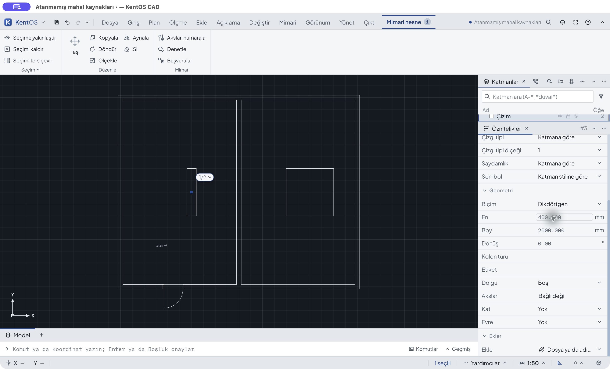

# Mimari nesne özelliklerinde uzunluk — ADR0648

25 Ekim 2026, `codex/architecture-2d-workflows`, üst commit `92a3f4eee`.
Yalnız masaüstü CAD kolon/merdiven/rampa fiziksel uzunluk okuyucusu değişti.
Model komutu, render, ölçek, şema ve API aynı. TS/TSX kaynağı değişmedi.

## Gerçek GUI kabulü

[before-binary.json](before-binary.json) önceki Property Units QA ikilisidir;
bu oturumun başlangıç dosyası `before.kcad` (manifestteki eski ilk yükleme
adı bu oturumun kaydı değildir). [after-binary.json](after-binary.json) güncel
Element Units QA ikilisini, kaynak özetlerini ve başlangıç kopyasını kaydeder.
Son kaynak ve paketlenmiş ikili özetleri kontrol edildi. Profiller/dosyalar
izole; üretim kullanıcı dosyaları değiştirilmedi.

Açık tema/13 yazı, geniş panel, gerçek macOS fare/klavye. Ham boylar
[shots.json](shots.json) içindedir; 1440×900 matris kabulü değildir.

| İşlem | Sonuç / görüntü |
|---|---|
| Eski kolon En `40 cm` | `40 mm`, .04 m; mahal 37.36 m² (02–03) |
| Yeni kolon En `40 cm`, tek Enter | `400 mm`, .4 m; mahal 36.64 m² (18–19) |
| `40 cm junk` | Açık uyarı, model aynı (12) |
| Taslak `1 m` → Escape | .4 m korunur (13 ve kayıt) |
| Tek Undo / Redo | 2 m / .4 m, mahal 33.44 / 36.64 m² (14–15) |
| Boy `2 ft` | 609.6 mm, mahal 37.19616 m² (16) |
| Bütün ölçüleri geri al | Başlangıç modeline tam dönüş (17,20) |

20 ham görüntünün hepsi kabul kanıtı değildir. İlk yardımcının önceki test
uygulamasını yakalamaya devam ettiği 04–08 `excluded-prior-app-observation`
adıyla saklandı, yeni sürüm kabulünden çıkarıldı. 09 seçim temizlenmiş genel
görünümdür; 10'da odak alanında olmadığından Command-A tüm nesneleri seçti.
Bu denemeler ürün başarısı diye sunulmadı. Ayrı `elementApp` bağlantısıyla
kolon yeniden seçilip ret/Escape/undo/redo ve başlangıçtan tek Enter tekrarlandı.
[gui-events.json](gui-events.json) bu ayrımı ve doğru ikiliyi açık kaydeder.
JPEG baytları dönüştürülmedi/kırpılmadı.

## Bağımsız model ve testler

`python3 docs/baseline/2026-10-25-architecture-element-units/verify.py`

10 gerçek GUI kaydı ayrı KCAD okuyucuyla çözülür; kolonun merkezi ± en/boy
yarısı ve mahal deliği Decimal ile hesaplanır. Sabit 4.8×7.8 iç yüzünden kolon
alanı düşülür. İzin verilen en/boy ve bağlı delik dışındaki tüm model, UUID,
ayar ve katmanlar tam karşılaştırılır. Ret/Escape/undo/redo dosyaları da dahil.

Odaklı App regresyonu beş çizim biriminde 10 kolon/merdiven/rampa hücresi için
metrik/imperial fiziksel sabitleri, tek Undo, geçersiz ek/alan sınırı, opsiyonel
boşaltma/gerekli boş ret, birimsiz giriş ve CBS legacy anlamını sınar. Açı,
basamak adedi, eğim ve kağıt balon çapı ayrıca korunur. Eski kodun düzeltilmiş
test düzeneği `red-physical.log` içinde .04/.4 farkıyla başarısızdır; yeni kod
`green-final.log` içinde başarılıdır. İlk test düzeneğinin `name` yerine `label`
kullanması ürün kusuru diye sayılmadı.

[test-runs.json](test-runs.json): son özellikler **41 başarılı / 4 atlanan**;
desktop derleme ve all-target clippy `-D warnings` başarılı. Her Cargo'da
`TS_RS_EXPORT_DIR=$PWD/.run/architecture-contours/contracts-ts` kullanıldı.
Ham günlükler korunmuştur; günlüklerdeki boşluklar yeniden biçimlendirilmedi.

Merdiven/rampa alanları bu dilimde App regresyonunda sınandı; onların tüm gerçek
tasarım iş akışı, diğer tema/boyutlar ve genel mimari kabul açık kalır.
