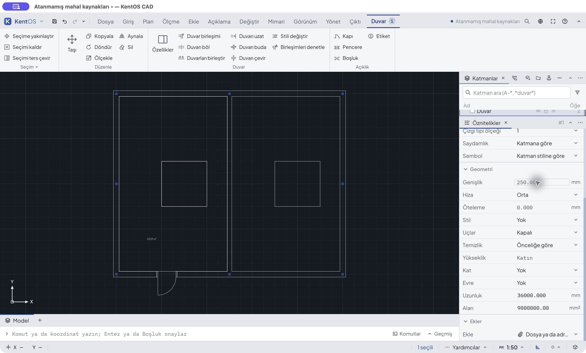

# Duvar ve açıklık özellikleri — gerçek GUI kabulü

25 Ekim 2026; ADR0647, `codex/architecture-2d-workflows`, üst commit
`e24fb6e4c`. Bu kayıt yalnız duvar/açıklık fiziksel uzunluk hücrelerinin CAD
birim eklerini kapsar. Genel mimari kabul değildir.

## Çalıştırılan uygulama ve gözlem

Eski çalışan ADR0646 test uygulaması [before-binary.json](before-binary.json)
ile tanımlıdır. Bu eski manifest ilk ADR0646 yüklemesini tarif eder;
bu oturumun başlangıcı `before.kcad`, kapı oluşturulunca `before-door-created.kcad`
oldu. Yeni [after-binary.json](after-binary.json) güncel iki Rust kaynağını ve
derlenmiş uygulamanın özetini kaydeder; izole kopya kapı oluşturulmuş kaydı açtı.
Üretim kullanıcı profili/dosyaları kullanılmadı. Kaynak özetleri son test edilen
ikiliyle karşılaştırıldı. TS/TSX kaynağı eklenmedi/değişmedi.

Gerçek macOS fare/klavye, açık uygulama penceresi; açık tema, 13 yazı, geniş
özellik paneli. [shots.json](shots.json) gerçek boyları kaydeder: eski pencereler
2880×1714, yeni pencereler 2880×1740 ham piksel. Bunlar varsayılan 1440×900
kabulü diye etiketlenmez. [gui-events.json](gui-events.json) her görüntünün
zamanını/ikilisini kaydeder. Tüm 29 JPEG CUA çıktısının değiştirilmemiş baytlarıdır.

## Önce / sonra

| Gerçek işlem | Eski sonuç | Yeni sonuç / kanıt |
|---|---|---|
| Duvar Genişlik `25 cm`, tek Enter | `25 mm`, model .025 m | `250 mm`, .25 m; 03 / 12 |
| Kapı Genişlik `120 cm`, tek Enter | `120 mm`, model .12 m | `1200 mm`, 1.2 m; 08 / 18 |
| Duvar Öteleme `-5 cm` | — | `-50 mm`, -.05 m; 15 |
| Duvar Yükseklik `300 cm` | — | `3000 mm`, 3 m; 16 |
| Kapı Konum `8 ft` | — | `2438.4 mm`, 2.4384 m; 22 |
| Kasa `2 in`, Lento `7 ft` | — | 50.8 mm / 2133.6 mm; 23 / 24 |
| Biçim Pencere, Denizlik `90 cm` | — | 900 mm; 25 |
| Denizlik boşalt → tek Undo | — | Yok → 900 mm; 26 / 27 |

Eski ilk `80 cm` kapı denemesi .08 m olarak okununca mevcut kasa doğrulaması
reddetti: `before-door-80cm-rejected.kcad` kapı oluşturulmuş kayıtla aynıdır.
Ardından Undo kapı oluşturmayı geri aldı (`before-door-creation-undo.kcad`).
Redo ile kapı geri getirildi; gerçek kusur `120 cm` ile ayrı kaydedildi.
Bu reddedilmiş ilk deneme yanlış 80 mm kaydedilmiş gibi sunulmaz.

Duvar ve kapıda geçersiz ek uyarısı, kapıda taslak `2 m` → Escape, tek Undo/Redo
gerçek klavyeyle denendi. Son dört Undo genişlik/konum/kasa/lentoyu başlangıçtaki
kapıya tam döndürdü (29). Pencere biçimine geçiş mevcut genel Biçim menüsüdür;
bu değişim stili otomatik yenilemez ve burada yeni stil davranışı eklenmedi.

## Bağımsız kayıt kontrolü

`python3 docs/baseline/2026-10-25-architecture-property-units/verify.py`

26 gerçek GUI kaydı, uygulama çağrısı olmadan KCAD okuyucusuyla çözülür.
İzin verilen alanlar dışındaki tüm model/UUID/katman/ölçek/ayarlar tam eşleşir.
500000/4400000 koordinatında dış duvarın iç yüzü, sabit bölme ve 4 m² kolon
düşümü Decimal ile ayrı hesaplanır. Başlangıç 33.44 m²; .25 m duvarla 33.00625
m²; -.05 m ötelemede 33.87625 m². Kapı söveleri merkez ± genişlik/2 ve duvarın
yüz koordinatlarıyla bağımsız hesaplanır (yalnız float yuvarlaması toleransı).
Geçersiz giriş/Escape değişmezliği, isteğe bağlı boşaltma, undo/redo ve son tam
geri dönüş karşılaştırılır. Eski hatalı kayıtlar referans başarısızlık olarak kalır.

## Otomatik kontroller ve sınır

[test-runs.json](test-runs.json) son komutları/zamanları/log özetlerini içerir.
Odaklı eski kod regresyonu kırmızı (`red-local.log`), son sürüm yeşil
(`green-final.log`). Daha önceki test kurulum/derleme denemeleri ürün kusuru
veya son sonuç diye sayılmadı. Son özellikler 40 başarılı / 4 atlanan;
`cargo build -p kentos-desktop` ve desktop all-target clippy `-D warnings` geçti.
Her Cargo'da sözleşmeler `.run/architecture-contours/contracts-ts` altına alındı.

Diğer mimari uzunluk hücreleri, web özellik adapteri ve tam araç/tema/boyut
matrisi açıktır. Bu dilim API/model/KCAD şeması veya render motoru değiştirmez.
