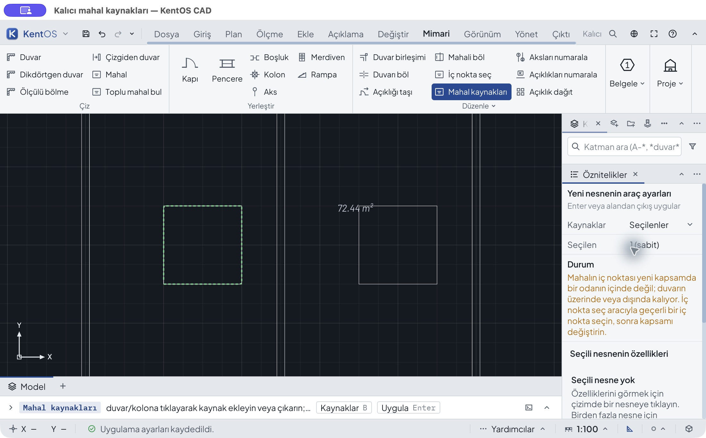

# Mahalın kalıcı kaynak seçimi — ADR0678

25 Ekim 2026, `codex/architecture-2d-workflows`, üst commit `f4e52d4c2`.
ARCH-SPACE-01'in seçilmiş duvar/kolon alt kümesi. Ana madde açık kalır;
sanal ayırıcı, büyük belgede uçtan uca performans ve bütün iş akışlarının
tam pencere matrisi bu kabulün kapsamında değildir.

## Davranış

- `sources` yokken önceki tüm uygun kaynak araması korunur. Açık liste
  mahalda sıralı/tekrarsız UUID olarak saklanır; kat ve atanmamış kapsamı
  ayrıca geçerlidir. Boş, yinelenen, yanlış tür, kayıp veya uygunsuz kat
  kaynağı sessizce bütün çizime genişletilmez.
- Mahal ve Toplu mahal bul araçları, etkinleştirmeden önce seçilen duvar ve
  kolonları görünür **Kaynaklar → Seçilenler (n)** tercihiyle kullanır.
  Mimari/Düzenle **Mahal kaynakları** mevcut mahalın kaynağını tek Enter ile
  değiştirir. Kaynak tıklamaları taslaktır; Escape çizime yazmaz.
- Seçili kaynağın silinmesi son geçerli sınırı korur, `sourceUnavailable`
  uyarısı üretir; tek Undo bağı ve alanı geri getirir. Dışlanan kaynağın
  değişmesi veya silinmesi mahalı farklı kaynağa bağlamaz.
- Kopya/dizi/pano grubu bütün bağımlılıkları içerirse kaynak UUID'leri her
  yeni gruba eşlenir. Kısmi kopya, son geometrisiyle bağımsız çizilmiş mahal
  olur ve uyarılır. Blok tanımında iç nesnelerin kalıcı UUID'si olmadığından
  kaynak bağı kaldırılır. Eski kopya/pano akışında yeni UUID ayrıştırması ve
  bütün bloklar arasında derin karşılaştırma yapılmaz.
- Python ve MCP aynı create/discover/edit/quantities sözleşmesini kullanır.
  KCAD 105 yalnız yeni alan veya kopukluk nedeninde seçilir; önceki dosya
  şemaları ve kanonik baytları değişmez. DXF kaynakları import yer tutucuları
  üzerinden gerçek yeni UUID'lere bağlar; eksik kaynak kayıp kalır.

## Gerçek GUI ve bağımsız dosya kabulü

53 ham JPEG görüntü `shots/`, olay/ikili eşlemesi [gui-events.json](gui-events.json)
içindedir. Test dosyaları/profilleri `.run/architecture-space-sources/` altında
izole edilmiştir. Kullanıcı üretim çizimleri değiştirilmemiştir.

| İşlem | Beklenen ve gözlenen |
|---|---|
| Dış duvar + sol kolon, tek mahal | 9,8 × 7,8 − 2 × 2 = **72,44 m²**; aradaki bölme dışlanır |
| Kaynak listesinden kolonu çıkar, tek Enter | **76,44 m²**; Undo 72,44 / Redo 76,44 |
| Bölmeyi listeye ekle | 4,8 × 7,8 − 4 = **33,44 m²**; tek Undo iki kaynağı geri getirir |
| Listeyi Tüm uygun kaynaklar olarak temizle | Sol oda 33,44 m²; Undo açık üç kaynağı geri getirir |
| Kapalı oda oluşturmayan veya boş liste | Onay reddi; Escape/kaydet son geçerli belgeyi korur |
| Dışlanan sağ kolonun silinmesi | 72,44 m² ve bağlı sınır aynı; Undo eski nesneyi getirir |
| Seçili sol kolonun silinmesi | Son 72,44 m² sınır/delik korunur, kaynak kaybı gösterilir; tek Undo tam geri döner |
| Sağ tık menüsü → Onayla/bitir | Sağ tık taslağı korur; tek menü seçimi 72,44 m², tek Undo 76,44 m² (47–49) |
| Toplu bul: bütün kaynaklar → seçilmiş iki kaynak | İki öneriden tek 72,44 m² önerisine geçer; tek Enter, tek Undo/Redo |

[verify.py](verify.py) GUI'nin gerçekten kaydettiği 30 KCAD dosyasını ayrı
Python okuyucuyla çözer. Alanları Decimal köşe çarpımlarıyla hesaplar;
kaynak üyeliği ve kimlikleri, bütün ilgisiz nesneler, katmanlar, proje ayarları,
mahal metadatası, ret ve Undo/Redo kayıtları karşılaştırılır. Nesne silinince
kanonik KCAD yerel `id` numaraları değişebildiğinden nesneler **UUID** ile
eşlenir; numara değişimi geometri kaybı diye yorumlanmaz.

Gerçek dar istemci 1100×650; geniş istemci yaklaşık 1440×825–842'dir (macOS
başlığı ham JPEG yüksekliğine dahildir). Açık/koyu ve 13/18 px denemeleri
vardır; 52–53 ile eksik koyu/18 px/geniş varyant da son ikilide tekrarlandı.
Kaynak hata notu sekiz görünümde kontrol edildi. Büyük yazıda mesaj panel içinde kaydırılır; hem başı hem sonu ayrı
ham görüntülerle kontrol edilmiştir. Bu kayıt 1440×900 veya bütün mimari
araçların sekizli matris kabulü diye sayılmaz.

## Bulunan kusurlar ve başarısız denemeler

- İlk ikilide araç factory'de bulunmasına rağmen `Session::TOOLS` listesinde
  yoktu; gerçek şerit tıklaması **handler missing** verdi (06). Liste ve
  dispatcher regresyonu düzeltildi; sonraki ikilide fareyle tekrarlandı.
- Kaynak hatası dar salt okunur hücrede kesiliyordu (15). Yeni aracın
  açıklaması tam genişlikte sarılan bir nota taşındı; eski araç ayarları aynı.
- Özellikteki kaynak özeti menünün eylem adı tarafından örtülüyordu.
  Seçili değerde kaynak sayısı korunacak şekilde düzeltildi. 40–46 görüntülerde
  son ikiliyle özellikten düzenleme, tek Enter, Undo/Redo ve uygulamayı
  kapatıp açma tekrarlandı; dört yeni dosya ayrıca bağımsız karşılaştırıldı. Tam güncel komut denetimi/katalog
  düzeltmesinden sonra 50–51 ve `latest-unchanged.kcad` ile yeniden açma/boş
  liste reddi/Escape tekrarlandı. Sağ tık menüsü 47–49 ile ayrıca doğrulandı.
- 13 numaralı deneme duvarı isabet ettirmedi. Dosya adı eski denemeyi taşır;
  **boş kaynak reddi kanıtı değildir**. Gerçek ret daha sonra tekrarlandı ve
  olay notunda ayrıldı. Ham resim değiştirilmedi.
- KCAD ilk geniş koşusu, desteklenmeyen şema örneğinin 105→106 taşınmasına
  ait eski test yolları/sabit sayısı yüzünden başarısızdı; bu yollar
  düzeltildikten sonra tüm KCAD testleri geçti. İlk koşu kabul sayılmadı.
- DXF kontrolünün ilk düzeneği `unit=None` ham okuyucu modunu kullanıyordu;
  200 mm fiziksel duvarı doğrudan 200 metre gibi domain'e veriyordu.
  Uygulamanın gerçek `file_import::read_options` yolu kullanıldı; tam/eksik
  kaynak roundtrip ve fiziksel alan geçti. Üretim ölçek kodu değiştirilmedi.
- İlk clippy koşusunda iki `= !` yazım uyarısı bulundu ve düzeltildi.
- Python genel regresyonu eski kapsam reddinin `scope` yolunun yeni ön
  denetimde `sources.scope` olmasını yakaladı. Eski kapsam önceliği/alan yolu
  korundu; yeni listenin reddi doğrudan `sources` alanını adlandırır.
- Yeni ortak örneklerin v2 dosya hazırlığında duvarın zorunlu `justify`
  alanı eksikti. Bağımsız dosya yazıcısı bütün 63 kurulumu reddetti; bu koşu
  geometri kabulü sayılmadı. Kurulumlara açık `center` eklendi; bağımsız
  yazıcı, native ve tipli Python ortak koşucusu sonra geçti. Dosya okuyucusunun
  doğrulaması gevşetilmedi.

## Otomatik kapılar

Sonuçların ham günlükleri ve komutları `test-runs.json` ve `testlogs/`
içindedir. Atlanan testler başarı sayılmaz; farklı koşuların
tekrarlanan testleri toplanarak yeni bir test sayısı üretilmez.

| Kapı | Sonuç ve sınırı |
|---|---|
| Native uygulama (`application7`) | 51 lib + 209 entegrasyon başarılı; 22 atlanan. Kaynak/DXF regresyonları ve ortak durumlar dahil |
| KCAD (`kcad3`) | 6 lib + 207 entegrasyon başarılı; 2 doctest atlanan; eski kanonik dosyalar dahil |
| Etkileşim (`interaction3`) | 63 lib + 677 entegrasyon başarılı; 1 entegrasyon/5 doctest atlanan. Son kaynak odaklı koşu ayrıca 3 başarılı |
| Masaüstü (`desktop3`) | 1283 başarılı, 221 atlanan. Sonraki özellik özeti değişimi son GUI ikilisinde ve son özellik testinde ayrıca kontrol edildi (41 başarılı/4 atlanan) |
| MCP (`mcp-spaces7`) | Gerçek host üzerinden 4 başarılı |
| Python (`python8`) | Genel 294 test başarılı; SDK drift ve Python crate clippy aynı kapıda geçti |
| Ortak durum düzeltmesi (`shared-native8`, `shared-python8`) | Açık `justify` içeren son JSON, native ve tipli Python koşucusunda geçti; 63 bağımsız durum |
| CAD dosya biçimleri (`formats8`) | 113 + 50 başarılı; 7 atlanan |
| Derleme / clippy / WASM | Son desktop derlemesi, ilgili bütün hedeflerin `-D warnings` denetimi, formats/geometry/DXF WASM derleme denetimleri geçti |

Koşu adları gerçek aşamaları ayırır; önceki geniş desktop/etkileşim/KCAD
koşuları son değişiklikte yeniden yapılmış gibi gösterilmez. Son üretim Rust
dosyaları ile GUI ikilisinin özeti kayıt sırasında karşılaştırıldı.

GUI ikilisinin özeti `after-binary.json` içindedir. Paket içindeki gerçek
ikili `Contents/MacOS/kentos-cad-bin` dosyasıdır; `kentos-cad` ayrı test profilini
ve çizimi açan başlatıcıdır. Kaydedilen özet gerçek ikiliye aittir.

63 ortak durum [bağımsız başvurudan](../../../scripts/fixtures/space_sources_cases.py)
üretilir: üç yöntem × beş birim × iki başlangıç × iki seçilmiş sınır = 60;
transform/dizi/pano için üç kısmi bağımlılık uyarısı ayrıca sınanır. Sabit
kurulum UUID'leri sıralanmış kaynak üyeliğini tam karşılaştırır. Başvuru
KentOS/SDK geometri kodu veya gerçek komut cevabı kullanmaz; Decimal alan/
çevre hesabı yapar. Aynı JSON native ve typed Python koşucusundan geçer.

Native kaynak regresyonu üç alan yöntemini, beş çizim birimini ve iki
koordinat başlangıcını analitik sabitlerle sınar. Buna kaynak takibi/kaybı,
atomik ret/değiştirme/temizleme, planın yazmaması, kopya/dizi/pano grupları,
DXF tam/eksik kaynak ve tek Undo eklenir. Etkileşim testleri gerçek desktop
dispatcher kaydını, seçim yakalamayı ve mevcut mahal düzenleme taslağını
sınar. Python/MCP typed komutları aynı bağımsız 72,44 m² örneğini kullanır.

Her Cargo çağrısında `TS_RS_EXPORT_DIR=$PWD/.run/architecture-contours/contracts-ts`
kullanıldı. Bu dizindeki 1125 `.ts` dosyası sözleşmelerin otomatik üretilmiş,
Git dışında kalan tip çıktısıdır. Yeni `.ts`/`.tsx` uygulama kaynağı eklenmedi;
komut kataloğu JSON'u ve Python SDK tipleri sözleşmeden yenilendi.
