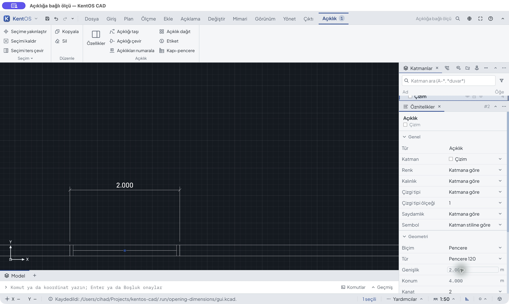
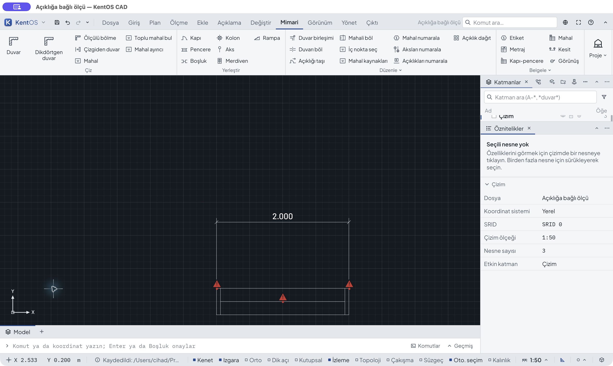
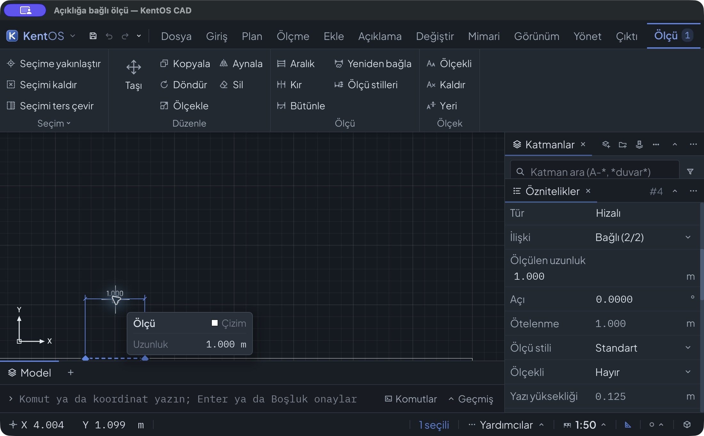

# Açıklığın gerçek noktalarına bağlı ölçü — 26 Ekim 2026

Durum: mevcut açıklık noktaları ve ilişkili ölçü dilimi kabul edildi.
ARCH-DIM-01 ve mimarinin tamamı bitmiş sayılmaz. Taban `ea7d1baeeb2e949062eb3aec6d900d4b697c7983`, aynı
`codex/architecture-2d-workflows` dalı; karar [ADR0694](../../adr/0694-opening-dimension-places.md).

## Düzeltmenin sınırı

Mevcut ilişkili ölçü, açıklığın gerçek jamb köşelerini ve başlangıç/bitiş/
merkez noktalarını izler. Kapı/pencere/boşluk şeklinin çizilen kanat/kasa/yay
parçalarına bağlanmaz. Kaynak kimliği, host değişikliği ve duvar→açıklık→ölçü
sırası korunur. Kopuk açıklığın eski görüntü köşeleri geçerli bağ olamaz.
Yaylı duvarda doğrusal ölçü gerçek kiriş mesafesidir; nominal yay boyunca eni
veya net geçiş eni değildir.

Eski ikiliyle gerçek GUI: dört nesneli `baseline-created.kcad` doğru 1 m
sayıyı gösterir, fakat **refs yoktur**. `02-before-first-jamb.jpg` kenedin
kaynağının duvar olduğunu gösterir. Yeni ortak store kazanan Endpoint'in
koordinat/tür/sırasını değiştirmeden aynı host'un görünür ve keneti açık
geçerli açıklığının jamb kimliğini verir. Yalnız noktanın uzamsal komşuları
aranır. Genel snap önceliği, wall/line uçları ve frame köşeleri değişmez.

Yeni komut/kalıcı alan/KCAD şeması/birim/ölçek/renderer değişikliği yoktur.
Yeni TS/TSX dosyası yoktur; ortak katalogdaki farklar açıklama metinleridir,
yapısal karşılaştırma `catalog-verification.json` içindedir. SDK'nin üretilen
belgeleri aynı `SubPlace` anlamını açıklar. Web uygulaması ADR0228 ile bekler.

## Bağımsız kabul

- `before.kcad`: 10 m duvar, 20 cm kalınlık, merkezi 4 m'de 1 m pencere,
  ayrı öznitelikli ilgisiz çizgi; m/1:50. `fixture-preparation.json` hazırlığı
  açıklar; `verify.py` bütün kaynak alanlarını sabit beklentilerle doğrular.
- Kaydedilmiş dosyaları bağımsız `tools/kcad/kcad.py` okur. Yeni UUID dışında
  yeni geometri/öznitelik/stil/ayar alanı çıktının kendisinden beklenen diye
  alınmaz. Eski serbest ölçünün tıklamayla oluşan offset'i gözlenen piksel
  konumunun aralığıyla sınırlıdır; yeni ölçüde yazılan 1 m offset sabittir.
- İlk silinmiş-model beklentisi runtime slot numaralarını tutuyordu ve bağımsız
  kontrol reddetti (`verification-notes.json`). Mevcut KCAD kolon biçimi slot
  numaralarını saklamaz (`columns.rs:1990`); dosya okuyucusu sırayla 1..n
  verir. Beklenen silinmiş modelin id alanları açıkça 1/2/3 düzeltildi;
  kimlik/öznitelik/geometri karşılaştırmasından hiçbir alan çıkarılmadı,
  üretim kodu değiştirilmedi. UUID'ler ve tüm referanslar aynen doğrulanır.
- `models.json` ve `gui-events.json`: ham dosyalar, amaç ve SHA256. Kayıtlar
  ilgili görüntü adımlarından sonra alınır. Tek undo/redo beklenen modelin
  tamamını ve aynı model için aynı dosya baytlarını geri getirmelidir.
- `previous-kcad.json`: önceki **1.828** takipli KCAD dosyasının baytları;
  kaynak fixture'lar ve eski GUI kayıtları değiştirilmez.
- `before-binary.json` / `after-binary.json`: ayrı ve dondurulmuş uygulama
  ikilileri ile üretim kaynaklarının hash'leri. Önceki QA ikilisi ezilmez.
- `test-runs.json` gerçek komut/zaman/çıkış/log SHA256 tutar; ham testlogs
  silinmez. `native-full` ilk sürümdür; `native-final` GUI'de bulunan kaynak
  kimliği düzeltmesini de içerir. İkincisi lib/tests çalıştırır; ilk turun
  doc testleri başarılıdır, son turda tekrar koşturulmamıştır.
- `verify-format.py` genel eski formatı değiştirmez: yeni rustfmt farkı sıfır,
  kalan farklar tam tabanla aynıdır. Bu çalışma tüm deponun formatının temiz
  olduğunu iddia etmez.

## Gerçek GUI akışı ve kanıt bütünlüğü

**36 ham ekran**: 34 kabul, iki tanısal; **21 tam model** ve ayrı dört
kabul dışı tanısal kopya. Boyutlar 2880×1720/1726 ve 2200×1364; açık tema
13 px, koyu 13 ve görünür hazır **16 px**. 29/30 dosya adları korunmuştur:
ilk sayısal 18 girişi uygulanmadı, gerçekten 13 px idi; notları düzeltildi.
34 ekranı ve `gui-appearance.json` hazır En büyük değerinin 16 olduğunu
kanıtlar. 35/36 büyük yazı tekrarıdır. Tüm tema/boyut kombinasyonları sınanmadı.

| Ham ekran | Gerçek işlem ve bağımsız kayıt |
|---|---|
| 01–03 | Eski ikili: jamb duvar kenedine gidiyor, doğru sayı fakat refs yok |
| 04–10 | Yeni ikili: Uç nokta · açıklık; önizleme kaydı yazmaz; 1 m offset tek Enter; Bağlı (2/2); tek undo/redo |
| 11–16 | Pencere genişliği 1→2, konum4→6; ölçü izler, tek undo/redo |
| 17–24 | Duvar20→40 cm; jamb ve ölçü birlikte; host silinince Kopuk; tek undo/redo ve dört adım geri dönüş |
| 25–26 | CUA dış değişiklik bildirimi; beklenmeyen yeni duvar/pencere/aks ayrı tanısal kaydedildi |
| 27–30 | Aynı dondurulmuş ikili ayrı uygulama/doğru dosyada dört nesne; iptal ve dar pencere görünümü |
| 31–33 | Kanıt yardımcısı düzeltildikten sonra yeni süreçte aç/kaydet ve gerçek iki jamb/Esc/kaydet tekrarı |
| 34–36 | Hazır16 px görünür seçim; geniş/dar panelde ilişki ve tam ölçü değeri; son model byte aynı |

25/26 akışında denetlenen giriş dizisinin dışında üç nesne eklenmişti. Dört özgün nesnenin
UUID ve bütün alanları aynıdır (`diagnostic-scope.json`); bu deneme kabul
edilmez. Son doğrulanmış dosya ayrı uygulamada açıldı. Sonraki ilk üç kanıt
kopyasında yardımcı eski hücrenin dosya yolunu yakaladığı için yanlış eski
7 nesneli dosyayı okudu; bağımsız kontrol bunu reddetti. Bunlar
`diagnostic-wrong-path-*.kcad` olarak saklandı; **silinmedi, doğru beklenen
model diye kullanılmadı**. Gerçek GUI dosyası dört nesneydi. Sabit açık yol
kullanan yeni yardımcıyla 31–33 tekrarlandı, son koyu16/dar kaydı da aynı
kaynakla alındı. `verification-notes.json` iki doğrulama düzeltmesini ve bu
meta veri düzeltmesini ayrı açıklar; üretim kodu bunlar için değişmedi.

## Koşturulan son native kontroller

`native-final` son üretim kaynağını sınar; aşağıdaki ignored değerleri eski
kapalı testlerdir, başarıya eklenmemiştir. Tam komut/çıktı logdadır.

| Takım | Başarılı | Mevcut ignored |
|---|---:|---:|
| geometry-core lib / ana integration | 524 / 269 | 5 / 21 |
| domain lib / ana integration | 10 / 68 | 0 / 0 |
| interaction lib / ana integration | 63 / 709 | 0 / 1 |
| application lib / ana integration | 52 / 224 | 0 / 22 |

Diğer domain belge/pafta ve core store/calls/adjoin/network hedefleri de
logda başarılıdır; ayrı perf hedeflerinin mevcut ignored'ları korunur.
Gerçek MCP hostunun **76 testi** geçti; yeni test `cad.snap.find` best/all
köşe sahipliği, salt okunur plan, tek yazım/geçmiş, genişlik izleme,
kaydet-aç ve kayıp hosta atomik ret davranışlarını sınar. `stamp` geçici
host concurrency alanıdır; UUID ve tüm entity alanları karşılaştırılır.

Python native uzantısı yeniden derlenip editable kurulmuştur. **342 test**
230,248 saniyede geçti; m/mm, üç açıklık biçimi ve iki koordinat başlangıcında
snap/plan/yazım/geçmiş/kaydet-aç ile ayrı kayıp host/atomik ret testi dahildir.
SDK üretilen belgeleri katalogla eşittir. Ham log mevcut CommandWarning,
ts-rs ve SQLite ResourceWarning bildirimlerini saklar; sıfır uyarı veya
kaynak sızıntısı olmayan bütün ürün iddiası yapılmaz.

Yeni bağımsız kontroller gerçek köşe ve orta noktaları, üç açıklık biçimi,
ters host, büyük koordinat, kalınlık/bölme, yay kirişini ve rehost'u kapsar.

## Açık kapsam

Otomatik cephe/mahal ölçü sıraları, iç/dış/çekirdek yüz seçimi, metin
çakışması ve çoklu görünüş/pafta matrisi açıktır. Merkez/başlangıç/bitiş
başvurularının açık semantik kullanımı API'dedir; bu dilimde ekranda yeni bir
merkez seçim aracı yapılmamıştır. Leaf/frame'in rastgele çizgi parçaları
anlamsal açıklık yeri değildir. Genel Zincir/Baz/Hızlı araçları yeniden
uygulanmamıştır. Bu kanıt bütün mimari veya tüm CAD/GIS kabulü değildir.

## Yeniden doğrulama

Depo kökünden `python3 docs/baseline/2026-10-26-architecture-opening-dimensions/verify.py`
bütün model/görüntü/log ve önceki KCAD hash'lerini denetler.
`python3 docs/baseline/2026-10-26-architecture-opening-dimensions/verify-format.py`
yeni Rust biçim farkı oluşmadığını kabul edilmiş tabana karşı denetler.
Native/Python/MCP/clippy/build/WASM komutlarının tamamı `test-runs.json`
içindedir. Cargo çalıştırırken `TS_RS_EXPORT_DIR` mutlak geçici bir dizine
ayarlanır; test üretimleri uygulama kaynağına yeni TS yazmaz. Python kontrolü
SDK eşitliğini denetler, native uzantıyı yeniden kurar ve tam SDK testlerini
çalıştırır; eski kurulu modül üzerinden yeni davranış kabul edilmez.

Bulut sunucusuyla `--live` kabulü ve diğer donanım/işletim sistemleri bu
dilimde tekrar çalıştırılmadı. MCP testleri native `Server` komut yönlendirmesini
sınar; harici bir stdio/ağ oturumu açıldığı iddiası değildir.

## İlgili gerçek görünümler

Genişlik 1→2 m değişirken bağlı ölçü:

Kaynak duvarı silince açık kopuk bağ:

Koyu16 px, dar pencerede Bağlı (2/2) ve tam birimli değer:

## Son tamamlanan kapılar

- `build`: son desktop ikilisi derlendi; iki ayrı son QA uygulaması aynı
  dondurulmuş SHA256 ile gerçek fare/klavye testinde kullanıldı.
- `python`: SDK eşitliği, taze native uzantı derleme/kurulum,342 test ve
  kentos-python all-targets clippy geçti.
- `clippy`: geometry-core, native-application, interaction, desktop ve MCP
  paketlerinin tüm hedefleri `-D warnings` ile geçti.
- `wasm`: geometry-wasm, wasm32-unknown-unknown hedefinde derlendi.
- Genel kaynak/model/katalog/bayt hash denetimi ve yalnız eski farklara izin
  veren Rust biçim denetimi geçti. Kabul, automaticDimensionChainsAccepted
  ve wholeArchitectureAccepted değerlerini **false** olarak korur.
