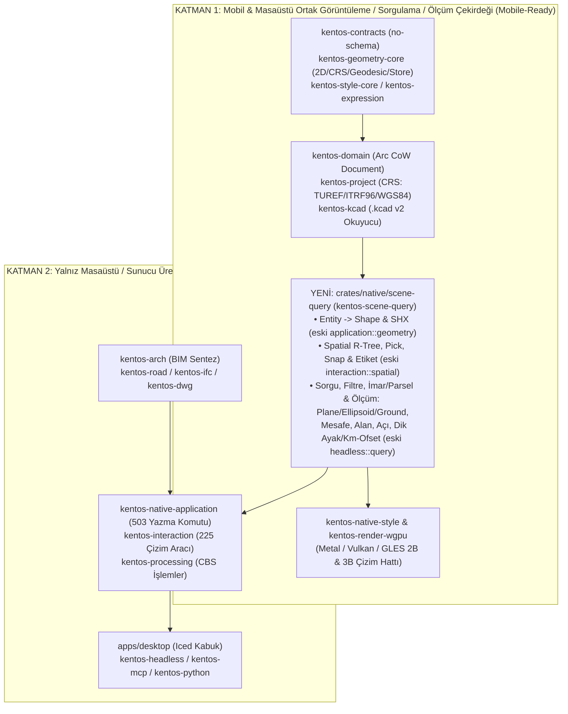
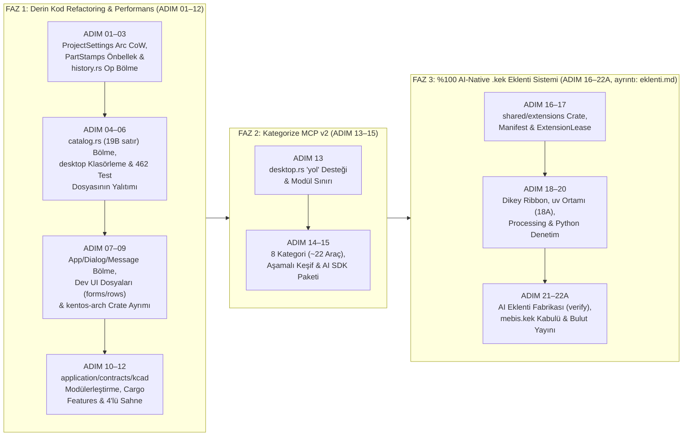
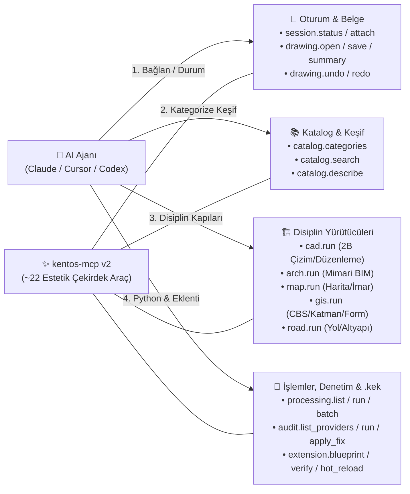

# KentOS CAD — Mimari Değerlendirme ve Sıralı Ana Uygulama Planı (Tek Kaynak)

Son güncelleme: **12 Kasım 2026**. Kapsam: **KentOS Mimari**, **KentOS Harita**, **KentOS GIS** ve **KentOS Yol** modüllerinin ortak kod tabanı, kod refactoring (modülerleştirme) adımları, **Kategorize MCP v2** mimarisi ve **QGIS ilhamlı `.kek` eklenti sistemi**.

> **Tek Sıralı Talimat İlkesi:** Mimari iyileştirme, derin kod refactoring, MCP v2 ve **%100 AI-Native (Sıfır Elle Kodlama) `.kek` eklenti sistemi** için **ana uygulama sırası bu belgedir (`ADIM 01` → `ADIM 22`)**. Dağınıklığı önlemek için tüm adımlar bağımlılık sırasına göre tek bir doğrusal akışta toplanmıştır:
> 1. **ÖNCE FAZ 1 (`ADIM 01` – `ADIM 12`):** Masaüstü, bellek/performans (`ProjectSettings` `Arc` Copy-on-Write, `PartStamps` önbelleği, `history.rs`), derleyici darboğazları (`catalog.rs` 19.043 satır) ve çekirdek crate **kod refactoring / modülerleştirme** adımları tamamlanır.
> 2. **SONRA FAZ 2 (`ADIM 13` – `ADIM 15`):** Temizlenen modül sınırları üzerine **Kategorize ve Estetik MCP v2 (`kentos-mcp`)** ve AI SDK bilgi paketi kurulur.
> 3. **EN SON FAZ 3 (`ADIM 16` – `ADIM 22`):** Temizlenen `shell/`, `application` ve `MCP v2` altyapısı üzerine **AI ajanları tarafından yazılıp doğrulanan (`.blueprint` → `.verify` → `.hot_reload`) QGIS ilhamlı `.kek` eklenti sistemi** inşa edilir.
>
> Ayrıntılı alt kabul ölçütleri için [plugins.md](file:///home/cihad/Projects/kentos-cad/plan/plugins.md), [python.md](file:///home/cihad/Projects/kentos-cad/plan/python.md) ve [form.md](file:///home/cihad/Projects/kentos-cad/plan/form.md) belgeleri yalnız referans sözleşme olarak kullanılır; **uygulama sırası buradaki `ADIM 01` – `ADIM 22` listesidir.**

---

## 1. Mevcut Yapı ve Mimarinin Değerlendirmesi

### 1.1. Kod Tabanının Sayısal Görünümü

| Katman / Crate | Dosya Sayısı | Satır Sayısı | Sorumluluk ve Mevcut Durum |
|---|---:|---:|---|
| `apps/desktop` | 1.159 | ~549.800 | Masaüstü kabuğu, şerit, tüm modül pencereleri ve ekran testleri (`src/` kökünde 650 `.rs` dosyası) |
| `crates/native/application` | 756 | ~301.500 | Dört disiplinin tüm anlamsal ürün komutu işleyicileri |
| `crates/shared/geometry-core` | 491 | ~200.900 | 2B/3B temel analitik geometri, Delaunay, exact predicates + alana özgü geometrik kurallar |
| `crates/native/interaction` | 363 | ~142.400 | Çizim/düzenleme araç oturumu (`Session`, `Tool`), kenetleme ve önizleme |
| `crates/shared/formats` | 221 | ~92.800 | DXF, LandXML, Shapefile, GeoJSON, CSV/XYZ, PDF/A, raster/mesh okuyucu ve yazıcıları |
| `crates/shared/commands` | 207 | ~90.300 | Ürün komutlarının şema/tip tanımları ve katalog üretimi |
| `crates/shared/contracts` | 173 | ~86.500 | Ortak veri sözleşmeleri (`Entity`, `ProjectSettings`, `DocumentSnapshotV1`, ayarlar) |
| `crates/ui` | 155 | ~85.000 | Iced 0.14 tabanlı KentOS UI bileşen kütüphanesi ve tema jetonları |
| `crates/native/processing` | 142 | ~49.000 | İşlemler (`processing.*`) araçları, model tasarımcısı ve arka plan iş koşucusu |
| `crates/shared/kcad` | 116 | ~41.100 | `.kcad` v2 CBOR kapsayıcısı, şema doğrulama ve sürüm geçişleri |
| `crates/server/application` | 77 | ~40.800 | Bulut/PostGIS proje işlemleri, revizyon, paylaşım ve yetkilendirme |
| `crates/native/domain` | 116 | ~39.800 | Masaüstü belge modeli (`Document`), işlem geçmişi (`undo/redo`), katmanlar ve takipçiler |
| `crates/shared/sheet` + `sheet-ui` | 131 | ~63.600 | Pafta düzeni çekirdeği, PDF/GeoPDF yazımı, Türk ruhsat/antet şablonları ve masaüstü arayüzü |
| `crates/shared/raster` | 86 | ~32.900 | Yüzey analizi, eşyükselti, eğim/bakı, hidroloji ve uzaktan algılama çekirdeği |
| `crates/shared/road` | 116 | ~24.500 | Yol mühendisliği çekirdeği (arazi yüzeyi, yatay/düşey güzergâh, dever, kesit, kübaj) |
| `crates/render/wgpu` | 43 | ~17.500 | Native `wgpu` çizim hattı, 65 km karo merkezli FP32/FP64 hassasiyet ve stil batch'leri |

### 1.2. Mimarideki Güçlü Temeller (Korunması Gereken İlkeler)

1. **Tek Yönlü Bağımlılık Denetimi ([scripts/arch/deps.mjs](file:///home/cihad/Projects/kentos-cad/scripts/arch/deps.mjs)):**
   - Saf hesap crate'lerinin (`crates/shared/*`) hiçbir UI (`iced`), GPU (`wgpu`), veritabanı (`sqlx`), HTTP (`axum`/`reqwest`) veya tarayıcı (`wasm-bindgen`) bağımlılığı alamaması ve bunun her test koşusunda `cargo tree` üzerinden otomatik denetlenmesi, projenin mimari çürümesini önleyen en güçlü mekanizmadır.
2. **"Araç = Anlamsal Komut" ve Üçlü Yüzey Bütünlüğü:**
   - Çizimi veya projeyi değiştiren her işlemin `kentos-commands` kataloğunda tipli bir komut olması; masaüstü UI, Python SDK (`kentos.cad`) ve AI/MCP (`kentos-mcp`) yüzeylerinin aynı doğrulama, yetki, geri alma (`undo`) ve plan/önizleme sözleşmesini kullanması büyük bir avantajdır.
3. **Kadastral ve Mühendislik Sayısal Doğruluğu:**
   - `libm` ve `serde_json/float_roundtrip` ile platformlar arası bit-bit determinizm; geometrik alan, tapu/kayıtlı alan ve gösterim değerinin ayrılması; `rust_decimal` ve pay/payda hisse koruması harita/kadastro ve yol hakediş hesapları için sağlam bir temeldir.
4. **Dört Disiplinin Aynı Belge ve Veri Modeli Üzerinde Buluşması:**
   - Mimari, Harita, GIS ve Yol disiplinlerinin aynı `.kcad` v2 dosyası ve aynı `kentos-domain::Document` üzerinde kayıpsız çalışması, farklı yazılımlar arasında DXF/Shapefile/LandXML taşırken yaşanan veri kaybını ortadan kaldırır.

### 1.3. Kod İncelemesinde Tespit Edilen Kritik Refactoring ve Performans Darboğazları

Kod tabanı üzerinde yapılan derinlemesine incelemede, eklenti sistemine geçmeden önce mutlaka çözülmesi gereken **10 somut yapısal, çalışma zamanı ve mobil modülerlik darboğazı** tespit edilmiştir:

| # | Tespit Edilen Darboğaz | İlgili Dosya ve Boyut | Somut Etkisi (Neden Ciddi İyileştirme Şart?) |
|---:|---|---|---|
| **1** | **Her Komutta ve Önizlemede `ProjectSettings` Derin Kopyalaması (`self.settings.clone()`)** | [document.rs#L305](file:///home/cihad/Projects/kentos-cad/crates/native/domain/src/document.rs#L305), [step.rs#L496](file:///home/cihad/Projects/kentos-cad/crates/native/domain/src/step.rs#L496), [contracts/src/document.rs#L245](file:///home/cihad/Projects/kentos-cad/crates/shared/contracts/src/document.rs#L245) | `Document::reading_copy()` (her `plan` çağrısında, her fare önizlemesinde `preview_followers`, her arka plan işinde çalışır) ve `keep(ProjectPart::Settings)`, `self.settings.clone()` çağırıyor. Oysa `ProjectSettings` içinde **tüm Yol TIN yüzeyleri (`RoadSettings`), koridorlar, kesitler, GNSS arşivleri (`MapSurvey`), parsel kütüğü (`ParcelRegister`), binlerce satırlık `source_bases` hash'leri ve formlar `Arc` olmadan düz `Vec`/`Option` olarak** duruyor! Basit bir çizgi çizerken bile megabaytlarca mühendislik verisi bellekte tekrar tekrar kopyalanıyor. |
| **2** | **Her Komut Öncesi Tüm Projeyi JSON'a Çevirip SHA-256 Alan `PartStamps::of(doc)`** | [call.rs#L86](file:///home/cihad/Projects/kentos-cad/crates/native/application/src/call.rs#L86), [etag.rs#L58](file:///home/cihad/Projects/kentos-cad/crates/native/domain/src/etag.rs#L58) | `recorded_with` içinde her MCP/Python/`call` komutu çalışmadan **önce**, komutun ne yaptığına bakılmaksızın `doc.settings_stamp()`, `doc.layers_stamp()`, `doc.styles_stamp()`, `doc.sheets_stamp()`, `doc.constraints_stamp()` çağrılıyor. Tek bir 2B nokta eklerken bile tüm `ProjectSettings`, tüm katman ağacı ve tüm stiller `serde_json::Value` ağacına çevrilip SHA-256 özeti hesaplanıyor! |
| **3** | **`history.rs` İçindeki 55+ Varyantlı `Op` Enum'ı ve `Arc`'sız `Vec` Kopyaları** | [history.rs#L91-L495](file:///home/cihad/Projects/kentos-cad/crates/native/domain/src/history.rs#L91-L495) (2.102 satır) | `Op` enum'ı 55+ varyanta ulaşmış; içindeki **18 adet `Op::Road*` varyantı** (`RoadSurfaces`, `RoadCorridors`, `RoadSections`, `RoadDrawings` vb.) ve mimari/CBS ayar varyantları (`Domains`, `OpeningTypes`, `Materials`, `ArchModules`) `Arc` kullanmadan düz `Vec<...>` tutuyor ve her `undo`/`redo` (`Op::inverse`) işleminde tüm vektörleri klonluyor. |
| **4** | **`catalog.rs` İçindeki 19.043 Satırlık Tek Fonksiyon (`pub fn catalog()`)** | [commands/src/catalog.rs#L20](file:///home/cihad/Projects/kentos-cad/crates/shared/commands/src/catalog.rs#L20) (19.043 satır), [capabilities.rs](file:///home/cihad/Projects/kentos-cad/crates/shared/commands/src/capabilities.rs) (8.170 satır) | 503 komutun tamamı ve 1.000+ `schemars::schema_for!<T>()` makro genişlemesi **tek bir 19.000 satırlık Rust fonksiyonu** içinde derleniyor. LLVM optimizer tek bir dev stack frame üzerinde çalıştığı için derleme süresini, RAM kullanımını ve `rust-analyzer` hızını felç ediyor. |
| **5** | **Görüntüleme (`render-wgpu`), Uzamsal İndeks (`Spatial`) ve Sorgu/Ölçüm (`query.rs`) Kodlarının 256 Bin Satırlık Yazma (`application`/`interaction`) Crate'lerine Bağlı Olması (Mobil Derleme Engeli)** | [style/Cargo.toml#L19](file:///home/cihad/Projects/kentos-cad/crates/native/style/Cargo.toml#L19), [interaction/src/spatial.rs](file:///home/cihad/Projects/kentos-cad/crates/native/interaction/src/spatial.rs) (2.638 satır), [headless/src/query.rs](file:///home/cihad/Projects/kentos-cad/crates/native/headless/src/query.rs) (639 satır) | Salt-okunur çizim hattı olan `kentos-render-wgpu` → `kentos-native-style` üzerinden sırf `geometry::shape` ve `shx_text` okumak için **tüm `kentos-native-application` (256.284 satır, 503 yazma komutu), `kentos-dwg`, `kentos-ifc`, `kentos-ncz`, `kentos-pointcloud` ve `kentos-road` crate'lerini** kendisine bağlıyor! Benzer şekilde nesne seçme/yakalama (`Spatial`) 225 çizim aracının olduğu `kentos-interaction` içinde; alan/mesafe/koordinat/elipsoit ölçümü (`query.rs`) ise `kentos-headless` içinde gömülü duruyor. Bu durum hafif bir **Mobil Görüntüleyici/Sorgulama/Ölçüm SDK'sı** derlemeyi imkânsız kılıyor. |
| **6** | **`apps/desktop/src/` İçinde 462 Test/Sahne Dosyasının (`146.814 Satır`) Üretim Koduyla Karışması** | [apps/desktop/src/lib.rs#L13](file:///home/cihad/Projects/kentos-cad/apps/desktop/src/lib.rs#L13) (Toplam 1.159 dosya: 697 üretim + 462 test/sahne) | Kök dizindeki 650 dosyanın **353 tanesi (`%54`'ü)** `*_scenes.rs`, `*_screens.rs` ve `*_tests.rs` dosyasıdır. `cargo test -p kentos-desktop --lib` çalıştığında 549.800 satırın tamamı tek bir dev test ikilisine (monolithic binary) derlenip bağlanmaktadır. |
| **7** | **5.061 Satırlık `app.rs` ve Dev `App` / `Dialog` / `Message` Yapıları** | [apps/desktop/src/app.rs](file:///home/cihad/Projects/kentos-cad/apps/desktop/src/app.rs) (5.061 satır) | `Dialog` enum'ı 130+ pencereyi, `Message` enum'ı 150+ olayı, `App` struct'ı dört disiplinin ~200 pencere/panel alanını tek yapıda tutuyor. |
| **8** | **Masaüstünde 4.000–5.500 Satırlık Dev Tekil Arayüz Dosyaları** | [forms/entry.rs](file:///home/cihad/Projects/kentos-cad/apps/desktop/src/forms/entry.rs) (5.444 satır), [properties/rows.rs](file:///home/cihad/Projects/kentos-cad/apps/desktop/src/properties/rows.rs) (4.617 satır), [labels.rs](file:///home/cihad/Projects/kentos-cad/apps/desktop/src/labels.rs) (4.193 satır), [sheets.rs](file:///home/cihad/Projects/kentos-cad/apps/desktop/src/sheets.rs) (4.101 satır) | Form veri girişi, öznitelik satırları, etiketleme ve pafta düzenleyici binlerce satırlık tekil dosyalarda toplanmış durumda; bakım ve derleme süresini zorlaştırıyor. |
| **9** | **Düz (Flat) Dizinlerde Yığılan Yüzlerce Komut, Etkileşim ve Sözleşme Dosyası** | `application/src` (612 dosya), `interaction/src` (225 dosya), `commands/src` (207 dosya), `contracts/src` (156 dosya) | Dört disiplinin (`arch`, `map`, `gis`, `road`) dosyaları alt klasörlere ayrılmadan aynı `src/` kökünde duruyor; [registry.rs](file:///home/cihad/Projects/kentos-cad/crates/native/application/src/registry.rs) (1.118 satır) 500+ komutu tek makroda eşleştiriyor. |
| **10** | **`.kcad` İçinde 253 Doğrusal Şema Sabiti ve 4.500 Satırlık `encode`/`decode` Dosyaları** | [kcad/src/lib.rs](file:///home/cihad/Projects/kentos-cad/crates/shared/kcad/src/lib.rs) (250 `SCHEMA_WITH_*` sabiti), [decode/objects.rs](file:///home/cihad/Projects/kentos-cad/crates/shared/kcad/src/decode/objects.rs) (4.551 satır), [encode.rs](file:///home/cihad/Projects/kentos-cad/crates/shared/kcad/src/encode.rs) (4.441 satır), [columns.rs](file:///home/cihad/Projects/kentos-cad/crates/shared/kcad/src/columns.rs) (4.378 satır) | Her disiplin özelliği ortak doğrusal şema numarasını artırıyor (`253`); `encode.rs` ve `decode/objects.rs` dört disiplinin tüm serileştirmesini tek dosyada yapıyor. |

---

## 2. Temel Mimari Kararlar: Masaüstü Paketleme ve Mobil/Saha Modülerliği

### 2.1. Masaüstü: Tek Çekirdek Binary + Modül Kimlikleri (`Multi-Call Binary`)

> **Karar:** Masaüstü üretim ve dağıtım (Release) katmanında şimdiki gibi **"Tek Çekirdek Binary (`kentos-cad`) + Modül Kimlikli Bağlantılar (`kentos-mimari`, `kentos-harita`, `kentos-gis`, `kentos-yol`) + `kentos-launcher`"** (Multi-Call Binary) mimarisiyle devam edilmelidir. Ancak kaynak kod ve derleme (Workspace/Crate) katmanında modüller **klasörlere, alt-durumlara ve Cargo `features` bayraklarına** ayrıştırılmalıdır.

- **Disk ve RAM Tasarrufu:** Dört modül ayrı binary olarak derlendiğinde toplam boyut >1 GB olurken, ortak multi-call binary **~216 MB** yer kaplar ve işletim sistemi çekirdeği aynı makinede birden fazla modül açıkken makine kodunu RAM'de (`page cache`) tek kez tutar.
- **Sıfır Kayıplı Dosya Devri (`hand_over`):** Kullanıcı bir harita projesini yol veya mimari modülüne devrettiğinde aynı `.kcad` şema sürümü ve koordinat/birim kuralları garanti edilir.
- **Kullanıcı Deneyiminde Tam Ayrım:** Her modül zaten kendi pencere başlığına, `.desktop` kimliğine, yerleşim dosyasına (`yerlesim-mimari.json` vb.), IPC soketine (`masaustu-mimari.sock` vb.) ve kendi şerit/komut kümesine (`App::offers`) sahiptir.

### 2.2. Mobil ve Saha Uygulamaları İçin İki Katmanlı Çekirdek Mimarisi (`Viewer/Query/Measure` vs. `Authoring`)

İleride iOS (`aarch64-apple-ios`), Android (`aarch64-linux-android`) ve saha tabletleri için **CAD, GIS, Harita, İmar Durumu, Altyapı ve Yol projelerini açıp görüntüleyen (`wgpu`), dokunmatik nesne/öznitelik/parsel/imar sorgulayan ve hassas ölçüm (düzlem, elipsoit, arazi/ground, dik ayak/kilometre-ofset, açı, alan) yapan** bir mobil uygulama derlenirken; 503 yazma komutunu (`kentos-native-application`), 225 masaüstü çizim aracını (`kentos-interaction`), ağır CBS işlem motorunu (`kentos-processing`), IFC/DWG/Pafta yazıcılarını ve masaüstü `iced` arayüzünü mobile derlemek **kesinlikle istenmez**.

Bu nedenle refactoring sırasında crate bağımlılık grafiği **kesin olarak iki katmana** ayrılacaktır:



1. **Şu Anki Engel (Ters Bağımlılık):**
   - [crates/native/style/Cargo.toml#L19](file:///home/cihad/Projects/kentos-cad/crates/native/style/Cargo.toml#L19) içinde `kentos-native-style`, sadece `geometry::shape`, `shx_text` ve `expression_unit` fonksiyonlarını çağırmak için **`kentos-native-application` crate'ine bağımlı**.
   - Bu tek satırlık bağımlılık yüzünden, sadece ekran çizimi yapan `kentos-render-wgpu` bile derlenirken 256.284 satırlık `kentos-native-application`, `acadrust` (`kentos-dwg`), `kentos-ifc`, `kentos-ncz`, `kentos-pointcloud` ve `kentos-road` derlenmek zorunda kalıyor!
2. **Refactoring Çözümü (`crates/native/scene-query` — `kentos-scene-query`):**
   - `application` içindeki salt-okunur `geometry::shape`, `shx_text`, `blocks::core_blocks_in`, `label_texts`, `layer_filter`, `expression_unit`;
   - `interaction` içindeki salt-okunur uzamsal indeks, nesne seçme (`pick`), yakalama (`snap`) ve etiket yerleştirme motoru olan `Spatial` ([spatial.rs](file:///home/cihad/Projects/kentos-cad/crates/native/interaction/src/spatial.rs));
   - `headless` içindeki salt-okunur sayfalama, filtreleme, koordinat sistemi ve Düzlem/Elipsoit/Arazi (`Plane` / `Ellipsoid` / `Ground`) ölçüm motoru olan `query` ([query.rs](file:///home/cihad/Projects/kentos-cad/crates/native/headless/src/query.rs)) ile dokunmatik ölçüm yardımcıları (`measure`, `angle`, `coordinate`, `station_offset` — dik ayak/kilometre-ofset);
   - **`crates/native/scene-query` (`kentos-scene-query`)** adlı yeni, hafif ve sıfır yazma-komutu içeren crate'e taşınacaktır.
   - Böylece `kentos-native-style` ve `kentos-render-wgpu` artık `kentos-native-application`'a **hiç bağımlı olmayacak**; mobil uygulama (`iOS` / `Android`) yalnız `kentos-kcad + kentos-domain + kentos-scene-query + kentos-render-wgpu` (~15'lik çekirdek) ile saniyeler içinde derlenebilecektir.

---

## 3. Sıralı Ana Uygulama Yol Haritası (`ADIM 01` → `ADIM 22`)



---

## FAZ 1 — Derin Kod Refactoring, Bellek/Derleyici Optimizasyonu ve Modülerleştirme (`ADIM 01` – `ADIM 12`)

> [!IMPORTANT]
> Eklenti sistemine (`.kek`) veya yeni büyük özelliklere geçmeden önce **Faz 1 adımları (`ADIM 01` – `ADIM 12`) sırasıyla tamamlanmalıdır**. İlk 4 adım (`ADIM 01` – `ADIM 04`) çalışma zamanı bellek kopyalamalarını ve derleyici darboğazlarını doğrudan ortadan kaldırır; sonraki adımlar (`ADIM 05` – `ADIM 12`) ise masaüstü ve çekirdek crate'leri temiz disiplin sınırlarına ayırır.

---

### [x] ADIM 01 — `ProjectSettings` ve `Document::reading_copy` / `keep` Sıfır-Kopya (`Arc` Copy-on-Write) Refactoring'i (Öncelik: P0)

- **Kod İnceleme Bulgusu:**
  - [crates/native/domain/src/document.rs#L305](file:///home/cihad/Projects/kentos-cad/crates/native/domain/src/document.rs#L305) içindeki `Document::reading_copy()` ve [crates/native/domain/src/step.rs#L496](file:///home/cihad/Projects/kentos-cad/crates/native/domain/src/step.rs#L496) içindeki `Document::keep(ProjectPart::Settings)` her çağrıda `self.settings.clone()` çalıştırıyor.
  - Oysa [crates/shared/contracts/src/document.rs#L245-L537](file:///home/cihad/Projects/kentos-cad/crates/shared/contracts/src/document.rs#L245-L537) içindeki `ProjectSettings` içinde dört disiplinin en ağır yapıları `Arc` olmadan düz değer olarak tutuluyor:
    - `road: Option<RoadSettings>` (TIN arazi yüzeyleri, üçgenler, güzergâhlar, boykesitler, enkesit setleri, koridorlar, kübaj ve hakediş tabloları),
    - `map_survey: Option<MapSurvey>` (GNSS kampanyaları, oturumlar, baz çözümleri),
    - `parcel_register: Option<ParcelRegister>` (tüm kadastral parsel kütüğü ve sınır geçmişi),
    - `map_work: Option<MapWork>`, `zoning_plan: Option<ZoningPlanData>`, `arch: Option<ArchSettings>`,
    - `source_bases: Vec<SourceBase>` (bağlı katmanlardaki binlerce nesnenin uzlaştırma özetleri), `forms: Vec<ProjectForm>`, `domains: Vec<FieldDomain>`, `relations: Vec<ProjectRelation>`, `lineage: Vec<LineageRecord>`.
- **Yapılacak İşlem:**
  1. `ProjectSettings` içindeki ağır disiplin alt-ağaçları (`road`, `arch`, `map_work`, `map_survey`, `parcel_register`, `zoning_plan`) `Option<Arc<T>>` olarak; büyük koleksiyonlar (`source_bases`, `forms`, `domains`, `relations`, `lineage`, `survey_adjustments`, `monitoring_reviews`, `standard_docs`, `profile_files`) `Arc<Vec<T>>` olarak sarmalanacaktır (`serde`'nin `rc` özelliği zaten aktif olduğu için JSON ve `.kcad` CBOR serileştirmesi bit-bit aynı kalır).
  2. `Document` içinde `pub(crate) settings: Arc<ProjectSettings>` tutulacak; `settings_mut(&mut self) -> &mut ProjectSettings` erişimi `Arc::make_mut(&mut self.settings)` (Copy-on-Write) kullanacaktır.
  3. [step.rs#L565](file:///home/cihad/Projects/kentos-cad/crates/native/domain/src/step.rs#L565) içindeki `*settings != self.settings` karşılaştırması önce `!Arc::ptr_eq(settings, &self.settings)` ile kısa devre (short-circuit) yapacaktır.
- **Tamamlanma Ölçütü:** `doc.reading_copy()` çağrısı TIN yüzeyi veya GNSS arşivi içeren bir projede sıfır heap vektör kopyalaması (`O(1)` `Arc` sayaç artışı) ile tamamlanır; tüm `document-ops` ve `kcad` testleri geçer.
- **12 Kasım 2026 ([ADR 8054 §1](../docs/adr/8054-phase-1-memory-and-build-bottlenecks.md)):** `Document`'ın ayarları ve stil kitaplığı `Arc` (yazınca kopyala); okuma kopyası 16 MB'lık bağlı kaynak özetinde 5,3 → 0,000 ms, 64 MB'ta 21,6 → 0,000 ms. Ayarların içindeki ağır parçaların paylaşımı ADIM 03'te geri almayla birlikte.

---

### [x] ADIM 02 — `PartStamps::of(doc)` ve `etag.rs` İçindeki Tam-Belge JSON + SHA-256 Hesaplamasının Önbelleklenmesi (Öncelik: P0)

- **Kod İnceleme Bulgusu:**
  - [crates/native/application/src/call.rs#L86-L98](file:///home/cihad/Projects/kentos-cad/crates/native/application/src/call.rs#L86-L98) ve [crates/native/domain/src/etag.rs#L58-L96](file:///home/cihad/Projects/kentos-cad/crates/native/domain/src/etag.rs#L58-L96) incelendiğinde; `recorded_with` içinde **her komut çalışmadan önce** (`state.summary || state.plan.is_some()` olduğunda — yani tüm MCP, Python SDK ve `call` çağrılarında) `PartStamps::of(cx.doc)` çağrılıyor.
  - Bu fonksiyon, çalıştırılan komut sadece tek bir 2B nokta eklese bile (`cad.point.create`), her seferinde **tüm `ProjectSettings`'i, tüm `LayerTree`'yi, tüm `ProjectStyles`'ı, tüm `ProjectSheets`'i, tüm `ConstraintSet`'i ve tüm `DimensionSet`'leri `serde_json::Value`'ya serileştirip SHA-256 hash'ini alıyor!**
- **Yapılacak İşlem:**
  1. `PartStamps` içindeki `before` damgaları komut başında peşin hesaplanmak yerine **tembel (lazy)** hale getirilecektir: yalnızca `Document::keep(part)` çağrıldığında (yani bir komut gerçekten `ProjectPart::Settings`, `Styles`, `Sheets` vb. bir parçayı değiştirmek üzereyken) o parçanın `before` damgası alınacaktır.
  2. Ayrıca `Document` üzerinde parça damgaları (`settings_stamp`, `layers_stamp`, `styles_stamp`, `sheets_stamp`, `constraints_stamp`, `dimension_sets_stamp`) `OnceLock<String>` / revizyon önbelleği ile tutulacak; ilgili parça değişmediği sürece tekrar JSON serileştirmesi ve SHA-256 yapılmayacaktır.
- **Tamamlanma Ölçütü:** Ayarları veya stilleri değiştirmeyen standart çizim/düzenleme komutlarında `settings_stamp()` ve `styles_stamp()` sıfır kez JSON serileştirmesi yapar; komut çalışma süresi büyük projelerde katlanarak hızlanır.
- **12 Kasım 2026 ([ADR 8054 §2](../docs/adr/8054-phase-1-memory-and-build-bottlenecks.md)):** komuttan önce parçalar paylaşımlı saklanır (`PartsAt`), damga yalnız değişen parça için ve bir kez alınır; kayıtlı çağrı başına ek yük 16 MB'ta 40,5 → 0,000 ms, 64 MB'ta 135,2 → 0,000 ms.

---

### [x] ADIM 03 — `crates/native/domain/src/history.rs` (2.102 Satır) İçindeki 55+ Varyantlı `Op` Enum'ının Disiplinlere Bölünmesi ve `Arc` İyileştirmesi (Öncelik: P0)

- **Kod İnceleme Bulgusu:**
  - [crates/native/domain/src/history.rs#L91-L495](file:///home/cihad/Projects/kentos-cad/crates/native/domain/src/history.rs#L91-L495) içindeki `Op` enum'ı 55'ten fazla varyanta ulaşmış durumda.
  - 370–475. satırlar arasındaki **18 adet `Op::Road*` varyantı** (`RoadAlignments`, `RoadProfiles`, `RoadTemplates`, `RoadSections`, `RoadSuperelevations`, `RoadCorridors`, `RoadVolumes`, `RoadHauls`, `RoadSurfaces`, `RoadDrawings` vb.) ve **mimari/CBS ayar varyantları** (`Domains`, `AuditExceptions`, `OpeningTypes`, `Materials`, `ArchModules`, `ArchOptions`, `OptionCombos`), `Op::MapWork`'ün aksine **`Arc` kullanmadan düz `Vec<...>` saklıyor** ve her `undo`/`redo` (`Op::inverse`) işleminde tüm vektörleri derin kopyalıyor.
- **Yapılacak İşlem:**
  1. Tüm `Op::Road*`, `Op::Arch*` ve `Op::Domains` varyantlarındaki `before` / `after` alanları `Arc<Vec<T>>` (veya `ADIM 01`'deki `Arc<RoadSettings>` / `Arc<ArchSettings>`) yapısına geçirilecektir.
  2. `Op` enum'ı çekirdek belge işlemleri (`Add`, `Remove`, `Update`, `Layer*`, `Block*`) dışındaki disiplin işlemlerini alt enum'larda toplayacaktır:
     - `Op::Arch(ArchHistoryOp)` (`history/arch.rs`)
     - `Op::Map(MapHistoryOp)` (`history/map.rs`)
     - `Op::Road(RoadHistoryOp)` (`history/road.rs`)
     - `Op::Gis(GisHistoryOp)` (`history/gis.rs`)
- **Tamamlanma Ölçütü:** `history.rs` 2.102 satırdan ~700 satıra iner; `Op::inverse()` içinde hiçbir `Vec` derin kopyalanmaz.
- **12 Kasım 2026 ([ADR 8054 §3](../docs/adr/8054-phase-1-memory-and-build-bottlenecks.md)):** `history/` klasörü (`mod.rs` 629 satır; `op`, `apply`, `forget`, `road`, `map`, `arch`, `gis`); yol/mimari/CBS yükleri `Arc`; 200 alan × 500 seçenekte geri alma 10,1 → 4,1 ms.

---

### [x] ADIM 04 — `crates/shared/commands/src/catalog.rs` (19.043 Satırlık Tek Fonksiyon) ve `capabilities.rs` (8.170 Satır) Derleyici Darboğazının Parçalanması (Öncelik: P0)

- **Kod İnceleme Bulgusu:**
  - [crates/shared/commands/src/catalog.rs#L20](file:///home/cihad/Projects/kentos-cad/crates/shared/commands/src/catalog.rs#L20) içindeki `pub fn catalog() -> CommandCatalog` fonksiyonu **19.043 satırlık tek bir Rust fonksiyonudur**! 503 komutun tamamı ve 1.000'den fazla `schema::<T>()` (`schemars::schema_for!`) makro genişlemesi tek bir `vec![...]` ifadesi ve tek bir LLVM fonksiyonu içinde derlenmektedir.
  - Benzer şekilde [crates/shared/commands/src/capabilities.rs](file:///home/cihad/Projects/kentos-cad/crates/shared/commands/src/capabilities.rs) **8.170 satır**dır ve `crates/shared/commands/src/` kökünde **207 dosya** düz (flat) durmaktadır.
- **Yapılacak İşlem:**
  1. `catalog.rs` disiplin bazlı alt modüllere (`src/catalog/{mod,core,arch,map,gis,road,cloud,processing}.rs`) bölünecek; her alt modül kendi `pub(super) fn descriptors() -> Vec<CommandDescriptor>` fonksiyonunu derleyecek ve ana `catalog()` fonksiyonu bunları `extend` ile birleştirecektir.
  2. `capabilities.rs` (8.170 satır) aynı şekilde `src/capabilities/{mod,core,arch,map,gis,road}.rs` alt modüllerine bölünecektir.
  3. `crates/shared/commands/src/` kökündeki 207 komut tip dosyası `core/`, `arch/`, `map/`, `gis/`, `road/` alt klasörlerine ayrılacak (`lib.rs` üzerinde `pub use` yeniden dışa aktarımları korunarak dış API hiç kırılmayacaktır).
- **Tamamlanma Ölçütü:** LLVM artık 19.000 satırlık tek fonksiyon derlemez; `cargo build -p kentos-commands` derleme süresi ve RAM tüketimi büyük oranda düşer, üretilen `commandCatalog.json` bit-bit aynı kalır.
- **12 Kasım 2026 ([ADR 8054 §4](../docs/adr/8054-phase-1-memory-and-build-bottlenecks.md)):** `catalog/` 10 parça, `capabilities/` 8 parça, 204 modül `core/map/road/gis/arch` klasörlerinde; katalog JSON'u aynı; sürüm derlemesi 110,6 s / 13,8 GB → 93,9 s / 9,1 GB.

---

### [x] ADIM 05 — `apps/desktop/src/` Dizin Yapısının Klasörlenmesi ve 462 Test/Sahne Dosyasının (`146.814 Satır`) Üretim Kodu Kökünden Ayrılması (Öncelik: P0)

- **Kod İnceleme Bulgusu:**
  - `apps/desktop/src/` altında toplam **1.159 `.rs` dosyası** (549.781 satır) var: bunların **697'si üretim dosyası (402.967 satır)**, **462'si ise `*_scenes.rs`, `*_screens.rs` ve `*_tests.rs` dosyasıdır (146.814 satır)**!
  - Kök dizindeki (`apps/desktop/src/*.rs`) 650 dosyanın **353 tanesi (`%54`'ü)** doğrudan test ve sahne dosyasıdır ve [apps/desktop/src/lib.rs](file:///home/cihad/Projects/kentos-cad/apps/desktop/src/lib.rs) içinde üretim modülleriyle karışık biçimde durmaktadır.
- **Yapılacak İşlem:**
  1. **Üretim Dosyaları 5 Disiplin Klasörüne Taşınacaktır:**
     - `apps/desktop/src/shell/` — Kabuk, şerit (`ribbon*`), durum çubuğu, komut satırı, kısayollar, yerleşim, görünüm (`viewport`), katman ağacı, pafta/etiket kabuğu ve ortak diyalog çerçeveleri.
     - `apps/desktop/src/arch/` — Mimariye özgü tüm pencereler, denetim (`arch_audit`), duvar/açıklık/mahal/metraj/ruhsat takımı/IFC yüzeyleri.
     - `apps/desktop/src/map/` — Harita CAD'e özgü pencereler (`map_work*`, `map_survey*`, `parcels*`, `readjustment*`, `zoning*`, `baselines*`, `ortho*`, `scan_network*`, `grade*`).
     - `apps/desktop/src/gis/` — CBS'ye özgü yüzeyler (`address/`, `networks/`, `temporal/`, `rasters/stac`, `data_profile*`, `subnetworks*`, `forms/`, tematik haritalama ve grafikler).
     - `apps/desktop/src/road/` — Yol modülüne özgü 25+ pencere ve görünüş (`terrain_window`, `alignment_window`, `profile_window`, `section_window`, `superelevation_window`, `corridor_window`, `volume_window`, `haul_window`, `guardrail_window`, `culvert_window`, `retaining_wall_window`, `road_*`).
  2. **353 Test ve Sahne Dosyası `src/tests/` Altına Yalıtılacaktır:**
     - Kök dizindeki tüm `*_scenes.rs`, `*_screens.rs` ve `*_tests.rs` dosyaları `apps/desktop/src/tests/{shell,arch,map,gis,road}/` klasörlerine taşınacaktır.
- **Tamamlanma Ölçütü:** `apps/desktop/src/` kökünde yalnız `lib.rs`, `main.rs`, `app.rs`, `program.rs` ve 5 modül bildirimi (`shell`, `arch`, `map`, `gis`, `road`) ile `#[cfg(test)] mod tests;` kalır.

- **12 Kasım 2026 ([ADR 8054 §5](../docs/adr/8054-phase-1-memory-and-build-bottlenecks.md)):** kökte yalnız `lib.rs`/`main.rs`; `tests/` 353, `shell/` 252, `cad/` 212, `gis/` 224, `map/` 37, `road/` 45, `arch/` 34 dosya; modül yolları `#[path]` ile aynı; 2 312 masaüstü testi geçti.
---

### [x] ADIM 06 — `App` Struct, `Dialog` ve `Message` Enum'larının Modül Alt-Durumlarına (`Sub-State`) Bölünmesi (Öncelik: P0)

- **Kod İnceleme Bulgusu:** [apps/desktop/src/app.rs](file:///home/cihad/Projects/kentos-cad/apps/desktop/src/app.rs) (**5.061 satır**) içindeki `App` struct'ı dört disiplinin ~200 pencere/panel alanını aynı yapıda tutuyor; `Dialog` (130+ pencere) ve `Message` (150+ olay) enum'ları dev birer merkezi dağıtıcıya dönüşmüş durumda.
- **Yapılacak İşlem:**
  1. **Durum (`State`) Yalıtımı:** Modüle özgü pencere ve oturum durumları `App` içinde dört alt yapıda (`Box` veya doğrudan modül struct'ı olarak) toplanacaktır:
     ```rust
     pub struct App {
         // ... ortak kabuk (shell), belge, viewport, katmanlar, bulut, eklenti oturumu ...
         pub(crate) arch: crate::arch::ArchUiState,
         pub(crate) map: crate::map::MapUiState,
         pub(crate) gis: crate::gis::GisUiState,
         pub(crate) road: crate::road::RoadUiState,
     }
     ```
  2. **Olay (`Message`) ve Pencere (`Dialog`) Yönlendirmesi:**
     - 30+ ayrı Yol mesajı tek bir `Message::Road(crate::road::Event)` dalında; 25+ Yol diyaloğu tek bir `Dialog::Road(crate::road::RoadDialogKind)` dalında toplanacaktır.
     - Aynı gruplama `Message::Arch` / `Dialog::Arch`, `Message::Map` / `Dialog::Map` ve `Message::Gis` / `Dialog::Gis` için uygulanacaktır.
- **Tamamlanma Ölçütü:** `app.rs` 5.061 satırdan ~1.200 satıra iner; bir modüle yeni pencere eklemek `app.rs`'e dokunmayı gerektirmez.
- **12 Kasım 2026 ([ADR 8054 §6](../docs/adr/8054-phase-1-memory-and-build-bottlenecks.md)):** Yol, harita, CBS ve mimarinin pencere durumu, iletileri ve pencereleri `road/state.rs`, `map/state.rs`, `gis/state.rs`, `arch/state.rs`'te (`App::road`, `Message::Road(road::Event)`, `Dialog::Road(RoadDialogKind)` …). `App` 346 → 220 alan, `Message` 293 → 174, `Dialog` 195 → 82 kol; `app.rs` 5.061 → 1.289 satır. Ayrım koddan okundu (tipin ve görünümün klasörü); `tests/shell_boundary_tests.rs` `app.rs`'in disiplin penceresi adlandırmasını engeller. 2.314 masaüstü testi geçti.

---

### [x] ADIM 07 — Masaüstündeki 4.000–5.500 Satırlık Dev Tekil Arayüz Dosyalarının (`forms/entry.rs`, `properties/rows.rs`, `labels.rs`, `sheets.rs`) Bölünmesi (Öncelik: P1)

- **Kod İnceleme Bulgusu:**
  - [apps/desktop/src/forms/entry.rs](file:///home/cihad/Projects/kentos-cad/apps/desktop/src/forms/entry.rs) (**5.444 satır**), [forms/designer_view.rs](file:///home/cihad/Projects/kentos-cad/apps/desktop/src/forms/designer_view.rs) (**2.959 satır**), [forms/designer.rs](file:///home/cihad/Projects/kentos-cad/apps/desktop/src/forms/designer.rs) (**2.851 satır**)
  - [apps/desktop/src/properties/rows.rs](file:///home/cihad/Projects/kentos-cad/apps/desktop/src/properties/rows.rs) (**4.617 satır**), [properties/mod.rs](file:///home/cihad/Projects/kentos-cad/apps/desktop/src/properties/mod.rs) (**2.975 satır**)
  - [apps/desktop/src/labels.rs](file:///home/cihad/Projects/kentos-cad/apps/desktop/src/labels.rs) (**4.193 satır**) ve [apps/desktop/src/sheets.rs](file:///home/cihad/Projects/kentos-cad/apps/desktop/src/sheets.rs) (**4.101 satır**)
- **Yapılacak İşlem:**
  1. `forms/entry.rs` → `forms/entry/{mod,state,widgets,validation,relations,attachments}.rs` alt modüllerine bölünecektir.
  2. `properties/rows.rs` → zaten kısmen ayrılmış olan `arch`/`dimension` alt modüllerine ek olarak `rows/{primitives,gis_fields,road_objects,blocks_tables,summary}.rs` olarak bölünecektir.
  3. `labels.rs` ve `sheets.rs` → `labels/{mod,layout,style,view}.rs` ve `sheets/{mod,book,viewport_edit,title_block,export}.rs` alt modüllerine ayrılacaktır.
- **Tamamlanma Ölçütü:** `apps/desktop` içinde 2.000 satırı aşan hiçbir tekil `.rs` dosyası kalmaz.
- **12 Kasım 2026 ([ADR 8054 §7](../docs/adr/8054-phase-1-memory-and-build-bottlenecks.md)):** 2.000 satırı aşan **20** dosyanın (notun saydığı dördü dahil; en büyüğü `tests/form_scenes.rs` 5.600) hepsi konularına göre 77 alt dosyaya bölündü, en büyük dosya artık 1.995 satır. Adlar notun önerilerinden değil kodun kendi konularından (ör. `entry/{opening,steps,view,items,controls,related}`); `entity_sections`'ın duvar, mahal, döşeme ve boşluk kolları kendi dosyalarında. Taşınan kod harfi harfine aynı (yalnız görünürlük ve yollar); 2.313 masaüstü testi geçti, `tests/source_size_tests.rs` sınırı bekler.

---

### [x] ADIM 08 — Mobil & Görüntüleyici Modülerliği: `crates/native/scene-query` (`kentos-scene-query`) ve `crates/shared/arch` (`kentos-arch`) Crate'lerinin Ayrılması (Öncelik: P0)

- **Kod İnceleme Bulgusu:**
  1. **Görüntüleme (`render-wgpu`) ve Stil (`style`) Ters Bağımlılığı:** [crates/native/style/Cargo.toml#L19](file:///home/cihad/Projects/kentos-cad/crates/native/style/Cargo.toml#L19) içinde `kentos-native-style` (ve dolaylı olarak [crates/render/wgpu](file:///home/cihad/Projects/kentos-cad/crates/render/wgpu/Cargo.toml)), sırf `geometry::shape`, `shx_text` ve `expression_unit` okumak için **256.284 satırlık `kentos-native-application` crate'ini** kendisine bağlıyor. Bu yüzden sadece harita/CAD çizimi yapmak isteyen bir mobil veya hafif görüntüleyici bile 503 yazma komutunu, `kentos-dwg`, `kentos-ifc`, `kentos-ncz`, `kentos-pointcloud` ve `kentos-road` crate'lerini derlemek zorunda kalıyor.
  2. **Uzamsal Sorgu (`Spatial`) ve Ölçüm (`query`) Kodlarının Yazarlık Crate'lerinde Gömülü Olması:** Dokunmatik/tıklama ile nesne seçme (`pick`), yakalama (`snap`) ve etiket yerleştirme motoru olan [interaction/src/spatial.rs](file:///home/cihad/Projects/kentos-cad/crates/native/interaction/src/spatial.rs) (2.638 satır) 225 çizim aracının olduğu `kentos-interaction` içinde; sayfalama, filtreleme ve Düzlem/Elipsoit/Arazi (`Plane` / `Ellipsoid` / `Ground`) ölçüm motoru olan [headless/src/query.rs](file:///home/cihad/Projects/kentos-cad/crates/native/headless/src/query.rs) (639 satır) ise `kentos-headless` içinde gömülü duruyor.
  3. **`geometry-core` İçindeki Ağır BIM Sentez Kodları:** `crates/shared/geometry-core` (**385 dosya ve ~173 bin satır**; [geom/arch.rs](file:///home/cihad/Projects/kentos-cad/crates/shared/geometry-core/src/geom/arch.rs) tek başına 2.591 satır) temel 2B/CRS/elipsoit/indeks geometrisi yanında ağır mimari BIM sentez kurallarını barındırıyor.
- **Yapılacak İşlem:**
  1. **`crates/native/scene-query` (`kentos-scene-query`) Crate'i Oluşturulacaktır (Mobil & Masaüstü Ortak Görüntüleme/Sorgulama/Ölçüm Çekirdeği):**
     - `kentos-domain`, `kentos-project`, `kentos-geometry-core` ve `kentos-expression` üzerinde duran, **sıfır yazma komutu içeren** saf salt-okunur crate olacaktır.
     - İçine taşınacak modüller (`kentos-native-application`, `kentos-interaction` ve `kentos-headless` içinden çıkarılıp burada `pub use` ile geriye dönük uyumlu tutulacaktır):
       - `shape` & `shx_text` & `blocks::core_blocks_in` (`Entity` → `Shape` dönüşümü ve SHX font okuma),
       - `label_texts`, `layer_filter` & `expression_unit` (katman filtreleme ve etiket metni üretimi),
       - `spatial::Spatial` (artımlı R-tree uzamsal indeks, nokta/pencere/çit seçimi `pick`, nesne kenetleme `snap` ve etiket yerleştirme),
       - `query` (katman/tür/bbox/öznitelik sorgulama, sayfalama, `Conventions`, CRS dönüşümü `TUREF/ITRF96 <-> WGS84`, parsel/imar durumu sorgu özetleri),
       - `measure` (`Method::Plane | Ellipsoid | Ground` üzerinde mesafe, alan, çevre, açı, kot/eğim ve güzergâh/boru hattı üzerinde **dik ayak / kilometre-ofset `station_offset`** ölçüm motoru).
  2. **`kentos-native-style` ve `kentos-render-wgpu` Bağımlılığı Temizlenecektir:**
     - `kentos-native-style/Cargo.toml` içinden `kentos-native-application` bağımlılığı tamamen kaldırılıp yerine `kentos-scene-query` konulacaktır.
     - [scripts/arch/deps.mjs](file:///home/cihad/Projects/kentos-cad/scripts/arch/deps.mjs) içinde `style` ve `render` gruplarının `application`, `cad-codec` (`dwg`) veya `geopackage` kullanması yasaklanacaktır!
  3. **`crates/shared/arch` (`kentos-arch`) Ayrılacaktır:**
     - Mimariye özgü parametrik BIM/duvar/merdiven/çatı geometrisi `crates/shared/arch` crate'ine taşınacak; `kentos-geometry-core` yalnız 2B/3B temel analitik geometri, CRS/Karney jeodezi ve uzamsal indeks (`store`) içerecektir.
- **Tamamlanma Ölçütü:** `cargo tree -p kentos-render-wgpu` ve `cargo tree -p kentos-scene-query` çıktısında `kentos-native-application`, `kentos-interaction`, `kentos-dwg`, `kentos-ifc` veya `schemars` kesinlikle yer almaz; mobil görüntüleyici/sorgulama/ölçüm çekirdeği tek başına derlenebilir hale gelir.
- **12 Kasım 2026 ([ADR 8054 §8](../docs/adr/8054-phase-1-memory-and-build-bottlenecks.md)):** 1. ve 2. işler tamam, ölçüt sağlandı: `kentos-scene-query` (geometri, bloklar, SHX ve etiket metinleri, katman süzgeci, görünüm kapsamı, geometri deposu, `Spatial`, katlar, `query`) ayrıldı, eski yollar yeniden dışa veriliyor; `kentos-render-wgpu` 216 → 165 crate, içinde uygulama, etkileşim, DWG, IFC ve `schemars` yok; `deps.mjs` bunu bekliyor. **3. iş (`kentos-arch`) sahibin kararıyla (13 Kasım) ayrı madde oldu** (aşağıda, Faz 1'in sonunda): geometry-core'un çekirdeğinden 39 dosya (nesne sınırı, depo, işlemler) mimari geometriyi kullanıyor; ayırmak önce geometry-core'un tabanını ayrı crate'e indirmeyi gerektiriyor.

---

### [x] ADIM 09 — `crates/native/application` (612 Dosya), `interaction` (225 Dosya) ve `contracts` (156 Dosya) Katmanlarının Disiplin Klasörlerine Ayrıştırılması (Öncelik: P1)

- **Kod İnceleme Bulgusu:**
  - `crates/native/application/src/` kökünde **612 üretim dosyası** (256.284 satır) düz duruyor; [registry.rs](file:///home/cihad/Projects/kentos-cad/crates/native/application/src/registry.rs) (1.118 satır) 500+ komutu tek makroda eşleştiriyor; [tests/all/fixtures.rs](file:///home/cihad/Projects/kentos-cad/crates/native/application/tests/all/fixtures.rs) tek başına **7.674 satır**!
  - `crates/native/interaction/src/` kökünde **225 dosya** (106.898 satır) ve `crates/shared/contracts/src/` kökünde **156 dosya** (aralarında 4.187 satırlık [road.rs](file:///home/cihad/Projects/kentos-cad/crates/shared/contracts/src/road.rs)) düz duruyor.
- **Yapılacak İşlem:**
  1. `crates/native/application/src/`, `crates/native/interaction/src/` ve `crates/shared/contracts/src/` içindeki dosyalar `core/`, `arch/`, `map/`, `gis/`, `road/` alt klasörlerine taşınacaktır (4.187 satırlık `contracts/src/road.rs` → `road/{terrain,alignment,profile,corridor,structures}.rs` olarak bölünecektir).
  2. `interaction` içindeki **salt-okunur dokunmatik/fare ölçüm ve sorgu etkileşim durum makineleri** (`measure`, `angle`, `coordinate`, `station_offset`, `pick`, `select_fence`, `select_circle`, `select_containing`, `navigate`) `interaction/src/viewer_tools/` altında toplanacak ve yazma araçlarından (`authoring_tools/`) ayrılacaktır; böylece mobil uygulama aynı etkileşim durum makinelerini doğrudan kullanabilecektir.
  3. `application/src/registry.rs` disiplin alt dağıtıcılarına (`core::dispatch`, `arch::dispatch`, `map::dispatch`, `gis::dispatch`, `road::dispatch`) bölünecektir.
  4. 7.674 satırlık `application/tests/all/fixtures.rs` disiplin bazlı test modüllerine ayrılacaktır.
- **Tamamlanma Ölçütü:** Üç crate'in kök `src/` dizinlerinde yalnız `lib.rs` ve disiplin modül klasörleri kalır; disiplinler arası yatay bağımlılık sıfırlanır.

- **12 Kasım 2026 ([ADR 8054 §9](../docs/adr/8054-phase-1-memory-and-build-bottlenecks.md)):** `application`, `interaction`, `contracts` kökünde yalnız `lib.rs` ve disiplin klasörleri (etkileşimde ayrıca `viewer_tools/`); `contracts/road.rs` → `road/{mod,terrain,alignment,profile,corridor,structures}`; kayıt beş alt dağıtıcıda; test koşucusu `fixtures/` (7 674 → 2 514 satır + parçalar). Yatay bağımlılık denetimi ADIM 11 ile.
---

### [x] ADIM 10 — `crates/shared/kcad` (253 Doğrusal Şema Sabiti ve 4.500 Satırlık `encode`/`decode` Dosyaları) Refactoring'i (Öncelik: P1)

- **Kod İnceleme Bulgusu:**
  - [crates/shared/kcad/src/lib.rs](file:///home/cihad/Projects/kentos-cad/crates/shared/kcad/src/lib.rs) içinde `SCHEMA_WITH_LINE_WEIGHTS = 3`'ten `SCHEMA_WITH_MONITORING_REVIEWS = 253`'e kadar **250 adet doğrusal şema sabiti** tanımlanmış durumda.
  - [decode/objects.rs](file:///home/cihad/Projects/kentos-cad/crates/shared/kcad/src/decode/objects.rs) (**4.551 satır**), [encode.rs](file:///home/cihad/Projects/kentos-cad/crates/shared/kcad/src/encode.rs) (**4.441 satır**), [columns.rs](file:///home/cihad/Projects/kentos-cad/crates/shared/kcad/src/columns.rs) (**4.378 satır**) ve [decode.rs](file:///home/cihad/Projects/kentos-cad/crates/shared/kcad/src/decode.rs) (**3.487 satır**) dört disiplinin tüm CBOR serileştirmesini tekil dev dosyalarda yapıyor.
- **Yapılacak İşlem:**
  1. `encode.rs` ve `decode.rs` içindeki disiplin ayarları `encode/{arch,map,gis,road}.rs` ve `decode/{arch,map,gis,road}.rs` alt modüllerine; `decode/objects.rs` ise `decode/objects/{primitives,annotations,arch,gis_road}.rs` alt modüllerine bölünecektir.
  2. `.kcad` v2 başlığında yeni özellikler için **Çekirdek Şema (`core_schema`) + Modül Uzantı Sürümleri (`extensions: { arch?: u16, map?: u16, gis?: u16, road?: u16, ext?: BTreeMap<String, u16> }`)** yapısı desteklenecek; böylece bir modüldeki veya `.kek` eklentisindeki veri uzantısı diğer modüllerin şema numarasını bozmayacaktır.
- **12 Kasım 2026 ([ADR 8054 §10](../docs/adr/8054-phase-1-memory-and-build-bottlenecks.md)):** 1. iş tamam: çözücünün ayarları `decode/{arch,map,gis,road}.rs`'te (her disiplin kolu kendi işlevi), katmanlar `decode/layers.rs`; kodlayıcıda `encode/{schema,layers,map,gis}.rs`; `decode/objects/{features,object,build}.rs`; `columns/{pack,unpack,tests}.rs`. decode.rs 3.487 → 1.563, encode.rs 4.441 → 1.449, objects.rs 4.551 → 1.139, columns.rs 4.378 → 750; 244 kcad fikstürü geçti. 2. iş de tamam (sahibin kararı: bilinmeyen sürüm reddedilir): şema 254 ile yükün kökü `modules`'ü taşır (her modülün ve `ext` altında her eklentinin kendi veri sürümü; `extensions` değil `modules`, çünkü kanonik sırada `document`'ten önce gelmeli); bilmediği sürümü, modülü ya da eklenti verisini okuyucu belgeyi okumadan "daha yeni sürüm" diye reddeder; bugünkü dosyalar bayt bayt aynı.

---

### [x] ADIM 11 — Cargo Feature-Gated Modüller (`mod-arch`, `mod-map`, `mod-gis`, `mod-road`) ve Mobil (`viewer-sdk`) Derleme Profili (Öncelik: P1)

- **Sorun:** Tek bir modül üzerinde çalışırken veya mobil/görüntüleyici hedefi derlenirken tüm disiplinlerin UI, yazma komutu, ağır dosya codec'leri (`dwg`, `ifc`, `ncz`) ve test kodları derlenip bağlanıyor (linking).
- **Yapılacak İşlem:**
  1. **Disiplin Feature Bayrakları:** `kentos-contracts`, `kentos-commands`, `kentos-native-application`, `kentos-interaction` ve `apps/desktop` içinde `mod-arch`, `mod-map`, `mod-gis`, `mod-road` Cargo feature'ları tanımlanacaktır (`default = ["mod-arch", "mod-map", "mod-gis", "mod-road"]`).
  2. **Format Codec Feature Bayrakları:** `crates/shared/formats` içinde `dxf`, `landxml`, `shapefile`, `geojson`, `pdf`, `raster` özellikleri Cargo feature'larına ayrılacak; böylece mobil hedef yalnızca ihtiyaç duyduğu hafif okuyucuları seçebilecektir.
  3. **Mobil Görüntüleyici/Sorgu/Ölçüm Cephesi (`kentos-scene-query`):** İleride iOS (`aarch64-apple-ios`) ve Android (`aarch64-linux-android`) FFI (`uniffi` / C-ABI) sarmalayıcısının doğrudan bağlanacağı tek hedef `kentos-scene-query` + `kentos-render-wgpu` + `kentos-kcad` olacak; [scripts/arch/deps.mjs](file:///home/cihad/Projects/kentos-cad/scripts/arch/deps.mjs) bu katmanın hiçbir masaüstü/sunucu/yazarlık bağımlılığı almadığını otomatik denetleyecektir.
  4. `.cargo/config.toml` içinde hızlı linker (`lld` / `mold`) yapılandırması ve `Makefile` içinde değişen dosyaya göre seçici fixture doğrulama hedefleri eklenecektir.
- **Tamamlanma Ölçütü:**
  - Masaüstünde `cargo build --release` tüm modülleri içeren tek `kentos-cad` binary'sini üretmeye devam eder,
  - `cargo test -p kentos-desktop --no-default-features --features mod-gis` yalnız kabuk + CBS modülünü 5–10 kat daha hızlı derleyip test eder,
  - Mobil/Saha çekirdeği (`cargo build -p kentos-scene-query -p kentos-render-wgpu`) 256 bin satırlık `application` ve 106 bin satırlık `interaction` yazarlık kodlarını **hiç derlemeden** saniyeler içinde üretilir.
- **13 Kasım 2026 ([ADR 8054 §11](../docs/adr/8054-phase-1-memory-and-build-bottlenecks.md)):** ölçüm hedefin bu yolla
  tutmadığını gösterdi: masaüstü test derlemesinin 158 sn'sinin 96 sn'si masaüstü crate'inde ve orada kabuk + CAD
  çekirdeği 260 bin, CBS tek başına 127 bin satır; masaüstü de bayraklansa CBS-yalnız ~1,5, mimari-yalnız ~1,8 kat.
  **Sahibin kararı:** bayraklar uygulama katmanında kaldı (uygulama: 47,9 sn → CBS 23,2 · mimari 29,9 · yol 27,2 ·
  çekirdek 21,3 sn), etkileşim ve masaüstü bayraklanmadı, masaüstünü crate'lere bölme Faz 2'nin sonunda ayrı madde.
  Headless/MCP/Python etkileşimi artık hiç derlemiyor (çıktı katmanının bağı koptu) ve MCP modül başına derleniyor
  (işlemci 97,2 → 59–65 sn); biçimlerin 13 kodeği özellik oldu, görüntüleyici zinciri 78 647 yerine 11 979 satır
  derliyor (biçim birimi 7,5 → 1,2 sn); bağlayıcı zaten rust-lld; `make test-module MOD=…` ve `make fixtures-changed`
  (tek komutun durumları 141 sn yerine 1,5 sn). CBS-yalnız test koşusu, ADIM 09'dan beri `arch/`ta duran ve modül
  derlemesinde kaybolacak dört temel CAD komutunu (Buda, Uzat, Köşe yuvarla, Pah) yakaladı.

---

### [→] ADIM 12 — Büyük Veri Bellek Sınırı, Modüller Arası Canlı Altlık (`Xref`) ve 4'lü Sahne Görünümü (Öncelik: P2)

> **13 Kasım 2026 (sahibin kararı):** yeniden düzenleme değil yeni ürün özellikleri olduğu için Faz 1'den ayrıldı; üç özellik araştırma, mevzuat ve ekran görüntüleriyle kendi maddeleri olarak [plan/argon-adim12.md](argon-adim12.md)'de. Faz 1 ADIM 11 ile kapanır.

- **Yapılacak İşlem:**
  1. **Büyük Veri Sınırı:** LiDAR/COPC nokta bulutları, milyonlarca üçgenlik TIN yüzeyleri ve büyük GeoPackage/PostGIS katmanları `Document` içindeki `Entity` yuvalarına kopyalanmayacak; `Document` yalnız kaynak kimliğini, CRS/datum bilgisini ve değişmez revizyon özetini (`revision_id`) tutacaktır.
  2. **Disiplinlerarası Canlı Altlık (`Xref` & `SourceLink`):** *Harita → Mimari* (aplikasyon/parsel altlığı), *Harita → Yol* (onaylı halihazır TIN ve kamulaştırma sınırı) ve *Mimari/Yol/Harita → GIS* bağlantı sözleşmesi standartlaştırılacak; kaynak dosya değiştiğinde bağlı modülde hangi hesapların eskidiği (`stale`) gösterilecektir.
  3. **Yol ve Harita Çoklu Görünüm:** [apps/desktop/src/split_view.rs](file:///home/cihad/Projects/kentos-cad/apps/desktop/src/split_view.rs) genişletilerek **Plan + Boykesit + Enkesit + 3B Perspektif** sahnelerinin aynı pencerede 2×2 / 1+2 düzende ve ortak **İstasyon/Km İmleci (`StationCursor`)** ile eşzamanlı çalışması sağlanacaktır.

---

### [ ] Ayrı iş (ADIM 08'in 3. işi) — geometry-core'un taban / mimari / çekirdek olarak bölünmesi ve `kentos-arch`

- **Ölçüm (13 Kasım 2026, [ADR 8054 §8](../docs/adr/8054-phase-1-memory-and-build-bottlenecks.md)):** geometry-core'un mimari
  modülleri 17 dosya, 13.101 satır (`geom/arch.rs`, duvar, döşeme, mahal, açıklık, çatı, kiriş, korkuluk, etiket, görünüş
  işareti …). geometry-core'un kendi çekirdeğinden 39 dosya onları kullanıyor (`entity.rs`, `ops/` 14, `store/` 10, öbür
  `geom/` 14); dışarıdan 10 crate'te 96 dosya `kentos_geometry_core::geom::<mimari>` yolunu kullanıyor; geometry-core web
  için de (WASM) derleniyor.
- **Yapılacak:** önce geometry-core'un tabanı (vektör, sayısal, öngörüler, temel geometri) ayrı bir crate'e iner; mimari
  geometri (`kentos-arch`) onun üstüne, nesne ve depo (`entity`, `store`, `ops`) en üste. 96 dosyanın yolu ve WASM paketleri
  güncellenir.
- **Tamamlanma ölçütü:** `kentos-geometry-core`'un tabanı mimari kodu derlemeden kullanılabilir; `cargo tree` ve
  `scripts/arch/deps.mjs` yönü bekler.

---

## FAZ 2 — AI Ajanları İçin Kategorize, Estetik ve Bağlama Duyarlı MCP v2 Mimarisi (`ADIM 13` – `ADIM 15`)

> [!NOTE]
> Faz 1 ile masaüstü modülleri, bellek yönetimi ve komut katmanı temizlendikten sonra, `.kek` eklenti sistemine geçmeden hemen önce `kentos-mcp` katmanı düzenlenir. Böylece Faz 3'te eklenecek her `.kek` eklentisi otomatik olarak bu temiz MCP v2 yapısına bağlanır.

### Mevcut MCP Sorunu
Şu an [crates/native/mcp/src/tools.rs](file:///home/cihad/Projects/kentos-cad/crates/native/mcp/src/tools.rs#L36-L86) içindeki `tools::list` fonksiyonu, tek seferde **503 katalog komutu + ~30 sunucu aracı (~535 araç ve ~7.2 MB JSON şema)** döndürüyor. Ayrıca [crates/native/mcp/src/desktop.rs](file:///home/cihad/Projects/kentos-cad/crates/native/mcp/src/desktop.rs#L17) içinde `PROGRAMS` dizisinde `"yol"` modülü eksik (`["mimari", "harita", "cbs"]`). Bu yapı AI ajanlarının bağlam penceresini (context window) ilk mesajda dolduruyor ve araç seçim isabetini düşürüyor.



---

### [x] ADIM 13 — Masaüstü MCP Bağlantısına (`desktop.rs`) `"yol"` Modülünün Eklenmesi ve Modül Sınırı Denetimi (Öncelik: P1)

- **Yapılacak İşlem:**
  1. [crates/native/mcp/src/desktop.rs](file:///home/cihad/Projects/kentos-cad/crates/native/mcp/src/desktop.rs#L17) içindeki `const PROGRAMS: [&str; 3] = ["mimari", "harita", "cbs"];` tanımı `["mimari", "harita", "cbs", "yol"]` olarak güncellenecek; `masaustu-yol.sock` üzerinden canlı `kentos-yol` penceresine bağlanma desteği açılacaktır.
  2. Canlı bir modül penceresine (`masaustu-<modül>.sock`) bağlanan MCP oturumu veya yerel Python konsolu, o modülün sunmadığı bir komutu çalıştırmaya kalktığında masaüstüyle aynı `not_offered` kuralına tabi olacaktır (başsız `headless` modda ise tüm disiplin komutları açık kalmaya devam edecektir).
- **13 Kasım 2026 ([ADR 8056 §1](../docs/adr/8056-phase-2-mcp-v2-and-in-app-agent.md)):** MCP dört programı biliyor
  (`yol` → `masaustu-yol.sock`). Ajan bağlantısı bir modülün programında yalnız sunulan ürün komutlarını çalıştırıyor
  (`run`, `call`, `start`, `replay`'in her satırı); kural, kaydın bölümü (`registry::discipline_of`: çekirdek her
  modülün, disiplin kendi modülünün) ile arayüzün `via` yollarının birleşimi; reddin gerekçesi komutun hangi programda
  olduğunu söylüyor. Aks, kolon, merdiven, rampa, kiriş, korkuluk ve kolon mesafesi kaydın mimari bölümüne taşındı.

---

### [x] ADIM 14 — 535 Düz Araç Yerine 8 Kategorili (~22 Çekirdek Araç) ve Aşamalı Keşifli MCP v2 Yüzeyi (Öncelik: P1)

- **Yapılacak İşlem:**
  - [crates/native/mcp/src/tools.rs](file:///home/cihad/Projects/kentos-cad/crates/native/mcp/src/tools.rs) içinde `McpProfile` (`Compact`, `Module(Module)`, `Full`) tanımlanacaktır.
  - Varsayılan `Compact` profilde 535 aracı düz dökmek yerine **8 net kategoriye ayrılmış ~22 estetik ve yüksek sinyalli araç** sunulacaktır:

| Kategori | MCP Araç Adları | Açıklama ve Ajan Ergonomisi |
|---|---|---|
| **1. Oturum ve Masaüstü (`session.*`)** | `session.status`, `desktop.attach`, `desktop.detach` | Canlı masaüstü penceresine (`mimari`, `harita`, `cbs`, `yol`) veya başsız (`.kcad`) oturuma bağlanır; aktif modülü ve etkin `.kek` eklentilerini bildirir. |
| **2. Çizim ve Belge (`drawing.*`)** | `drawing.new`, `drawing.open`, `drawing.save`, `drawing.summary`, `drawing.undo`, `drawing.redo` | Çizimin özetini (katmanlar, nesne sayıları, CRS, proje türü, birim) ve geçmişini yönetir. |
| **3. Katman, Seçim ve Sorgu (`scene.*`)** | `scene.layers`, `scene.entities`, `scene.selection`, `scene.query_spatial` | Katman listesini, nesne özniteliklerini, seçili nesneleri ve mekânsal sorguları sayfalı ve hafif biçimde okur. |
| **4. Kategorize Katalog Keşfi (`catalog.*`)** | `catalog.categories`, `catalog.search`, `catalog.describe` | Ajan 503 şemayı ezberlemez: `catalog.categories` ile 8 ana disiplini görür, `catalog.search(domain="gis", query="buffer")` ile arar, `catalog.describe` ile yalnız kullanacağı komutun tam JSON şemasını alır. |
| **5. Disiplin Komut Yürütme (`*.run`)** | `cad.run`, `arch.run`, `map.run`, `gis.run`, `road.run`, `command.batch` | Her disiplin için temiz bir kapı sunar (`mode: "plan"` önizleme/doğrulama ve `mode: "execute"` uygulama). |
| **6. İşlemler Motoru (`processing.*`)** | `processing.list`, `processing.describe`, `processing.run`, `processing.batch` | Yerleşik Rust ve `.kek` Python Processing algoritmalarını kategori bazlı listeler ve çalıştırır. |
| **7. Denetim ve Mevzuat (`audit.*`)** | `audit.list_providers`, `audit.run`, `audit.apply_fix` | Mimari (PAİY/Yangın), Harita (Topoloji/İmar), Yol (KTEK) ve `.kek` özel denetimlerini çalıştırır; `Finding` ve `Fix` önerilerini döndürür. |
| **8. AI Eklenti Fabrikası (`.kek`) (`extension.*`)** | `extension.blueprint`, `extension.verify`, `extension.hot_reload`, `extension.list`, `extension.run` | **Sıfır elle kodlama:** AI ajanına `.kek` yazması için tam bağlam şablonu (`blueprint`) verir, üretilen eklentiyi 4 kapılı simülatörde (`verify`) doğrular ve canlı masaüstüne sıcak yükler (`hot_reload`). |

  - Eski entegrasyon testlerinin kırılmaması için `--profile full` seçeneğiyle 535 araçlık düz liste modu geriye dönük uyumlu olarak korunacaktır.
- **13 Kasım 2026 ([ADR 8056 §2](../docs/adr/8056-phase-2-mcp-v2-and-in-app-agent.md)):** ölçüm: tam liste 534 araç,
  7 864 902 bayt; kompakt 44 araç, 39 787 bayt. Araçlar ortak katmanda (`kentos_headless::agent_tools`): MCP'nin kendi
  çizimleri, bağlı masaüstü ve uygulama içi ajan (ADIM 15A) aynısını kullanır. Sahibin koruyucusu: yazan komut önce
  `plan`, `execute` yalnız o `planId` ile ve çizim değişmediyse; plansız yazma `plan_required`. Kapılar `cad.run`,
  `arch.run`, `map.run`, `gis.run`, `road.run`, `command.batch`; `catalog.*`, `scene.*`, `audit.*`, `processing.*`,
  `session.status`, `desktop.detach`. Program varsayılan kompakt, `--profile full` eskisi; `Server::new()` tam (testler
  için). `extension.*` Faz 3'e kaldı (`.kek` sistemi gelince).

---

### [x] ADIM 15 — MCP Resources (`kentos://*`) ve AI Eklenti Bilgi Paketi (`ai-kek-pack`) (Öncelik: P1)

- **Yapılacak İşlem:**
  1. [crates/native/mcp/src/server.rs](file:///home/cihad/Projects/kentos-cad/crates/native/mcp/src/server.rs) içine MCP standart `resources/list` ve `resources/read` uçları eklenecektir:
     - `kentos://session/overview` → Açık proje türü, modül, CRS, katman ağacı ve aktif `.kek` eklentileri.
     - `kentos://catalog/categories` → Kategorize edilmiş komut ağacı.
     - `kentos://extensions/installed` → Kurulu `.kek` paketleri ve sundukları Ribbon/Processing/Audit katkıları.
     - **`kentos://sdk/ai-kek-pack` (AI Eklenti Üretim Rehberi):** Eklentiler **asla elle yazılmayacağı, tamamen AI ajanları tarafından üretileceği için**; bu kaynak AI ajanına tek okumada tüm geçerli ikon adlarını, `kentos.ui` bileşen şemalarını, `ProjectAuditFacts` veri alanlarını, `kentos_sdk.pyi` tip imzalarını ve çalışan altın `.kek` örneklerini sunar.
  2. Bir `.kek` eklentisi etkinleştirildiğinde veya sıcak yüklendiğinde (`hot_reload`) MCP sunucusu `notifications/tools/list_changed` bildirimi gönderecektir.
- **13 Kasım 2026 ([ADR 8056 §5](../docs/adr/8056-phase-2-mcp-v2-and-in-app-agent.md)):** `kentos://session/overview`
  (çizimler ve bağlı masaüstleri: özet, katman ağacı, kapılar; 5 873 bayt) ve `kentos://catalog/categories` (6 791
  bayt) eklendi; `kentos://catalog` listede boyutuyla (43 897 695 bayt). `kentos://extensions/installed`,
  `kentos://sdk/ai-kek-pack` ve `notifications/tools/list_changed` `.kek` sistemiyle Faz 3'e kaldı.

---

---

### [x] ADIM 15A — Uygulama İçi Yapay Zekâ Ajanı: Ayarlardan Sağlayıcı ve API Anahtarı, Varsayılan Ajan, Sohbetle Çizim (Öncelik: P1)

> **13 Kasım 2026, sahibin isteği:** "uygulama ayarlarına kişi kendi yapay zeka ajanını ayarlayabilmeli api key ile ve
> bunun varsayılan olup olmadığını belirleyebilmeli daha sonra varsayılan ajanıyla chat yapabilmeli kentos-ui içinde bu
> konuyla ilgili bileşenimiz mevcut … chat penceresi kullanarak mcp ve uygulama içi işler yapabilmen, agentic olacak,
> anthropic openai deepseek gemini kimi glm ve diğerlerini desteklemeli, api dökümanlarını araştır." Faz 2 ile birlikte.

- **Var olan:** `kentos-ui`'nin `widget/ai` modülü (4 045 satır: sohbet, yazma kutusu, akışlı yanıt, düşünme özeti,
  araç çağrısı, soru, kaynak; ağ ve sağlayıcı kodu yok, masaüstü henüz kullanmıyor); MCP'nin araç katmanı (ADIM 14
  onu ~22 çekirdek araca indirir); gizli bilginin yeri için yerleşik kalıp: `~/.config/kentos-cad/` altında yalnız
  kullanıcının okuyabildiği (0600) dosya ya da yalnız bu oturum (veritabanı bağlantıları, ADR 0623; harita servisleri,
  ADR 0208 §12); HTTP için `reqwest` 0.13 (rustls) ve `tokio`.
- **Yapılacak:**
  1. Sağlayıcıların API belgelerinin araştırması (`docs/research/`): Anthropic, OpenAI, DeepSeek, Google Gemini,
     Moonshot Kimi, Zhipu GLM ve öbürleri (Mistral, xAI, Qwen, OpenRouter, yerel Ollama/LM Studio): adres, kimlik
     doğrulama, araç çağrısı, akış (SSE), model adları, hata ve sınırlar.
  2. Sağlayıcı katmanı (ağ kodu ayrı crate'te, arayüzde değil): iki tel biçimi (Anthropic Messages ve OpenAI uyumlu Chat
     Completions) ve gerekiyorsa Gemini'nin kendi biçimi; akış, iptal, araç döngüsü. Testler gerçek API'ye gitmez.
  3. Ayarlar › Yapay zekâ ajanları: ekle, düzenle, sil; sağlayıcı, model, adres, API anahtarı (gizli gösterilir; "Anahtarı
     sakla" 0600 dosya, yoksa yalnız bu oturum; ortam değişkeni de okunur), **varsayılan** işareti, "Bağlantıyı dene".
  4. Sohbet penceresi (`widget/ai`): varsayılan ajanla konuşma; ajan çizimi okur ve komutlarla yazar (ADIM 14'ün araç
     katmanı, uygulamanın içinde): her yazma önce planlanır (MCP koruyucusu), planı sohbette görünür, bir geri alma
     adımıdır; modül penceresinde yalnız o modülün komutları (ADIM 13).
- **Tamamlanma ölçütü:** ayarlardan bir sağlayıcı anahtarla tanımlanır, varsayılan seçilir; sohbetten verilen bir çizim
  isteği ajanın araç çağrılarıyla çizilir, geri alınabilir; altı sağlayıcının tel biçimi sahte sunucuya karşı test
  edilir; anahtar hiçbir günlüğe, çizime ya da hata kaydına düşmez.
- **13 Kasım 2026 ([ADR 8056 §4](../docs/adr/8056-phase-2-mcp-v2-and-in-app-agent.md)):** `kentos-agent` crate'i (13
  sağlayıcı, dört tel biçimi, kendi çalışma zamanı, 58 test); Uygulama ayarları › Yapay zekâ ve üstünde açılan ajan
  penceresi; Asistan paneli (`view.assistant`, her programda); araçlar ADIM 14'ün katmanı, önce plan, silen ya da
  değiştiren yazma onay ister. Gerçek pencerede DeepSeek `deepseek-flash` ile oda çizdirildi. Sahibin uyarısıyla
  `Select` satırı ve model alanı bileşende düzeltildi (DESIGN.md §7.13).

---

### [ ] Ayrı iş (ADIM 11'in devamı) — Masaüstünün crate'lere bölünmesi (Öncelik: P1)

- **Ölçüm (13 Kasım 2026, [ADR 8054 §11](../docs/adr/8054-phase-1-memory-and-build-bottlenecks.md)):** uygulama değişince
  masaüstü test derlemesi 158 sn; 96 sn'si 561 bin satırlık tek `kentos-desktop` crate'i (kabuk 139 bin, CAD 121 bin,
  CBS 127 bin, testler 102 bin, yol 32 bin, mimari 21 bin, harita 18 bin). Cargo özellikleri bunu en çok ~1,5–1,8 kat
  kısaltır; bir modülde çalışırken 5–10 kat ancak değişen modülün crate'inin tek başına derlenmesiyle gelir.
- **Yapılacak:** kabuk (`App`, pencere, kurdele, ortak araçlar) bir crate, CAD çekirdeği, CBS, mimari, harita ve yol
  kendi crate'lerinde; testler kendi crate'lerinde. ADIM 06'nın sınırları (`road::Event`, `App::road_event`,
  `App::road_dialog_view` …) bir sözleşmeye (trait / mesaj) dönüşür, çünkü disiplin crate'i `App`'e kendi `impl`'ini
  yazamaz. Önce sınırın envanteri ve tek disiplinle (en küçük: harita, 18 bin satır) deneme; ölçüm, sonra karar.
- **Tamamlanma ölçütü:** bir disiplin dosyası değişince yalnız o disiplinin crate'i ve son bağlama derlenir; ölçüm
  önce/sonra; `release` ikilisi ve davranış aynı.

## FAZ 3 — %100 AI-Native (Sıfır Elle Kodlama) ve QGIS İlhamlı `.kek` Eklenti Sistemi (`ADIM 16` – `ADIM 22A`)

> **13 Kasım 2026:** Faz 3'ün bütün ayrıntısı eklenti sisteminin **tek planına** taşındı: **[eklenti.md](eklenti.md)**
> (sahibin isteği: "Eklenti sistemi ile ilgili tüm planı birleştir ve tek plan haline getir, daha sonra onun üzerinden
> gidelim"). AI-native ilke, QGIS karşılığı, `.kek` paket standardı ve manifest v1, adımların yapılacakları ve kabulleri,
> kabul korpusu, kararlar ve kaynaklar oradadır; [plugins.md](plugins.md) ve [python.md](python.md) de oraya
> birleştirildi. Burada yalnız sıra ve durum tutulur. Birleştirmede iki adım eklendi: isteğe bağlı Python/uv ortamı
> (`ADIM 18A`) ve bulut kataloğu ile onaylı yayın (`ADIM 22A`).

| Durum | Adım | Ayrıntı |
|---|---|---|
| `[~]` | ADIM 16 — Sözleşme crate'i, manifest v1, güvenli `.kek` okuyucu ve paketleyici | [eklenti.md §4](eklenti.md) |
| `[ ]` | ADIM 17 — Kayıt defteri, `ExtensionLease` ve yerel yaşam döngüsü | [eklenti.md §4](eklenti.md) |
| `[ ]` | ADIM 18 — Eklentiler sekmesi, yönetici, dikey şerit sekmeleri ve Python'suz katkılar | [eklenti.md §4](eklenti.md) |
| `[ ]` | ADIM 18A — Python ve uv: kullanıcının seçtiği isteğe bağlı ortam | [eklenti.md §4](eklenti.md) |
| `[ ]` | ADIM 19 — Python yürütücüsü, aracı ve İşlemler/ifade köprüsü (birinci dikey dilim) | [eklenti.md §4](eklenti.md) |
| `[ ]` | ADIM 20 — Ortak denetim motoru: masaüstü ve bulut aynı betikle | [eklenti.md §4](eklenti.md) |
| `[ ]` | ADIM 21 — AI eklenti fabrikası (`blueprint`, `verify`, `hot_reload`) | [eklenti.md §4](eklenti.md) |
| `[ ]` | ADIM 22 — `kentos.ui` panelleri, MapTool, katman şeması ve referans `mebis.kek` | [eklenti.md §4](eklenti.md) |
| `[ ]` | ADIM 22A — Bulut kataloğu, onaylı yayın ve güncelleme | [eklenti.md §4](eklenti.md) |

---

## 4. Özet Uygulama Tablosu (Tek Bakışta Sıralı Takip)

| Sıra | Faz | Adımlar | Somut Çıktı | Önkoşul |
|---:|---|---|---|---|
| **1** | **FAZ 1.A — Bellek, Hız ve Derleyici Darboğazları** | `ADIM 01`, `ADIM 02`, `ADIM 03`, `ADIM 04` | `ProjectSettings` `Arc` Copy-on-Write (sıfır derin kopya), `PartStamps` tembel/önbellekli SHA-256, `history.rs` `Op` bölünmesi ve 19.043 satırlık `catalog.rs` fonksiyonunun parçalanması | Yok (İlk yapılacak iş) |
| **2** | **FAZ 1.B — Masaüstü Kabuk ve Dev Dosya Refactoring** | `ADIM 05`, `ADIM 06`, `ADIM 07` | `apps/desktop/src/` altının `shell/`, `arch/`, `map/`, `gis/`, `road/` ve `tests/` olarak ayrılması; `App`/`Dialog`/`Message` bölünmesi; 5.000 satırlık `forms/entry.rs` ve `properties/rows.rs` dosyalarının parçalanması | `ADIM 01`–`04` |
| **3** | **FAZ 1.C — Mobil Çekirdek (`scene-query`), Crate, `.kcad` ve Feature Yalıtımı** | `ADIM 08`, `ADIM 09`, `ADIM 10`, `ADIM 11`, `ADIM 12` | Mobil/Görüntüleyici için `kentos-scene-query` (Spatial + Query + Measure + Shape) ve `kentos-arch` crate ayrımı (`render-wgpu`'nun `application`'dan koparılması), `application`/`interaction`/`contracts`/`kcad` klasörlemesi, Cargo `mod-*` feature yalıtımı, canlı `xref` ve 4'lü sahne görünümü | `ADIM 05`–`07` |
| **4** | **FAZ 2 — Kategorize MCP v2 & AI SDK Paketi** | `ADIM 13`, `ADIM 14`, `ADIM 15` | `desktop.rs` `"yol"` desteği, 535 düz araç yerine 8 kategorili (~22 çekirdek araç) + aşamalı keşifli (`catalog.*`) yüzey ve `kentos://sdk/ai-kek-pack` kaynağı | `FAZ 1` |
| **5** | **FAZ 3 — %100 AI-Native `.kek` Eklenti Sistemi** ([eklenti.md](eklenti.md)) | `ADIM 16` – `ADIM 22A` | `crates/shared/extensions`, `ExtensionLease`, dikey Ribbon sekmeleri (*Mezarlık BS*, *Kent BS*), isteğe bağlı uv ortamı, Python Processing/Audit enjeksiyonu, `extension.blueprint` + `extension.verify` AI fabrikası, referans `mebis.kek` kabulü ve onaylı bulut yayını | `FAZ 1` ve `FAZ 2` |
