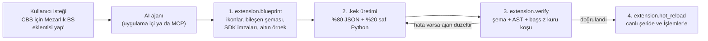
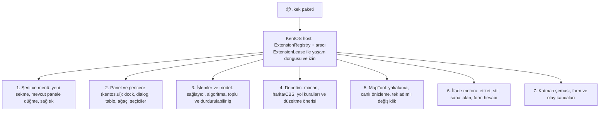

# KentOS — Eklenti sistemi (`.kek`), Python ve AI: tek plan

**13 Kasım 2026, sahibin isteği:** "Eklenti sistemi ile ilgili tüm planı birleştir ve tek plan haline getir, daha sonra
onun üzerinden gidelim." Bu belge eklenti sisteminin **tek planıdır**. Şunların yerini alır:

| Eski kaynak | Ne taşındı | Eski kimlikler |
|---|---|---|
| [argon-tavsiye.md](argon-tavsiye.md) FAZ 3 (`ADIM 16`–`22`) | AI-native ilke, QGIS karşılığı, yedi katkı noktası, adımların ayrıntısı, MEBİS örneği | ADIM 16–22 (numaralar korunur) |
| [plugins.md](plugins.md) (30 Ekim, 12 Kasım) | Kesin ürün kararları, kod envanteri, yedi iş paketi, teslim sırası | EKL-01 … EKL-07 |
| [python.md](python.md) (12 Ekim) | Ürün şartları, mimari kurallar, uv ortamları, `.kek` standardı, çalışma modeli, UI ve İşlemler standardı, bulut onayı, AI, kabul korpusu, kararlar | PY-OPT, PY-UV, PY-KEK, PY-RUN, PY-UI, PY-TOOL, PY-CLOUD, PY-AI, ECO-API, ECO-QA, ECO-DEC |

Eski kimlikler aşağıda köşeli ayraçta durur: başka belgelerin "PY-KEK-07" gibi başvuruları buradan bulunur. Eski iki
dosya bu plana yönlendiren kısa notlara indi; `argon-tavsiye.md` FAZ 3'ü adımların tek satırlık özetini ve bu belgeye
bağlantıyı tutar.

**Form sistemi ayrı plandır:** CBS formu, tasarımcı, domain/ilişki, merkezi yayın, ACL ve mobil saha akışı
[form.md](form.md)'nindir. Burada yalnız eklentinin form taşıması ve form eylemiyle kesişimi vardır. Temel form
Python, uv ya da `.kek` beklemez.

Durum işaretleri: `[ ]` başlanmadı, `[~]` sürüyor ya da kısmen, `[x]` bitti (kanıtıyla). Bu plan, bir adım bitince
ölçüm ve ADR bağlantısıyla güncellenir; ölçülmemiş süre, FPS ya da başarı oranı yazılmaz.

---

## 1. Amaç ve değişmez ilkeler

**Amaç:** KentOS'un kendi arayüz bileşenleriyle çalışan, mevcut CAD/CBS/harita/yol yeteneklerini kullanan, ağır işi
durdurulabilir yürüten ve **yapay zekânın ürettiği** bir eklenti ekosistemi. Sahnedeki her ürün işlemi arayüz, Python,
MCP, eklenti ve uygulama içi ajan üzerinden aynı anlamla yapılabilir. Python bilmek ya da bir AI sağlayıcısı kullanmak
temel uygulamanın ön koşulu değildir.

### 1.1 Eklentileri insan değil AI ajanları yazar

`.kek` eklentileri elle kodlanmak için değil, uygulama içi ajan (ADR 8056 §4) ya da dış MCP ajanları tarafından
üretilmek için tasarlanır. Geleneksel eklenti sistemlerinde ajanların hata kaynağı; sinyal/slot bağlantıları, derin
sınıf mirası, elle `unload` temizliği ve belirsiz API imzalarıdır. KentOS'ta:

1. **%80 bildirimsel JSON, %20 saf Python.** Şerit sekmesi, paneller, formlar, katman/domain/ilişki şeması, araç
   parametreleri ve MapTool yakalama kuralları katı şemalı JSON'dur. Python dosyasında yalnız tipli girdi alıp tipli
   çıktı döndüren saf fonksiyonlar vardır (`@ext.command`, `@ext.processing`, `@ext.audit`, `@ext.expr`,
   `@ext.map_tool`); pencere yaşam döngüsü, sınıf mirası ya da menü silme kodu yazılmaz.
2. **Kapalı çevrim doğrulayıcı.** Ajan ürettiği paketi kullanıcıya sunmadan `extension.verify` ile denetletir: şema ve
   başvuru tutarlılığı, Python sözdizimi ağacı (AST) ve SDK uyumu, başsız kuru koşu, kalıntısız kaldırma; hata, ajanın
   tek adımda düzeltebileceği yapısal raporla döner (ADIM 21).
3. **Kayıtların sahibi kiralamadır.** Eklentinin açtığı her sekme, panel, araç, menü, sağlayıcı ve geri çağırma
   `ExtensionLease` ile etiketlenir; devre dışı bırakma, çökme, güncelleme ve kaldırma hepsini tek çağrıda temizler
   (ADIM 17).



### 1.2 Kesin ürün kararları [EKL §1, PY §1]

| Konu | Karar |
|---|---|
| Paket | KentOS eklentisi **`.kek`** uzantılı, ZIP tabanlı pakettir; içerik ve kök manifest (`format: kentos.extension`) doğrulanmadan tanınmaz. İşletim sistemi eklentisi değil, KentOS'un incelediği ve yönettiği uygulama paketidir. |
| Ana giriş | Her kurulu eklentinin yönetimi ve ana girişi **Eklentiler** sekmesindedir; türüne uygun ek erişimler aynı kayda bağlanır. |
| Sınıflar | **`vertical`** (MEBİS, Kent BS gibi dikey sistemler): hedef modülde kendi üst şerit sekmesini açabilir. **`utility`** (küçük araçlar): yeni üst sekme açmaz; Eklentiler'de ve mevcut panel/menülerde yer alır. |
| Arayüz | KentOS UI bileşenleri; Python'a ayrı Qt/PySide görünümü ya da Iced işaretçisi verilmez. Python bir tanım üretir, KentOS kendi bileşenleriyle çizer. |
| Katkılar | Bir paket komut, panel/dialog, İşlemler sağlayıcısı, denetim kuralı, ifade fonksiyonu, MapTool, taşınabilir form ve katman şeması sunabilir; birkaçı birlikte olabilir. |
| Ağır iş | Arayüzü kilitlemez; ilerleme, iptal ve kaynak temizliği sözleşmesi vardır; sonuç belgeye denetimli ve tek geri alma adımıyla uygulanır. |
| Ortam | Python/uv, yorumlayıcı ve paket kurulumu isteğe bağlıdır. Kişisel analiz, eklenti geliştirme ve yayımlanmış eklenti ortamları ayrıdır. Python'suz kullanıcı CAD/CBS'yi ve hazır Rust araçlarını aynen kullanır. |
| Otomasyon | Arayüzdeki ürün işlemi ve seçenekleri sürümlü komut/Python/MCP/eklenti yüzeyinde aynı sonucu verir; ekran tıklaması taklidi yeterli değildir. |
| AI | AI ile eklenti üretimi birincil geliştirici akışıdır; uygulama içi sağlayıcıdan bağımsız ajan ile dış MCP istemcisi aynı ürün sözleşmesini kullanır. |
| Yayın | Yerel kullanım buluta bağlı değildir. Bulutta yayımlanacak **her sürüm** değişmez paket özetiyle onaydan geçer. |
| Belge | Sürüme bağlı Python API referansı, UI/İşlemler rehberi, çalışan örnekler ve MCP keşfi zorunlu teslimdir. |
| Form | Eklenti taşınabilir CBS formu getirebilir; form kullanmak Python kodu çalıştırmakla aynı yetenek değildir. Temel form Python/uv/`.kek` olmadan çalışır. |

### 1.3 Ortak mimari kurallar [PY §3]

- **Tanım katmanları:** veri (`DatasetSchema`, domain, alt tür, ilişki, kaynak), sunum (form ve UI tanımı; veri şemasının
  ya da ACL'nin yerine geçmez), iş (İşlemler aracı, eylem, komut ve iş tanımları), dağıtım (manifest, `.kek` içerik
  listesi, bağımlılık kilidi, yayın inceleme kaydı), oturum (çalışma bağlamı, form oturumu, gönderi zarfı, anlık görüntü,
  değişiklik kümesi).
- **Otorite:** yerelde mevcut yerel/web alanı (domain), bulutta yetkili uygulama/servis katmanı. Her değişiklik ortak
  komut ve işlemden geçer. Eklenti canlı `Document`'a, SQL bağlantısına ya da UI nesnesine doğrudan dokunmaz.
- **Python:** ayrı eklenti süreçleri ve tipli IPC/aracı (broker); uzun hesap arayüz iş parçacığında çalışmaz; bütün
  eklentileri aynı süreçte içe aktarmak varsayılan değildir.
- **Taşınabilir kural:** ortak ifade profili ve AST ile değerlendirilir; zorunlu form doğruluğu yalnız masaüstündeki bir
  Python geri çağırmasına bağlanmaz.
- **İzin:** bir bileşeni gizlemek ya da salt okunur yapmak güvenlik sınırı değildir; veri okuma/yazma ve şema/form
  tasarımı ayrıca denetlenir.
- **İsteğe bağlılık:** proje açmak, `.kek` görmek, katalogda gezinmek ya da AI önerisi; yorumlayıcı/paket kurmak, eklenti
  içe aktarmak ya da kod yürütmek için izin sayılmaz.
- **Tamlık:** UI, komut, Python ve AI aynı yaşam döngüsü, parametre, sorgu, doğrulama ve sonuç yüzeylerine erişir; ayrı
  API'de farklı iş kuralı doğmaz.
- **Kullanıcı akışı** [EKL §3]: Eklentiler → eklentinin türüne uygun arayüz/araç → doğrulama ve önizleme → gerekiyorsa
  arka plan işi → sonucu inceleme → ortak komutla uygulama. Tek kayıtlı eklenti kimliği komutu, UI kaynağını, İşlemler
  sağlayıcısını, yardımı ve MCP keşfini birbirine bağlar. UI'nin evsahibi KentOS'tur; Python hesap ve geri çağırma süreci
  ayrı yaşar; belge değişikliğinin otoritesi mevcut uygulama/alan komutlarıdır.
- **Masaüstü, başsız ve bulut aynı şey değildir:** her araç hangi ortamda çalışabildiğini bildirir. Masaüstü Python
  eklentisi kendiliğinden web/mobilde çalışmış sayılmaz; taşınabilir tanım ile Python yürütücüsü desteği ayrıdır. Web
  işi ADR 0228 sınırını korur.

### 1.4 QGIS ile karşılık

| QGIS | KentOS `.kek` | Ajan için neden kolay |
|---|---|---|
| `metadata.txt` + dağınık kod | `manifest.json` + `schema.json` + formlar | Şerit, katman/domain/ilişki şeması ve formlar JSON Schema'yla, koda gömülmeden |
| `classFactory(iface)` + sınıf mirası | `@ext.command` / `@ext.processing` / `@ext.audit` | Saf fonksiyon: tipli girdi, tipli çıktı |
| `initGui()` / `unload()` | Kendiliğinden `ExtensionLease` | `unload` yazılmaz; host kiralamayla temizler |
| `iface.addToolBar` / `addPluginToMenu` | `contributions.ribbonTabs` | Dikey eklenti tek JSON bloğuyla kendi sekmesini açar |
| `QDockWidget` / `QDialog` | `ui/*.panel.json` | `Table`, `Tree`, `Form`, `LayerPicker`, `FeaturePicker` JSON'la |
| `QgsProcessingProvider` | araç tanımı + `@ext.processing` | Tanımdan parametre penceresi, model düğümü, toplu iş ve MCP aracı |
| `QgsMapTool` | `mapTools` + `@ext.map_tool` | Kenetleme ve önizlemeyi Rust yapar; Python onaylanan noktaları işler |
| `@qgsfunction` | `@ext.expr` | İfade motoruna, etiketlere ve stillere tek dekoratör |
| *(yok)* | `@ext.audit` | Rust'ın çıkardığı `ProjectAuditFacts` üzerinde mevzuat/topoloji kuralı ve düzeltme |



---

## 2. Bugün kodda olan (13 Kasım 2026)

Kaynak okumaları; satırlar ilgili commit'indir. "Var" bu oturumda test edildiği anlamına gelmez, ayrıca yazılır.

| Alan | Kaynak | Durum ve sınır |
|---|---|---|
| Tipli Python SDK | `scripts/python/sdk.py`, `python/pyproject.toml`, `python/kentos/cad/` | Katalogdan ad alanı, tip ve docstring üretimi; sapma denetimi var. Geliştirici portalı ve örnek kabulü değil. |
| Python yerel bağı | `crates/native/python/src/lib.rs` | PyO3/başsız oturum, ortak komut yolu; Rust çalışırken GIL bırakılır. Genel UI bağı değil. |
| Konsol süreci | `apps/desktop/src/shell/python/host.rs` (ADR 0132) | Ayrı Python süreci, boru okuma/yazma, sonlandırma. Yorumlayıcı seçimi uv yöneticisi değil. |
| Geri alma ve durdurma | `apps/desktop/src/shell/python/mod.rs` | Betik yazımları gruplanır, hatada/durdurmada geri alınır; çalışma boyunca başka düzenleme engellenebilir. |
| Donma riski | aynı dosya | Konsol RPC'si masaüstünde yürür; ayrı süreç, ağır ürün çağrılarını kendiliğinden arka plana almaz. |
| Python yankısı | `apps/desktop/src/shell/python/echo.rs` | `drafting.pythonEcho`; komut/seçim/geri alma yankısı, gizli alan ayıklaması. |
| Ajan bağlantısı ve işler | `apps/desktop/src/shell/python/agents.rs`, `crates/native/headless/src/rpc.rs` | Belge tutamacı, modül bağlantısı (ADR 8056 §1), meşgul/kapalı belge, iş başlat/durum/bekle/iptal. |
| Ajan araçları | `crates/native/headless/src/agent_tools.rs` (ADR 8056 §2) | Kapılar, önce plan, katalog keşfi, denetim ve İşlemler araçları; MCP, masaüstü bağlantısı ve uygulama içi ajan ortak. |
| Uygulama içi ajan | `crates/native/agent`, `apps/desktop/src/shell/assistant/` (ADR 8056 §4) | 13 sağlayıcı, kullanıcının anahtarı, Asistan paneli; eklenti üretimi henüz yok. |
| MCP | `crates/native/mcp` (ADR 8056 §2, §5) | Kompakt 44 araç; `kentos://session/overview`, `kentos://catalog/categories`; eklenti kaynakları ve `tools/list_changed` yok. |
| Yerel İşlemler | `crates/native/processing/src/{types,registry,runner}.rs` | Rust fonksiyon işaretçisi yürütücü, iç `Document`/`Slot` bağlamı, geri bildirim, değişiklik kümesi, yerleşikler ve kullanıcı modelleri. **Dinamik Python sağlayıcı bağdaştırıcısı eksik halkadır.** |
| İşlemler arka planı | `apps/desktop/src/gis/processing/background.rs` | Okuma kopyası/iş parçacığı, ilerleme, durdurma bayrağı; zorla öldürme değil, iş birlikli iptal. |
| Sunucu işleri | `crates/server/application/src/jobs.rs`, `apps/jobrun` | Kiralama/çit/nabız, hazırlanmış eser, revizyon/yetki denetimli işleme, ayrı hesap süreci. İkinci iş sistemi kurulmaz. |
| KentOS UI | `crates/ui/src/widget/` | Zengin Rust/Iced bileşenleri; Python'a açılan tanım katmanı yok. |
| CBS formu | `crates/shared/contracts/src/gis/form_schema.rs` (`kentos.form`), `crates/shared/commands/src/gis/cad_forms.rs` (`kentos.form-package`, ADR 0435), `crates/shared/forms` (ön denetim) | Taşınabilir form paketi ve dışa/içe aktarma var (`.kform`); `.kek` içinden alma açık (FORM-DESIGN-20). |
| AI yüzeyleri | `crates/ui/src/widget/ai` (ADR 0154) | Sağlayıcıdan bağımsız sohbet bileşenleri; Asistan bunları kullanıyor. |
| `.kcad` modül sürümleri | `crates/shared/kcad` şema 254 (ADR 8054 §10) | Her `.kek` eklentisinin verisinin kendi sürümü için yer var; bugün eklenti verisi okunmaz, reddedilir. |
| ZIP | `crates/shared/zip` (`kentos-zip`) | Sınırlı, CRC denetimli okuyucu/yazıcı; 13 Kasım'da `kentos-formats`'tan ayrıldı (ADIM 16). |
| Gerçek yeni parçalar | — | `.kek` yöneticisi, uv akışı, `kentos.ui` Python katmanı, dinamik Python sağlayıcı yaşam döngüsü, eklenti bulut kataloğu: **yok**. |

Form ilişkileri ve çıktı işleri gibi alanlarda eski Python planının bazı "yok" kayıtları artık güncel değildir; yeni iş
başlamadan ilgili maddenin kod/ADR karşılığı yeniden okunur, eski tabloya bakılarak çalışan altyapı değiştirilmez.

---

## 3. Paket standardı (`.kek` v1)

Bu bölüm ADIM 16'nın sözleşmesidir; kaynağı Rust'taki `kentos-extensions` crate'idir, JSON Schema, Python tipleri ve
ajan rehberi oradan üretilir [PY-KEK-01]. Aşağıdaki örnekler v1'in kendisidir; "bugün çalışan API" ancak ilgili adım
`[x]` olunca doğrudur.

### 3.1 Paketin yapısı

```text
mebis.kek
├── manifest.json              # kimlik, sınıf, modüller, katkılar, istenen yetenekler (zorunlu)
├── integrity.json             # her dosyanın yolu, boyu ve SHA-256'sı; kendini içermez (zorunlu)
├── LICENSE                    # (zorunlu)
├── schema.json                # dikey eklentinin katman/domain/ilişki şeması (isteğe bağlı)
├── pyproject.toml             # Python katkısı varsa zorunlu: gereksinimlerin kaynağı
├── uv.lock                    # Python katkısı varsa zorunlu: çözülmüş sürümlerin kaynağı
├── src/mebis/logic.py         # yalnız @ext.* dekoratörlü saf fonksiyonlar
├── tools/*.tool.json          # İşlemler araç tanımları
├── ui/*.panel.json            # kentos.ui panel tanımları
├── forms/*.kform              # taşınabilir form paketleri (kentos.form-package, ADR 0435)
├── assets/                    # ikonlar (SVG), görseller
├── docs/                      # yardım
└── tests/                     # örnek veri ve doğruluk testleri
```

- **Paket içi yollar ASCII'dir** (`A–Z a–z 0–9 . _ -` ve `/`): Unicode biçim/harf büyüklüğü çakışmaları ve benzer
  görünen adlar baştan imkânsızdır; büyük/küçük harf yalnız farkıyla iki dosya reddedilir [PY-KEK-07].
- **Girmez:** `.venv`, yorumlayıcı, `__pycache__`/`.pyc`, `.git`, kullanıcı sırları (`.env`, anahtarlar), mutlak kullanıcı
  yolları, derleme önbelleği [PY-KEK-05]. v1 kaynak paketidir: platforma özel tekerlek/ikili (`.so`, `.dll`, `.dylib`,
  `.pyd`, `.exe`) girmez; ileride girerse platform işareti, özeti, lisansı ve bağımlılık önizlemesiyle [PY-KEK-06].
- **`integrity.json`:** içerik dosyalarının yolu, boyu ve SHA-256'sı; kendi özetini içermez. Pakette olup listede
  olmayan, listede olup pakette olmayan ya da özeti tutmayan her dosya paketi geçersiz kılar [PY-KEK-09]. Paketin
  **içerik özeti**, bu listenin kanonik biçiminin SHA-256'sıdır: ZIP'in sıkıştırma ve tarih ayrıntılarından bağımsız,
  "aynı sürüm, farklı içerik" sorusunun cevabı. Bulut onayı ve imza bu özete **dışarıdan** bağlanır; paketin içindeki
  liste tek başına yayıncı güveni değildir.
- **Deterministik paketleme:** sıralı girişler, sabit zaman damgası, aynı girdiden bayt bayt aynı paket [PY-KEK-04].
- **MIME:** `application/vnd.kentos.extension+zip` önerilir; tescilli standart gibi sunulmaz, tanıma manifestten yapılır.

### 3.2 Manifest v1

```json
{
  "format": "kentos.extension",
  "schemaVersion": 1,
  "id": "tr.ornek.mebis",
  "version": "1.0.0",
  "name": "Mezarlık Bilgi Sistemi (MEBİS)",
  "summary": "Mezarlık adaları, mezar yerleri ve defin kayıtları.",
  "publisherId": "ornek-belediye",
  "kind": "vertical",
  "modules": ["cbs", "harita"],
  "licenseFile": "LICENSE",
  "icon": "assets/mebis.svg",
  "compatibility": {
    "sdkProtocol": 1,
    "operatingSystems": ["windows", "macos", "linux"]
  },
  "python": {
    "projectFile": "pyproject.toml",
    "lockFile": "uv.lock",
    "optionalFeatures": { "grafik": { "extra": "charts", "label": "Doluluk grafikleri" } }
  },
  "schemaFile": "schema.json",
  "entrypoints": {
    "commands": [
      { "id": "init-schema", "title": "MEBİS katmanlarını kur", "icon": "layers", "handler": "mebis.logic:init_schema" }
    ],
    "mapTools": [
      { "id": "single-grave", "title": "Tekli mezar", "capture": "orientedRectangle",
        "templateWidthM": 1.10, "templateLengthM": 2.20, "snapLayers": ["mezar_parsel", "mezar_yeri"],
        "handler": "mebis.logic:on_single_grave_placed" }
    ],
    "processing": [
      { "id": "occupancy-by-island", "descriptor": "tools/occupancy-by-island.tool.json",
        "handler": "mebis.logic:occupancy_by_island" }
    ],
    "audits": [
      { "id": "status-mismatch", "title": "Defin kaydı / mezar durumu uyuşmazlığı", "domain": "cbs",
        "handler": "mebis.logic:audit_status_mismatch" }
    ],
    "expressions": [ { "id": "mezar-etiketi", "handler": "mebis.logic:mebis_mezar_etiketi" } ],
    "panels": [
      { "id": "search-dock", "title": "Mezar ve merhum sorgulama", "side": "right",
        "definition": "ui/search_dock.panel.json" }
    ],
    "forms": [
      { "id": "mezar-yeri", "definition": "forms/mezar_yeri.kform" },
      { "id": "defin-kaydi", "definition": "forms/defin_kaydi.kform" }
    ]
  },
  "contributions": {
    "ribbonTabs": [
      { "id": "mebis", "label": "Mezarlık BS", "module": "cbs",
        "panels": [
          { "label": "Proje ve katmanlar", "items": [ { "command": "init-schema", "size": "large" } ] },
          { "label": "Mezar planlama", "items": [ { "mapTool": "single-grave", "size": "large" } ] },
          { "label": "Denetim ve rapor",
            "items": [ { "audit": "status-mismatch", "size": "large" }, { "processing": "occupancy-by-island" } ] }
        ] }
    ],
    "contextMenus": [ { "command": "init-schema", "target": "layer" } ]
  },
  "requestedCapabilities": [
    { "id": "document.write", "scope": "current-project" },
    { "id": "ui.ribbonTab", "scope": "plugin-owned" },
    { "id": "processing.provider", "scope": "plugin-owned" },
    { "id": "audit.provider", "scope": "plugin-owned" }
  ]
}
```

Kurallar (inceleyici bunları kod çalıştırmadan uygular; ihlal, yapısal bir sorun kaydıdır):

- `format` `kentos.extension`; `schemaVersion` tam sayı. Bilmediği yeni bir sürüm "daha yeni bir KentOS gerekir" diye
  reddedilir. Bilinmeyen alan reddedilir: ajanın uydurduğu anahtar burada yakalanır.
- `id`: ters alan adı biçimi, küçük harf, en az iki parça (`tr.ornek.mebis`). `version`: anlamsal sürüm. `publisherId`
  pakette bir iddiadır; ad alanı sahipliğini bulut katalog doğrular [PY §6.2].
- `kind`: `vertical` ya da `utility`. **`utility` şerit sekmesi açamaz** [EKL-02]. `modules`: `mimari`, `harita`, `cbs`,
  `yol` alt kümesi, boş olmaz; her sekmenin `module`'ü bu listededir.
- Katkı kimlikleri pakette yereldir (`init-schema`); host onları `ext.<id>.<yerel>` ad alanına koyar, yerleşik bir komutu
  gölgeleyemez [EKL-02, PY-TOOL-03].
- `handler` `modül.yolu:fonksiyon` biçimindedir ve **içe aktarılmadan** bilinir: inceleme, önizleme ve yardım Python
  çalıştırmaz [PY-KEK-11, PY-RUN-05]. Dekoratörler çalışma anında fonksiyonu bildirilen kimliğe bağlar; `extension.verify`
  AST'den her bildirilen kimliğin tam bir dekoratörlü fonksiyonu olduğunu ve fazlası olmadığını denetler (ADIM 21).
- Python katkısı (bir `handler`) varsa `python.projectFile` ve `python.lockFile` zorunludur. Python sürüm aralığının
  **tek kaynağı** `pyproject.toml`'un `requires-python`'udur; manifest onu tekrar etmez [PY-UV-13]. Paket listesi
  manifestte tutulmaz; gereksinimler `pyproject.toml`'da, çözülmüş sürümler `uv.lock`'ta.
- Başvurulan her dosya (`descriptor`, `definition`, `schemaFile`, `licenseFile`, `icon`) pakette ve `integrity.json`'da
  vardır. Şerit öğesi var olan bir katkıyı gösterir.
- Formlar `kentos.form-package` v1'dir ve form çekirdeğinin ön denetiminden (`kentos_forms::preflight`) hatasız geçer.
- İkonlar SVG'dir; betik, dış bağlantı (`href`), gömülü görsel ve olay özniteliği taşımaz; masaüstünün çizdiği öğelerle
  (path, circle, rect, ellipse) sınırlıdır.
- `requestedCapabilities` v1 sözlüğündendir (aşağıda); istenen yetenek **verilmiş yetki değildir**, kurum politikası ve
  kullanıcı seçimiyle birlikte değerlendirilir [PY §6.2].

**Yetenek sözlüğü v1** (ADIM 16'da sabitlenir, genişletmek sürüm artışıdır): `document.read`, `document.write`,
`datasets.read`, `datasets.create`, `datasets.manage`, `ui.ribbonTab`, `ui.panel`, `ui.contextMenu`, `processing.provider`,
`audit.provider`, `expression.provider`, `mapTool`, `files.userSelected`, `network`. Kapsamlar: `user-selected`,
`current-project`, `plugin-owned`.

### 3.3 Araç tanımı [PY §9.2]

`tools/*.tool.json` yalnız taşınabilir veridir (`kentos.processingTool` v1). Yürütücü (Rust yerleşik, Python eklenti,
tarayıcı işçisi, yetkili sunucu işi) ayrı bir bağdaştırıcıdır; Rust fonksiyon işaretçisi ya da TS kapanışı dışarıya
serileştirilen sözleşme olamaz.

```json
{
  "format": "kentos.processingTool",
  "schemaVersion": 1,
  "id": "occupancy-by-island",
  "version": "1.0.0",
  "label": "Ada bazlı doluluk",
  "category": "Mezarlık BS",
  "parameters": [
    { "id": "islands", "type": "features", "required": true, "accepts": { "geometryKinds": ["polygon"] }, "readIntent": "snapshot" },
    { "id": "graves", "type": "features", "required": true, "accepts": { "geometryKinds": ["polygon"] }, "readIntent": "snapshot" },
    { "id": "destination", "type": "destination", "allowedKinds": ["table", "file"], "default": { "kind": "table" } }
  ],
  "outputs": [ { "id": "report", "type": "table", "sinkParameter": "destination" } ],
  "mutation": { "mode": "none" },
  "feedback": { "progress": true, "cancel": true },
  "capabilities": { "runtimes": ["desktop-python"] }
}
```

Girdi katman/seçimi **çağrı anında** açık kaynak/anlık görüntü/UUID girdisine çözülür. Kabul girdisi ayrıca yazılır
(ör. min–maks normalleştirmede `[2, 4, 6] → [0, 0.5, 1]`; boş/null, bütün değerlerin eşit olması, ondalık→NumPy
dönüşümü ve çıktı hassasiyeti): "NumPy kullanıyor" algoritma tanımı değildir.

| Parametre türü | Zorunlu anlam |
|---|---|
| Nesne/katman | Kaynak kimliği, anlık görüntü, geometri türleri, seçim/süzgeç, okuma/düzenleme kapsamı, boşa izin |
| Alan | Kaynak parametre başvurusu, kalıcı alan kimliği, izinli veri türleri, çoklu, okuma/yazma niyeti |
| Sayı | Tam/ondalık, birim, en az/en çok/adım, hassasiyet, boş olabilirlik/varsayılan |
| Seçenek/domain | Kod türü, domain/sürüm ya da sıralama; bağımlı süzgeç ve varsayılan |
| Geometri | Nokta/kutu/yol, CRS/UCS/birim, çizim/kaynak kapsamı |
| Raster/bulut/ağ | Kaynak türü, bant/öznitelik, aralık, başvuru sistemi ve araç yeteneği |
| Dosya/tablo | Kullanıcının seçtiği dosya, MIME/biçim, sayfa/sütun eşlemesi, boyut sınırı |
| Hedef | Yeni katman / geçici sonuç / mevcut veri / yerel dosya / bulut eseri |
| Kural/ifade | İfade profili/şema başvurusu, izinli alanlar, doğrulama ve değerlendirme bütçesi |

| Çıktı türü | İşleme ve sahiplik |
|---|---|
| Yeni vektör katman | Geometri + şema + CRS + köken; host atomik oluşturur |
| Kaynak değişikliği | İzinli nesne/alan yamaları; kaynak revizyonları ve tek geri alma |
| Raster/nokta bulutu | Hazırlanmış dosya/eser; biçim/CRS/nodata/bant ve bağlama politikası |
| Tablo/sayı/metin | Tipli sonuç; modelde sonraki adıma aktarılır |
| Rapor/grafik | Veri + eser; arayüz gösterimi ve dosya sonucu ayrı |
| Dosya/bulut eseri | Hazırlanmış tutamaç; kullanıcının hedef seçimi ve yetkili son işleme |
| Seçim | Kalıcı nesne başvuruları; belge değişikliği değil oturum sonucu |

### 3.4 Python tarafı

Saf fonksiyonlar; sınıf mirası ve yaşam döngüsü kodu yok. Kimlik manifestteki yerel kimliktir.

```python
from kentos import ext

@ext.command("init-schema")
def init_schema(ctx: ext.CommandContext) -> ext.CommandResult:
    """schema.json'daki ada, parsel, mezar yeri ve defin katmanlarını tek adımda kurar."""
    return ctx.apply_declarative_schema("schema.json")

@ext.processing("occupancy-by-island")
def occupancy_by_island(ctx: ext.ProcessingContext, islands, graves) -> dict:
    stats: dict[str, dict[str, int]] = {}
    for g in ctx.read_features(graves):
        if ctx.is_stopped():
            return ctx.cancelled()
        row = stats.setdefault(g.attrs.get("ada_no", "BELIRSIZ"), {"toplam": 0, "dolu": 0})
        row["toplam"] += 1
        row["dolu"] += g.attrs.get("durum") == "DOLU"
    return {"report": [{"ada_no": k, **v} for k, v in stats.items()]}

@ext.audit("status-mismatch")
def audit_status_mismatch(facts: ext.GisAuditFacts) -> list[ext.AuditFinding]:
    findings = []
    burials = facts.group_related("defin_kaydi", foreign_key="mezar_id")
    for grave in facts.features("mezar_yeri"):
        if grave.attrs.get("durum") == "BOS" and burials.get(grave.id):
            findings.append(ext.AuditFinding(
                severity="error", feature_id=grave.id,
                message=f"Mezar ({grave.attrs.get('mezar_no')}) için defin kaydı var ama durumu 'BOŞ'.",
                fix=ext.SemanticFix(title="Durumu 'DOLU' yap", command="cad.entities.set",
                                    args={"uids": [grave.id], "attrs": {"durum": "DOLU"}}),
            ))
    return findings

@ext.expr("mezar-etiketi")
def mebis_mezar_etiketi(mezar_no: str, durum: str, merhum_adi: str | None = None) -> str:
    return f"{mezar_no}\n({merhum_adi})" if durum == "DOLU" and merhum_adi else f"{mezar_no} [{durum}]"
```

`kentos.ext` adları ve bağlam API'si ADIM 19'da kesinleşir; bu örnek o adımın kabul hedefidir.

---

## 4. Sıralı adımlar

Sıra bağımlılığa göredir: önce sözleşme ve paket, sonra kayıt ve Python'suz katkılar (Python kurmayan kullanıcıya da
değer verir), sonra isteğe bağlı Python ortamı ve yürütücü, en son AI fabrikası, zengin arayüz ve bulut yayını.
**Birinci dikey dilim** "üç bileşenli demo" ile kapanmaz: ikinci kullanıcıya kurulabilen, iptal edilen, gerçek çıktı
üreten, yeniden çalıştırılan ve kaldırılabilen paket olmalıdır [EKL §5].

**Bağımlılık omurgası** [PY §14]: (1) form/ortak bileşen sözleşmesi → taşınabilir eklenti UI'si/araç tanımı → Python
dinamik yürütücü/aracı; (2) isteğe bağlı uv → kişisel geliştirme ortamı → değişmez yayın ortamı → `.kek` yaşam döngüsü;
(3) çalışan form komutu/ACL → isteğe bağlı kaynak/eylem/özel bileşen; (4) değişmez `.kek` özeti + bağımlılık/izin üst
verisi → inceleme → onaylı yayın; (5) aynı kaynak/komut/şema → üretilmiş Python/CLI/MCP → AI ekosistemi. Taşınabilir
form çekirdeği → isteğe bağlı eklenti yönü korunur; çekirdek formdan uv'ye ya da eklenti yöneticisine zorunlu bağımlılık
kurulmaz.

Her adımın teslimi: ilgili Rust/Python/komut ve fikstür testleri; hata, iptal, revizyon, yetki ve geri alma; gerçek
fare/klavyeyle pencere sınaması ve ekran görüntüsü; uzun işte arayüz yanıtı, iptal gecikmesi, CPU/bellek ve aktarım
boyutu ölçümü. Ham görüntüler depoya girmez. Yalnız plan teslim edilen işte kod testi çalıştırılmış gibi yazılmaz.

### [~] ADIM 16 — Sözleşme crate'i, manifest v1, güvenli `.kek` okuyucu ve paketleyici (P1)

[argon ADIM 16; PY-KEK-01…09, PY-KEK-11; PY-UV-13, PY-UV-17'nin paket tarafı; ECO-QA-02; P08]

- **`crates/shared/extensions` (`kentos-extensions`):** masaüstü, CLI, başsız, MCP ve bulutun ortak kullandığı saf crate
  (dosya sistemi ve ağ yok; dosyadan okuyan ince işlev yalnız yerel hedefte).
- **`manifest`:** §3.2'nin tipleri ve kuralları; `ExtensionKind::{Vertical, Utility}`; yetenek sözlüğü v1; her sorun
  kalıcı bir kod, dosya, JSON işaretçisi ve Türkçe çözümle (ajan tek adımda düzeltebilsin).
- **`archive`:** `inspect(bayt)` hiçbir Python kodu çalıştırmadan paketi açar ve denetler: ZIP sınırları (girdi sayısı,
  toplam ve dosya başına boyut, sıkıştırma oranı, derinlik) [PY-KEK-08]; yol kuralları (mutlak yol, `..`, ters bölü,
  sürücü harfi, ASCII dışı, büyük/küçük harf çakışması, yinelenen girdi) ve sembolik/sabit bağ [PY-KEK-07]; yasaklı
  içerik [PY-KEK-05]; `integrity.json` boy ve SHA-256'sı, listede olmayan ya da eksik dosya [PY-KEK-09]; manifest ve
  başvurduğu dosyalar; formların ön denetimi; ikonların güvenliği; `pyproject.toml` ile `uv.lock`'un tutarlılığı (proje
  adı, `requires-python`, doğrudan bağımlılıkların kilitte olması; tam çözüm uv'nin, ADIM 18A) [PY-UV-13, 17].
  Doğrulama bitmeden canlı eklenti klasörüne hiçbir şey çıkarılmaz.
- **`pack`:** aynı denetimden geçen, deterministik paketleyici; `integrity.json`'ı kendisi yazar [PY-KEK-03, 04]. SDK
  şablonu, `extension.verify` ve paket komutu aynı doğrulayıcıyı kullanır.
- **Önce:** ZIP okuyucusu kendi crate'ine (`kentos-zip`) ayrılır; `kentos-formats` onu `zip` adıyla verir (13 Kasım).
- **Kabul:** altın örnek paket (`fixtures/extensions/v1/`) paketlenir, incelenir, içerik özeti iki kez aynı; olumsuz
  korpus (zip-slip, mutlak yol, sembolik bağ, yinelenen ve harf çakışmalı ad, bomba oranı, şifreli girdi, listede olmayan
  dosya, özet uyuşmazlığı, `.venv`/`.pyc`/ikili, eksik manifest, yanlış biçim, bilinmeyen alan, kötü kimlik/sürüm,
  `utility`'nin sekmesi, bilinmeyen modül ve yetenek, kayıp başvuru, bozuk form, betikli ikon, eskimiş kilit) her biri
  yapısal ve Türkçe bir ret, hiçbiri panik değil [P08, ECO-QA-02].

### [ ] ADIM 17 — Kayıt defteri, kiralama ve yerel yaşam döngüsü (P1)

[argon ADIM 17; PY-RUN-01, 02, 03, 09, 13, 17, 18; PY-KEK-10, 12, 13, 14, 16, 17; EKL-02 (ad alanı), EKL-07 (yerel)]

- `ExtensionRegistry` (`crates/native/application`): paket dizini, kurulum makbuzu, etkin durum, ortam, izin kararları ve
  çalışan oturumlar **kullanıcı başına** [PY-RUN-01].
- Durum makinesi: keşfedildi → incelendi → bağımlılık/izin bekliyor → hazırlanıyor → hazır → etkin/çalışıyor →
  durduruldu/hata/devre dışı/güncelleme bekliyor [PY-RUN-02, EKL-07]. Kurma, ortam hazırlama, etkinleştirme, çalıştırma,
  devre dışı bırakma, güncelleme ve kaldırma ayrı işlemlerdir; birinin başarısı ötekinin olduğu anlamına gelmez
  [PY-RUN-03]. Her durumda yardım, günlük ve çözüm yolu vardır; durum arayüz/Python/MCP'de aynı anlamla görülür.
- Her etkinleştirmeye `(eklenti, sürüm, kuşak)` üçlüsünden **`ExtensionLease`**; sekme, panel düğmesi, sağ tık, İşlemler
  sağlayıcısı, denetim kuralı, ifade fonksiyonu, UI oturumu ve abonelik bununla etiketlenir; `revoke_lease` tek çağrıyla
  kalıntısız temizler [PY-RUN-09]. Geç geri çağırma eski kuşakla gelirse uygulanmaz [PY-RUN-10].
- Kurulum akışı: incele → bağımlılık/izin/uyumluluk göster → kullanıcının seçimi → hazırlık alanına kur → etkinleştir
  [PY-KEK-10]. Katkı bazında: taşınabilir kaynak (form, şema) almak ile Python ortamı hazırlamak ve eylem izinleri ayrı;
  seçilmeyen katkı için ortam/izin hazırlanmaz [PY-KEK-17].
- Güncelleme yeni sürümü ayrı hazırlar, denetler ve atomik geçer; çalışan iş eski sürümün kiralamasında kalır; başarısızsa
  önceki sürüm hazır kalır; geri dönüş ve veri göçü ayrıca denetlenir [PY-KEK-13, 14, PY-RUN-17].
- Kaldırma kaynak/ortam/UI/komut kayıtlarını temizler; kullanıcının çıktısını ve bağımsız form yayınlarını silmez
  [PY-KEK-16]. Eklentinin kalıcı ayar/veri ad alanı kullanıcı ve eklentiyle ayrılır; sıfırlama/dışa aktarma yolu vardır
  [PY-RUN-18].
- Yerel paket, kurum paketi ve onaylı genel paketin güven durumu ayrı görünür; yerel geliştirme için bulut yayını
  gerekmez [PY-KEK-12]. Çökme uygulamayı kapatmaz, taslak korunur, yeniden başlatılabilir [PY-RUN-13].
- **Kabul:** Python'suz bir paket kur → etkinleştir → devre dışı → yeniden etkinleştir → güncelle → geri dön → kaldır;
  her adımdan sonra kayıt defterinde o kiralamaya ait hiçbir şey kalmaz; yarım güncelleme çalışan sürümü bozmaz.

### [ ] ADIM 18 — Masaüstü: Eklentiler sekmesi, yöneticisi, dikey şerit sekmeleri ve Python'suz katkılar (P1)

[argon ADIM 18; EKL-02; PY-KEK-15; FORM-DESIGN-20; ADIM 15'ten kalan MCP keşfi]

- **Eklenti Yöneticisi** (Eklentiler sekmesi): ".kek paketi incele / yükle", "İzin ve bağımlılık özeti",
  "Etkinleştir / Devre dışı bırak / Kaldır", güncelleme ve geri dönüş. Her kurulu eklenti adı, yayımcısı, sürümü, sınıfı,
  durumu, yardımı, ayarları ve aç/çalıştır ile bulunur; Python kapalı ya da bağımlılık eksikken yönetim ekranı çalışır ve
  nedenini söyler [EKL-02]. `.kek` dosya ilişkilendirmesi yalnız inceleme akışını açar; çift tıklamak çalıştırmak değildir
  [PY-KEK-15].
- **Şerit:** etkin modülde (`self.program`) `vertical` eklentilerin sekmeleri statik sekmelerin yanına eklenir; `utility`
  katkıları Eklentiler'de ve uygun mevcut panelde. Başka modülün sekmesi yanlış modülde sunulmaz; ana kayıt görünür kalır
  ve neden çalışmadığını söyler (`module_surfaces.rs`, `offers/module_has` korunur) [EKL-02].
- **Bağlam menüleri:** seçili nesnenin katman/türüne abone eklenti eylemleri sağ tıka eklenir. Komut arama ve kısayollar
  `ext.<id>.*` kimliklerini bulur.
- **Python'suz katkılar ilk çalışan değerdir:** taşınabilir formlar (`kentos.form-package`, mevcut `cad.forms.import`
  yolu; kaynak başvuruları ve ACL yeniden bağlanır, başka kiracının yetkisi kopyalanmaz [FORM-DESIGN-20]), katman şeması
  kurulumu (ADIM 22'nin şema biçimiyle), yerleşik komutlara bağlı şerit düğmeleri, İşlemler modelleri ve stiller. Bunlar
  Python ya da uv istemez.
- **MCP:** `kentos://extensions/installed` (kurulu paketler ve katkıları) ve eklenti etkinleşince/kalkınca
  `notifications/tools/list_changed`; sayfalama ve liste değişikliği modern ve eski protokol sürümlerinin kurallarına
  uyar [EKL-06].
- **Kabul:** Python'suz bir `vertical` örnek (form + şema + şerit sekmesi) gerçek pencerede kurulur, sekmesi yalnız kendi
  modülünde görünür, formu açılır, devre dışı bırakılınca sekme ve kayıtlar hayalet komut bırakmadan kalkar; ilgisiz
  modülün yüzeyi bozulmaz; MCP listesi değişikliği bildirir.

### [ ] ADIM 18A — Python ve uv: kullanıcının seçtiği isteğe bağlı ortam (P0/P1)

[EKL-05; PY-OPT-01…14; PY-UV-01…31]

**Kullanıcı seçimi ve kişisel deneyim:**
- [ ] Tercihlere "Python ve eklentiler" alanı; kapalı kullanıcıya yorumlayıcı/uv/paket başlangıç maliyeti yüklenmez
  [PY-OPT-01]. Etkinleştirme sihirbazı uv algılama, Python seçimi, çalışma ortamı ve paket kurulumunu ayrı adımlarda
  sunar [PY-OPT-02]. "uv var / bulunamadı / sürümü uyumsuz / çalıştırılamıyor" açık yetenek olarak bildirilir [PY-OPT-03].
- [ ] Ortam kişiseldir; aynı cihazdaki farklı hesapların paket/eklenti/sır alanları karışmaz [PY-OPT-04]. Paket arama,
  sürüm seçme, ekleme/kaldırma/güncelleme, bağımlılık ağacı ve önbellek boyutu uygulama içinden [PY-OPT-05]. NumPy örnek
  akışı: ihtiyacı seç → kurulacakları gör → kişisel ortama kur → konsolda kullan → betik/eklenti bağımlılığına ekle
  [PY-OPT-06].
- [ ] Paket seçimi yayımlanmış eklentinin ortamını değiştirmez [PY-OPT-07]; gerekli/isteğe bağlı paketler ve hangi
  özelliğin hangisini istediği görünür [PY-OPT-08]; "yalnız form görüntüle", "analizi çalıştır", "geliştirici modu"
  farklı gereksinim taşıyabilir [PY-OPT-09]. Reddedilen bağımlılık eklentiyi nedenli pasif bırakır; her açılışta indirme
  ya da onay baskısı yok [PY-OPT-10]. Seçimler kullanıcı kapsamında hatırlanır [PY-OPT-11]; kurum politikası dış dizin ya
  da bulut yürütme sınırı koyabilir, kullanıcı onayı politikayı genişletemez [PY-OPT-12]. Kaldırma, silinecek dosya ve
  çıktıların kapsamını gösterir; kişisel betikler varsayılan temizliğe girmez [PY-OPT-13]. Her kurulum akışında ilk
  kullanıcı hazır araçlarla devam edebilir [PY-OPT-14].

**Algılama ve kurulum:**
- [ ] PATH'ten ve kullanıcının seçtiği yoldan uv; sürüm/platform/mimari destek matrisiyle karşılaştırılır [PY-UV-01];
  GUI'nin kabuktan farklı PATH'i hesaba katılır, elle yol ve "yeniden algıla" vardır [PY-UV-02]. uv yoksa işletim
  sistemine uygun resmî yollar sunulur; yöntem, hedef, indirme ve PATH/izin değişikliğini kullanıcı seçer, onaysız
  sistem kurulumu yok; komut ve kaynak önceden incelenebilir; yönetici izni gerektirmeyen kullanıcı yolu tercih
  edilebilir [PY-UV-03…06]. İptal, vekil sunucu, indirme hatası, sağlama toplamı, PATH'te görünmeme ve yeniden deneme
  düzgün biter [PY-UV-07]. Mevcut uv kendiliğinden değiştirilmez [PY-UV-08]. Platform ve en az uv/Python sürümleri tek
  bir uyumluluk manifestinden okunur [PY-UV-09].

**Ortam modeli ve bağımlılık çözümü:**
- [ ] Üç ortam: kişisel analiz, eklenti geliştirme, değişmez yayın ortamı [PY-UV-10]. Yayın ortamının anahtarı
  kullanıcı + eklenti kimliği/sürümü + kilit özeti + Python ABI + OS/mimari + seçilen ek özellikler [PY-UV-11]. Paket
  önbelleği paylaşılabilir, değişen venv paylaşılmaz; iki eklentinin çelişen NumPy'ı aynı yorumlayıcı ad alanına girmez
  [PY-UV-12].
- [ ] `pyproject.toml` gereksinimin, `uv.lock` çözülmüş sürümün kaynağıdır; manifestte üçüncü bir liste yok [PY-UV-13].
  Bağımlılık önizlemesi doğrudan/geçişli, sürüm, ek özellik, Python/platform işareti, dizin, lisans ve mümkünse
  indirme boyutunu gösterir [PY-UV-14].
- [ ] Hazırlama ile çalıştırma ayrıdır: kurulum/çözüm kullanıcı kararıyla; çalıştırma hazır ortamla, indirmesiz
  [PY-UV-15]. Çalıştırmada Python indirme kapalı [PY-UV-16]; yayın ortamında kilit güncellenmez, uyumsuzlukta yeniden
  çözülmez, geçersiz paket hatası verilir [PY-UV-17]. uv belgesine göre `--locked` güncelliği denetler, `--frozen`
  denetimi atlar, `--no-sync` eşitlemeyi atlar: birbirinin eşi değildir; hazırlamada `uv sync --locked`, çalıştırmada
  `uv run --locked --no-sync`.
- [ ] Mevcut yayın venv'i yerinde bozulmaz; hazırlık ortamı kurulur, eşitleme/denetim/içe aktarma duman testi geçince
  atomik etkinleşir [PY-UV-18]. Geliştirme bağımlılıkları yayına kurulmaz [PY-UV-19]. Yerel tekerlek, kaynaktan derleme
  ve işletim sistemi kütüphanesi ayrılır; başarısız derleme eklenti hatası gibi gösterilmez [PY-UV-20]; derleme kancaları
  kod yürütür, açık kapsamla yönetilir, genel yayında tekerlek önceliklidir [PY-UV-21].
- [ ] uv argv ile çağrılır, kabuk dizgisi birleştirilmez; zaman aşımı, çıktı sınırı, istek/iş kimliği [PY-UV-22].
  Sistem Python'una yazma, genel `pip`, `--system` normal akışta yok [PY-UV-23]. Ortam yolu, yorumlayıcı ve çalışma
  klasörü açıkça seçilir; çevredeki `.python-version`, uv yapılandırması ya da etkin venv hedefi belirlemez [PY-UV-24].
- [ ] Kurum aynası, vekil sunucu ve kimlik bilgileri kullanıcı/kiracı kapsamında; sırlar `.kek`'e, kilide ya da betik
  çıktısına yazılmaz [PY-UV-25]. Dizin önceliği ve paket kaynağı sabitlenir; özel paket adı başka genel dizinden sessizce
  çözülmez [PY-UV-26]. Çevrimdışı önbellek/tekerlek deposu platform etiketi ve özetle doğrulanır [PY-UV-27].
- [ ] Ortam denetimi üst veri, SDK içe aktarma, gerekli paket sürüm/içe aktarma, yerel kütüphane ve eklenti uyumunu
  tanılar [PY-UV-28]. Sır içermeyen kilit/ortam/SBOM raporu dışa aktarılır [PY-UV-29]. Önbellek/venv/yorumlayıcı
  temizliğinde sahiplik ve etkin iş başvuruları denetlenir [PY-UV-30]. Aracı (broker) SDK'sı host'un doğrulanmış,
  sürümü eşleşen tekerleğinden gelir; eklenti aynı SDK paket adını başka dizinden gölgeleyemez [PY-UV-31].
- **Kabul:** P01–P07 (§5). İstemeyen kurmayı reddeder ve normal çalışır; NumPy isteyen kendi ortamına kurar; iki
  eklentinin farklı NumPy'ı birbirini bozmaz; internet kapalıyken hazır ortam çalışır; çalıştırma kendiliğinden paket ya
  da yorumlayıcı indirmez. Testler sahte taşımayla ve temiz bir kullanıcı profiliyle; gerçek kullanıcı ortamı
  değiştirilmez [ECO-QA-03].

### [ ] ADIM 19 — Python yürütücüsü, aracı ve İşlemler/ifade köprüsü (P1)

[argon ADIM 19; EKL-04; PY-RUN-04…08, 10…12, 14…16, 19…23; PY-TOOL-01…23; PY-UI-07]

**Süreç ve aracı:**
- [ ] Her eklenti sürümü için ayrı süreç; IPC protokol sürümü, eklenti/sürüm/özet, istek/çalışma/oturum kimliği ve zaman
  aşımı taşır [PY-RUN-04]. Kod yürütme tembel başlar; tanımlar kod yüklenmeden gösterilir [PY-RUN-05]. Aracı bağlamı;
  izinli çizim/veri kümesi anlık görüntüsü, seçilmiş kaynaklar, birim/CRS, kullanan ve çıktı hedefi kapsamını verir
  [PY-RUN-06]. Python'a canlı belge, veritabanı bağlantısı, iç slot, UI işaretçisi ya da host sır deposu verilmez
  [PY-RUN-07]. Değişiklik yalnız doğrulanmış değişiklik kümesi/komutla; eklentinin kendini yerleşik ya da başka
  yayımcı gibi tanıtması reddedilir [PY-RUN-08].
- [ ] stdout/stderr, günlük/ilerleme, istisna/iz ve eser ayrı kanallarda, sınırlı ve UTF-8 [PY-RUN-11]. Durdur: önce iş
  birlikli iptal, gerekirse süreç sonlandırma; işlenmemiş değişiklik ve geç sonuç iptal [PY-RUN-12]. Yerleşik analiz
  çağrıları üst iş/kullanan/kaynak kapsamını devralır; iç içe çağrı izni genişletemez [PY-RUN-14]. Eklentiden eklentiye
  çağrı açık bağımlılık/yetenek taşır; döngü, derinlik ve bütçe denetlenir [PY-RUN-15]. Aynı veride arayüz, eklenti ve
  AI birlikteyken kaynak revizyonu doğrulanır; başka etkin belgeye yazılmaz [PY-RUN-16].
- [ ] Güvenilir yerel Python kipi ile işletim sistemi düzeyinde korumalı kip ayrıdır; **ayrı süreç tek başına korumalı
  alan değildir** [PY-RUN-19]. Aracı yalnız aracı erişimini sınırlar; güvenilir eklentinin doğrudan dosya/ağ işlemlerini
  engellediği iddia edilmez [PY-RUN-20]. Korumalı kip seçilirse gerçek OS yalıtımıyla uygulanır; destek yoksa açıkça
  kullanılamaz [PY-RUN-21]. Önizleme/doğrulamada aracı değişiklik ve dış eser izinlerini kapatır [PY-RUN-23].

**İşlemler:**
- [ ] Tanım şeması; parametre/çıktı kimliği tekliği, kaynak başvuruları, görünürlük/varsayılan ifadeleri ve
  desteklenen çalışma zamanı [PY-TOOL-01]. SDK describe/validate/estimate/execute yaşam döngüsünü tipli tanımlar;
  inceleme içe aktarma gerektirmez [PY-TOOL-02]. Kayıt ad alanı/yayımcı/sürüm çakışmasını reddeder [PY-TOOL-03].
  Parametre penceresi tanımdan KentOS UI ile oluşur; şema komut/model/Python/AI'ın da kaynağıdır [PY-TOOL-04].
- [ ] Katman/alan/nesne seçimi UUID/anlık görüntü/izdüşümle çözülür, iç slot kimliği dışarı çıkmaz [PY-TOOL-05];
  geometri/veri/alan türü, zorunlu domain, CRS, ölçek/birim ve boş girdi hesap öncesi ortak doğrulanır [PY-TOOL-06];
  okuma/düzenleme/çıktı oluşturma niyeti tanımda; gizli ve kilitli veri, kaynak ACL'si ve kiracı kapsamıyla çözülür
  [PY-TOOL-07]. Büyük girdi sayfa/parça/tampon ile; milyon nesnenin JSON kopyası zorunlu yol değildir; ölçülmüş toplu
  ikili aktarım, sınırlı kuyruk ve bellek bütçesi [PY-TOOL-08, EKL-04]. Hesap bitene dek canlı belge kilidi tutulmaz
  [PY-TOOL-09].
- [ ] Python ham sonuç değil tipli değişiklik kümesi / katman, tablo, eser kurucusu üretir; host tamamını doğrular
  [PY-TOOL-10]. Yeni katman adı/stili/şeması/CRS'si/kökeni mevcut çalıştırıcı yoluyla tek işlemde [PY-TOOL-11]; hedef
  seçimine göre geçici/yeni katman/dosya/bulut eseri; üzerine yazma ve kaynak değişikliği ayrı planlı seçenek
  [PY-TOOL-12]; dosya yazımı hazırlık yolu üzerinden, doğrulamadan sonra atomik, iptalde temizlik [PY-TOOL-13]; çıktı
  kuralları host'ta yeniden doğrulanır [PY-TOOL-14].
- [ ] İlerleme/günlük/uyarı/kayıp/ölçü/sonuç/iş tutamacı tipli ve akışlı; başarı yalnız gerçek işlemeden sonra
  [PY-TOOL-15]. İptal istisnası, süreç öldürme, zaman aşımı, kaynak çatışması ve bellek taşması tek yaşam döngüsünde
  [PY-TOOL-16]. Kaynak düzenlemesi ya da çok katmanlı sonuç tek geri alma grubunda; dış dosya etkisinin kapsamı ayrıca
  söylenir [PY-TOOL-17]. İşlenmiş sonuçta "iptal edildi" yalanı söylenmez; `already_committed` anlamı korunur [EKL-04].
- [ ] Eklenti analizinden yerleşik araç çağrısı (`ProcessingService`) [PY-TOOL-18]; model tablo/dosya/katman/sonucu
  sonraki adıma aktarır, mevcut tablo/dosya sınırları kapanır [PY-TOOL-19]; model eklenti kimliği/sürümü/özetini ve
  ortam gereksinimini saklar, eksik eklenti model açılırken kod kurdurmaz [PY-TOOL-20]. Arayüz, komut satırı, toplu iş,
  Python, AI/MCP ve başsız sunucu aynı araç kimliği/şema/sonuç sözleşmesi [PY-TOOL-21]; çalışma kökeni (araç, eklenti,
  sürüm, ortam özeti, girdi anlık görüntüsü, parametre/birim/CRS/tohum, çıktı kimlikleri) [PY-TOOL-22]; genel araç
  üst verisinde örnek veri ve doğruluk testleri [PY-TOOL-23].
- [ ] **Bileşik `ToolHost`:** `crates/native/application/src/processing_host.rs`'in `ToolHost`'u yerleşik Rust
  algoritmalarıyla `ext.<id>.<araç>` Python algoritmalarını birleştirir; Python algoritması `uv run --locked --no-sync`
  ile ayrı süreçte, `BatchFlow` (`stopped()`, `progress(done, total)`, `stop_flag()`) üzerinden gerçekten durdurulabilir;
  sonuç tek değişiklik kümesi olarak belgeye ya da hedef GeoPackage/PostGIS kaynağına yazılır; model tasarımcısında
  (`cad.processing.models`) yerleşiklerle zincirlenir, `cad.processing.batch` ile toplu koşar.
- [ ] **Uzun iş boyunca** görüntüleme/kaydırma/yakınlaştırma/iptal çalışır; düzenleme güvenle desteklenmiyorsa yalnız ilgili
  belge için nedenli kısıt, bütün uygulama kilitlenmez [EKL-04]. Uzun geri çağırmalar iş olarak çalışır, arayüz
  beklemez [PY-UI-07].
- [ ] **İfade motoru:** `kentos-expression` kayıt defterine `ext.<id>.<fonksiyon>`; etiket, tematik stil kuralı, sanal
  alan, süzgeç ve form hesabında; önbellekli/vektörel değerlendirme.
- [ ] **Komutlar:** `@ext.command` sürümlü komut kaydına; şerit, Eklentiler, bağlam menüsü ve komut aramada aynı kimlik.
- [ ] **Form eylemi:** isteğe bağlı eklenti/form eylemi için tanım/sürüm/yürütücü/izin özeti sabitlenir; eksik ya da
  çevrimdışı yürütücü açık "bekliyor/kullanılamaz" sonucudur [FORM-API-13, ECO-DEC-09].
- **Kabul (birinci dikey dilim, [EKL §5 sıra 1]):** tek kullanıcıda yerel `.kek`; NumPy kullanan tek İşlemler
  algoritması ve KentOS parametre penceresi: uv seçimi, bağımlılık açıklığı, ayrı süreç, gerçek iptal, tipli sonuç, yeni
  katman, tek geri alma; Python/MCP eşdeğerliği. İlk mühendislik hedefleri (ölçülmüş garanti değil): iptal isteği 100
  ms'de görünür, iş birlikli hesap 1 sn'de durur, yanıt vermeyen süreç en çok 5 sn'de sonlanır; kaynak temizleme süresi
  ayrıca raporlanır. Büyük topoloji taraması, Python CPU döngüsü, uzun NumPy çağrısı, takılan ağ, yoğun günlük ve alt
  süreç vakalarında durdurulur; aynı iş arayüz/Python/MCP/modelden iptal edilip belge ve dosya bütünlüğü karşılaştırılır.
  P10–P13 (§5).

### [ ] ADIM 20 — Ortak denetim motoru: masaüstü ve bulut aynı betikle (P1)

[argon ADIM 20; EKL-02'nin denetim satırı]

"Geometriyi Rust çıkarır, kararı aynı Python betiği verir."

- **`ProjectAuditFacts`:** poligon kesişimleri, mahal net/brüt alanları (`paiy_areas`), yangın kaçış grafiği
  (`kentos_domain::escape`), topoloji/parsel kapanma özetleri, kurp/görüş mesafesi hesapları saf Rust'ta çözülür ve
  deterministik bir JSON/CBOR özeti olarak tek seferde üretilir; masaüstünde ve bulutta aynı kod olduğu için girdi bit
  bit aynıdır.
- **Kurallar ortak Python betiği:** `crates/native/application` içinde `audit_host.rs` (`AuditRuleProvider`); ulusal
  yönetmelikler, belediye plan notları, KTEK kuralları ve dikey CBS kuralları (`catalog/standards/*.py` ve `.kek`
  içindeki `@ext.audit`) bulgu (önem, mevzuat maddesi, nesne/katman kimliği, odaklanma kutusu) ve tek tuşla uygulanan
  anlamsal düzeltme (`SemanticFix`) döndürür.
- **Masaüstü:** Denetim paneli, nesneye odaklanma, "Otomatik düzelt" tek geri alma adımı; AI/MCP `audit.run` aynı yol
  (ADR 8056 §2'nin `audit.*` kapıları).
- **Bulut:** `apps/api` (`ChildProcessor`) ve `apps/jobrun` içine `RunRequest::Audit(AuditJobInput)`; kayıt, onay noktası
  ya da istemci isteğinde `kentos-jobrun` ağsız (`network: false`), dosya kısıtlı (`forbid_local_files`) ve bütçeli
  (`ProcessingBudget`) kutuda `ProjectAuditFacts` çıkarıp masaüstündekiyle aynı betiği çalıştırır; `answer.json`'a
  bulgular, geçen/kalan kurallar, düzeltmeler ve istenmişse `delta`.
- **Köken:** her rapora betiğin sürümü ve SHA-256'sı (`paiy_2026.py @ sha256:…`) ile denetlenen revizyonun özeti
  (`snapshot_etag`) yazılır; masaüstü ile bulut sonucu aynı girdide birebir aynıdır.
- **Kabul:** aynı proje ve betikle masaüstü ve bulut aynı bulgu kümesini ve aynı kökeni üretir; düzeltme tek geri alma
  adımıdır; bulut kutusu ağa ve yerel dosyalara erişemez.

### [ ] ADIM 21 — AI eklenti fabrikası: `extension.blueprint`, `extension.verify`, `extension.hot_reload` (P1)

[argon ADIM 21; EKL-06; PY-AI-01…14; ECO-API-01…14; ADIM 15'ten kalan `kentos://sdk/ai-kek-pack`]

- [ ] **Kod üretimi:** Rust katalog ve sözleşmelerinden `kentos_sdk.pyi` (Python tip imzaları), geçerli ikon listesi,
  `kentos.ui` bileşen şeması, `ProjectAuditFacts` şeması ve manifest/araç/panel JSON Schema'ları üretilir; üretilmiş
  dosya elle düzeltilmez, kaynak ve üretici aynı commit'te güncellenir; sapma derleme hattında hatadır [ECO-API-01, 05].
- [ ] **`extension.blueprint(kind, module, prompt)`:** hedef modüle uygun hazır klasör iskeleti, kullanılabilir ikonlar,
  bileşen şemaları ve çalışan altın örnek; MCP kaynağı `kentos://sdk/ai-kek-pack` aynı paketi tek okumada verir.
- [ ] **`extension.verify` / `kentos kek verify`** (pencere açmadan): Kapı 1 şema ve başvuru tutarlılığı (komut, ikon,
  katman/domain/ilişki alanı, form bağları); Kapı 2 Python AST ve imza uyumu (bildirilen her kimliğin tek dekoratörlü
  fonksiyonu, yasaklı/tehlikeli çağrı); Kapı 3 başsız kuru koşu (sentetik `.kcad` üzerinde bağlama, şerit ve panelin
  hatasız kurulması, algoritma ve denetimin örnek girdiyle geçerli değişiklik kümesi/bulgu döndürmesi, kaldırmada sıfır
  kalıntı); Kapı 4 ajanın tek adımda düzelteceği yapısal rapor ("manifest.json satır 28: `icon: 'grave'` yok; en yakın
  geçerli ikonlar: `polygon`, `grid`, `layers`"). Uydurulmuş API, eksik bağımlılık, eski şema ve kapalı belge
  açıklanabilir biçimde reddedilir [EKL-06].
- [ ] **`extension.hot_reload` ve `extension.preview_render`:** doğrulanan eklenti uygulama kapanmadan yüklenir; oluşan
  sekmenin ve panelin görüntüsü/düzen özeti ajana kanıt olarak döner.
- [ ] **Akış:** kurulu yetenek/API/belge keşfi → isteğin ve parametrelerin açıklığı → taslak → bağımlılık/izin planı →
  doğrulama/test → `.kek` → kullanıcı incelemesi ve yerel etkinleştirme → istenirse yayına gönderme [EKL-06]. Kullanıcı
  seçimi gerektiren aşama (bağımlılık kurma, izin, yayın) ajan tarafından sessizce geçilmez [PY-AI-05]; ajan kurulu
  paketi ya da izni uydurmaz, yetenek sorgusundan öğrenir [PY-AI-06]; araç çağrıları sürüm/özet/kaynak anlık görüntüsüyle
  bağlanır, eskiyen sonuç fark edilir [PY-AI-07].
- [ ] **Üretim:** AI kullanıcının isteğinden eklenti iskeleti, taşınabilir UI ve İşlemler tanımı üretir, paket
  gereksinimlerini açıkça listeler [PY-AI-02]; eklentideki form/domain/ilişki taslakları form derleyicisinin ve
  politikasının kurallarına uyar, kaynak yetkisini genişletmez [PY-AI-03]; üretilen Python ayrı bir test koşusuyla
  doğrulanır, "AI yazdı" paket incelemesinin ya da bağımlılık kararının yerine geçmez [PY-AI-04]; doğal dil analizleri
  yerleşik ve eklenti araçlarını aynı plan/model üzerinden zincirler [PY-AI-08]; üretilen eklenti/form için Python
  örneği, yürütme planı, gerçek değişiklik kümesi, test raporu ve çıktılar kullanıcıya incelenebilir [PY-AI-12];
  eklenti/araç/form/ortam keşfi, yetenekler, şemalar, bağımlılıklar, örnekler ve hata kodları ortak katalogda [PY-AI-01];
  AI'nin form/sorgu/gönderisi etkin alan/satır politikasına uyar, tasarım/yayın/kurulum/onay ayrı ve doğru kullanıcıyla
  [ECO-API-12].
- [ ] **Güvenlik:** eklenti açıklaması, README, veri öznitelikleri ve form yardım metni güvenilmeyen veridir; içindeki
  talimatlar uç/kullanan/yetki/yayın kapsamını değiştiremez [PY-AI-09, A02]; form alan maskesi, satır ACL'si ve hassas
  izdüşüm AI bağlamında da uygulanır [PY-AI-10]; ajanın kişisel güvenilir Python yürütmesi ile kapsamlı araç çağrısı ayrı
  yetki sınıflarıdır [PY-AI-11]; sağlayıcıya gönderilecek veri kullanıcı/kiracı politikasıyla sınırlanır, bağımlılık
  kurma isteği veri gönderme onayı sayılmaz [PY-AI-13]. Anahtarlar ADR 8056 §4'teki gibi ayarlardan ayrı, günlük ve
  pakette yok.
- [ ] **Yüzeyler:** uygulama içi ajan (Asistan) ve dış MCP aynı komut, belge kapsamı, gizli alan ayıklaması, önizleme ve
  izinleri kullanır [EKL-06]; çalışan işler, maliyet/istek bütçesi ve gönderilecek çizim verisinin kapsamı kullanıcıya
  anlaşılır gösterilir. Sürümlü Python API referansı, kavramsal başlangıç, KentOS UI ve İşlemler rehberi, paketleme, hata
  ayıklama, sürüm geçişi ve SDK sürümüyle test edilen çalışan örnekler; çevrimdışı belge paketi [EKL-06].
- [ ] **API ailesi** (adlar SDK uyumluluk ADR'sinde kesinleşir): `python.environments.*`, `extensions.*`
  (inspect/package/check/install/prepare/enable/disable/run/update/uninstall), `extensions.catalog.*`, `ui.sessions.*`,
  `processing.tools.*`, `processing.models.*`/`jobs.*`. Okuma/doğrulama/plan çağrıları yazmaz; indirme/kurma ayrı açık
  komuttur [ECO-API-03]; her komut değişmez kaynak/sürüm/özet, kullanan/bağlam, beklenen revizyon ve sonuç/uyarı/geri
  alma/iş/eser taşır [ECO-API-04]; keşif sayfalama ve izdüşüm kullanır, bütün ekosistem her isteme doldurulmaz
  [ECO-API-07]; genel "çalıştır" yolu aynı yetki/doğrulama/durum makinesine tabidir [ECO-API-08]; CLI aynı doğrulayıcı
  ve yürütücüyü kullanır, yerel test ile bulut yayını ayrı yetkidir [ECO-API-09]; SDK şablonları (GUI, İşlemler,
  taşınabilir form, birleşik paket) [ECO-API-10]; uyumluluk/ABI/eskime ve çalışma zamanı matrisi keşfedilebilir
  [ECO-API-11]; anlamsal eylem kaydedici izinli işlemi düzenlenebilir Python örneğine çevirir, sır ve hassas alan kayda
  girmez [ECO-API-13]; hata ayıklama raporu sır içermeden ortam özeti, kaynak sürümleri, şemalar ve hata kodunu toplar
  [ECO-API-14]; kapsam manifesti UI/komut/Python/AI/web/masaüstü/mobil/başsız ve seçenek düzeyinde tamlığı ölçer
  [ECO-API-06].
- **Kabul:** A01–A03 (§5). Uygulama içi ajan ve bağımsız bir dış MCP istemcisi aynı küçük eklentiyi kurulu belgeden
  üretip doğrular; README ya da çizim metni kod yürütme/kurulum/yayın yetkisi değildir. Kod üretimi başarısı, anlamsal
  araç doğruluğu ve niyeti doğru anlama ayrı değerlendirilir [PY-AI-14, ECO-QA-16].

### [ ] ADIM 22 — `kentos.ui` panelleri, MapTool, katman şeması kurulumu ve referans `mebis.kek` kabulü (P1)

[argon ADIM 22; EKL-03; PY-UI-01…18]

- [ ] **Bileşen envanteri ve şeması:** KentOS UI bileşenlerinin özellik/olay/eylem ve erişilebilirlik davranışı Python
  şemasına eşlenir: düzen (yığın/satır/ızgara, sekme, grup, akordeon, kaydırma, bölücü, adımlayıcı), basit girdi
  (metin, sayı, tarih/saat, mantıksal, seçim, çoklu seçim), CBS girdisi (katman/nesne/alan seçici, koordinat/harita
  seçimi, CRS/birim, ilişki başvurusu), kaynak ve çıktı (dosya/eser seçici, ek, görsel önizleme, çıktı hedefi), veri
  görünüşü (tablo/ızgara, ilişki listesi, ağaç, kart, özet/ölçü/grafik), iş denetimi (düğme, ilerleme/günlük, doğrulama
  özeti, iptal/yeniden dene), host yüzeyi (dialog, dock/panel, komut/şerit/menü, bağlam eylemi) [PY-UI §8.1, EKL-03].
  Birkaç basit bileşen bağlayıp "tam UI API" denmez; özel çizim/düzenleyici bileşenlerinin sınırı ayrıca gösterilir.
- [ ] **Tanım ve oturum:** kararlı bileşen/oturum/eylem kimlikleri, tipli değer/olay, doğrulama, salt okunur/etkin durum,
  düzen [PY-UI-01, 06]; `kentos.ui` Python cephesi şemadan üretilir [PY-UI-02]; aracı oluştur/yamala/kapat/odakla/bildir
  ve eylem kaydı [PY-UI-03]; yama geldiğinde kullanıcının odağı, taslağı ve kaydırması korunur [PY-UI-04]; bileşen değeri
  ile kalıcı nesne değeri ayrıdır, her tuş belge değişikliği değildir [PY-UI-05]; varsayılan/görünür/etkin/zorunlu/hesaplı
  kurallar ortak ifade profiliyle, taşınamayan kapanış gönderilmez [PY-UI-08]; genel Python geri çağırması çalışma zamanı
  yeteneği ister, zorunlu saha formu eksik geri çağırmayla sessizce çalışmaz [PY-UI-09]; dosya/harita/kamera/pano host
  servisiyle [PY-UI-10]; form/tablo/grafik/harita seçimi komut/oturum kimlikleriyle, görsel seçim örtük girdi sayılmaz
  [PY-UI-11]; tema, yazı, boşluk, doğrulama, klavye odağı, erişilebilirlik ve yerelleştirme KentOS kurallarıyla, Python
  ikinci bir tasarım dili yaratmaz [PY-UI-12, EKL-03]; ekran boyu sunum profili (ızgara tek sütuna, sekme akordeona) ama
  kimlikler ve doğrulama anlamı aynı [PY-UI-13]; keyfi HTML/JS/QML şemada yok [PY-UI-14]; özel bileşen tanım, değer
  kodlayıcı, doğrulama, platform çizicisi ve salt okunur yedekle kayıtlı [PY-UI-15]; eksik özel bileşende formun
  çalışabilirliği önceden denetlenir [PY-UI-16]; durdurma/kaldırma sırası, çoklu örnek, kalıcı pencere kapsamı ve
  kaydedilmemiş taslak tanımlı; pencere kapanması, kaldırma ve belge değişimi geç geri çağırmayı etkisiz kılar, bir
  taslak başka belgeye uygulanmaz [PY-UI-17, EKL-03]; aynı tanımın masaüstü/web/mobil önizlemesi ve başsız durum testleri
  ortak fikstürlerde [PY-UI-18]. Tablo ve listede büyük veri sayfalama ve sanallaştırmayla.
- [ ] **Panel köprüsü:** eklentinin JSON'la bildirdiği `Table`, `Tree`, `Form`, `LayerPicker`, `FeaturePicker`,
  `Progress` bileşenleri sağ/alt dock ya da kalıcı pencere olarak açılır.
- [ ] **MapTool köprüsü:** manifestteki yakalama/kenetleme ve şablon önizleme kuralları (ör. 2,20 × 1,10 m mezar
  dikdörtgeni) Rust etkileşim oturumunda çizilir; kullanıcı noktaları onaylayınca `@ext.map_tool` çağrılır; sonuç tek
  geri alma adımı.
- [ ] **Katman şeması kurulumu:** `schema.json` (katmanlar, alt türler/domain'ler, `1:N` ilişkiler) ve formlar host'un tek
  komutuyla projeye kurulur; biçim bu adımda ADR'yle sabitlenir, form planının şema/ilişki sözleşmesini yeniden yazmaz.
- [ ] **Referans eklenti** (`fixtures/extensions/v1/mebis.kek`, §3): AI ajanı üretir; kendi şerit sekmesini, sağ dock
  panelini, iki İşlemler aracını, bir MapTool'u ve bir denetim kuralını sunar; şerit, Eklentiler, İşlemler, Denetim,
  komut arama ve MCP aynı kimliğe gider; devre dışı bırakılınca hepsi hayalet komut/geri çağırma bırakmadan kalkar
  [EKL-02 kabulü].
- **Kabul:** Python'dan dialog + dock + tablo + katman seçici; açık/koyu tema, dar pencere ve büyük yazıda gerçek fare ve
  klavyeyle; yanlış sayı, Tab/Enter/Esc, giriş sırasında yama, kapat/kaldır ve geç geri çağırma sınanır; bileşen kapsam
  raporu ile üretilen API referansı aynı sürümü gösterir [EKL-03]. P10, P13 (§5).

### [ ] ADIM 22A — Bulut kataloğu, onaylı yayın ve güncelleme (P1)

[EKL-07 (bulut); PY-CLOUD-01…18]

- [ ] Durum makinesi: `taslak → gönderildi → denetleniyor → değişiklik isteniyor / onaylandı → yayımlandı → askıda /
  geri çekildi / arşivlendi`. Yüklenen taslağı yalnız yazarı ve yetkili inceleyenler görür; **yükleme yayın değildir**.
- [ ] Yerel kullanım bulut hesabı gerektirmez; yayın açık kullanıcı eylemidir [PY-CLOUD-01]. Kişisel/özel, kiracı ve genel
  katalog kapsamları; görünürlük ile çalıştırma izni ayrı [PY-CLOUD-02]. Yayımcı ad alanı sahipliği, iletişim/destek,
  lisans, kaynak/derleme bilgisi ve sürüm notları [PY-CLOUD-03]. Gönderilen sürüm paket özeti + üst veri + kilit + SBOM +
  istenen yetenekler kümesiyle değişmez [PY-CLOUD-04].
- [ ] Kendiliğinden denetim: arşiv/şema/bağımlılık/lisans/uyumluluk, test sonuçları ve sır sızıntısı [PY-CLOUD-05]; kod ve
  bağımlılık duman testleri yalıtılmış inceleme işçisinde, gerçek sır ve üretim verisi olmadan [PY-CLOUD-06]. Yetkili
  inceleyicinin açık onayı olmadan yayın yok; yazar kendi genel sürümünü onaylayamaz [PY-CLOUD-07]. **Her sürüm yeniden
  onaydan geçer**; kod/kilit/izin/eser değişikliği eski onayı geçersiz kılar [PY-CLOUD-08]. Onaylama ve yayımlama ayrı
  izinler [PY-CLOUD-09]. Yayımcı onaylı özetin yerine başka içerik koyamaz; indirme ve kurulum bütünlüğü/onay kaydını
  doğrular [PY-CLOUD-10]. Ret gerekçe kodu, ilgili dosya/bağımlılık ve yeniden gönderme yoluyla [PY-CLOUD-11].
- [ ] Liste sürüm durumu, uyumluluk, Python/yerel bağımlılık ve gerekli izinlerle süzülür [PY-CLOUD-12]; kurma ve
  çalıştırma tüketicinin seçimidir, onaylı olmak kişinin bağımlılık/izin kararını atlatmaz [PY-CLOUD-13]; güncelleme yeni
  bağımlılık/yetenek/platform farkını gösterir, eski sürüm denetimli korunur [PY-CLOUD-14]; askıya alma/geri çekme yeni
  kurulum/çalıştırma ve bulut işi politikasını uygular, nedeni görünür, yerelde inen baytların geri alınabildiği iddia
  edilmez [PY-CLOUD-15]; kötü sürüm bildirimi, denetim kaydı, inceleyici geçmişi, geri dönüş ve yazar/sürüm devri
  denetlenebilir [PY-CLOUD-16]; katalog işlemleri kiracı/proje sırrı ya da özel veri sızdırmaz, sayı/arama/sonuç ACL
  sonrası hesaplanır [PY-CLOUD-17]; Python/MCP/AI yayın çağrısı da aynı durum makinesine bağlı, programlı çağrı
  incelemeyi atlayamaz [PY-CLOUD-18].
- [ ] Bulut Python işleri ayrı işçi/kapta, kaynak sınırı, ağ politikası, kapsamlı kimlik bilgisi ve kiracı yalıtımıyla;
  masaüstü eklenti süreci sunucu yalıtımı sayılmaz [PY-RUN-22].
- **Kabul:** P14–P15 (§5). Onaysız sürüm genel/kiracı yayın ucundan görülmez ve kurulmaz; onaylı paketin tek baytı ya da
  kilidi değişirse yeniden inceleme gerekir; kullanıcı buluta yayımlamadan `.kek` ile yerelde çalışır; yerel
  yükle–çalıştır–durdur–devre dışı–etkinleştir–güncelle–geri dön–kaldır akışı gerçek arayüzde geçer [EKL-07].

---

## 5. Sürekli kapılar ve kabul korpusu

### 5.1 Otomasyon eşdeğerliği (her adımda) [EKL-01; ECO-API-02, 06; ROAD-API-12; CAD-ADV-20]

- Arayüzün komut kaydı ile ürün komut kataloğu ayrı incelenir; bir düğmenin kayıtlı olması anlamsal API'nin tamam olduğunu
  kanıtlamaz. Çizim/değiştirme, seçme, sorgulama, stil/kat/pafta, dosya ve eklenti yaşam döngüsü birlikte taranır.
- Her işlem **ve seçenek** için eşleme raporu: arayüz → ürün komutu ya da host eylemi → girdi/çıktı/plan şeması → Python →
  MCP → eklenti → iş/iptal → geri alma → yetki → belge → kabul kanıtı. Eksik parametre ve farklı anlam ayrı bulgudur;
  genel bir "çalıştır" aracı tamlık sayılmaz. Başlangıç kaynağı `docs/cad/manifest.md`, `catalog/v1/operations.json` ve
  gerçek komut/dağıtıcı yollarıdır; manifestteki eski sayılar yeni denetimin sonucu gibi kullanılmaz.
- Çizimi değiştiren iş anlamsal komuta gider; Python/AI geometriyi yeniden hesaplamak zorunda kalmaz. Seçim, kamera, araç
  başlatma, panel açma gibi oturum işleri için ayrı tipli host sözleşmesi; başsızda fiziksel pencere olmayan iş açık
  yetenek/ret ile. Python yankısı aynı komut girdilerinden gelir; gizli alan, anahtar ve yerel kimlik yankıda açığa
  çıkmaz.
- **Her yeni özellik bu eşlemeyi aynı teslimde tamamlar**: anlamsal komut + Python + MCP/AI + eklentiden erişim + sürümlü
  belge + test/GUI kanıtı. Belge/SDK/MCP/eklenti desteği sonradan yapılacak isteğe bağlı iş değildir.
- **Kabul:** aynı konut işlemi arayüz/Python/MCP/eklenti üzerinden yürütülür; normalleştirilmiş model, birimler,
  ret/uyarı, kalıcı kimlik, tek geri alma ve kaydet–aç sonucu eşdeğerdir.

### 5.2 Doğrulama [ECO-QA-01…16]

- [ ] JSON Schema/kod üretimi/kayıt sapması, yinelenen kimlik, kaynak başvurusu ve uyumsuz yetenek testleri [ECO-QA-01].
- [ ] Arşiv ayrıştırıcısı yol/boyut/oran/özet/kodlama/harf/platform uç durum korpusu ve olumsuz test [ECO-QA-02] (ADIM 16).
- [ ] İsteğe bağlılık/uv/Python/paket kurulumu sahte taşıma ve temiz profille [ECO-QA-03]; Windows/macOS/Linux, ABI,
  mimari/yerel tekerlek ve çevrimdışı önbellek matrisiyle kurma/çalıştırma duman testi [ECO-QA-04].
- [ ] Süreç çökme/durdurma/yeniden başlatma, geç geri çağırma, kaldırma ve çoklu örnek fikstürleri [ECO-QA-05].
- [ ] İşlemler eklenti/yerleşik/model/arayüz/Python/MCP için aynı anlık görüntü ve tipli sonuç uyum testi [ECO-QA-06].
- [ ] Taşınabilir UI/kural/değer kodlayıcı/doğrulama aynı profilde eşdeğer sonuç [ECO-QA-07]; eklenti UI görsel testleri
  ile durum/odak/değer korunumu, kaldırma, geç geri çağırma ve doğrulama gezinmesi gerçek girdiyle [ECO-QA-08].
- [ ] ACL testleri ham HTTP/genel komut/Python/eklenti/AI/tablo/arama/dışa aktarma ve olay yollarını kapsar [ECO-QA-09].
- [ ] İşlemler değişiklik kümesi, tipli katman/tablo/dosya hedefi, yinelenen deneme ve hazırlanmış eser temizliği hata
  enjeksiyonuyla [ECO-QA-10]. Taslak/sürüm onay özeti, paket kurcalama, kapsam yükseltme ve yayımlanmamış görünürlük
  olumsuz testleri [ECO-QA-11]. Kilitli ortamda çevrimdışı çalışma, eksik tekerlek, geri alınan aracı izni ve değişen
  kaynak revizyonu [ECO-QA-12].
- [ ] Başlangıç/keşif, ortam hazırlama, geri çağırma gidiş-dönüşü, büyük UI/İşlemler yükü, Python toplu işi ve host bellek
  ölçümü [ECO-QA-13]; eşikler gerçek başvuru cihazı ve korpus ölçümünden sonra sabitlenir, ölçülmüş gibi süre/FPS
  icat edilmez [ECO-QA-14]; üreticinin kendi çıktısı tek doğruluk kanıtı sayılmaz, bağımsız beklentiler yazılır
  [ECO-QA-15]; AI değerlendirmesi bağımlılık/izin seçimini koruma, doğru tanım üretme, kaynak kapsamı ve yayın yaşam
  döngüsünü ayrı ölçer [ECO-QA-16].

### 5.3 Zorunlu kabul korpusu [PY §13.1]

| ID | Senaryo | Beklenen | Adım |
|---|---|---|---|
| P01 | uv/Python kapalı kullanıcı uygulamayı açar | CAD/CBS ve hazır Rust araçları çalışır; indirme yok | 18A |
| P02 | uv bulunmaz; kullanıcı kurmak istemez | Uygulama çalışır; Python eklentisi nedenli engelli | 18A |
| P03 | İşletim sistemine uygun uv yolunu seçer/kurar | Sürüm/mimari doğrulanır; elle algılama çalışır | 18A |
| P04 | NumPy'ı seçip kişisel ortamına kurar | Önizlenen doğrudan/geçişli bağımlılıklar kurulur; konsol çalışır | 18A |
| P05 | İki eklenti uyumsuz paket sürümü ister | Ayrı ortamlarda çalışır; birbirini bozmaz | 18A |
| P06 | `.kek` önizleme; bağımlılık kurulumunu reddet | Eklenti içe aktarılmaz; paket/Python indirilmez | 17, 18 |
| P07 | Hazır eklenti çevrimdışı çalışır | Kilitli hazır ortam; örtük eşitleme/kurma yok | 18A |
| P08 | Bozuk/zip-slip/özeti tutmayan `.kek` kur | Canlı dosya değişmez; yapısal ret | 16 |
| P09 | Dosya/SDK/içe aktarma/yerel kütüphane uyumsuz | Hazır sayılmaz; doğru hata | 18A, 19 |
| P10 | Python KentOS UI paneli açar, değer değiştirip analiz başlatır | Arayüz donmaz; durum/odak korunur; gerçek ilerleme/durdur | 19, 22 |
| P11 | Eklenti aracı yeni katmana ve dosyaya | Aynı değerler; tipli çıktı/köken; doğru hedef | 19 |
| P12 | Yerleşik ve Python araç modelde zincirlenir | Tablo/dosya/katman aktarılır; kapsam/izin korunur | 19 |
| P13 | Eklenti çöker/zaman aşar/iptal/kaldırılır | Yarım sonuç yok; geç geri çağırmalar reddedilir | 19, 22 |
| P14 | `.kek` onaysız ya da aynı sürüm farklı içerikle yayımlanır | Yayın/kurulum reddedilir; onaylı özet değişmez | 22A |
| P15 | Yeni sürüm bağımlılık/yetenek ekler | Yeniden inceleme; kullanıcı farkı görür | 22A |
| A01 | AI eklenti/UI/araç taslağı ve bağımlılık planı üretir | İncelenebilir şema/kod; kurulum/yayın/onay atlanmaz | 21 |
| A02 | README/katman/form yardımında araç talimatı vardır | Veri olarak işlenir; yetki/uç değişmez | 21 |
| A03 | Aynı eklenti aracı arayüz, komut, Python ve MCP'den | Uygun kapsam ve aynı anlamsal sonuç/doğrulama/denetim | 19, 21 |

CBS formunun I01–I08, F01–F14 ve form AI kabulleri [form.md](form.md)'dedir.

### 5.4 Tamamlandı kapısı [PY §13.2]

- [ ] Kaynak sözleşme, ortak şema, kod üretimi ve göç tamam.
- [ ] Arayüz/Python/komut/AI ve desteklenen çalışma zamanı bağdaştırıcıları aynı anlamsal testi geçti.
- [ ] İsteğe bağlılık, izin, bağımlılık, paket ve inceleme yaşam döngüsü uçtan uca doğrulandı.
- [ ] Eklenti SDK'sı ve İşlemler sorgu/değişiklik izinleri aracı/sunucu girişlerinde ve işlemede uygulandı; form eylemi
  aynı form politikasına bağlandı.
- [ ] Yazmayan doğrulama/plan, hata/iptal geri alımı, eş güçlülük ve kaynak çatışması testleri geçti.
- [ ] `.kek` paket/kilit/kaynakları ve yerel/bulut kurma/güncelleme/geri çekme taşınabilirliği doğrulandı.
- [ ] Teslim edilen host'larda eklenti UI/yürütücü erişilebilirliği ve desteklenmeyen çalışma zamanı davranışı doğrulandı.
- [ ] Gerçek analiz/İşlemler ve KentOS UI eklentisiyle tüketici kurulum/kullanım kabulü yapıldı.
- [ ] Kalan platform/paket/biçim sınırı yetenek ve belgede açık; yanlış "hazır/tam" durumu yok.

---

## 6. Kararlar

### 6.1 Birleştirmede verilen kararlar (13 Kasım 2026)

Kaynaklar arasındaki çelişkiler şöyle bağlandı; sahip itiraz ederse ADIM 16 kodu bunlara göre değişir.

| # | Konu | Çelişki | Karar |
|---|---|---|---|
| B1 | Manifest biçimi | argon örneğinde `schemaVersion: "1.0"`, `publisher`, `permissions`; python.md'de `format`, `schemaVersion: 1`, `publisherId`, `requestedCapabilities` | python.md'nin iskeleti + argon'un `kind`/`modules`/`contributions`'ı; `schemaVersion` tam sayı (§3.2) |
| B2 | Python'un girişi | argon'da tek `entrypoint` modülü ve dekoratörler; python.md'de katkı başına `handler` | Katkı başına `handler: modül:fonksiyon`; inceleme içe aktarmadan yapılır, dekoratör kimliği çalışma anında bağlar, `verify` AST'den denetler |
| B3 | Kimlikler | argon'da `ext.mebis.*` paket içinde; EKL-02'de `ext.<plugin_id>.*` | Pakette yerel kimlik; host `ext.<id>.<yerel>` ad alanını verir |
| B4 | Python sürüm aralığı | python.md'de manifestte `compatibility.python` | Tek kaynak `pyproject.toml`'un `requires-python`'u |
| B5 | Formlar | argon `forms/*.form.json`, python.md `inspection.form.json` | Mevcut `kentos.form-package` v1 (`.kform`, ADR 0435) ve form ön denetimi |
| B6 | İzinler | argon'da serbest `permissions` listesi | `requestedCapabilities` + v1 yetenek sözlüğü; bilinmeyen yetenek reddedilir |
| B7 | Yollar | python.md "case/Unicode çakışması" | Paket içi yollar ASCII; büyük/küçük harf çakışması reddedilir |
| B8 | Sıra | argon'da uv ve bulut adımı yok; plugins.md'de ilk dilim NumPy aracı | uv ADIM 18A, bulut ADIM 22A; Python'suz katkılar ADIM 18'de ilk değer; NumPy dilimi ADIM 19'un kabulü |
| B9 | Eklenti verisi `.kcad`'de | — | Şema 254'ün `modules.ext` yeri kullanılır; okuyucunun eklenti verisini tanıması ADIM 17/18'de, eklenti verisinin sürümü manifestle bağlanır |

### 6.2 Açık kararlar [ECO-DEC-01…12]

| # | Karar | Gerektiği adım | Kimin |
|---|---|---|---|
| ECO-DEC-01 | Çalışma zamanı OS yalıtım profilleri; hangi masaüstü/sunucu ortamında gerçekten uygulanacağı | 19 | **Sahip** |
| ECO-DEC-02 | uv/Python sürüm/ABI/yerel tekerlek matrisi; çekirdek yorumlayıcı ile dış derleme ayrımı | 18A | Ölçümle |
| ECO-DEC-03 | Ad alanı/imza/inceleme güven kökü ve içerik özeti kanonikleştirme standardı | 16 (özet), 22A (güven kökü) | **Sahip** (güven kökü) |
| ECO-DEC-04 | Kişisel/geliştirici/çalışma ortamı sahipliği, önbellek ve kilit/disk düzeni | 18A | Ölçümle |
| ECO-DEC-05 | Taşınabilir eklenti UI'si ile form standardının bileşen/profil/sürüm bağı | 22 | form.md ile |
| ECO-DEC-06 | Python araç yürütücü DTO'su, tipli anlık görüntü/toplu API, çıktı hedefi, işlem sınırı | 19 | ADR |
| ECO-DEC-07 | Python UI geri çağırma/iş, kalıcı/çoklu örnek/kaldırma ve host durum sahipliği | 22 | ADR |
| ECO-DEC-08 | `.kek` taşınabilir kaynak alımı ile yürütülebilir giriş hazırlama/etkinleştirmenin bağımsız yetenekler olması | 17 | ADR |
| ECO-DEC-09 | İsteğe bağlı form/İşlemler eylemi için form sürümü, eklenti özeti, ortam ve aracı izni sabitleme | 19, 22 | form.md ile |
| ECO-DEC-10 | Web/mobil Python yürütücü ve paket desteği matrisi (taşınabilir form buna bağlanmaz) | 22 | Ölçümle |
| ECO-DEC-11 | Özel dizin/kimlik bilgisi/yerel derleme ve bulut işçisi ağ/dosya/kiracı yalıtım politikası | 22A | **Sahip** |
| ECO-DEC-12 | Genel/kiracı eklenti inceleme rolü ile kurum form yayın/veri inceleme rollerinin ayrı yaşam döngüleri | 22A | ADR |

### 6.3 Geliştiren ajana sınırlar [PY §15]

- Mevcut Rust/TS sınırları, KentOS UI bileşenleri, İşlemler çalıştırıcısı, SDK/kod üretimi ve proje erişimi
  genişletilir; ikinci paralel sistem kurulmaz. Mevcut `run: fn(...)` ya da TS kapanışı Python eklenti desteği sayılmaz.
- Form/veri/şema/domain/ilişki tasarımı, ACL ve mobil/çevrimdışı işleri [form.md](form.md)'de sürer; eklentinin kaynak ve
  eylem entegrasyonu aynı sözleşme ve komutlara bağlanır.
- ZIP/bütünlük/inceleme ve ortam yalıtımı birbirinin yerine güvenlik kanıtı olarak kullanılmaz. NumPy ve analiz paketleri
  isteğe bağlı Python yeteneğidir; Rust geometrisi ya da taşınabilir form kuralları bunlara bağımlı olmaz.
- İnceleme işçisi üretim kimlik bilgisiyle çalışmaz; kaynak önizleme/alma kod yürütme ya da bağımlılık kurma onayı
  değildir. Üretilmiş katalog/şema/SDK dosyaları elle düzeltilmez.
- Her teslim gerçekten çalıştırılan testi, kalan yeteneği ve atlanan kabulü ayrı raporlar.

---

## 7. Araştırma kaynakları

Kaynaklar 12 Ekim ve 30 Ekim 2026'da incelendi; ürün sürümleri ve platform desteği uygulama sırasında yeniden doğrulanır.
Bu kaynaklar KentOS'un yazılmamış eklenti katmanının çalıştığına ya da başarım hedeflerinin ölçüldüğüne kanıt değildir.

| Kaynak | Konu |
|---|---|
| [QGIS 3.44 — Structuring Python Plugins](https://docs.qgis.org/3.44/en/docs/pyqgis_developer_cookbook/plugins/plugins.html) | Üst veri, yaşam döngüsü, bağımlılık yapısı |
| [QGIS 3.44 — Writing a Processing plugin](https://docs.qgis.org/3.44/en/docs/pyqgis_developer_cookbook/processing.html) | Sağlayıcı kaydı/temizliği, araç kutusu/model/toplu iş |
| [QGIS 3.44 — Processing scripts](https://docs.qgis.org/3.44/en/docs/user_manual/processing/scripts.html) | Tipli parametre/çıktı, yardım, iptal |
| [QGIS 3.44 — Tasks](https://docs.qgis.org/3.44/en/docs/pyqgis_developer_cookbook/tasks.html) | Arka plan işinde ana iş parçacığı nesneleri ve kaynak ömrü |
| [QGIS 3.44 — Releasing your plugin](https://docs.qgis.org/3.44/en/docs/pyqgis_developer_cookbook/plugins/releasing.html) | Paket ve dağıtım; KentOS'un inceleme politikası sahibin şartıdır |
| [uv — Installation](https://docs.astral.sh/uv/getting-started/installation/) | İşletim sistemine göre kurulum ve kullanıcı seçimi |
| [uv — Python versions](https://docs.astral.sh/uv/concepts/python-versions/) | Yönetilen/sistem yorumlayıcı, kendiliğinden indirme |
| [uv — Projects](https://docs.astral.sh/uv/guides/projects/) | pyproject/kilit/ortam |
| [uv — Dependencies](https://docs.astral.sh/uv/concepts/dependencies/) | Doğrudan/isteğe bağlı/geliştirme bağımlılığı |
| [uv — Locking and syncing](https://docs.astral.sh/uv/concepts/projects/sync/) | Kilit/eşitleme ve kurma/çalıştırma ayrımı |
| [uv — Resolution](https://docs.astral.sh/uv/concepts/resolution/) | Evrensel çözüm ile platform uygunluğunun ayrı doğrulanması |
| [uv — Package indexes](https://docs.astral.sh/uv/concepts/indexes/) | Özel dizin, kaynak önceliği |
| [uv — Caching](https://docs.astral.sh/uv/concepts/cache/) | Önbellek ve çevrimdışı hazırlık |
| [uv — Using environments](https://docs.astral.sh/uv/pip/environments/) | Yalıtılmış venv ve sistem ortamı sınırları |
| [uv — CLI reference](https://docs.astral.sh/uv/reference/cli/) | Bağdaştırıcının kullanacağı bayraklar |
| [MCP 2026-07-28 — tools](https://modelcontextprotocol.io/specification/2026-07-28/server/tools) | Araç keşfi, şema, sayfalama, değişiklik bildirimi |
| [MCP 2025-11-25 — cancellation](https://modelcontextprotocol.io/specification/2025-11-25/basic/utilities/cancellation) | İptal bildirimi ve geç sonuç yarışı (eski sürüm; modern sürümün kuralları ayrıca izlenir) |
| `docs/research/2026-11-13-yapay-zeka-saglayicilari.md` | Uygulama içi ajanın sağlayıcıları (ADR 8056 §4) |
