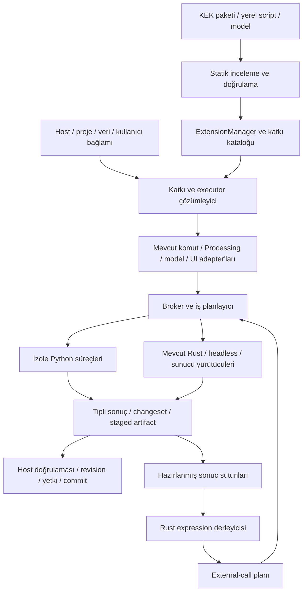

# KEK — KentOS Eklenti mimarisi

İnceleme: **27 Ekim 2026**, kaynak tabanı `687ed3885`. Çalışma dalı:
`plan/kek-extension-architecture`. **Durum: mimari ve uygulama planı; uygulanmadı.**
Kod ve resmî QGIS belgeleri incelendi; bu çalışmada uygulama testleri,
eklenti kurulumu veya gerçek QGIS çalıştırması yapılmadı.

Bu belge eklenti sözleşmesi, kayıt/etkinleştirme, proje bağlamı, script,
model ve expression entegrasyonunun ana planıdır. [python.md](python.md)
Python/uv ortamları, paket güvenliği, KentOS UI, kullanıcı tercihleri ve
onaylı katalog için mevcut `PY-*`/`ECO-*` işlerini tutar; burada tekrar
açılmazlar. İki belgenin eski örnekleri çelişirse bu mimarinin katkı bazlı
manifest/kayıt modeli esas alınır. Henüz yayımlanmış bir KEK v1 API'si yoktur.

## 1. Ürün hedefi ve temel kararlar

KEK, uygulamanın sonradan genişletilme biçimi olmalıdır. Bir eklenti tek
pakette komutlar, etkileşimli araçlar, paneller, Processing algoritmaları,
modeller, expression fonksiyonları ve veri kaynakları sunabilmelidir.
NumPy, SciPy, pandas, Shapely, GeoPandas, rasterio veya başka Python
kütüphaneleri uygun çalışma ortamında kullanılabilmelidir. Bir paketin
kurulabilirliği OS/Python ABI, native bağımlılık ve lisans koşullarına
bağlıdır; bütün kütüphanelerin her platformda çalıştığı varsayılmaz.

Ana kararlar:

1. **Paket, katkı, ortam ve çalışan oturum ayrı varlıklardır.** Bir `.kek`
   dosyası Python içermeyen model/stil/form kaynağı da taşıyabilir.
2. **Tek eklenti kataloğu, mevcut sistemlere adapter'lar.** Processing,
   expression, komut ve UI kayıtları kendi görevlerini sürdürür; bunların
   sahiplik ve yaşam döngüsü aynı `ContributionRegistry` ile yönetilir.
3. **Keşif kod çalıştırmaz.** Manifest/descriptor okunması Python import,
   ortam kurulumu veya activation hook çağrısı gerektirmez.
4. **Hesap Python sürecinde; uygulama otoritesi host'ta.** Python canlı
   belge/DB/UI nesnesi almaz. SDK istekleri ortak komut, snapshot, iş ve
   changeset yollarına gider. Ayrı süreç tek başına güvenlik sandbox'ı değildir.
5. **Proje türü görünürlüğü, veri uygunluğu ve yetki farklı kararlardır.**
   Birden çok proje türünde aynı eklentinin farklı katkıları gösterilebilir.
6. **Processing aracı bir kez yazılır.** Araç kutusu, model, batch,
   `cad.processing.run`, Python, MCP ve headless aynı descriptor/executor'ı kullanır.
7. **Python fonksiyonları expression dilinden çağrılır.** Dil Python'a
   çevrilmez; kayıtlı, tipli fonksiyon çağrıları dış yürütücüye planlanır.
   Çizim döngüsünde nesne başına senkron Python/IPC çağrısı yapılmaz.
8. **Önce masaüstü ve headless; gerektiğinde bulut.** Ortak sözleşmeler
   taşınabilir kalır. [ADR 0228](../docs/adr/0228-web-pause-desktop-and-cloud-first.md)
   uyarınca yeni web/mobil/Pyodide gerçekleştirmesi bu planın ilk teslimini bekletmez.

“Uygulamada her şey” SDK'nın kapsam hedefidir: yayımlanmış ürün işlerinin
komut karşılıkları, sorguları ve oturum servisleri eklentiye açılır.
Çekirdeğin özel belleğini veya yetki değerlendirmesini değiştirebilmek bu
hedefin gereği değildir. Henüz API'si olmayan bir ürün işi, kapsam
matrisinde açık iş olarak kalır; genel `execute` çağrısı boşluğu kapatmış sayılmaz.

## 2. Mevcut kodun durumu ve somut bağlantı boşlukları

Aşağıdaki bulgular kaynak okumaya dayanır; önceki ADR'lerdeki test
sonuçlarının bu oturumda tekrarlandığı anlamına gelmez.

| Kaynak | Mevcut temel | Gerekli değişiklik |
|---|---|---|
| [Masaüstü Python host](../apps/desktop/src/python/host.rs), [Python kanal karşılığı](../python/kentos/host.py) | Konsol ayrı OS sürecinde; generation, çıktı, stop ve host çağrıları var | Konsolun kişisel namespace'i ile eklenti release/runtime oturumlarını ayır; protokol/bütçe/ownership ekle |
| [Python paket tanımı](../python/pyproject.toml), [native binding](../crates/native/python/src/lib.rs) | `kentos._native` bir PyO3 extension; headless belge ve SDK komutları var | PyO3 wheel'i uygulamaya interpreter embed edilmiş gibi değerlendirme; broker transport'u aynı SDK kurallarına bağla |
| [Native Tool](../crates/native/processing/src/types.rs) | `run/validate/preview` function pointer; girdiler belge/yerel slot referansları | Taşınabilir descriptor ile host içi executable nesnesini ayır; dışarı UUID/snapshot ve buffer handle ver |
| [Native registry](../crates/native/processing/src/registry.rs) | Built-in araçlar, kullanıcı modelleri ve `model:` çözümlemesi | Provider/katkı kaydı, sahipli unregister, sürümlü katalog görüntüsü ve lease |
| [Processing komut adapter'ı](../crates/native/processing/src/command.rs) | Komut yollarında `Registry::builtin()` yeniden kuruluyor | UI'a eklenen araç komutta kaybolmasın; bütün girişlere aynı bağlamlı registry snapshot enjekte et |
| [Application ToolHost](../crates/native/application/src/processing_host.rs) | Application üst katmanın `ToolHost` arayüzüne bağlı | Arayüzü koru; global kullanıcı/proje durumu eklemek yerine host/session resolver geçir |
| [Processing komutları](../crates/native/application/src/processing_run.rs), [Python wrapper](../python/kentos/cad/processing.py) | `cad.processing.tools/run/batch`, plan, kayıt ve undo temeli | Eklenti araçları için aynı keşif, validate/plan/execute ve sonuç yolu |
| [Model](../crates/native/processing/src/model.rs), [model runner](../crates/native/processing/src/model_runner.rs), [model edit](../crates/native/processing/src/model_edit.rs) | Tipli bağlantı, cycle kontrolü, okuma kopyasında hesap/tek undo; kullanıcı modeli var | Model release/dependency lock, portable katkı, table/file handle zinciri; `model_as_tool` bugün boş output metadata veriyor |
| [İfade çekirdeği](../crates/shared/expression/src/lib.rs), [parser](../crates/shared/expression/src/parser.rs), [library](../crates/shared/expression/src/library.rs), [exec](../crates/shared/expression/src/exec.rs) | Ortak Rust AST/program, statik `Func`/`FUNCTIONS`, scalar ve sütun motoru | Bağlamlı function resolver, external-call düğümü, tip/dependency kontrolü ve asenkron host planlayıcı |
| [Expression pushdown](../crates/shared/expression/src/pushdown.rs) | Güvenli SQL önsüzgeci ve sonucu tekrar değerlendirme | Python çağrısını SQL'e gömme; desteklenmeyen bölüm residual aşamada ve kaynak bütçesiyle işlensin |
| [Workspace sözleşmesi](../crates/shared/contracts/src/document.rs), [mevcut workspace sunumu](../apps/web/src/app/workspaces.ts), [masaüstü modları](../apps/desktop/src/modes.rs) | `cad/gis` hazır; `plan3d/disaster` tanımlı gelecek türler; tür güvenlik sınırı değil | Katkı bazlı sunum selector'ı; `road` henüz mevcut workspace kimliği değildir |
| [Sunucu Processing işi ADR](../docs/adr/0559-processing-server-jobs.md), [iş sözleşmesi](../crates/shared/contracts/src/processing_job.rs) | Ayrı çocuk süreç, snapshot, lease/fencing ve commit/sink temeli | Python worker capability ve artifact taşımasını mevcut job protokolüne ekle; ikinci queue kurma |
| [Web registry](../apps/web/src/processing/registry.ts) | Tool kaydı `Disposable` döndürüyor; category kaydı mevcut | Davranış örneği; native dinamik kayıt hazır demek değil. Web adapter'ı geri dönüş kapsamı |

Önceki [Python planı](python.md) paketleme, uv, izin ve UI tarafında güçlüdür.
Eksikler: ortak katkı sözleşmesi, workspace seçimi, scriptleri kolay
kaydetme, bağımsız model dağıtımı, Python expression ABI'si ve canlı
kayıtların bütün ürün yollarına taşınmasıdır. Mevcut built-in, batch,
sunucu işi ve model yetenekleri yeniden sıfırdan yapılmayacaktır.

## 3. QGIS'ten alınacak yaklaşım

Kıyas **QGIS 3.44 sürümlü resmî belgelerinden** yapıldı. Bu bir “en güncel
QGIS sürümü” iddiası veya bütün QGIS API'siyle uyumluluk hedefi değildir.
Tablodaki KentOS sütunu önerimizdir; QGIS'in bu mimariyi uyguladığı söylenmez.

| QGIS'te belgelenen yaklaşım | KEK kararı |
|---|---|
| [Plugin metadata, `classFactory(iface)`, `initGui/unload`](https://docs.qgis.org/3.44/en/docs/pyqgis_developer_cookbook/plugins/plugins.html) | Statik manifest + simetrik lifecycle; UI'a doğrudan pointer yerine tipli host servisleri |
| [Processing provider ile algoritma kaydı](https://docs.qgis.org/3.44/en/docs/pyqgis_developer_cookbook/processing.html) | Eklenti analizi normal araç kutusuna/model/batch'e girer; ayrı Python araç kutusu yapılmaz |
| [Script editor, algoritma sınıfı ve `@alg`](https://docs.qgis.org/3.44/en/docs/user_manual/processing/scripts.html) | Basit script için hafif yol; aynı descriptor `.kek` içindeki provider'a da paketlenebilir |
| [Modelin tek algoritma olması, dosyada/projede saklanması ve Python'a aktarılması](https://docs.qgis.org/3.44/en/docs/user_manual/processing/modeler.html) | Mevcut model runner genişler; Python'suz model paketi ve Python/built-in karma zincir |
| [Function Editor; profil/proje Python fonksiyonları; geometry/column/null metadata](https://docs.qgis.org/3.44/en/docs/user_manual/expressions/expression.html) | Aynı keşfedilebilir fonksiyon deneyimi; tipli imza, proje kapsamı, açık trust ve batch çalışma |
| [Arka plan işlerinin UI nesnelerine dokunmaması ve context ömrü](https://docs.qgis.org/3.44/en/docs/pyqgis_developer_cookbook/tasks.html) | Snapshot, job ve lease ömürleri host'a ait; ağır hesap ayrı süreçte |

Özellikle algoritmaların çıktıyı tanımlaması, sonuç katmanını host'un
yüklemesi ve hesap içinden dialog açılmaması yararlıdır.
[QGIS script kuralları](https://docs.qgis.org/3.44/en/docs/user_manual/processing/scripts.html)
bu ayrımı açıklar. QGIS'in `@alg` yolu Scripts provider'ıyla sınırlıdır;
KEK'te script ve paketlenmiş araç aynı sözleşmeye derlenmelidir.

QGIS'in [metadata bağımlılığı](https://docs.qgis.org/3.44/en/docs/pyqgis_developer_cookbook/plugins/plugins.html)
başka eklentiyi belirtir. Bizde bu grafik ile Python paket çözümlemesi
ayrı tutulacak; sürüm aralığı kurulumda somut digest'e çözülecektir.
QGIS API/Qt eklentilerinin KEK'te doğrudan çalışacağı vaat edilmez.

## 4. Bileşenler ve bağımlılık yönü



| Bileşen | Sorumluluk / sınır |
|---|---|
| `PackageStore` | Immutable kaynak/digest, kurulum makbuzu, staging, rollback; Python import etmez |
| `ExtensionManager` | Kurulum, seçilmiş katkılar, grants, ortam hazırlama ve enable/update/disable |
| `ContributionRegistry` | Tanım, sahip, release, görünürlük, gereksinim ve generation; iş kuralı çalıştırmaz |
| `ActivationPlanner` | Hangi katkıların bu host/projede kullanılabilir olduğu ve dependency closure |
| `RuntimeManager` | Hazır environment, process, görev kuyruğu, bütçe, stop ve lease |
| `HostServices/Broker` | Katalog komutları, izinli snapshot, Processing çağrısı, UI session, dosya/secret handle |
| Mevcut ürün registry'leri | Komut, tool, model, function, format ve UI için ince adapter'lar |
| Mevcut domain/application | Doğrulama, revision, undo, persistence ve yetki; eklenti aynı yoldan geçer |

Saf sözleşme ve doğrulama Rust shared katmanında; process, uv, IPC ve OS
adapter'ları native katmanda bulunur. Iced, DOM, SQLx, process veya
CPython bağımlılığı ifade/geometri çekirdeğine eklenmez. Desktop yalnız
sunum ve composition root'tur. Yeni registry küresel mutable singleton
olmaz; application instance, kullanıcı/tenant ve proje oturumuyla çözülür.

Bir çağrı `CatalogSnapshot { generation, resolvedReleases }` alır. İç içe
Processing/model/expression çağrıları bu görüntüyü ve actor'ü devralır.
UI yenilenirken çalışan işin algoritması değişmez. Global `ToolHost`
bağlantısı genişletilecekse per-request context geçirmeli; global etkin
projeyi okuyarak kullanıcı/işler arasında veri taşımamalıdır.

## 5. KEK manifesti ve katkı sözleşmesi

### 5.1 Kimlik, sürüm ve katkı türleri

Paket kimliği yayıncıya bağlı, kalıcı bir namespace'tir. Katkının tam ID'si
paket ID'si + yerel katkı ID'sinden türetilir. Etiket/çeviri/dosya adı
kimlik değildir. Manifest format sürümü, host API sürümü, IPC protokolü,
paket sürümü ve algoritmanın davranış sürümü ayrı alanlardır.

| Katkı türü | Kullanıldığı yer | İlk teslim |
|---|---|---|
| `processing.tool` / provider grubu | İşlemler, batch, model, komut, Python/MCP | Evet |
| `processing.model` | Dosyadan/projeden/paketten tek algoritma | Evet |
| `expression.function` | Oluşturucu, Akış, hesap/sorgu, hazırlandığında stil/etiket | Evet, §11 fazlarıyla |
| `command` / `ui.panel` / `ui.action` | Menü/şerit, komut arama, dock/dialog, bağlam menüsü | Evet, mevcut `PY-UI` işleriyle |
| `interactive.tool` | Nokta/nesne seçimi, snap, önizleme ve tek onay | Sonraki faz; §12 sözleşmesi baştan belirlenir |
| `form.resource` / `style.resource` / `sheet.template` | Python'suz taşınabilir kaynaklar | Mevcut compiler/registry'ye adapter |
| `data.provider` / `io.format` | Yeni kaynak, okuma/yazma, servis | Sonraki faz; capability/streaming şart |
| `document.extension` / `scene.provider` | Kalıcı özel metadata, 3D/yol içerikleri | İlgili domain geldiğinde, §12 sınırlarıyla |

Bilinmeyen **zorunlu** katkı/descriptor sürümü paketin ilgili özelliğini
engeller. Açıkça optional katkı seçilmeden bırakılabilir. Salt kaynak
paketinde Python/uv/entrypoint zorunlu değildir. Eklenti DLL/Rust ABI'sini
UI sürecine yüklemek v1'in parçası değildir.

### 5.2 Önerilen tek manifest örneği

Örnek gelecekteki v1 sözleşmesidir; bugün çalışan API/şema değildir.
Alanların codegen kaynağı uygulama diliminde Rust contracts olacaktır.

```json
{
  "format": "kentos.extension",
  "schemaVersion": 1,
  "id": "tr.example.analytics",
  "version": "0.1.0",
  "name": "Kent analizi",
  "publisherId": "example-publisher",
  "licenseFile": "LICENSE",
  "compatibility": { "hostApi": ">=1.0.0,<2.0.0" },
  "environments": {
    "analysis": {
      "projectFile": "pyproject.toml",
      "lockFile": "uv.lock",
      "extras": ["analysis"]
    }
  },
  "runtimes": {
    "local": {
      "kind": "python-process",
      "environment": "analysis",
      "hosts": ["desktop", "headless"]
    }
  },
  "extensionDependencies": [],
  "contributions": [
    {
      "id": "normalize",
      "kind": "processing.tool",
      "definition": "tools/normalize.tool.json",
      "execution": { "runtime": "local", "handler": "kent_analysis.tools:normalize" },
      "presentation": { "workspaces": ["cad", "gis"], "placements": ["processing"] },
      "requirements": { "hostCapabilities": ["processing.external/1"] },
      "requestedCapabilities": [
        { "id": "datasets.read", "scope": "user-selected" },
        { "id": "datasets.create", "scope": "current-project" }
      ]
    },
    {
      "id": "net_area",
      "kind": "expression.function",
      "definition": "expressions/net_area.function.json",
      "execution": { "runtime": "local", "handler": "kent_analysis.functions:net_area_batch" },
      "presentation": { "workspaces": ["cad", "gis"], "placements": ["expression"] },
      "requirements": { "hostCapabilities": ["expression.external/1"] },
      "requestedCapabilities": []
    },
    {
      "id": "report",
      "kind": "processing.model",
      "definition": "models/report.model.json",
      "presentation": { "workspaces": ["gis"], "placements": ["processing"] },
      "requirements": { "hostCapabilities": ["processing.models/1"] },
      "requestedCapabilities": []
    }
  ]
}
```

Bu örnekte yerel Python runtime sunucu desteği ilan etmez. Modelin Python
gerektirip gerektirmediği kendi adımlarının dependency closure'ından çıkar;
aynı pakette Python bulunması her modeli Python bağımlısı yapmaz.
`requestedCapabilities` talep listesidir; gerçek grant host/kurum/kullanıcı
kararıyla ve veri yetkisiyle kesişir. Paket kendisini güvenilir yayıncı
ilan edemez. Package-level Python aralığı portable katkıları engellemez;
Python gereksinimi `pyproject.toml` ve çözülen ortam metadata'sından gelir.

Manifest hangi katkının hangi dosya/handler/runtime'a ait olduğunun tek
kaynağıdır. Tool descriptor parametre/çıktı ve algoritma semantiğini,
function descriptor imza ve evaluation profilini, model ise DAG'ını tutar.
İki dosyada executor/izin/sürüm listesi elle tekrar edilmez. Derlenen
etkin descriptor bu bilgileri birleştirir. `.kek` paket yapısına
`expressions/`, `models/` ve gerektiğinde `extensions.lock.json` eklenir.

### 5.3 Bağımlılık çözümleme

- Python gereksinimleri `pyproject.toml` + `uv.lock`; eklenti/API
  gereksinimleri `extensionDependencies` + `extensions.lock.json` kaynağındadır.
- Eklenti bağımlılığı `{ id, versionRange, contributionIds, optional }`
  bildirir; resolve sonucu package/release/descriptor digest'lerini kilitler.
  Başka eklentinin Python modülü `import` edilmez; çağrı kayıtlı servise gider.
- Required bağımlılıklarda döngü reddedilir. Runtime çağrı grafiğinde ayrıca
  recursion/depth/budget kontrolü vardır. Optional bağımlılık eksikse yalnız
  ona bağlı katkı engellenir.
- Varsayılan bir profil/proje bağlamında bir paket ID'sinin tek sürümü
  çözülür. İki projenin farklı sürüm pin'leri ayrı context/process ile
  çalışabilir; global import tablosunda son yüklenenin kazanması yoktur.
- Side-by-side sürüm aynı context'te ancak bütün sembol/service çözümlemesi
  tam release ID taşıyabildiği ayrı bir capability ile ileride açılır.
- Kullanıcı “en yenisi”ni seçebilir; bir run başladıktan sonra exact digest
  kullanılır. Bulut onayı ve runtime provenance aynı digest'e bağlanır.

## 6. CAD, GIS, 3D Plan ve Yol için bağlam

### 6.1 Dört ayrı kontrol

| Kontrol | Soru | Başarısızlık davranışı |
|---|---|---|
| Sunum | Bu katkı bu proje türünün araç kutusunda/menüsünde gösterilsin mi? | Normal yüzeyde gizli; Eklentiler ekranında kapsamı görünür |
| Host/runtime | Gerekli API, environment ve yürütücü bu cihazda var mı? | “Python ortamı eksik”, “Bu host desteklemiyor” gibi açık neden |
| Veri/iş uygunluğu | Seçili veri tipi, CRS, birim, geometri/scene/corridor capability uygun mu? | Parametreye bağlı disabled/validation sonucu |
| Yetki | Actor bu veriyi okuyabilir/yazabilir, bu işi çalıştırabilir mi? | Broker ve commit'te ret; UI gizleme güvenlik sayılmaz |

Çalıştırılabilirlik: **etkin katkı + çözülen bağımlılıklar + host/executor
uyumu + veri/iş gereksinimleri + gerçek izinler**. Görünürlük bunun yerine
geçmez. Örneğin CAD'e özel sunulan sayısal alan aracı, verisi uygunsa GIS'ten
açık ID ile çağrılabilir; sırf menü selector'ı yüzünden reddedilmez.
Gerçekten yol gerektiren araç `civil.alignment/1` ister; CAD'de o kaynak
yoksa çalışamaz. Headless kod UI'ın varsayılan projesini/seçimini tahmin etmez.

### 6.2 Selector anlamı

- `presentation.workspaces` yalnız sunum içindir. Paket varsayılanı
  tanımlanabilir; katkı kendi listesiyle onu **değiştirir**, örtük union olmaz.
- Açık liste “yalnız bunlar”; `"*"` seçeneği bütün desteklenen mevcut ve
  gelecek türler anlamındadır. Alan yoksa varsayılan `"*"`; boş liste
  komut/API katkısını otomatik UI yerleşimi olmadan kaydeder.
- Böylece bugünkü `cad/gis` listesi gelecekte kendiliğinden Yol'a taşınmaz.
  “Hepsinde çalışır” diyen geliştirici bunu bilinçli seçer.
- Host, eklenti manifestinden yeni proje türü yaratmaz. `plan3d/disaster`
  bugün tanımlı fakat hazır olmayan türlerdir. `road` burada **ayrılmış
  gelecek önerisidir**; çekirdek workspace sözleşmesine sürümlü eklendiğinde
  kullanılabilir olur. Bilinmeyen tür metadata'sı korunur, o host'ta eşleşmez.
- Eski/kararsız proje türü mevcut `effective_mode` davranışını izler;
  eklenti varsayılan CAD/3D/Yol ataması yapmaz. Hiç proje yoksa yalnız
  `application` kapsamlı katkılar kullanılabilir.
- Selector kuralları host'un sınırlı, statik predicate dilidir: all/any,
  workspace/host/data kind/selection bilgileri. Görünürlük hesaplamak için
  Python callback veya arbitrary expression yürütülmez.

| Katkı örneği | Gösterildiği türler | Gerçek veri/runtime gereksinimi |
|---|---|---|
| CSV/tabloda NumPy analizi | CAD, GIS; isterse `"*"` | Numeric kolonlar, yerel Python |
| Mahal metraj paneli | CAD, ileride 3D Plan | Mimari kaynak sorgusu ve belge komutları |
| Raster sınıflandırma | GIS, ileride Afet Analizi | Raster snapshot, uygun native paketler |
| Parselden kütle modeli | GIS ve ileride 3D Plan | İmar alanları + ileride scene/model output capability |
| Güzergâh ve kübaj | İleride Yol; isteğe bağlı CAD/GIS sunumu | Alignment/profile/surface ve düşey datum capability |
| Ortak expression fonksiyonu | Seçilen bütün türler | İmza ve evaluation profili; tür, fonksiyonun matematiğini değiştirmez |

Proje türü değişince yalnız yerleşimler ve context kayıtları yenilenir.
Paket kaldırılmaz, tekrar kurulmaz. Açık panel taslağı korunabilir;
uygunsuz eylem durur ve nedeni gösterilir. Çalışan iş baştaki project ID,
source revision ve run context'ine bağlı kalır; yeni aktif projeye yazamaz.

## 7. Kayıt, activation ve yaşam döngüsü

Paketin `installed/enabled` durumu, katkının `available/blocked` durumu ve
sürecin `stopped/starting/running/failed` durumu ayrı tutulur. Büyük bir
state enum'unda her kombinasyon tek duruma sıkıştırılmaz.

1. **Inspect:** archive/manifest/descriptor/lock doğrula, katkı ve izinleri
   göster. Kod yürütme, environment install ve hook çağrısı yok.
2. **Select/resolve:** kullanıcı katkıları seçer; gerekli dependency closure,
   host destekleri ve izin farkı hesaplanır. İstemediği Python özelliği kurulmaz.
3. **Prepare:** seçilmiş locked ortam ve SDK adapter'ı staging'de hazırlanır;
   import/smoke artık açık kod yürütme kapsamındadır.
4. **Enable/register:** provider, tools, models, functions, commands ve UI
   placements toplu validate edilir; **tek generation** olarak görünür olur.
   Üçüncü kayıt çakışırsa ilk iki kayıt da geri alınır.
5. **Activate:** runtime ilk gerçek çağrıda başlar; headless Processing işi
   UI activation hook'u gerektirmez. Hook'lar idempotent ve süre/bütçe sınırlıdır.
6. **Quiesce:** disable/update sırasında yeni çağrılar kesilir; UI actions
   pasif olur. Disable varsayılan olarak etkin işleri iptal eder. Normal
   güncellemede çalışan iş eski release lease'iyle bitebilir.
   İzin iptali/güvenlik durdurmasında işi durdur, henüz commit olmayanı reddet.
7. **Dispose:** işler/session/abonelik/overlay/handle/kayıtlar sahiplikleriyle
   temizlenir; descriptor tanısı kalır. Hook başarısız olsa da host cleanup yapar.

Her kayıt `RegistrationLease { ownerRelease, contextId, generation }`
taşır. Eski release'in dispose'u yeni kaydı aynı ID'den silemez. Geç callback,
event ve process sonucu generation/context/run ID kontrolünden geçer.
Built-in ID veya başka yayıncı namespace'i üzerine kayıt yasaktır.

Application, project, document ve view oturumlarının ömrü ayrıdır.
Eklenti runtime process'i paylaşılabilse de her broker handle açık scope
taşır. Profil/kullanıcı/tenant değişiminde eski oturum ve grants temizlenir.
Kapat-aç ve crash-loop için otomatik sonsuz restart yerine tanı, kontrollü
yeniden başlatma ve **eklentisiz güvenli açılış** bulunur.

Event bus örnekleri: project opened/closing, active document changed,
selection changed, committed changes, view changed. Olaylar sıra/generation
ve bounded queue taşır; sık selection/view olayları birleştirilebilir.
Her fare hareketinde tüm belge Python'a gönderilmez. Kendi komutunun
olayından sonsuz yazma döngüsü origin/correlation ve recursion sınırıyla
önlenir. UI/domain lock'u altında callback beklenmez.

## 8. Python runtime, dış kütüphaneler ve IPC

[python.md §5–7](python.md#5-py-uv--uv-entegrasyonu-kurulum-ve-environment-manager--p0p1)
ortam/paket izin işleri korunur. Ek mimari kararlar:

- Temel process isolation anahtarı kullanıcı/tenant + paket release +
  lock/extras + Python ABI/OS/arch'tır. Yetki veya proje verisi gerektiriyorsa
  ayrı context süreçleri seçilir. Kişisel konsol ortamı plugin release env'i değildir.
- Python SDK façade'sı mevcut komut şemalarından üretilir; transport
  `desktop-broker/headless/remote` olabilir. Plugin'e host'un canlı
  `Document` nesnesi veya kısıtsız app bağlantısı verilmez. İçeride açtığı
  bağımsız headless belge host'a kendiliğinden yetki kazandırmaz.
- Python UDF worker'ına varsayılan mutation/UI/secret servisi verilmez.
  Analiz çalışanları da yalnız seçilmiş read/output scope'u alır.
- Release çalıştırırken hazır interpreter doğrudan seçilir; normal `uv run`
  çağrısının otomatik lock/sync yapmasına güvenilmez. uv belgelerinde bu
  davranış açıktır; kurulum ile execution ayrı aşamalardır.
  [uv locking/sync](https://docs.astral.sh/uv/concepts/projects/sync/)
- Bilimsel kitaplıkların BLAS/OpenMP/process havuzları concurrency
  bütçesine dahildir. Her plugin bütün çekirdekleri ayrı ayrı tüketmesin;
  per-job CPU/RAM/disk/time ve host başına süreç/pool üst sınırı olsun.
- Venv native wheel veya sistem GDAL/PROJ kütüphanelerini otomatik uyumlu
  yapmaz. CRS/grid/data path ve Python native ABI tanısı sunulur; host'un
  DLL/search path'ini eklenti için değiştirmek yerine süreç ortamı ayrılır.

### 8.1 Kontrol ve veri kanalları

Kontrol protokolü hello/negotiation, describe-result, invoke, progress,
cancel, result, error, release-handle ve shutdown mesajlarını tanımlar.
Zarf host/plugin protocol versions, request/run/parent IDs, context,
generation, deadline ve idempotency referanslarını içerir. Yerel IPC
kimlik doğrulaması/kanal sahipliği host tarafından kurulur; Python'ın
gönderdiği actor/tenant iddiasına güvenilmez.

stdout/stderr log içindir; native kitaplıkların çıktısıyla RPC bozulmaması
için kontrol ayrı pipe/socket üzerinden framed ve uzunluk sınırlı taşınır.
JSON satırı kullanılan mevcut konsol taşınırken uyumluluk adapter'ı olur;
bu protokol mevcut konsolun tamamlandığı iddiasıyla genişletilmez.

Büyük veri için JSON nesne başına varsayılan yol değildir. Sürümlü tipli
sütun buffer'ları, validity mask, UUID, CRS/birim ve schema fingerprint
taşınır. İlk dilim bounded chunk/file handle olabilir; Arrow IPC veya
shared memory yalnız ölçüm/platform gerekçesiyle seçilir. Geliştirici
API'si taşıma biçiminden bağımsız `FeatureBatch/TableBatch` görür.
Pickle/untrusted Python object deserialization wire formatı olmaz.

Handle'lar owner/session/run, boyut, read/write intent ve expiry taşır.
Read snapshot salt okunurdur; sonuç staged buffer/artifact'a yazılır.
Backpressure, toplam bytes/rows ve maksimum açık handle sayısı sınırlanır.
Crash, cancel ve lease kaybında orphan dosyalar temizlenir.

### 8.2 Python veri codec'leri ve geometri doğruluğu

NumPy/pandas için dtype/null ve kolon sıra bilgisi, GeoPandas/Shapely için
geometri + CRS, raster kitaplıkları için band/nodata/window ve grid dönüşümü
SDK adapter'larında açıkça taşınır. Bunlar isteğe bağlı köprülerdir; her
plugin bütün analitik ekosistemi kurmak zorunda değildir.

Analitik CAD yayı, spline, blok veya mimari nesne basit GIS geometriye
çevrilecekse kaynak UUID/revision, temsil biçimi ve segmentleme toleransı
bildirilir. Türetilmiş polygon/polyline'ın geri dönmesi kaynak tanımını
sessizce ezemez. Sonuç ayrı türev katman olur veya destekli anlamsal edit
komutuna dönüşür. Birim, yatay/düşey CRS, axis order, datum/grid ve Z/M
koruma politikası açık olmalıdır; dosya/array sayılarından tahmin edilmez.
Decimal/büyük integer → float64 ve analytic → tessellated dönüşümleri
loss report/provenance taşır. SDK kolaylığı çekirdeğin geometri otoritesini değiştirmez.

Trusted yerel Python dosya/ağ/OS'ye doğrudan erişebilir; broker bunu
engellemiş sayılmaz. Korumalı mod ancak gerçek OS izolasyonu varsa açılır.
Sunucuda Python kodu API veya mevcut worker'ın sırlarıyla import edilmez;
mevcut job lease/fencing/tenant sistemine bağlı ayrı sınırlı executor gerekir.

## 9. Python script ile ProcessingTool geliştirme

### 9.1 Üç giriş, tek derlenen sözleşme

| Geliştirme biçimi | Kayıt/dağıtım |
|---|---|
| Tek `.py` + statik metadata | Kullanıcı “Processing script ekle” seçer; descriptor ve dependency planını görür |
| `.py` + `.tool.json` + proje/lock | Daha geniş parametre/çıktı/help ve yeniden üretilebilir ortam |
| `.kek` içindeki provider araçları | Aynı descriptor; yayıncı/namespace/release ve çoklu katkı lifecycle'i |

QGIS benzeri dekoratör/builder ergonomisi sunulabilir; **keşif sırasında
dekoratör çalıştırılmaz**. Tek dosyalı yol sınırlı literal `KEK_TOOL`
metadata'sını AST'den okur; import/call/comprehension kabul etmez.
`ast.literal_eval` yalnız desteklenen boyut/derinlikte literal'e uygulanır.
Gelişmiş builder'ın descriptor üretmesi geliştiricinin açık build adımıdır;
build kod çalıştırır, inspector değildir. Üretilen descriptor ortak
validator'dan geçer; paket inspection'ı onu tekrar üretmek için import yapmaz.

Önerilen geliştirici örneği (aşağıdaki SDK yardımcıları **henüz yoktur**):

```python
import numpy as np

KEK_TOOL = {
    "id": "mean_value",
    "label": "Ortalama değer",
    "parameters": [
        {"id": "input", "type": "features", "required": True},
        {"id": "field", "type": "field", "sourceParameter": "input",
         "valueTypes": ["integer", "decimal"], "required": True},
    ],
    "outputs": [{"id": "mean", "type": "number", "nullable": True}],
    "handler": "execute",
}

def execute(parameters, context, feedback):
    total = 0.0
    count = 0
    for batch in context.read_batches(parameters["input"], fields=[parameters["field"]]):
        feedback.check_cancelled()
        values = batch.numeric(parameters["field"], nulls="omit", precision="float64")
        total += float(np.sum(values, dtype=np.float64))
        count += len(values)
    return {"mean": total / count if count else None}
```

NumPy bağımlılığı scriptin environment metadata/lock'unda ayrıca bulunur;
kodun `import` satırından paket ismi/sürümü tahmin edilmez. Yerel script
kimliği profil sahibinin namespace'ine atanır; değişen kaynak digest'i yeni
geliştirme generation'ıdır. Bu örnek aritmetik ve yaklaşık float64 hesabıdır;
boş girişte null, null hücrelerde omit, precision loss ve sonlu olmayan
girdinin reddi descriptor/testte tanımlanır. Exact decimal isteyen veri
örtük olarak NumPy float'a çevrilmez. Kabul: `[2, null, 4, 6] → 4`,
boş/tamamı-null → null; büyük/sınır sayılar ayrıca bağımsız referans ister.

### 9.2 Çalıştırma sözleşmesi

`ToolDescriptor` parametre/çıktı, birim/CRS, input schema, validation,
mutation mode, cancellation, batch/model uygunluğu ve davranış sürümünü
bildirir. `ResolvedExecutor` ise runtime/entrypoint/env lease'idir.
Mevcut Rust `Tool` function pointer'ları built-in adapter'ın içinde kalır.

Akış: **resolve → host validate → explicit snapshot → compute → staged
result → host validate/revision/permission → commit**. Python ham
`Entity/Slot` yazamaz; sonuç UUID/typed patch, LayerBuilder/TableBuilder veya
artifact handle'dır. Uygulamanın komutlarıyla çizim yapmak isteyen panel
SDK command/session yolunu kullanır; analiz hesabı doğrudan kalıcı yazmaz.

- UI otomatik dialog'u ve `cad.processing.tools/run/batch` aynı descriptor'ı
  görür. Komut host'u `Registry::builtin()` yerine çağrının registry
  snapshot'ını kullanır. `model:` ve built-in kimlikler korunur.
- Dinamik araçlar için her kuruluma özel statik SDK kod üretmek gerekmez;
  mevcut genel Processing çağrısında tool ID + keşfedilmiş tipli schema
  kullanılır. Geliştirici opsiyonel Python stub üretebilir.
- Python'dan built-in veya başka provider çağırmak parent job/grant/deadline'ı
  devralır. İç çağrı, ana modelin staging belgesinde çalışır; ayrı undo ve
  beklenmedik canlı belge commit'i üretmez.
- Statik validate/plan kod import etmeden çalışır. Algoritma preview'u
  Python hesap gerektiriyorsa açık runtime çağrısıdır ve mutating broker
  servisleri kapalıdır; trusted Python'ın OS yan etkileri tamamen önlenmiş sayılmaz.
- Dosya/DB/haricî servis sonucu belge undo'suyla aynı atomik işlem değildir.
  Varsayılan staged çıktı ve tek belge commit'i; haricî write intent ayrıca
  gösterilir. Karma sink başarısızlığının raporu ve compensation sınırı tanımlanır.
- Desteklenmeyen platformda otomatik buluta veri gönderilmez. Alternatif
  executor kullanıcı tarafından seçilir ve data transfer kapsamı görünür olur.

## 10. Modeller: Python, built-in ve başka modeller

Model hem görsel tasarımcıdan hem Python builder/scriptinden üretilebilir;
sonuç **aynı portable DAG tanımıdır**. Python kodu her açılışta yeniden
çalıştırılacak model tanımı olarak saklanmaz. Model `.model.json`, proje
kaynağı veya `.kek` katkısı olabilir; ayrı uzantı adı uygulama ADR'sinde seçilir.

### 10.1 DAG v1 genişletmeleri

- Tool/model ID, descriptor/behavior version, package/release digest ve
  input/output schema fingerprint'leri bağımlılık tablosunda pin'lenir.
  Modelin sürüm aralığı authoring içindir; run lock exact çözüm taşır.
- Node portları feature/table/file/raster/scene/surface gibi tipli handle
  taşıyabilir; dosya path metni veya yerel slot listesi portable çıktı değildir.
  Mevcut `features` bağlantıları iç adapter'da çalışmayı sürdürür.
- Modelin dış output'ları `model_as_tool` metadata'sına gerçekten aktarılır;
  model başka modelin normal algoritma node'u olabilir. Model recursion'ı da
  araç dependency döngüsü gibi kontrol edilir.
- Girdiden bağımsız **explicit execution dependency** tanımlanır; veri
  bağlantısı yok diye aynı external kaynağa yazan node'lar paralel başlamaz.
- V1 varsayılan sıralı çalışır. Paralelleştirme ancak bağımsız, saf veya
  ayrık output'lu node'larda source/write conflict analiziyle açılır.
- Koşullu dallanma, bounded iterator, node atlama ve restart/checkpoint
  sonraki yeteneklerdir; şema capability bildirir. Desteklenmeyen node
  sessizce atlanarak “başarılı model” üretilmez.
- SDK `build/check/save/describe/run` yolları aynı model validator/runner'ı
  kullanır; Python builder kodu taşıma standardının yerine geçmez.

### 10.2 Transaction, kilit ve tekrar üretim

Mevcut okuma kopyası/record/replay yaklaşımı genişler. Ara node değişiklikleri
staging belge/artifact graph'ında uygulanır; kullanıcı belgesine bütün
başarılı model tek undo/commit'te geçer. Source revision/grants commit'te
yeniden denetlenir. İptal/crash'te geçici çıktılar temizlenir. Haricî
servis/DB/dosya yan etkilerine belgeyle dağıtık transaction sözü verilmez.

Cache anahtarı tool/function/model release + descriptor/parametre + input
snapshot/schema + CRS/birim/numeric policy + env/seed içerir. Cache kullanıcı/
tenant/field projection/grant kapsamında ayrılır; içerik hash'i veri erişim
hakkı vermez. Saf olmayan node cache'lenmez. Yeniden başlatma committed
yan etkiyi tekrarlamaz; idempotency ve external-step politikası gerekir.

Eksik eklentiyle model **açılır ve düzenlenebilir**; çözülemeyen node ve
portlar metadata'sıyla korunur, çalıştırma engellenir. “Projeyi açtım”
otomatik dependency install/enable değildir. Kullanıcı farkı inceleyerek
uyumlu sürüme migration yapabilir; son sürüm sessizce ikame edilmez.

## 11. Expression engine'den Python fonksiyonu çağırma

### 11.1 Public yüzey ve descriptor

Expression oluşturucuda bir **Python Fonksiyonları** düzenleyicisi ve
eklenti fonksiyon grupları bulunur; imza, örnek, yardım, runtime, kaynak,
dependency ve hata konumu gösterilir. Aynı işlev Akış'ta typed node olur.
Profil, proje ve `.kek` kapsamı seçilebilir; proje fonksiyonları kapanışta
çözümlemeden çıkar. Projedeki kod salt açılışta import edilmez.

Önerilen function descriptor:

```json
{
  "format": "kentos.expressionFunction",
  "schemaVersion": 1,
  "symbol": "ornek_net_alan",
  "label": "Net alan",
  "behaviorVersion": 1,
  "parameters": [
    { "id": "gross", "type": "number", "unit": "m2", "nullable": true },
    { "id": "deduction", "type": "number", "unit": "m2", "nullable": true }
  ],
  "returns": { "type": "number", "unit": "m2", "nullable": true },
  "nullPolicy": "propagate",
  "rowErrorPolicy": "fail",
  "deterministic": true,
  "effects": "pure",
  "access": { "fields": [], "geometry": false, "contextVariables": [] },
  "evaluation": {
    "mode": "batch",
    "profiles": ["processing", "query", "prepared-presentation"]
  }
}
```

Bu descriptor §5 manifestindeki `net_area` katkısına aittir; canonical ID
`tr.example.analytics.net_area`, handler/env/permissions manifestten gelir.
`ornek_net_alan([Brüt alan], [Kesinti])` expression dilinin mevcut çağrı
biçimini kullanır. Noktalı Python modül yolu dilde yeni sözdizimi sayılmaz.
Sembol yalnız kullanıcıya dönük addır; kayıtlı resource'un `functionBindings`
tablosu canonical ID, behavior version ve release digest taşır. Çakışan
sembol yükleme sırasına göre seçilmez; açık bağlama veya tanısal ret gerekir.
Built-in fonksiyon adları/takma adları rezerve kalır.

Python örneği, varsayımsal batch SDK protokolüyle:

```python
def net_area_batch(arguments, context):
    gross, deduction = arguments
    # Host nullPolicy=propagate ve aktif satır maskesini uygular.
    # Kolonların numeric/null codec'leri SDK sözleşmesidir.
    return gross - deduction
```

Her call dtype/length/validity, sonlu değer, unit ve return schema açısından
host'ta doğrulanır. İlk numeric UDF profili mevcut motorun float64 sayısını
esas alır; exact decimal/integer/date/geometry türleri ortak değer codec'i
desteklediğinde eklenir. Descriptor'a yazmak tek başına bu türleri açmaz.
`[100, 80, null]` ve `[10, 5, 2]` girdisi `[90, 75, null]` vermelidir.

### 11.2 Derleme ve execution sınırı

Mevcut statik `find_function → Func → Node::Call/Ins::Call` yolu dış
fonksiyon taşıyamaz. Yalnız listeye Python callback eklemek yeterli değildir.

1. Yeni external-aware derleme girişi, örneğin
   `compile_plan_with(source, schema, function_catalog)`, immutable
   `FunctionCatalog`/resolver alır. Mevcut `compile/compile_with`
   imzaları ve built-in scalar/sütun hızlı yolu korunur.
2. Parser/resolve kayıtlı dış sembolü `ExternalFunctionRef` olarak çözer;
   AST/program'da `ExternalCall` imza/dependency/release referansı taşır.
   Kaynak konumu ve argüman arity/type hataları normal compile error'dur.
3. Saf Rust planner dış çağrı gereksinimini bildirir; IPC/process/Python
   bilmez. Asenkron host evaluator girdileri hazırlar ve worker'a gönderir.
4. Batch çağrı aktif satır maskesiyle çalışır; dönen kolonlar doğrulanarak
   sonraki Rust işlemlerine verilir. Birden çok/nested external call
   dependency sırasıyla devam ettirilir; bütün expression Python'a taşınmaz.
5. Scalar kullanım aynı host evaluator'ın tek satırlı çağrısıdır. Mevcut
   `Expr::evaluate` imzası/değer davranışı değişmez ve IPC beklemez;
   legacy derleme dış fonksiyonu bilinmeyen işlev olarak reddetmeyi sürdürür.
   Yeni `ExpressionPlan` ayrı `evaluate_async/evaluate_prepared` yolunda
   çalışır. Eksik dış sonuç sütunu bu yeni API'de “hazırlama gerekli”
   hatasıdır; eski API üzerinden sessiz null'a dönüştürülmez.

Mevcut CASE/koşul/null ve hata yakalama semantiği korunur: ihtiyaç olmayan
dalda Python yürütüp exception üretmek kabul edilmez. Maske ve lazy-frame
scheduler için bağımsız test gerekir. İç lambda/aggregate bağlamları ilk
sürümde desteklenmiyorsa derlemede açık capability hatası verilir; destek
geldiğinde aynı function ref ile frame/batch planına katılır.

İşlevin okuduğu kolon/geometri/context metadata'sı explicit'tir. Cache ve
invalidation yalnız deklarasyona güvenerek private veriyi açmaz: worker'a
yalnız izinli projection gönderilir. Dünya/başka katman okuyan fonksiyon
ek scope ve snapshot gerektirir; genel canlı document/SQL erişimi alamaz.
İfade fonksiyonu command/UI çağırıp kalıcı mutation yapamaz; böyle bir iş
Processing/action katkısıdır. `effects=pure` beyanı tek başına sandbox kanıtı değildir.

### 11.3 Kullanım profilleri ve performans

| Kullanım | Python yürütme kuralı |
|---|---|
| Processing, field calculator, sorgu | İptal edilebilir async job; büyük kaynakta batch/chunk ve memory budget |
| Oluşturucu/Akış önizlemesi | Küçük örnek, debounce, eski istek iptali; preview result generation kontrolü |
| Stil, etiket ve pafta | Önceden hesaplanan revision-bound sütunlar; render/frame/pick içinde IPC yok |
| Formun kolaylık hesabı | Host/runtime destekliyorsa async, taslak/session korunarak |
| Zorunlu form/server doğrulaması | Yetkili host aynı fonksiyon/env sürümünü gerçekten çalıştırabiliyorsa; istemci sonucu tek başına doğruluk kaynağı değil |
| SQL/PostGIS pushdown | Python SQL'e çevrilmez; güvenli built-in kısım önsüzgeç, Python bounded residual job |
| Web/mobil offline | Yerel uygun executor veya sürümlü hazır sonuç yoksa unsupported; sessiz null/başarı yok |

Stil/etikette ilk hazırlama bitene kadar “hesaplanıyor/eksik executor”
durumu görünürdür. Önceki revision sonucu güncel diye sunulmaz. Preview
eski görseli açıkça eski etiketiyle tutabilir; kesin pafta/export, geçerli
sonuç yoksa bekler veya reddedilir. Tablo bir bütün generation olarak
değişir; satırların yarısı eski/yarısı yeni değerle resmî çıktı üretilmez.

Cache key function release + source revisions + schema/projection +
argümanlar + environment/numeric policy + kullanılan context variables
içerir. Veri/yetki/fonksiyon değişince invalidation gerekir. Camera/view
bağımlı veya nondeterministic fonksiyonlar render hazırlamasına kabul
edilmez; açık Processing işi olarak çalışabilir. “Pure/deterministic”
beyanları doğrulama ve bütçeyle desteklenir; her Python fonksiyonunun
gerçekte saf olduğuna ilişkin otomatik kanıt verilmez.

Per-row Python loop yalnız worker içinde bounded scalar adapter olarak
olabilir; host her nesne için RPC yapmaz. NumPy vektör yolu önceliklidir.
Benchmark aynı built-in ifadelerin eski/yeni compile/scalar/batch süresini,
soğuk/sıcak worker'ı ve 10k/100k/1m satırda IPC/hesap/peak memory'yi ayırır.
Ölçmeden FPS veya sabit milisaniye garantisi konmaz.

Runtime crash/timeout/missing function/permission hataları normal veri null'u
değildir: diagnostics + başarısız evaluation/commit engeli üretir.
`nullPolicy` yalnız gerçek null girdilerini düzenler. Opsiyonel
`null-with-diagnostics` satır politikası ancak descriptor ve çağıran
nullable profili açıkça kabul ederse seçilir; zorunlu validation ve kesin
raporda hatayı başarılı boş değere dönüştüremez.

## 12. Diğer genişleme noktaları ve veri ömrü

“Her şeyi yapabilme” hedefinin destek noktaları baştan sürümlenmelidir;
ilk sürümde hepsini gerçekleştirme zorunluluğu oluşturulmaz.

| Alan | Güçlü ve sürdürülebilir sınır |
|---|---|
| Etkileşimli CAD/GIS aracı | Host point/entity pick, snap, constraints, preview overlay ve Enter/Esc/undo session servisi; pointer hareketinde Python bekleme yok |
| Komutlar ve otomasyon | Ürün katalog metadata'sı + schema; headless eşdeğeri ve UI session gereksinimi açık |
| Veri provider'ı | Query/schema/cursor/projection/revision/cancel; capability'ye göre read/write; doğrudan privileged DB bağlantısı yok |
| Import/export | MIME/sniff, schema/CRS/loss report, staged output, streaming; save/open hook'u sessizce veri atamaz |
| Özel özellik/panel/widget | KentOS UI descriptor ve value codec; keyfi Python widget çizimi yerine host'un desteklediği bileşenler |
| Stil, işaret ve overlay | Tipli geometri/style buffer ve host render katmanı; raw wgpu/DOM pointer veya Python per-frame shader callback yok |
| Pafta/rapor | Mevcut sheet/template ve export komutları; kaynak revision/dependency takibi |
| 3D/terrain/yol | [3d.md](3d.md)/[road.md](road.md) source graph, CRS/datum/unit, surface/corridor IDs ve job sonuçları |
| Proje aç/kaydet ve lifecycle | Deklaratif metadata + kullanıcıya bağlı hook; dosya açma otomatik Python yürütme yetkisi değil |
| Geliştirici/kurum servisi | Named service descriptor ve scoped IPC; başka eklentiye raw object/closure transfer edilmez |

### 12.1 Eklenti eksikken dosyanın açılması

Eklentinin kalıcı ayarı/verisi proje içinde `owner ID + schema version +
payload + resource dependencies` olarak saklanabilir. Boyut sınırı ve
aynı baytları koruma kuralı vardır. Runtime/cache/grant/secret proje verisi
değildir. KCAD sürüm/opt-in ve bağımsız codec korpusu olmadan yeni alan eklenmez.

Eksik eklentide opaque payload ve model/function binding korunur. Bilinen
geometri/staged sunum fallback'i varsa salt okunur gösterilebilir; kaynak
özel nesnenin yerine yazılmaz. Özel nesnenin anlamını değiştiren edit,
silme veya export kaybı açık raporlanır. Tanımsız payload'ın iç ilişkileri
anlaşılmadan genel UUID rewrite/kopya yapılmaz; gerekli adapter yoksa
o işlem reddedilir. Genel araçlar nesneyi bozarak “destek” sağlamaz.

Migration aşamalıdır: önce yedek/okuma kopyasında dönüştür, yeni schema ile
doğrula, sonra atomik değiştir. Release rollback'i veri migration'ını
kendiliğinden geri almış sayılmaz. Tamamen yeni entity türü veya native
provider ABI'si ayrı ADR ve capability ister; ilk KEK sürümünde mevcut
entity/komutlarla üretim ve namespaced metadata yeterlidir.

## 13. Kullanıcı ve geliştirici deneyimi

Eklentiler ekranında kurulu/etkin/engelli durum, katkı listesi, “CAD, CBS,
ileride 3D Plan/Yol” kapsamı, Python gereksinimi ve eksik nedenler birlikte
gösterilir. “Paketi kurdum” ile “bütün katkılar hazır” aynı rozet değildir.
Kullanıcı eklentinin yalnız model/formunu veya yalnız analiz kısmını seçebilir.

Geliştirici akışı: **şablon oluştur → script/model/fonksiyon yaz → statik
check → seçili dev env'de test → KentOS UI/başsız preview → `.kek` paketle**.
Yerel geliştirme ve özel kurum dağıtımı buluta yayın gerektirmez. Public
katalogdaki her değişmez sürüm mevcut review/onay sürecinden geçer.

Önerilen `kek init/check/test/package`, `script add`, `model build`,
`function add` komutları bu aşamada isim önerisidir. Hepsi aynı contracts/
validator/runtime servislerine bağlanır. Test işi gerçek kullanıcı
projesinde çalışmaz; geçici snapshot ve sahte/staged sink kullanır.

Geliştirici modu hot reload yalnız plugin-owned katkıları yeni generation'a
taşır. Açık panelde draft/scroll/focus korunur; kurulu production release
yerinde değiştirilmez. Python debugger çalışan plugin sürecine açık
geliştirici seçimiyle bağlanabilir. Profiler paket import/IPC/compute/host
commit sürelerini ayırır; hata raporunda secret/ham proje verisi bulunmaz.

Consumer kabulü için üç referans paket planlanır:

- **Sayısal analiz:** NumPy ortalama/normalizasyon aracı, net alan UDF'si
  ve built-in/Python karma rapor modeli; CAD ve GIS'te ortak katkılar.
- **Mahal denetimi:** Mevcut mahal sorgu/komutlarını kullanan CAD paneli,
  seçim/nokta önizlemesi ve rapor; geometri hesabını Python'a kopyalamaz.
- **Python'suz saha paketi:** Mevcut form compiler'ına kaynak ve yalnız
  built-in adımlı model; Python/uv kapalı tüketicide kurulur ve kullanılır.

Bu örnekler bu planlama tesliminde üretilmedi; K fazlarının gerçek
kurulum/kullanım kabulünde hazırlanacaklardır.

## 14. Kod yerleşimi ve mevcut sisteme geçiş

Yeni dizin/crate adları öneridir; implementasyonda dependency denetimiyle
kesinleşir. Birden çok crate'i henüz kullanıcısı yokken boş iskelet olarak açmayın.

| Yer | Planlanan görev |
|---|---|
| `crates/shared/contracts/src/extensions/` | Manifest, contribution, requirement, protocol DTO/schema/codegen |
| `crates/shared/expression/` | ExternalFunctionRef, resolver, dış çağrı planı, type/mask semantiği; runtime bağımlılığı yok |
| `crates/native/extensions/` | Manager, store, activation, scoped registry ve broker servisleri |
| `crates/native/python-runtime/` | uv/env/process/IPC adapter'ı; gerekirse extensions içinde modül olarak başlar |
| `crates/native/processing/` | Built-in/external executor adapter'ı, model çıktı ve snapshot çözümlemesi |
| `crates/native/application/` | Aynı komut/permission/result; context resolver girişi; üst runtime crate'ine ters bağımlılık yok |
| `apps/desktop/` | Eklenti/ortam ekranı, KentOS UI mount, composition root |
| `python/kentos/` | Üretilmiş komut façade'sı + extension/tool/model/function geliştirme yardımcıları |
| `crates/server/*`, `apps/jobrun/` | Mevcut job protokolüne Python executor; capability olmadan sunucu desteği ilan edilmez |

Geçiş sırası: built-in araçlara descriptor adapter'ı ekle → mevcut ID,
sonuç/undo davranışını sabit tut → per-context registry'yi tüm girişlere
taşı → external executor ekle. Mevcut function pointer'ları topluca yeniden
yazmak veya dinamik plugin'i mevcut built-in listesine sahte pointer ile
eklemek gerekmez. UI komut kaydı ile ürün komut protokolü ayrı kalır;
aynı katkı adapter'larla ikisine bağlanır.

Built-in fonksiyonlar statik hızlı yolda kalır; external resolver yalnız
dış fonksiyon içeren derlemeyi etkiler. Mevcut expression codec/dil/fixture'ları
korunur. Saklanan model/ifade/function binding için ayrı sürüm yükseltme
ve eski dosya uyumu korpusu hazırlanır. Web geri döndüğünde üretilmiş
sözleşmeleri ve ortak fixture'ları kullanır; şimdiden web UI gerçekleştirmesi yapılmaz.

## 15. Uygulama fazları ve izlenebilir işler

`[ ]` işaretleri tamamlanmamış uygulama işleridir. Mevcut `PY-*`/`ECO-*`
görevlerine referans yeni ikinci görev listesi açmak anlamına gelmez.
Form/3D/yol planlarının ürün önceliği bu belgeyle yeniden sıralanmaz.

| Faz | Somut sonuç | Bağımlılık / çıkış |
|---|---|---|
| K0 — Contracts ve bağlam | Manifest/registry snapshot/selector/function signature standardı | Aşağıdaki P0 kararları; statik conformance fixtures |
| K1 — Python'suz KEK | Inspect/install/enable/unload; model/stil/form kaynak kaydı | `PY-KEK`, `PY-RUN`; T01–T05/T23 |
| K2 — Python araç dikey dilimi | Locked env + process/broker + bir NumPy aracı | `PY-OPT/UV/RUN/TOOL`; T06–T12 |
| K3 — Model ve script ürünü | Script ekle, Python'suz/karma model, typed output | K2; T13–T16 |
| K4 — Expression UDF | Builder/Akış, async batch UDF, hazırlanan stil/etiket sütunları | K2; T17–T22; built-in performans regresyon kontrolü |
| K5 — UI ve etkileşim | Panel/action, point pick/preview ve tek onay | `PY-UI`, mevcut interaction; T24–T26 |
| K6 — Geniş ekosistem | Providers/formats, kalıcı metadata, sunucu executor, onaylı katalog | Domain ihtiyaçları + `PY-CLOUD`; T27–T30 |
| K7 — Gelecek host'lar | Web/mobil runtime adapter'ları ve ortak conformance | ADR 0228 uyarınca ayrı ürün sırası; capability matrisi |

### 15.1 K0/K1 — Temel ve proje bağlamı

- [ ] **KEK-CORE-01:** Contract/manifest/katkı tipleri ve schema/codegen kaynağı;
  id/version/descriptor digest ve tek kaynak doğrulama. `PY-KEK-01/02` ile birlikte.
- [ ] **KEK-CORE-02:** Immutable registry snapshot; atomic registration,
  ownership/generation lease ve per-project dependency resolution.
- [ ] **KEK-CORE-03:** Mevcut Processing komut adapter'ını aynı registry'ye
  geçir; built-in ID/`model:`/undo/plan sonucu korunarak external giriş aç.
- [ ] **KEK-CORE-04:** Install/enable, contribution availability ve process
  durumlarını ayır; quiesce, crash-loop ve eklentisiz açılış.
- [ ] **KEK-CTX-01:** Sunum selector'ı, inherited/override/empty/`*` ve
  bilinmeyen gelecek workspace semantics; headless bağlamı.
- [ ] **KEK-CTX-02:** Host/data/grant kontrollerini bütün UI/SDK/command
  yollarında ortak çöz; görünürlük yetki yerine kullanılmasın.
- [ ] **KEK-CTX-03:** İki proje/tenant, workspace değişimi, aktif belge
  değişimi, late event/result ve iptal edilmiş grant senaryoları.

### 15.2 K2/K3 — Script ve modeller

- [ ] **KEK-SCRIPT-01:** Literal script metadata/sidecar ve builder çıktısı;
  kod import etmeden keşif, dependency preview ve ortak tool validator.
- [ ] **KEK-SCRIPT-02:** Streaming numeric örnek; null/float64/precision,
  cancel ve typed result; mevcut `PY-TOOL-01`–`23` kapılarına bağla.
- [ ] **KEK-SCRIPT-03:** Tool/provider discovery, UI dialog, batch,
  `cad.processing.run`, Python/MCP ve headless aynı sonuç; optional stub.
- [ ] **KEK-MODEL-01:** Portable model resource/release/dependency lock;
  SDK builder ve dosya/proje/paket aynı validator.
- [ ] **KEK-MODEL-02:** Model-as-tool dış output metadata ve
  feature/table/file handle zinciri; model içinde model ve explicit ordering.
- [ ] **KEK-MODEL-03:** Staging belge/artifact graph, cancel/rollback,
  conflict/idempotency; dış sink transaction sınırının görünür raporu.
- [ ] **KEK-MODEL-04:** Eksik plugin/digest migration tanısı ve opaque
  node preservation; koşul/iterator/checkpoint ayrı capability backlog'u.

### 15.3 K4 — Python expression fonksiyonları

- [ ] **KEK-EXPR-01:** Function descriptor/resolver/bindings, schema ve
  canonical ID/sembol çakışması, editor/Akış metadata entegrasyonu.
- [ ] **KEK-EXPR-02:** `ExternalCall` AST/program + async host evaluator;
  scalar prepared yol, nested çağrı ve branch/mask/null semantiği.
- [ ] **KEK-EXPR-03:** Batch DTO/validity/row order/schema/size kontrolü,
  bounded scalar adapter ve gerçek NumPy UDF örneği.
- [ ] **KEK-EXPR-04:** Missing/crash/timeout/bad dtype/length/NaN hata
  ayrımı; form/server doğruluğunda fail-closed profili.
- [ ] **KEK-EXPR-05:** Stil/etiket/pafta için revision-bound hazırlık/cache,
  invalidation ve export gate; render içinde sıfır IPC kabulü.
- [ ] **KEK-EXPR-06:** SQL residual, scope/projection ve source budget;
  registry/release/grant değişiminde prepared program geçersizleştirme.
- [ ] **KEK-EXPR-07:** Built-in scalar/batch regresyonu, 10k/100k/1m satır,
  cold/warm worker ve memory/cancel benchmark'ı; ölçümle performans kapısı.

### 15.4 K5/K6 — UI, persistence ve ekosistem

- [ ] **KEK-EXT-01:** Point/entity picker, preview overlay, session draft,
  Enter/Esc ve tek undo; `PY-UI` lifecycle/keyboard/accessibility ile ortak.
- [ ] **KEK-EXT-02:** Named service/event/progress kanalı; backpressure,
  origin/recursion ve cleanup; disable sırasında açık panel davranışı.
- [ ] **KEK-EXT-03:** Namespaced project payload/dependency pins,
  kayıpsız missing-plugin round-trip ve migration/rollback sözleşmesi.
- [ ] **KEK-EXT-04:** Provider/format extension noktalarını gerçek ihtiyaçla
  genişlet; schema/query/paging/CRS/streaming ve loss report conformance.
- [ ] **KEK-EXT-05:** Mevcut job worker'a Python executor capability;
  izole process/container, grant/revision/fencing ve staged sonuç. `PY-RUN-22`.
- [ ] **KEK-EXT-06:** SDK kapsam manifesti, yerel hot reload/debug,
  üç örnek KEK ve katalog release/onay akışı. `ECO-API`, `PY-CLOUD`, `ECO-QA`.

## 16. Zorunlu kabul senaryoları

| ID | Senaryo | Beklenen kanıt |
|---|---|---|
| T01 | Python kapalı; model/stil kaynağı olan KEK | Inspect/install/kullanım; interpreter indirme ve import yok |
| T02 | İki katkı kaydoldu, üçüncü ID çakıştı | Kataloğa yarım provider/UI/function kaydı kalmaz |
| T03 | Aynı paket CAD/GIS için farklı araçlar sunuyor | Doğru yerleşim; Eklentiler ekranında hepsi ve blocked nedenleri |
| T04 | `*`, boş liste, tür override ve henüz bilinmeyen `road` | Tanımlı selector sonucu; olmayan workspace kendiliğinden açılmaz |
| T05 | UI'da gizli aracı doğrudan ID ile çağır | Veri/host/grant uygunsa aynı sonuç; görünürlük yetki değil |
| T06 | NumPy aracı UI/command/Python/MCP'de keşfet/çalıştır | Aynı tool ID/schema ve bağımsız beklenen sonuç |
| T07 | İki eklenti farklı NumPy sürümü istiyor | Ayrı immutable env/process; konsol env'i değişmez |
| T08 | Import exception/native crash/sonsuz döngü/stop | Uygulama açık, yarım commit yok, scope/handle temizliği |
| T09 | Run sırasında başka proje aç ve workspace değiştir | Sonuç yalnız baştaki proje/revision'a; geç UI mesajı reddedilir |
| T10 | Normal update sırasında eski run bitiyor | Eski lease korunur; yeni çağrı yeni release, tekrar commit yok |
| T11 | Yetki iptali sırasında sonuç dönüyor | Yeni çağrılar ve henüz commit edilmemiş sonuç reddedilir |
| T12 | Büyük veri + yavaş okuyucu/yazıcı + disk dolu | Bounded memory/backpressure/cancel; orphan artifact yok |
| T13 | Built-in → Python → tablo/dosya → model zinciri | Tipli port/handle, aynı source scope ve tek belge undo |
| T14 | Python builder, görsel tasarımcı ve dosyadan model | Aynı canonical DAG/validation; kodu tekrar yürütmeden açılır |
| T15 | Üç node'lu modelin son adımı fail/cancel | Canlı belgede ara sonuç yok; dış yan etkinin kapsamı raporlu |
| T16 | Eksik veya farklı digest'teki eklentiyle model aç | Node ve ayarlar korunur; otomatik install/ikame yok |
| T17 | Python net alan UDF + built-in expression | `[100,80,null]-[10,5,2] → [90,75,null]`; scalar/batch eşdeğer |
| T18 | Aynı sembolü isteyen iki paket; built-in override | Açık binding/ret; yükleme sırası sonucu değiştirmez |
| T19 | Kullanılmayan dalda hata veren UDF | Mevcut lazy/mask semantiği korunur; gereksiz çağrı yapılmaz |
| T20 | UDF yanlış uzunluk/dtype/NaN/crash/timeout veriyor | Veri null'undan ayrı diagnostic; sessiz başarılı validation yok |
| T21 | UDF'li etikette veri/function/grant değişimi | Cache invalid; frame/pick içinde IPC yok; export eski sonuçla geçmez |
| T22 | Zorunlu form/server kuralında executor yok | Özellik önceden engelli; istemci hesap değeriyle yetkili kabul yapılmaz |
| T23 | Paket inspect'te import side effect'li dosya var | Metadata okunur; kod, build hook ve decorator çalışmaz |
| T24 | Plugin paneli/nokta aracı Enter/Esc/undo | Taslak/odak korunur; iptalde kalıcı değişiklik yok |
| T25 | Crash/unload/reload sonrası geç callback/event | Eski generation yeni panel/tool/function kaydını etkileyemez |
| T26 | Kullanıcı/tenant değişimi ve safe mode açılış | Önceki broker handle/grant/event/veri erişimi yok |
| T27 | Missing plugin payload'lı KCAD aç/kaydet | Payload/dependency kayıpsız; unsupported edit/copy/export açık ret/rapor |
| T28 | Kaynak migration fail ve release rollback | Orijinal belge korunur; veri migration'ı rollback edilmiş sayılmaz |
| T29 | Python sunucu işi lease kaybı/çift teslim/iptal | Mevcut fencing/actor/revision kontrolüyle en fazla bir commit |
| T30 | Public release digest değişti, izin/native bağımlılık eklendi | Yeni review/update farkı; eski onay başka içeriğe uygulanmaz |

Bu korpus mevcut [python.md §13](python.md#13-eco-qa--doğrulama-ve-uçtan-uca-kabul--p0p1)
P/A senaryolarını tamamlar. Algoritma doğruluğu bağımsız referans, lifecycle
fault injection, gerçek consumer kurulumu ve görünür UI akışları ayrı
kanıtlanır. Ekran görüntüsü IPC/izin/transaction kanıtının yerine geçmez.
Yalnız uygulanmış host/capability matrisi için tamamlandı denebilir.

## 17. Uygulamadan önce kesinleşecek mühendislik seçimleri

| Konu | Bu planın yönü | Kesinleşme kapısı |
|---|---|---|
| Büyük veri taşıması | Sürümlü batch/handle API; başlangıçta bounded chunk | K2'de mevcut columns vs Arrow IPC ölçümü; OS cleanup testi |
| Ortam/interpreter matrisi | Kullanıcının seçtiği opt-in Python, immutable env | `PY-UV` ABI/OS/native wheel matrisi; yeni sürüm numarası varsayma |
| Registry dependency injection | Context resolver + immutable snapshot | K0'da `ToolHost`/command host bağımlılık denetimi ve iki proje testi |
| Function değer ABI'si | Mevcut numeric/text/bool/null subset; explicit codec version | K0/K4'te scalar/batch/mask conformance; decimal/geometri ayrı capability |
| Sandbox | Trusted local açıkça ayrı; gerçek OS isolation capability | Desteklenen OS'lerde fault/escape sınırı; destek yoksa protected iddiası yok |
| Kalıcı plugin payload | Namespaced bounded kaynak + missing-plugin preservation | K6'da KCAD schema opt-in ve bağımsız okuyucu/yazıcı round-trip |
| Workspace genişlemesi | Core registry'ye ait; eklenti selector kullanır | Yol/3D ürün dilimi ve workspace sözleşmesi ADR'si |

Bu kararlar uygulayıcı mühendislik işleridir; planı incelemek için
kullanıcıdan yeni onay gerektiren adımlar olarak yorumlanmaz. Mevcut
kullanıcı kararları: Python/kurulum opt-in, KentOS UI, ortak komut/undo,
bulut sürüm onayı ve masaüstü önceliği korunur.

## 18. Araştırma kaynakları

Kaynaklar 27 Ekim 2026'da yeniden açılıp incelendi. QGIS'e ait olgular
yukarıda bağlantılarıyla verildi; süreç/broker/selector/batch-UDF kararları
KentOS için mimari çıkarımlardır.

- [QGIS 3.44 — Structuring Python Plugins](https://docs.qgis.org/3.44/en/docs/pyqgis_developer_cookbook/plugins/plugins.html)
- [QGIS 3.44 — Writing a Processing plugin](https://docs.qgis.org/3.44/en/docs/pyqgis_developer_cookbook/processing.html)
- [QGIS 3.44 — Writing new Processing algorithms as Python scripts](https://docs.qgis.org/3.44/en/docs/user_manual/processing/scripts.html)
- [QGIS 3.44 — The model designer](https://docs.qgis.org/3.44/en/docs/user_manual/processing/modeler.html)
- [QGIS 3.44 — Expressions / Function Editor](https://docs.qgis.org/3.44/en/docs/user_manual/expressions/expression.html)
- [QGIS 3.44 — Expressions, Filtering and Calculating Values](https://docs.qgis.org/3.44/en/docs/pyqgis_developer_cookbook/expressions.html)
- [QGIS 3.44 — Tasks](https://docs.qgis.org/3.44/en/docs/pyqgis_developer_cookbook/tasks.html)
- [uv — Locking and syncing](https://docs.astral.sh/uv/concepts/projects/sync/)
